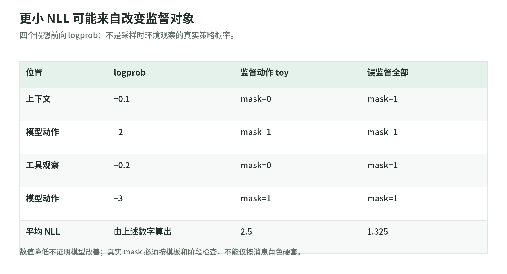

# 配方标准库实验：数清样本，保住训练与评测合同

<a id="rufus-lab"></a>

研究日期：2026-11-03。[总览](README.md)。下面只用 Python 标准库操作小数组和显式合同，不运行模型、tokenizer、GPU、梯度、沙箱或外部 API。它不是 Rufus-Air trainer。

源码：[training_recipe_lab.py](https://github.com/IanLiYi1996/learning-wiki/blob/main/scripts/training_recipe_lab.py)；测试：[test_training_recipe_lab.py](https://github.com/IanLiYi1996/learning-wiki/blob/main/tests/test_training_recipe_lab.py)。Python 3.9+，在仓库根目录运行：

```bash
python -B scripts/training_recipe_lab.py
python -B -m unittest discover -s tests -p 'test_training_recipe_lab.py' -v
```

## A. Rollout 数：多更新不等于多生成

`rollout_counts(256,16,2)` 报告 4096 个生成回答和两个 optimizer updates，不报告 8192 次独立生成。这个乘法核对了论文配置的单位，不推断 minibatch、梯度累积或每次更新究竟消费哪些样本。

教学例 `rollout_counts(100,4,2,aborted=20)` 返回 400 个生成、380 个有效。只给中止总数不能恢复每题剩余组大小，因此脚本也不假装已算出组内优势。

## B. 零成功：有限样本不是无解证明

假设独立采样、每次成功概率 $p$，采 $G$ 次全败：

$$
P(K=0)=(1-p)^G.
$$

`zero_success_probability(.05,16)` 约为 **0.4401267**；`(.1,4)` 为 **0.6561**。所以观察到 `0/16` 可以是一次并不罕见的采样事件，不能判定真实成功概率为零。

这里的 $p$ 是明确给定的假想值，不是脚本从模型推断的参数；真实 rollout 可能相关、验证器也可能有误差。它没有计算置信区间或实现论文的完整难度筛选器。

## C. Loss mask：低 loss 可能只是算错了对象

<!-- illustration: ruf-mask-contract-36ac5068f1 -->


*图：更小 NLL 可能来自改变监督对象。四个假想前向 logprob；不是采样时环境观察的真实策略概率。*
<!-- /illustration: ruf-mask-contract-36ac5068f1 -->

四个假想 token 的 logprob 为 `[-0.1,-2,-0.2,-3]`，分别对应上下文、模型动作、工具观察、模型动作。只监督两个动作，token 平均 NLL 为：

$$
L=-\frac{\sum_t m_t\log p_t}{\sum_t m_t}
=\frac{2+3}{2}=2.5.
$$

错误地监督全部位置则为 **1.325**，数值更小，却优化了不同对象。mask 不会把观察从输入删除，也不是 attention mask。

这是最小 toy。真实 SFT 的当前／历史消息、控制 token、推理标签和截断可能使某些 assistant 位置也不计损失；应从生产模板和实际训练 mask 检查，不能仅凭角色名字决定。

## D. Token 合同：文本副本不能替换采样动作

`replay_contract` 检查小记录的字段长度、token ID、动作 mask、loss mask 和旧策略概率。采样 IDs `[11,12,13,14]` 原样回放通过；改成 `[11,12,99,14]` 返回 `False`。这些是虚构 ID，未验证真实 tokenizer。

上下文的 `None`／零概率位置只是占位；模型动作须有有限、非正的 logprob。loss 位置必须是动作，但动作可以被 loss 屏蔽：这允许演示“保留输入，不贡献某个训练目标”。

这里不要求当前新策略概率等于旧策略概率；它们变化才可能产生更新。它也不核验真实推理时的分布、专家路由或版本同步。所谓“精确保真”限于这个输入数组合同。

## E. 终止原因：未知 timeout 不应自动得零

toy 状态 `task_failed` 有有效零奖励；`infra_aborted` 没有有效奖励。传入裸 `timeout` 会报错，要求调用方先按环境合同分类。

这不是说所有超时都丢弃：网页访问失败可以是任务中可恢复的观察，策略耗尽自身预算也可能正常计分。哪类失败应排除，必须由指定任务与环境定义。

## F. 资源与评测：两张容易算错的账

`resource_days(64,13,gpus_per_node=8)` 为 **832 node-days／6656 GPU-days**，只核对数量与时间，不计算价格、有效 FLOPs 或 MFU。非法数量、非有限值和溢出被拒绝，不把 `inf` 包装成成本。

`EvalContract` 显式保存题集、工具、模拟器、裁判、解码、预算、样本数、聚合、上下文管理、失败计分、评测日期窗口、搜索 locale 与泄题过滤。只换模拟器与“mean → any-success”，`protocol_differences` 就返回 `("simulator","aggregation")`；换服务错误规则或网页窗口也会被分别指出。

合同完全相同也不是充分的因果证明，还可能有随机波动、数据泄漏或未知依赖；脚本只指出已记录字段是否一致，不比较排行榜。

## 六道练习与参考答案

1. 同一批 400 个候选更新两次，独立 rollout 是否变成 800？
2. 16 次全错能否证明题目无解？
3. loss 从 2.5 变为 1.325，能否直接说模型更好？
4. 文字看起来相同但 token IDs 不同，能否沿用旧采样概率？
5. 框架报 timeout，是否直接拿零奖励参与同题组优势？
6. 同一权重、不同模拟器的分数差，是否就是模型能力变化？

答案：①不是。②不是。③先检查监督对象与 mask。④不能，概率对应具体动作序列。⑤先按环境合同区分基础设施、任务预算与可恢复观察。⑥不是，测量条件变化了。

## 一页复现合同模板

| 记录栏 | 需要填写什么 |
| --- | --- |
| 起点／交接 | 模型与 tokenizer 版本；继承哪些权重、optimizer、scheduler、RNG |
| 数据／模板 | 来源与限制、去污染、分布／筛选、角色与 loss mask |
| 更新与采样 | prompts、samples、updates、长度预算、精度、旧概率与权重同步 |
| 反馈／环境 | verifier／judge 版本、工具 schema、沙箱、失败类别和中止规则 |
| 验收 | 训练反馈、开发选点、最终测试、非目标能力；完整 EvalContract |
| 资源与停止 | GPU／CPU／沙箱／API 分开计费与授权，何时停止或回退 |

这张表是一份待具体任务填写的合同，不是本课已经完成的大规模训练计划。

<a id="public-sources"></a>

## 教学与作者配方的边界

样本计数与 mask 背景见 [01](data-sft-and-rlvr.md)，token 与中止合同见 [02](agentic-environments.md)，状态／奖励边界见 [03](reward-and-stability.md)，资源和评测单位见 [04](infrastructure-and-evaluation.md)。具体数组、概率和协议冲突为本 Wiki 原创。

没有真实训练或模型成绩复现。代码测试不能替代 loss／gradient parity、分布验证、并行一致性与独立 benchmark。
