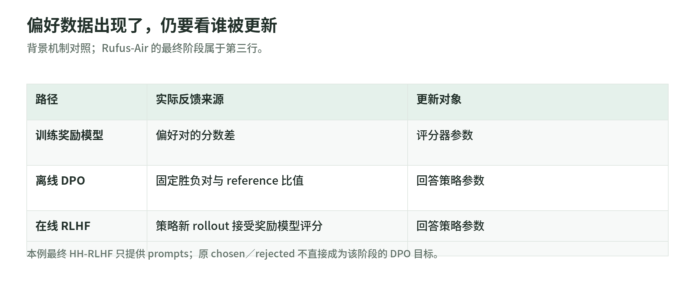

# 03 奖励可靠性、RLHF 与训练稳定性

[配方导读](README.md) · 研究日期：2026-11-03 · 分类：深度学习／训练／后训练配方／奖励与稳定性

本章回答：怎样确认模型学会了任务，而非学会讨好评分器？以 Rufus-Air v2 的 §3.4、§3.8、§4.1、§6 为主线，区分奖励协议、更新算法与系统一致性。论文观察、背景机制和原创教学例分开；这里不是整篇翻译，也不把作者经验写成通用最优配方。

## 1. IF 裁判：只检查必须满足的条件

Rufus-Air 的指令遵循（IF）奖励把机械条件交给 Python，把跨轮语义条件交给教师 LLM；必须逐条通过才给正奖励，不是通过几条就按比例得分。作者排除“可选加分项”，因为它们会引入噪声与长度偏好。[R，§3.4](https://arxiv.org/html/2609.29421v2#S3.SS4)

教学例：用户要求“两段、不得提品牌、记住第一轮的素食偏好”。前两条可以写检查器，第三条需要结合历史理解；令每条判断为 $q_j\in\{0,1\}$，整体奖励写成 $R_{\rm IF}=\prod_jq_j$。若额外奖励“介绍背景、补充案例、给出延伸阅读”，目标就从履行请求变成覆盖评审清单。

二元输出只是格式，不是可靠性证明。例如检查器若把空行计作一段，模型可以用空段骗过结构条件；语义裁判若漏读第一轮，再大的模型也可能放过含肉菜谱。应先用合格、违规和边界样本测试每条 rubric，再审计组合后的漏判；“全部通过”仍取决于各条判断是否可信。这是协议设计建议，不是作者已测完的鲁棒性结论。

裁判视图也属于协议。本章建议只给评分器必要的对话上下文、约束与最终回答，不给候选模型的隐藏思考。否则“我已经检查过素食要求”可能被误当成满足要求的证据。`<think>` 内写了正确答案，交付文本却没写，仍不应通过。

这不等于从训练轨迹删除思考 token，也不自动决定其梯度 mask；判分视图与采样轨迹是不同对象。论文说明最终回答位于 `</think>` 后，并在非 agent 评测层做 thinking-tag stripping，但所读章节未给出训练裁判的完整清洗代码，不能冒称已验证。[R，§3.4、§5.1](https://arxiv.org/html/2609.29421v2#S5.SS1)

## 2. 偏好模型、DPO 与最终 RLHF：谁被更新

<!-- illustration: ruf-reward-paths-31ae6b47ee -->

*图：偏好数据出现了，仍要看谁被更新。背景机制对照；Rufus-Air 的最终阶段属于第三行。*
<!-- /illustration: ruf-reward-paths-31ae6b47ee -->

不要见到 chosen/rejected 就认定正在做 DPO：

| 路径 | 数据与反馈 | 更新对象 |
| --- | --- | --- |
| 奖励模型训练 | 偏好对，学习两回答的分数差 | 评分器 |
| 离线 DPO | 固定偏好对，直接优化相对偏好 | 回答策略 |
| 在线 RLHF | 当前策略生成回答，奖励模型评分 | 回答策略 |

这是背景机制；DPO 不要求另训显式奖励模型，在线 RLHF 则把反馈施加到策略新生成的样本上。“偏好数据来自当前模型”也不等于更新算法就是在线 RL。[T，§5.1–5.2](https://arxiv.org/html/2411.15124v1#S5.SS1)

Rufus-Air 最后使用现成 Skywork-Reward-V2-Qwen3-8B，以 GRPO 训练；HH-RLHF 原有回答与标签只用于离线分析，训练只取筛过的 prompts。它不是另训 Rufus 奖励模型，也不是用原偏好对做最终 DPO。[R，§3.8](https://arxiv.org/html/2609.29421v2#S3.SS8)

该阶段对正的原始奖励施加超长回答的线性惩罚，负奖励保持不变。不能简写成“所有回答统一扣长度分”，也不能把无界奖励模型分数解释成质量概率。[R，§3.8 Reward design](https://arxiv.org/html/2609.29421v2#S3.SS8)

教学上应保留原始分数、惩罚后分数与长度三列；否则平均奖励上升可能只是长度分布改变，无法判断内容是否更有用。

## 3. 优势不是合格证：标准化保留了什么

同一提示词采样 $G$ 个回答，常见组相对优势为：

$$
\bar r=\frac1G\sum_i r_i,\qquad
A_i=\frac{r_i-\bar r}{s_r+\epsilon}.
$$

它比较组内表现，不设绝对合格线；std 约定与 $\epsilon$ 须跟实现一起记录。[S1，GRPO](https://github.com/THUDM/slime/blob/540ea919e45b8b929198abce008a103be9cfc779/docs/en/advanced/policy-mismatch.md#grpo)

原创手算：三份都很差的回答得分为 $(0.49,0.50,0.51)$。用 population std、令 $\epsilon$ 可忽略，优势约为 $(-1.225,0,1.225)$；分数换成 $(0,1,2)$，标准化优势仍相同。尺度消失了，微小裁判误差也可能获得看似强烈的更新信号。

只减均值则前组得到 $(-0.01,0,0.01)$，保留差距大小，但依赖奖励尺度。Rufus-Air 在噪声较大的 Search Agent 阶段采用这种 mean-only 优势；这是局部选择，不能推广为所有阶段统一禁用 std。[R，§3.7 Training setup](https://arxiv.org/html/2609.29421v2#S3.SS7)

若一组全为零，有限 $\epsilon$ 下优势为零；可能全部失败，也可能裁判失灵，绝不是“任务已经解决”。

## 4. 大 batch 与 MoE 路由回放：解决不同误差

Rufus-Air 报告一般 RL 使用大 rollout batch，并用 Rollout Routing Replay（R3）缓解 MoE 采样与训练的路由差异。[R，§4.1](https://arxiv.org/html/2609.29421v2#S4.SS1)

增加每题回答数帮助估计组内基线，增加题目数扩大每步覆盖；两者不是同一个旋钮。重复采样同一有偏裁判只会更稳定地估计其偏见，不会自动得到真实质量。

MoE 即使权重相同，两端也可能为同一 token 选不同专家。R3 记录采样时的专家身份，在训练前向回放，减少这部分 log-prob 差异；回放不是缓存专家输出，也不消除量化、采样变换或旧策略带来的其他误差。[S1，R3](https://github.com/THUDM/slime/blob/540ea919e45b8b929198abce008a103be9cfc779/docs/en/advanced/policy-mismatch.md#r3)

诊断建议：分别观察奖励分布、组内差异、训练／采样 log-prob 差和有效样本数；不要把“奖励更平滑”当作全部稳定性的证据。

这里的 batch 是一次收集的回答集合，不必等于一次 optimizer step 的样本数。若反复用同一批轨迹更新，当前策略会逐渐离开采样策略；因此交接时还要记录每批更新次数。大 batch 不能替代对样本新鲜度的检查，R3 也不是“旧数据变成当前策略数据”的开关。[S1，策略区分与 TIS](https://github.com/THUDM/slime/blob/540ea919e45b8b929198abce008a103be9cfc779/docs/en/advanced/policy-mismatch.md#tis)

## 5. 阶段 checkpoint：继承权重不等于恢复训练状态

论文串行阶段继承上一阶段 checkpoint，最终交付 RLHF 第 29 次迭代，而不是默认取最后一次保存。[R，§2.1、§3.8](https://arxiv.org/html/2609.29421v2#S3.SS8)

跨阶段初始化与同阶段断点续跑应分开：前者要定义新目标和新参考策略，后者要恢复原实验进度。建议交接记录明确权重、Adam 动量、学习率调度器、步数、随机数与采样器状态，以及奖励版本。丢掉动量后再加载权重，不应称为无缝续跑。

Slime 的 Megatron 保存接口传入 optimizer 与 scheduler；HF 加载路径则加载权重并返回 iteration 0。这核实了“权重初始化”和“训练状态恢复”的接口区别，不证明所有保存配置都包含全部状态。[S2，L120–202](https://github.com/THUDM/slime/blob/540ea919e45b8b929198abce008a103be9cfc779/slime/backends/megatron_utils/checkpoint.py#L120)

Rufus-Air 所读章节没有交代各阶段是否重置或沿用 Adam 状态；上游 Slime 快照也不是 Rufus-Slime 适配实现的复现证据。这是仍需补齐的交接信息。

## 6. 奖励黑客与阶段顺序：有效不等于因果最优

奖励黑客是代理分数改善，却偏离真正目标；数值训练可以很稳定，回答仍越来越投机。Gao 等用独立“金标准”奖励模型模拟真实目标，研究优化代理模型后目标分数受损的现象；它不是直接人评证明，也没给 Rufus-Air 一个通用安全步数。[G，摘要](https://proceedings.mlr.press/v202/gao23h.html)

作者把易被钻空子的开放偏好奖励放最后，以缩短暴露；IF 虽含 LLM judge 却较早运行，说明顺序不只是“代码先、模型后”。§6 明确：这是在实验经验与预算下有效的顺序，未证明最优；也没有同一套评测覆盖所有阶段。[R，§2.1、§6](https://arxiv.org/html/2609.29421v2#S6)

还要区分换题与换裁判：RLHF 图 8 的训练奖励和 Arena-Hard 留出奖励都由训练所用 Skywork 模型给分，不是表 14 的下游胜率。换一批题仍可能共享评分盲点，不能把两条奖励曲线同时上升当作独立验证。[R，§3.8 Training dynamics](https://arxiv.org/html/2609.29421v2#S3.SS8)

教学审计应另留跨技能检查、独立裁判或人工复核，并保留前阶段候选供回退。将奖励升高、验证进步、旧能力未明显下降分别举证；只换顺序还需控制预算、数据和初始状态，不能凭最终总分作因果归因。

## 7. 三道自测与答案

1. 隐藏思考满足三条约束，最终回答漏一条，能给 IF 正奖励吗？

   答：不能。评的是交付文本；隐藏思考不送裁判不等于从训练轨迹删除它。

2. HH-RLHF 有偏好标签，为何最终阶段不是 DPO？

   答：要看训练实际消费什么。这里只取 prompts，对策略新回答用现成奖励模型评分，再以 GRPO 更新。

3. 大 batch、R3、恢复权重能否保证训练可靠？

   答：不能。它们分别涉及统计、路由一致性与初始化；仍须检查奖励偏差、其他采样误差及优化器状态。

## 8. 一手来源、版本与读取范围

| 来源 | 所读版本／版本日期 | 读取日期 | 实读范围与边界 |
| --- | --- | --- | --- |
| R：Chang 等，Rufus-Air（2026 预印本） | [2609.29421v2](https://arxiv.org/abs/2609.29421v2)，2026-09-25 | 2026-11-03 | HTML §3.4、3.8、4.1、6；补读 §2.1、3.7、5.1；未核 Rufus-Slime 训练实现 |
| T：Lambert 等，Tülu 3（2024 预印本） | [2411.15124v1](https://arxiv.org/abs/2411.15124v1)，2024-11-22 | 2026-11-03 | HTML §5.1–5.2 的 RM、DPO、在线反馈区别；不迁移整套配方 |
| G：Gao、Schulman、Hilton，Scaling Laws for Reward Model Overoptimization | [ICML 2023／PMLR 202](https://proceedings.mlr.press/v202/gao23h.html) | 2026-11-03 | 正式论文页摘要与实验设定；未精读全文或拟合 scaling law |
| S1：THUDM Slime 官方机制文档 | `540ea919…`，2026-10-27 | 2026-11-03 | 上文固定完整 commit 链接的策略区分、GRPO、TIS、R3 段；静态阅读 |
| S2：同版本 Slime checkpoint.py | `540ea919…`，2026-10-27 | 2026-11-03 | save/load 与 HF 初始化路径；未运行后端 |

全文状态：R、T 的公开 HTML 可读，未下载 PDF；引用数未查询。公式数字为原创手算，裁判视图与交接清单为教学建议。本次无模型下载、训练、付费调用或独立复现；导航、配图及实验另由专题主维护者整合。
