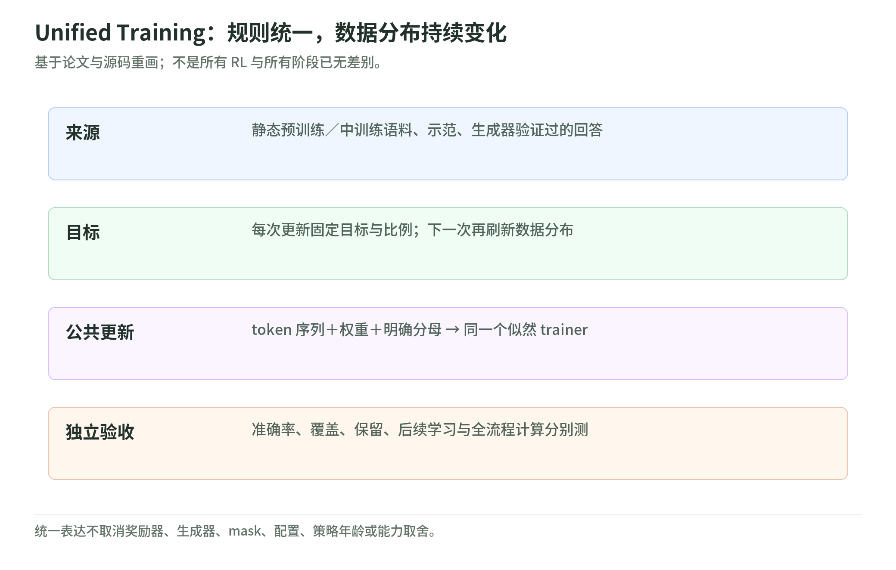

# Unified Training 101：同一种训练规则，不同的数据分布

研究日期：2026-11-04。解读 Yuda Song 等人的 *Training Foundation Models with a Single Algorithm*，arXiv v1 于 2026-10-29 提交。材料是[论文](https://arxiv.org/html/2610.40564v1)、[作者项目页](https://yudasong.github.io/unified-training/)和[公开代码](https://github.com/yudasong/unified-training)。以下区分作者结果、原创推导和未执行的实验。

## 1. 这篇统一的是什么

<!-- illustration: uni-study-map-dfce1ad34b -->

*图：Unified Training：规则统一，数据分布持续变化。基于论文与源码重画；不是所有 RL 与所有阶段已无差别。*
<!-- /illustration: uni-study-map-dfce1ad34b -->

传统配方把预训练、midtraining、SFT、RL 分成几个阶段。作者提出：对合适的 RL 目标，可以把成功条件下的生成分布当作新的监督目标；静态语料、示范、奖励筛选生成因此共享一种加权似然更新。发生变化的是**训练数据的分布、比例和时机**，不是每到一个阶段就必须换学习规则。[论文 §3–4](https://arxiv.org/html/2610.40564v1)

一个原创类比：学生不断做同一种“对照答案学习”的练习，但答案来源在变化。有时来自教材，有时来自示范，有时来自自己生成后经验证的成功解答。统一练习动作，不等于这些答案一样可靠、一样新鲜或一样值得分配时间。

## 2. 三层含义，别互相代替

| 层 | 作者做了什么 | 尚不能说什么 |
| --- | --- | --- |
| 数学 | 将 MLE、MaxRL 及若干扩展写成目标分布拟合 | 所有 PPO／GRPO 细节都等价于普通 SFT |
| 系统 | 静态与生成样本共用数据格式、损失和 trainer | 不需要奖励器、采样器、配置或版本管理 |
| 实验 | 在指定小模型、数据与预算上比较混合与分阶段 | 所有规模、所有任务、所有预算都更优 |

“Single Algorithm”是共同的学习形式，不是一个通吃模型、数据、奖励和调度的默认配置。传统分阶段训练仍是混合比例在各阶段只落到一个来源的特例。[论文 §3 与 Discussion](https://arxiv.org/html/2610.40564v1)

## 3. 九页阅读路线

| 页 | 核心问题 |
| --- | --- |
| [01 似然与目标分布](likelihood-and-targets.md) | 谁生成答案，谁更新参数？为什么目标必须暂时固定？ |
| [02 MaxRL、REINFORCE 与有限采样](maxrl-and-finite-sampling.md) | 答对样本如何加权？难题为什么仍可能没信号？ |
| [03 token 权重与分母](weighted-loss-and-masks.md) | 错误回答权重为零，为什么还要计入分母？ |
| [04 异步系统与实现合同](asynchronous-system.md) | 旧策略生成能不能当作当前策略的梯度？ |
| [05 数据混合与调度](mixing-and-schedules.md) | 样本比例、token 比例、loss 权重和计算比例有什么区别？ |
| [06 证据、预算与局限](evidence-and-limits.md) | accuracy、coverage、保留和后续学习分别证明什么？ |
| [07 标准库实验](lab.md) | 用小数组检查条件分布、权重、分母、调度和 FLOPs |
| [来源与版本](sources.md) | 本次到底读了什么，没有执行什么？ |

**30 分钟直觉路线**：本页 → 02 → 03 → 06。**90 分钟机制路线**：按章阅读，运行标准库实验；不包括下载权重或训练。

## 4. 值得带走的判断

先问“现在在拟合谁的答案分布”，再问“给哪些题多少机会”，最后问“怎样计量保留与成本”。相同的 loss 名字可以对应不同的有效问题分布；相同的更新次数可以对应不同的计算量。

作者报告混合能改善某些性能、覆盖和保留取舍，也报告分阶段训练或其他目标在部分指标更优。此页不复刻整张排行榜，不把事后观察到的最优曲线变成任意预算下的保证。[论文 §5](https://arxiv.org/html/2610.40564v1)

## 5. 和既有专题连接

与 [Rufus-Air](../rufus-air/README.md) 对读：前者沿阶段组织 recipe，本篇把阶段改写成数据来源的时间表，不否定初始化、环境和奖励设计。

与 [Agentic-RL Lab](../agentic-rl-lab/README.md) 对读：区分监督目标、生成策略、优势、裁剪和信用分配；共同的数据接口不意味着所有优化器行为一样。

与 [PixelBench PRT](../../vision/pixelbench/prt-training.md) 对读：加入静态重建监督不等于 RL；加了样本与更新时，必须同时记账。与 [AI 自我改进](../../self-improvement/README.md) 对读：参数更新、数据迭代与研究代理修改训练方案是不同闭环。

本专题基于一手材料核验，并提供原创本地 SVG／2× PNG 与离线测试。没有安装上游训练环境、下载权重、启动 GPU、调用付费模型或重跑论文 benchmark；发布网页不等于复现模型。
