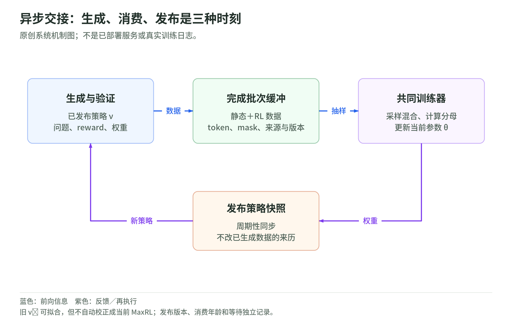
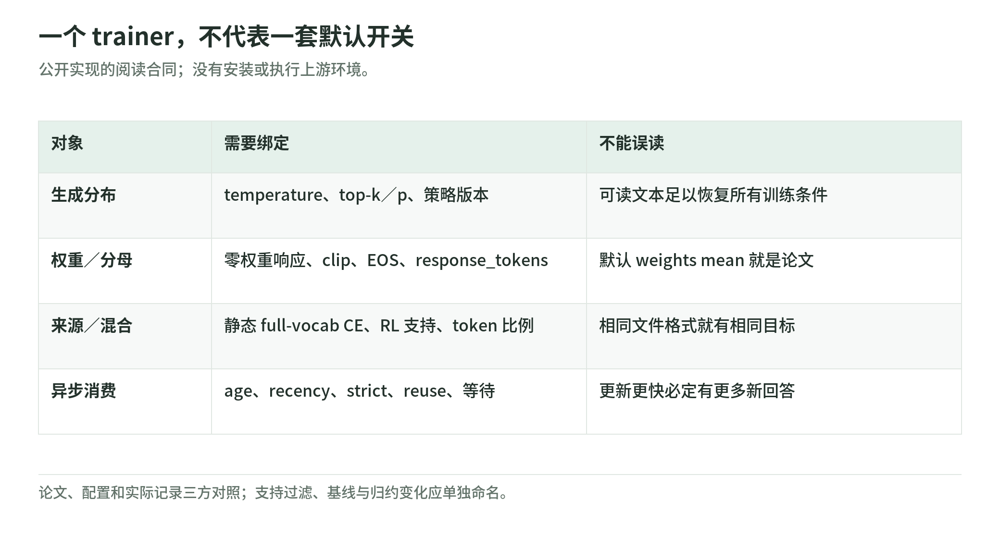

# Unified Training 04：异步生成，不能省略策略版本

研究日期：2026-11-04。[导读](README.md) · [目标分布](likelihood-and-targets.md) · [分母合同](weighted-loss-and-masks.md) · [来源](sources.md)

## 1. 生成器、缓冲区、训练器怎样交接

<!-- illustration: uni-asynchronous-handoff-40b392e0c5 -->

*图：异步交接：生成、消费、发布是三种时刻。原创系统机制图；不是已部署服务或真实训练日志。*
<!-- /illustration: uni-asynchronous-handoff-40b392e0c5 -->

系统有两个不同速度的工作：生成器用某个已发布策略采样、验证、计算权重，把完成批次追加到缓冲区；训练器从静态与生成来源抽样，更新参数，再周期性发布新权重给生成器。[论文 §4.3](https://arxiv.org/html/2610.40564v1)

静态数据不需要每次重新生成，RL 数据却有生成策略、问题、验证器和采样参数的版本。共用格式，只是让同一个 trainer 能消费它们，并不会使它们变成同一种来历。

原创合同：一条生成记录至少绑定 token、prompt 边界、响应权重、奖励、问题身份、生成策略版本、验证器版本、采样设置、生成／消费时刻。训练检查点还要记录已消费数据、混合计划和优化器状态。文件存在不代表一批数据已经原子完成。

## 2. “最近生成”与“当前策略”分开

论文允许训练器拟合另一策略的成功条件分布 $\nu^+$。这解释了异步数据为何仍能用似然训练，但不是一份“off-policy 偏差自动消除”的证明：它一般不等于当前策略的 MaxRL 梯度。[论文 §3.2](https://arxiv.org/html/2610.40564v1)

原创时序例：生成器在版本 v10 采样；训练器已经更新到 v14，仍消费这批 v10 回答。它拟合的是 v10 的成功目标，不是凭空获得 v14 会产生的成功回答。策略 age=4 只是版本距离，不测量两分布的实际差异。

公开配置有更新间隔、recency window、最大 policy age 与 strict age 等不同开关；文档注明非 strict 模式可能保留每个生成器最新一轮，严格模式则等待满足约束的新样本。因此不能只看到一个年龄上限变量就断言从未消费超龄数据。[配置说明](https://github.com/yudasong/unified-training/blob/5b3eaa0f3ce39f695beb5d27a0bb0f92368b3118/docs/configuration.md)；[freshness 逻辑](https://github.com/yudasong/unified-training/blob/5b3eaa0f3ce39f695beb5d27a0bb0f92368b3118/src/unified_training/rollout_freshness.py)

论文每四个更新发布一次权重，但检查八个生成器最新完成轮时，记录的生成策略落后 12–44 个更新。作者未记录实际消费样本的策略版本分布，故这只是可用轮的检查，不是“消费年龄已完整测得”。发布间隔、可用数据年龄与消费年龄三者必须区分。[论文 D.6](https://arxiv.org/html/2610.40564v1#A4.SS6)

## 3. 代码核验：哪些配置决定论文目标

<!-- illustration: uni-implementation-contract-a61fe1511c -->

*图：一个 trainer，不代表一套默认开关。公开实现的阅读合同；没有安装或执行上游环境。*
<!-- /illustration: uni-implementation-contract-a61fe1511c -->

| 环节 | 应检查的对象 | 为什么重要 |
| --- | --- | --- |
| 响应赋权 | `rollout_common.weight_groups` | 成功比例、零权重保留、基线／裁剪／截断选项 |
| 序列保存 | `episodes.py`、`dataset.py` | token 对齐、prompt 边界、分母位置和版本 |
| 损失 | `hf_trainer.weighted_ce_sums` | 静态／RL 分布、支持检查、全局分母 |
| 调度 | `corpus_mix.py`、实验 `.env` | 目标 token 份额与实际抽样不自动一致 |
| 同步 | policy snapshot／freshness | 什么权重生成、什么时候消费、何时等待 |
| 验收 | puzzle／math／code harness | reward 成功不是全部能力保留 |

这是本次源码阅读地图，不是我们已运行的训练追踪。[固定代码树](https://github.com/yudasong/unified-training/tree/5b3eaa0f3ce39f695beb5d27a0bb0f92368b3118)

## 4. 一样叫 log-prob，也可能不是一样的分布

公开 trainer 对静态样本用普通 full-vocabulary CE，对 RL 位置可重建带 temperature、top-k、top-p 的采样分布。当前支持集合之外的位置会影响分子及分母的处理。[`weighted_ce_sums`](https://github.com/yudasong/unified-training/blob/5b3eaa0f3ce39f695beb5d27a0bb0f92368b3118/src/unified_training/hf_trainer.py)；[配置文档](https://github.com/yudasong/unified-training/blob/5b3eaa0f3ce39f695beb5d27a0bb0f92368b3118/docs/configuration.md)

原创判断：如果只用原始 token 重新算 full-vocabulary log-prob，而生成其实使用截断采样，训练合同就可能改变。若复制 token 后又重新 tokenize，边界与 mask 也可能变。复现要同时保存生成分布和实际评分分布，而不是仅保存可读文本。

理论上的固定目标与生产代码的支持过滤应分别阅读。本文没有证明复杂截断、支持变化及数值实现都等价于一项无条件的 on-policy 目标。

## 5. 快速更新不等于更多独立学习信号

异步训练可以减少等待，但训练器可能复用缓冲区中的回答。updates／秒、fresh rollouts／秒、model-FLOPs 与墙钟时间是不同量；硬件布局改变也可能改变消费策略年龄。[论文附录 A.2、D.6](https://arxiv.org/html/2610.40564v1)

原创观测清单：按更新记录来源 token、零权重响应、重用次数、生成与消费版本差、等待时间、过滤率、校验器吞吐及持出成绩。提升 updates／秒时，检查是否只是更快重复旧数据。

上游说明训练、评测和 NeMo-RL 使用不同环境，启动脚本会下载模型／语料；包含代码执行奖励的流程还需要隔离。本文仅阅读，没有启动这些脚本。不要因仓库给了命令就默认客户数据上传、采购 GPU 或执行生成代码已获授权。[上游 README](https://github.com/yudasong/unified-training/blob/5b3eaa0f3ce39f695beb5d27a0bb0f92368b3118/README.md)

## 6. 自测与答案

1. 能拟合旧策略成功分布，是否证明它是当前策略梯度？答：不是。
2. policy age=4 是否直接等于 KL 距离？答：不等于，是版本计数。
3. updates／秒提升是否意味着样本生成更快？答：未必，还需看新样本和复用率。

下一章：[数据混合与调度](mixing-and-schedules.md)。
