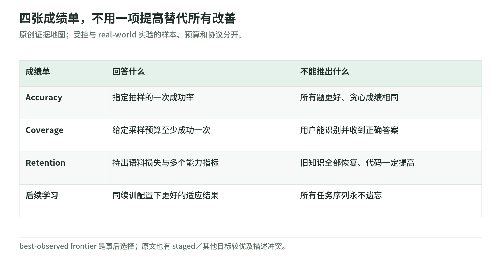

# Unified Training：如何阅读证据、计算预算与局限

研究日期：2026-11-04。固定阅读[论文 v1](https://arxiv.org/html/2610.40564v1)，交叉核验[项目页](https://yudasong.github.io/unified-training/)、[官方仓库](https://github.com/yudasong/unified-training)与[HF 模型卡](https://huggingface.co/sfanm/unified-training)。本章的重点不是复述排名，而是判断一项收益究竟回答了什么问题。

## 1. 两组实验，不能互相借用结论

受控实验把 124M 模型从零训练，保留相同的 20B-token 预训练流与约 510M-token 推理中训练语料。增大中训练曝光量会重用这份语料，不等于获得更多独立知识。Base、Extended 分别训练 6000、12000 个 RL 更新；每个配置的两颗 RL 种子共享同一个初始化，并非两次独立从零预训练。[§5.1、C.4](https://arxiv.org/html/2610.40564v1#A3.SS4)；[受控实验说明](https://github.com/yudasong/unified-training/blob/5b3eaa0f3ce39f695beb5d27a0bb0f92368b3118/experiments/controlled/README.md)

真实语料实验的 0.76B base 也由作者从零预训练、再中训练得到，不是现成 Qwen。之后才在 Math12K 上做数学 RL，并混入 240M-token 的网页、数学、代码与推理轨迹语料。因此这组实验支持的是既有 base 上的混料效果，不能据此宣称大模型从零统一预训练已验证成功。[D.1](https://arxiv.org/html/2610.40564v1#A4.SS1)；[模型卡](https://huggingface.co/sfanm/unified-training)

阅读判断：前者可控但人工任务窄，后者内容丰富但只测试训练管线的一段。二者互补，却没有替彼此补齐规模与因果证据。

## 2. 四张成绩单，不能合成一句“更强”

<!-- illustration: uni-evidence-scorecards-0c57a86669 -->

*图：四张成绩单，不用一项提高替代所有改善。原创证据地图；受控与 real-world 实验的样本、预算和协议分开。*
<!-- /illustration: uni-evidence-scorecards-0c57a86669 -->

### 2.1 Accuracy：一次抽样是否答对

受控实验的 accuracy 是 pass@1，不是贪心解码正确率。Base 测试训练大小内的新组合；Extended 增加更大谜题，而其泛化测试使用连 RL 都没见过的大小。必须区分“学会 RL 任务”和“越过训练分布”。[§5.1、C.1、C.4](https://arxiv.org/html/2610.40564v1#S5.SS1)

反例值得保留：staged 在部分中间计算预算上贡献最优 accuracy 点，不是处处落后。表 9 中，同一峰值学习率下，staged 的 Base 最终 pass@1 从两遍中训练的 **24.54%** 降到四遍的 **15.15%**。我的判断是：多读语料、初始化表现好、最终可塑性好，是三件不同的事。[C.6、C.7](https://arxiv.org/html/2610.40564v1#A3.SS6)

### 2.2 Coverage：多次尝试是否至少命中一次

受控实验从每题 64 个回答分别估计 pass@1 与 pass@16；先为每颗种子算分，再平均，不能把两个模型的回答池拼起来。Coverage 并不证明模型会选出正确答案。真实语料实验主要报告 pass@32 等覆盖率，后续代码实验又使用 pass@16，不能跨协议直接比较。[C.4](https://arxiv.org/html/2610.40564v1#A3.SS4)；[D.1、D.7](https://arxiv.org/html/2610.40564v1#A4.SS7)

staged 也能在部分中间预算取得更好的 coverage。多次采样提高命中机会，产品仍须承担筛选成本；没有可靠裁判时，“能生成对答案”不等于“用户拿到对答案”。[C.7](https://arxiv.org/html/2610.40564v1#A3.SS7)

### 2.3 Retention：原始语料损失、知识题与代码要分开

真实语料的常数 token fraction 实际扫 **0、0.1、0.2、0.5、1、2、5%**，没有 10% 条件。它是启动前按长度估计的目标比例，回答变长后实际比例会漂移；不能当作精确不变的数据占比。[D.1、D.2](https://arxiv.org/html/2610.40564v1#A4.SS2)

表 14 的 base held-out loss 为 **1.4352 nats/token**。该指标对 24 个语料组件等权平均；后续负的 Δloss 表示更会预测这些语料，不等于所有知识题都提高。加大混料比例持续降低这项损失，但数学覆盖率并不单调，SciQ、ARC-Challenge 也非同步上升，代码 accuracy 与 coverage 可能反向变化。[表 14—16](https://arxiv.org/html/2610.40564v1#A4.SS1)

反例更直观：移除指定代码来源，在常数混料下反而提高代码 accuracy；换成经过执行验证的代码，也没有普遍提高 accuracy。不能仅凭语料标签推断收益，格式、mask、调度和目标间干扰都可能改变结果。[D.4](https://arxiv.org/html/2610.40564v1#A4.SS4)

### 2.4 Continual learning：更好的起点，不是永不遗忘

数学训练后，各模型接受相同的代码 RL；WebInstruct 是另一条数学训练后的续训分支，不是“数学→代码→通识”的长任务链。统一训练历史改善部分最终指标，但较小混料的 HumanEval+ coverage 未必更好，WebInstruct 的最大混料模型也没有赢下整体 coverage。代码续训后，所有模型的语料损失都上升。[D.7、D.8](https://arxiv.org/html/2610.40564v1#A4.SS7)

我的判断：这支持“先前训练能改善后续适应”，没有证明持续学习中永久保留旧能力。起点更强、下降较少、不下降，不能混写。

## 3. 计算预算：前沿、FLOPs 与秒数不是同一种证据

项目页的 best-observed frontier 是在已测试配置和 checkpoint 中，事后挑出预算内最好成绩；accuracy、coverage 分别选择。线段只是视觉连接，不是额外评测点。它说明搜索空间里曾出现哪些好解，不是预先承诺某配方花完指定预算就能达到该点，也未把整个配方搜索成本算入单条训练路径。[项目页说明](https://yudasong.github.io/unified-training/)；[A.2](https://arxiv.org/html/2610.40564v1#A1.SS2)

受控实验的公式为 `6P(Tpre+Tmid)+8P·Trollout+6P·Tmix`。P 为参数量，四项 T 是预训练、RL 前中训练、RL 回答及混入语料的输入 token 数。其中 `8P` 明确是生成 `2P` 加策略训练 `6P`；prompt 即使不计 loss，仍计模型处理成本。公式没有单列奖励模型 forward 或 verifier，不能声称这些已经计入；混料、I/O 也不是这项模型算术量的测量对象。论文还排除了评测、未使用生成、重启丢弃工作及若干开销。[A.2](https://arxiv.org/html/2610.40564v1#A1.SS2)；[计算源码](https://github.com/yudasong/unified-training/blob/5b3eaa0f3ce39f695beb5d27a0bb0f92368b3118/src/nl_tower/compute.py)

真实语料比较匹配的是更新次数，不是总 FLOPs。异步与 staged 的秒数又使用不同 GPU 数，且异步可能重用已有回答。因此更新吞吐、生成新回答的速度、FLOPs、端到端用时不能互换。我的验收条件是：先选定哪一种成本要优化，再讨论“省算力”。[A.2、D.6](https://arxiv.org/html/2610.40564v1#A4.SS6)

## 4. 同一形式，不代表同一算法或干净对照

统一 loss 用全批 response／中训练 token 的共同分母，错误回答的零权重 token 仍参与归一化；RL 使用当前 top-k/top-p 支持集，静态语料使用全词表。分别归一化两源、再加系数的替代方案，在匹配数据条件下也能获胜。统一表达便于组织训练，不能自动证明其优化选择更优。[D.1、C.9](https://arxiv.org/html/2610.40564v1#A3.SS9)；[trainer 源码](https://github.com/yudasong/unified-training/blob/5b3eaa0f3ce39f695beb5d27a0bb0f92368b3118/src/unified_training/hf_trainer.py)

zero-mix 是保持同一异步 trainer 的混料消融，不是 staged 的同义词。staged 使用当前策略新回答并减 reward baseline；异步使用旧策略回答且不减 baseline。总体 on-policy 下的等价，不能消除有限样本与陈旧数据的差异。[D.6](https://arxiv.org/html/2610.40564v1#A4.SS6)

另有公开描述冲突：§5.2/D.1 写 staged 先使用追加语料；D.6 却写 zero-mix 与 staged 从同一 base 直接数学 RL，发布脚本默认也指向 `realworld/base`。这尚不能由公开描述完全消解，故不能把该参考差异全部归因于混料。[§5.2](https://arxiv.org/html/2610.40564v1#S5.SS2)；[D.6](https://arxiv.org/html/2610.40564v1#A4.SS6)；[发布脚本](https://github.com/yudasong/unified-training/blob/5b3eaa0f3ce39f695beb5d27a0bb0f92368b3118/experiments/realworld/run_nemo_rl.sh)

## 5. 理论结论的边界与自己的判断

理论统一的是适合这类构造的 RL：MaxRL、相应 REINFORCE 与 TailRL 等，并未证明所有 PPO／GRPO 连同裁剪、约束都可原样化为同一个 likelihood 更新。固定旧生成策略 ν 时拟合的是其成功条件分布 ν⁺，一般不是当前策略的 MaxRL 梯度。[§3、F.1](https://arxiv.org/html/2610.40564v1#S3)

有限 N 还使题目获得权重 `1−(1−pν(x))^N`：目标 ν⁺ 未变，罕见成功的难题却被下调。全错题无梯度，统一 trainer 本身不能创造从未采到的成功。判断它是否适合新任务，应问裁判可靠性、成功率和任务干扰，而不是只问能否共享交叉熵。[§4.2](https://arxiv.org/html/2610.40564v1#S4.SS2)

作者明确未找到通用最佳混料／调度，也未建立可预测的 scaling law；规模有限，多数训练一次只优化一个 RL 任务。[§7](https://arxiv.org/html/2610.40564v1#S7) 本章据此将结论限定为：统一形式打开了数据调度空间，公开实验证明其中有好选择，但没有给出所有规模、预算与任务序列通用的最优配方。

本次仅核验公开论文、网页、模型卡与源码；未下载权重、未训练、未运行 benchmark、未调用付费 API，不将静态阅读称为独立复现。

返回[专题首页](README.md) · 查阅[来源与核验边界](sources.md) · 进入[教学实验](lab.md)。
