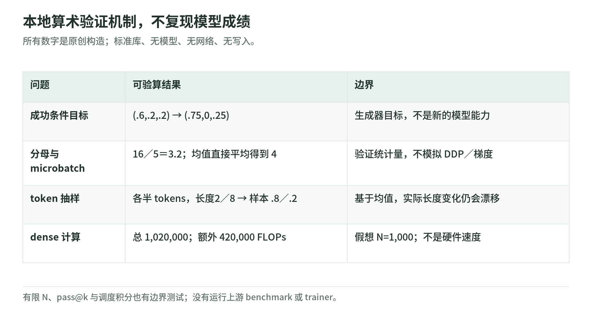

# Unified Training：免费离线验算与阅读自测

研究日期：2026-11-04。下面是本 Wiki 原创标准库实验，不是作者 trainer、真实 RL 或论文复现。只计算内存中的概率与数组，没有模型、网络、文件写入、权重下载、GPU、自动微分、代码奖励执行或付费 API。

代码：[unified_training_lab.py](https://github.com/IanLiYi1996/learning-wiki/blob/main/scripts/unified_training_lab.py)；测试：[test_unified_training_lab.py](https://github.com/IanLiYi1996/learning-wiki/blob/main/tests/test_unified_training_lab.py)。Python 3.9+，从仓库根目录运行：

```bash
python scripts/unified_training_lab.py
python -m unittest discover -s tests -p 'test_unified_training_lab.py' -v
```

## 1. 四类合同，用小数组拆开

<!-- illustration: uni-lab-contracts-5d4adab010 -->


*图：本地算术验证机制，不复现模型成绩。所有数字是原创构造；标准库、无模型、无网络、无写入。*
<!-- /illustration: uni-lab-contracts-5d4adab010 -->

目标合同问拟合哪个条件分布；权重合同问题内成功比例怎样校正；归约合同问零权重与 microbatch 是否保留正确分母；预算合同问样本、token、调度与计算是否在同一尺度。

这些都能脱离真实模型验证，却不能证明模型一定学会任务。输出里的数字是原创例，论文结果在[证据页](evidence-and-limits.md)归属于作者。

## 2. 生成器不同，成功目标不同

概率 `(0.6,0.2,0.2)`，奖励 `(1,0,1)`，成功质量为 0.8，目标为 `(0.75,0,0.25)`。换成均匀生成器，目标变为 `(0.5,0,0.5)`。

成功质量为零时函数拒绝伪造分布。这说明“写成 CE”不等于有监督信号，更不能证明旧策略回答就是当前策略的成功目标。没有实现任何网络的梯度。

## 3. 有限四次采样仍有难度偏差

奖励 `[1,0,0,0]` 给成功回答权重 4；`[1,1,1,0]` 给每个成功回答 4/3；全错组全零，不除零。

对于成功率 0.25 与 0.75，四次至少一次成功概率分别为 0.68359375、0.99609375。小概率计算使用稳定的 `log1p`／`expm1`，避免 `1−(1−p)^N` 在极小 p 时被浮点减法吞掉。

另一个函数演示评测的组合估计：四个样本一个成功，pass@1=0.25、pass@2=0.5、pass@4=1。这不是模型单次能力突然升到 100%，也没有替产品实现正确答案选择器。有限训练目标质量与评测 pass@k 是两个不同用途，不能只因公式相近而混用。

## 4. 分母决定 3.2、8 与 2 的区别

构造一个 prompt 位置，两个成功响应 token（NLL=2、权重=4），三个错误响应 token（权重=0）：

```text
加权分子 = 16
非 prompt 目标 token = 5
共同响应 token mean = 3.2
```

prompt 权重零，且不计数；错误响应权重零，却计数。移除错误响应，mean=8；改用权重和归一化，mean=2。后两项是对照手算，不是程序默默采用的替代口径。

两个 microbatch 的统计量 `(16,2)`、`(0,3)` 合并得 3.2；直接平均均值 8 与 0 得 4。测试验证这一反例，不模拟真实 DDP。

## 5. 比例与调度也能检查

两来源平均长度 2、8，目标 token 份额各一半，归一化的样本抽样概率应为 `(0.8,0.2)`。每边期望贡献都是 1.6 个 token。若各一半样本，则短／长来源 token 份额是 20%／80%。

constant、decay、growth、half 四条教学调度的平均份额都是 0.005。测试对 1,000 个区间用中点积分，检查相同面积，但各时刻比例不同；这没有模拟学习轨迹或保证相同效果。

## 6. FLOPs 验算不测真实速度

N=1,000，pre=100、mid=20、rollout=30、mix=10：

```text
6N(pre+mid) + 8N×rollout + 6N×mix = 1,020,000
扣除共享 pretrain = 420,000
```

对应[计算章](mixing-and-schedules.md)的 dense 估算结构。没有测 GPU 时间、验证器、attention、重计算、padding、IO 或费用。别把整数算对误称为硬件性能复现。

## 7. 八道自测

1. 目标是否应在本次似然求导时固定？答：是。
2. 旧生成器的条件分布是否自动等于当前 MaxRL 梯度？答：不是。
3. N=1 能否消除难题低成功率的偏差？答：不能。
4. 错误响应权重零是否应删出本文响应分母？答：不应。
5. 标准 CE 默认分母是否一定符合论文？答：不一定，配置要核验。
6. 静态样本各占 50% 是否意味着 token 也各一半？答：只有长度等条件合适时才可能。
7. 同样平均份额是否同样学习轨迹？答：不是。
8. Coverage 提升是否证明用户收到的答案更准？答：不能，还需要选择与验证。

返回[导读](README.md)；查看[来源与未执行项](sources.md)。
