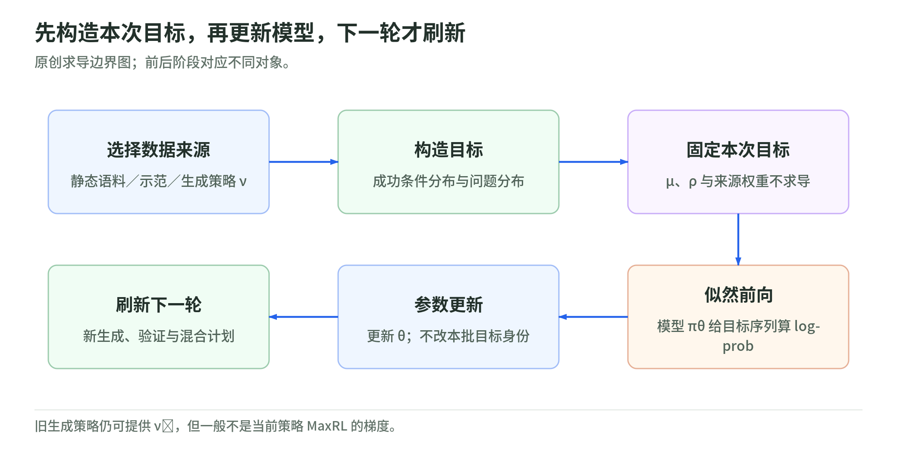

# Unified Training 01：规则固定，目标分布更新

研究日期：2026-11-04。[导读](README.md) · [MaxRL](maxrl-and-finite-sampling.md) · [实现分母](weighted-loss-and-masks.md) · [来源](sources.md)

## 1. 先把“谁提供答案”写出来

<!-- illustration: uni-fixed-target-ebcd5bbf10 -->

*图：先构造本次目标，再更新模型，下一轮才刷新。原创求导边界图；前后阶段对应不同对象。*
<!-- /illustration: uni-fixed-target-ebcd5bbf10 -->

令 $\pi_\theta(y\mid x)$ 是要训练的模型：输入 $x$，输出序列 $y$。数据来源则有自己的问题分布 $\rho(x)$ 和答案分布 $\mu(y\mid x)$。最大似然损失可写为：

$$
\mathcal L(\theta;\rho\circ\mu)
=-\mathbb E_{x\sim\rho,\ y\sim\mu(\cdot\mid x)}
\log\pi_\theta(y\mid x).
$$

拟合的对象是答案分布，不是“文本”这个载体本身。预训练和 midtraining 可以用空 prompt 配语料，SFT 用问题配示范，RL 则由生成与验证构造新的目标。[论文 §2–3](https://arxiv.org/html/2610.40564v1)

原创直觉：把模型想成给候选答案分配概率的人。教材答案来自外部，生成成功答案来自某一策略；两者都能作为需要提高概率的数据，却不自动具备相同的质量或覆盖。

## 2. 混合的不只是几个文件

每个来源 $s$ 在第 $t$ 次更新有自己的 $\rho_{s,t}$、$\mu_{s,t}$，混合系数非负并归一化：

$$
q_t=\sum_s\lambda_{s,t}(\rho_{s,t}\circ\mu_{s,t}),
\qquad \sum_s\lambda_{s,t}=1.
$$

共同训练规则是 $\mathcal L(\theta;q_t)$。在本次求导时，来源分布与混合系数**保持固定**。下一次再重新采样、验证和调整调度。若把目标构造的依赖也放进本次梯度，就不再是论文所述的固定目标拟合。[论文 §3.2](https://arxiv.org/html/2610.40564v1)

原创反例：一个样本来自“模型当前最喜欢的答案”，更新后又立刻把它替换成新的最喜欢答案，然后把这条替换路径算进导数。这与保存一批目标、再提高它们的概率不是同一个过程。数据管道版本与求导边界因此属于数学合同，不只是工程细节。

## 3. 最大似然为什么像 forward KL

对固定 $\mu$，交叉熵与 $\mathrm{KL}(\mu\|\pi_\theta)$ 只相差目标的熵，后者不随训练参数变化；因此两者梯度相同。[论文 §2.1](https://arxiv.org/html/2610.40564v1)

以下是原创三答案算例。目标分布是 `(0.75,0,0.25)`，两个候选模型分别给出 `(0.5,0.25,0.25)` 与 `(0.7,0.1,0.2)`。提高目标所占答案的概率通常会降低交叉熵；但把零目标答案概率压到零不是每一步必然发生的动作，也不能从平均 loss 推出每个问题都更好。

模型若给目标有质量的答案零概率，理论交叉熵会发散。真实语言模型与截断采样接口的支持集合又不同，公开实现还有 top-k／top-p 的支持检查；不能只拿三项概率例模拟全部模型行为。参见[实现合同](asynchronous-system.md)。

## 4. 任意生成策略，和当前策略不是同一个词

让生成器用固定策略 $\nu$ 采样，二元奖励筛选后得到：

$$
\nu^+(y\mid x)
=\frac{\nu(y\mid x)r(x,y)}
{\sum_{y'}\nu(y'\mid x)r(x,y')}.
$$

训练器可以拟合 $\nu^+$，只要成功质量非零、目标构造符合约定。若 $\nu=\pi_{\theta_t}$，可对应当前迭代的 on-policy MaxRL；若是旧副本或另一生成器，拟合仍有定义，但一般不等于当前策略 MaxRL 的梯度。[论文 §3.2](https://arxiv.org/html/2610.40564v1)

原创例：生成概率 `(0.6,0.2,0.2)`，第一和第三个答案成功，成功质量 0.8，条件分布为 `(0.75,0,0.25)`。另一个生成器均匀采样，会得到 `(0.5,0,0.5)`。奖励规则没变，监督目标已经变了。

这也说明，只靠成功筛选不能发明生成器从未产出的解法。训练可以提高成功样本概率，但探索、初始能力与示范来源仍然重要。

## 5. “统一”不是撤销所有区别

统一的是似然形式与数据接口。问题分布、答案分布、验证器、样本权重、模板、支持集合、优化器状态和时序仍决定实际更新。

作者将传统分阶段作为每次只选一个来源的特例。一个混合框架既能模拟原阶段，也能研究重叠来源；理论包含某种配方，不说明那种配方最优，更不说明最优调度已经自动求出。[论文 §3](https://arxiv.org/html/2610.40564v1)

## 6. 自测与答案

1. 本次更新为何把目标分布固定？答：求的是模型对已有目标的似然梯度，不是整个目标生成流程的导数。
2. 奖励一样，换生成器会不会换目标？答：会，成功条件分布依赖生成策略。
3. 共同 loss 是否意味着预训练与 RL 数据风险相同？答：不意味着，来源与反馈合同仍不同。

下一章：[MaxRL 与有限采样](maxrl-and-finite-sampling.md)。
