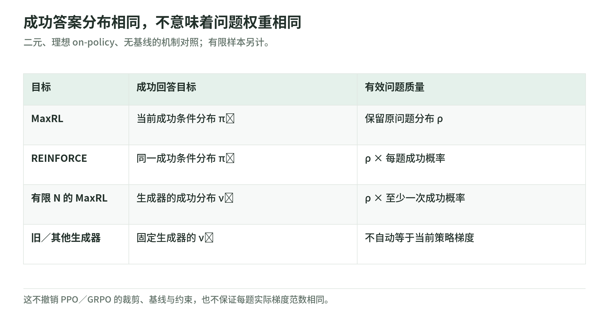
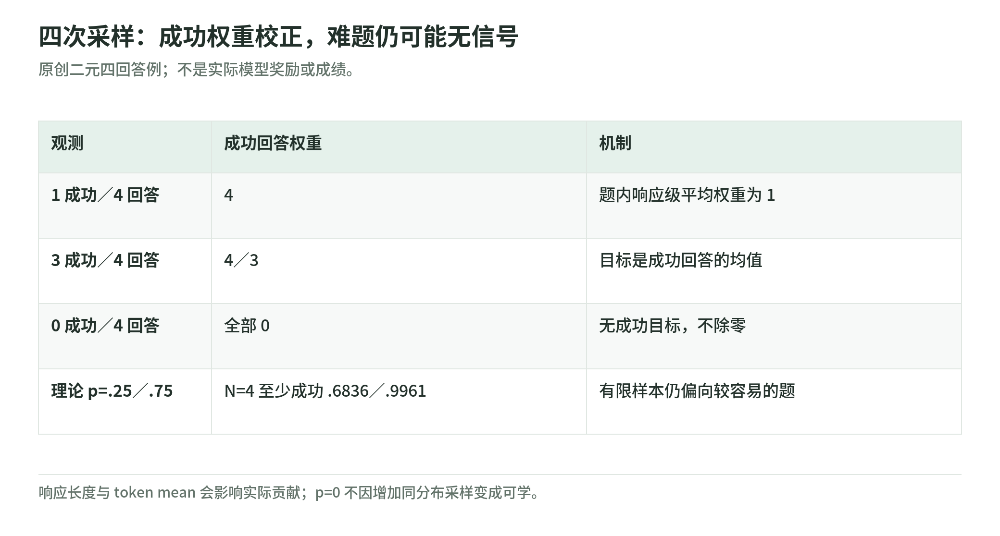

# Unified Training 02：成功条件分布与有限采样偏差

研究日期：2026-11-04。[导读](README.md) · [似然基础](likelihood-and-targets.md) · [离线实验](lab.md) · [来源](sources.md)

## 1. MaxRL：提高“成功概率”的对数

二元奖励下，设模型在题目 $x$ 上成功的概率为 $p_\theta(x)$。MaxRL 的方向是提高 $\log p_\theta(x)$，其梯度可以写为成功条件分布下的 score 均值：

$$
\nabla_\theta\log p_\theta(x)
=\mathbb E_{y\sim\pi_\theta^+(\cdot\mid x)}
[\nabla_\theta\log\pi_\theta(y\mid x)].
$$

因此在迭代点，把当前成功分布固定为目标，再做最大似然更新，可获得这个方向。这不是宣称对任意参数位置、任意采样流程都自动等于原目标的完整梯度。[论文 §3.1](https://arxiv.org/html/2610.40564v1)

原创直觉：同样绝对增加 0.01，成功率从 0.01 到 0.02 与从 0.80 到 0.81，比例改善不同。对数目标更关注相对改善；但是否拿得到成功样本，是接下来更实际的问题。

## 2. REINFORCE：成功答案相同，问题权重不同

<!-- illustration: uni-question-distribution-8dab1771bd -->

*图：成功答案分布相同，不意味着问题权重相同。二元、理想 on-policy、无基线的机制对照；有限样本另计。*
<!-- /illustration: uni-question-distribution-8dab1771bd -->

在二元、无基线的理想 on-policy 推导中，REINFORCE 与 MaxRL 都指向成功答案分布，但 REINFORCE 的有效问题分布与 $\rho(x)p_\theta(x)$ 成正比；MaxRL 保留原问题分布 $\rho$。[论文 §3.2 与附录 F.1](https://arxiv.org/html/2610.40564v1)

原创例：两题本来各占一半，成功率分别是 0.25、0.75。对 REINFORCE 的期望贡献，后一题会得到更高质量；MaxRL 理想目标不按成功率再偏向后一题。不能因此说 MaxRL 的每题梯度范数、token 数或实际学习收益都相同，目标分布与数值更新是不同层次。

PPO／GRPO 的裁剪、负优势、基线与约束也不能由这个无基线推导自动消掉。论文核心统一实现使用适合的非负监督权重，范围不等于所有 RL 实现。[论文 §2、§3 与 Discussion](https://arxiv.org/html/2610.40564v1)

## 3. 每题采 N 个回答，怎样得到权重

<!-- illustration: uni-finite-sampling-8eb55b45e3 -->

*图：四次采样：成功权重校正，难题仍可能无信号。原创二元四回答例；不是实际模型奖励或成绩。*
<!-- /illustration: uni-finite-sampling-8eb55b45e3 -->

若 $N$ 个回答中 $c$ 个成功，$\hat p=c/N$。成功回答的响应 token 权重为 $1/\hat p=N/c$，错误回答为零；全错时不给分子贡献，不执行除零。[论文 §4.2](https://arxiv.org/html/2610.40564v1)；[固定实现 `weight_groups`](https://github.com/yudasong/unified-training/blob/5b3eaa0f3ce39f695beb5d27a0bb0f92368b3118/src/unified_training/rollout_common.py)

原创四样本例：

| 奖励组 | 成功回答权重 | 按四个回答平均的权重 |
| --- | --- | --- |
| `[1,0,0,0]` | 4 | 1 |
| `[1,1,1,0]` | 4/3 | 1 |
| `[1,1,1,1]` | 1 | 1 |
| `[0,0,0,0]` | 无成功目标，全部零 | 0 |

这不是普通“把成功回答留下就做 SFT”。不按题内成功比例校正，易题产出的成功答案更多，目标的问题权重会改变。响应长度不同时，token 归约还会影响实际贡献，详见[下一章](weighted-loss-and-masks.md)。

## 4. 有限 N 仍然会漏掉难题

一题至少出现一个成功样本的概率是：

$$
a_N(p)=1-(1-p)^N.
$$

作者指出，有限样本的期望更新仍拟合生成器的成功条件分布，但该题被乘上 $a_N(p)$。当 $N=1$，这就是 $p$，对应 REINFORCE 式难度权重；足够大时，对成功概率大于零的题，质量趋近 1。[论文 §4.2](https://arxiv.org/html/2610.40564v1)

原创验算：$p=0.25,N=4$，至少一次成功为 0.68359375；$p=0.75,N=4$ 则为 0.99609375。四次采样已缓和偏差，却没有令两题一样容易获得信号。

若 $p=0$，增加有限或无限的同分布采样都不会产生成功。改善初始化、引入示范、改进探索或重新定义可学任务，比假装“多采几次必然学会”更重要。此处是数学边界与教学判断，不是我们对真实模型测到的概率。

## 5. 连续奖励不能随意套同一筛选

论文也讨论归一化到 `[0,1]` 的连续奖励。REINFORCE 可看作奖励加权目标，并按每题平均奖励改变有效问题分布；TailRL 则把不同奖励阈值的条件分布组合起来。[论文 §3.2、附录 F.2](https://arxiv.org/html/2610.40564v1)

这是“怎样选择目标”的不同方案，不是把每个 reward 强行转成同一个整数、或拿一个任意 judge 分数直接当本文二元证明。奖励可信度、校准、零质量阈值与有限样本处理仍须单独核验。我们的离线实验只覆盖二元小例，不实现 TailRL 或实际裁判。

## 6. 自测与答案

1. N=1 的有限 MaxRL 权重是否已消除难度偏差？答：没有，题目质量仍为成功率。
2. 四次全错该怎样处理？答：无成功目标，不除零；是否保留其响应用于分母是另一约定。
3. 对数成功目标能否从零成功支持中直接创造答案？答：不能靠同一成功筛选实现。

下一章：[token 权重、mask 与分母](weighted-loss-and-masks.md)。
