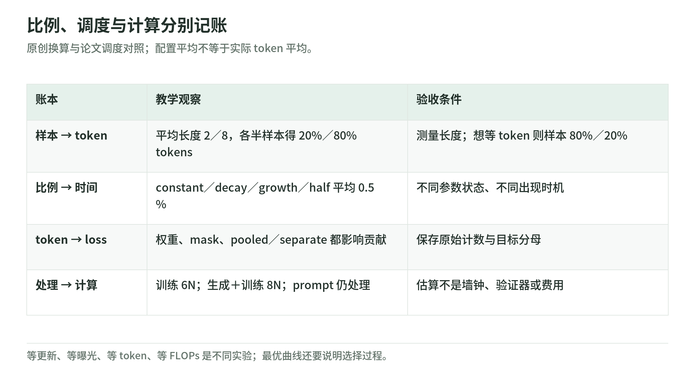

# Unified Training 05：比例、时机与总计算是三本账

研究日期：2026-11-04。[导读](README.md) · [分母](weighted-loss-and-masks.md) · [证据](evidence-and-limits.md) · [来源](sources.md)

## 1. 把“占 2%”补成一句完整的话

<!-- illustration: uni-mixture-clocks-8f38eb258d -->


*图：比例、调度与计算分别记账。原创换算与论文调度对照；配置平均不等于实际 token 平均。*
<!-- /illustration: uni-mixture-clocks-8f38eb258d -->

至少有四种比例：样本占比、响应／语料 token 占比、加权 loss 贡献占比、计算占比。理论里的来源系数与实现的 token 抽样、附加样本和权重归约不能不加说明地互换。[论文 §4.3、附录 A.1](https://arxiv.org/html/2610.40564v1)

原创例：两来源每条平均 2 与 8 个目标 token，各抽一半样本，预期 token 比是 20%／80%，不是 50%／50%。想各占一半 token，样本抽样率应与 `份额／平均长度` 成正比，归一化后是 80%／20%。

$$
P(s)\propto f_s/T_s.
$$

这是基于均值的目标换算，长度分布变化时，实际比例会漂移。配置文档还区分启动时冻结换算与在线重算；论文 real-world 比例在训练前估计，不应称为每步实测完全一致。[配置说明](https://github.com/yudasong/unified-training/blob/5b3eaa0f3ce39f695beb5d27a0bb0f92368b3118/docs/configuration.md)；[论文附录 A.1](https://arxiv.org/html/2610.40564v1)

## 2. 相同平均份额，为什么结果仍不同

作者比较四种平均配置份额均为 0.5% 的计划：始终 0.5%；从 1% 线性降到 0；从 0 升到 1%；从 2% 在前半程降到 0 后保持 0。[论文 §5.2.2、附录 A.1](https://arxiv.org/html/2610.40564v1)

用归一化进度 $t\in[0,1]$ 写成原创教学表达：

```text
constant: 0.005
decay:    0.010 × (1−t)
growth:   0.010 × t
half:     max(0, 0.020 × (1−2t))
```

四条曲线的面积都为 0.005，但对应的参数状态不同：早期看到语料可能影响后续 RL 能学什么；晚期看到语料可能改善保留，也可能牵动目标任务。顺序不能由一个平均比例概括。

这不是证明某种调度通用最优。作者报告前半程退火在部分 Coding／SciQ 指标更好，却失去一部分 corpus loss 收益；真实 token 长度不同还会改变实际份额。[论文 §5.2.2](https://arxiv.org/html/2610.40564v1)

## 3. 总算力：不能只数有 loss 的位置

受控实验使用 dense-model 近似：训练处理 token 约需 $6N$ FLOPs，生成约需 $2N$。用论文的计数方式：

$$
C_{\rm total}
=6N(T_{\rm pre}+T_{\rm mid})
+8NT_{\rm rollout}+6NT_{\rm mix}.
$$

RL 项的 8 包括生成与一次训练。prompt 虽被 loss mask 掉，仍被模型处理，因此计入这里的输入 token；FLOPs 分母与响应 loss 分母不同。[论文附录 A.2](https://arxiv.org/html/2610.40564v1)

原创例：N=1,000，四种 token 数依次为 100、20、30、10，总计 1,020,000 FLOPs；扣除共享预训练是 420,000。它只演示计数，不是本机耗时或实际模型成本。

论文估算省略 attention 长度修正、padding、activation recomputation、评测、未使用生成和重启丢弃工作。不能把这条曲线写成端到端 GPU 秒或费用。真实运行还要单独量验证器、IO、同步、并发和等待。

## 4. 等更新数，不等总计算

受控设置的比较把预训练、midtraining、生成与训练计入估算。real-world 主要保持 optimizer updates 相同，而非完整 compute-matched；加静态样本改变每步工作，异步还能复用可用回答。[论文附录 A.2](https://arxiv.org/html/2610.40564v1)

原创合同应记录：独立语料大小、重复曝光 token、实际消费 token、请求与完成生成数、验证费用、更新次数、总模型估算、墙钟与硬件。训练完整语料多遍不应被写成获得同等数量的新数据。

固定 loss 权重也不固定总梯度影响：响应长度、分母、问题成功率和目标分布共同影响更新。这是需要测量的学习轨迹，不是一张比例表能单独证明的能力。

## 5. 与静态重放、SFT 混合怎样区别

可以用同一数据格式实现重放旧语料、添加示范或添加在线成功回答，但三者改变的是不同来源。保留损失下降不等于所有旧能力恢复；添加成功样本也不等于没有探索成本。

对照实验可分别固定数据内容、曝光、优化步数、生成预算、token 预算或 FLOPs，每种回答不同问题。建议预先写主要验收指标，并把开发阶段调度搜索的成本和最终训练成本分开。这是本 Wiki 的研究建议，不是作者已证明的最优搜索程序。

## 6. 自测与答案

1. 等样本比例是否等 token 比例？答：不等，长度不同就会改变。
2. 平均配置份额相同是否是同一数据轨迹？答：不是，时机与实际长度均可不同。
3. prompt 无 loss 是否不花模型 FLOPs？答：不是，仍进入前向和训练处理。

下一章：[如何阅读实验与局限](evidence-and-limits.md)。
