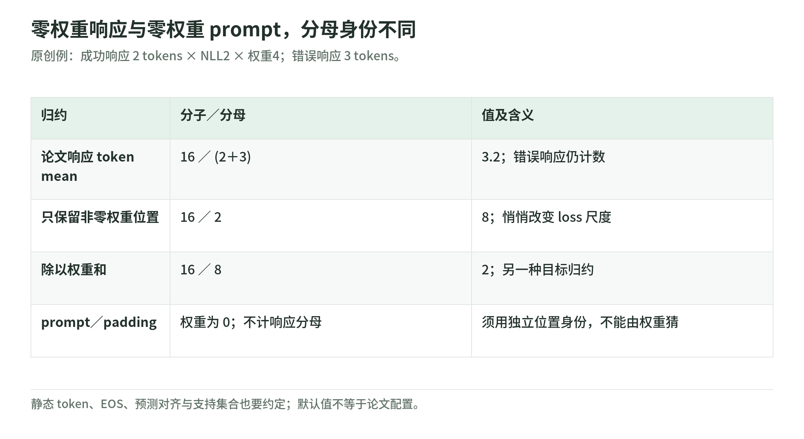

# Unified Training 03：一份权重表，还要配一份分母合同

研究日期：2026-11-04。[导读](README.md) · [MaxRL](maxrl-and-finite-sampling.md) · [异步实现](asynchronous-system.md) · [来源](sources.md)

## 1. 公共格式：序列 z 与权重 w

<!-- illustration: uni-mask-denominator-4dffe8876d -->

*图：零权重响应与零权重 prompt，分母身份不同。原创例：成功响应 2 tokens × NLL2 × 权重4；错误响应 3 tokens。*
<!-- /illustration: uni-mask-denominator-4dffe8876d -->

每条样本保存 token 序列 $z$，以及每个预测位置的权重 $w$。语料 token 权重为 1；SFT 的 prompt 为 0、示范响应为 1；RL 的 prompt 为 0、响应按题内奖励获得权重。[论文 §4.1](https://arxiv.org/html/2610.40564v1)

统一的实现形式为：

$$
\widehat{\mathcal L}
=-\frac{1}{T_B}
\sum_{(z,w)\in B}\sum_\ell
w_\ell\log\pi_\theta(z_\ell\mid z_{<\ell}).
$$

这里的 $T_B$ 是非 prompt 的有效 token 数，而不是 $\sum w_\ell$，也不是仅计算权重非零的 token 数。EOS 的口径和 padding、因果预测对齐同样要明确。[论文附录 A.1](https://arxiv.org/html/2610.40564v1)

原创直觉：分子回答“哪些预测有多大学习贡献”，分母回答“怎样把本批次归约”。同一张权重表不能自动回答两个问题。

## 2. 错误回答权重零，却仍是响应

在论文的响应 token 归一化下，错误回答虽不贡献分子，其响应 token 仍计入分母。prompt 权重也为零，却不计入这个分母；因此不能靠 `weight != 0` 或 `weight == 0` 推断位置身份。[论文附录 A.1](https://arxiv.org/html/2610.40564v1)；[实现 `loss_denominator`](https://github.com/yudasong/unified-training/blob/5b3eaa0f3ce39f695beb5d27a0bb0f92368b3118/src/unified_training/hf_trainer.py)

原创例：四个回答中仅一个成功。成功响应有两个 token，各 NLL=2、权重=4；三个错误响应各一个 token、权重=0。加权分子为 16，全部响应数为 5，loss=3.2。

若删掉错误响应，分母变为 2，loss=8；若除以权重和 8，则 loss=2。这不是显示格式的变化，而是损失尺度及梯度发生变化。

全错批次仍可有响应分母，分子为零；只有 prompt、没有任何目标 token 的批次则无有效平均。教学代码用 `None` 表示后一种情况，不把空批次伪装成一次成功训练。

## 3. 合并后归一化，与各算各的再相加

设 RL 与静态数据的加权 NLL 和分别为 $N_R,N_D$，响应数为 $T_R,T_D$，静态权重为 $w$：

$$
\mathcal L_{\rm pooled}
=\frac{N_R+wN_D}{T_R+T_D},
\qquad
\mathcal L_{\rm separate}
=\frac{N_R}{T_R}+\alpha\frac{N_D}{T_D}.
$$

前者的相对静态系数依赖 $wT_D/T_R$，还有整体尺度；后者使用固定 $\alpha$。两个公式都可以实现，但不是同一目标。作者做了保持初始化与例数相同的消融，不是证明各自归一化在所有条件都更差。[论文附录 A.1、C.9](https://arxiv.org/html/2610.40564v1)

原创反例：把同一批静态答案写得更长，样本比例没变，pooled 中的 token 贡献却变了。若用固定 alpha 的 separately-normalized loss，长度对贡献的作用又不同。讨论“静态占 2%”之前，必须先问是哪一种比例。

## 4. Microbatch 与多卡不能偷偷换分母

原创算例：一个 microbatch 分子 16、分母 2；另一个分子 0、分母 3。整体应该为 `(16+0)/(2+3)=3.2`；简单平均两批 loss 得 `(8+0)/2=4`。

因此，分布式训练需要对齐全局分子、全局分母与梯度缩放，不仅是让每张 GPU 都调用一次 loss。公开 trainer 对全局分母归约，还考虑当前采样支持检查后的精确分母；这说明“同一种 CE”仍有重要实现合同。[`hf_trainer.py`](https://github.com/yudasong/unified-training/blob/5b3eaa0f3ce39f695beb5d27a0bb0f92368b3118/src/unified_training/hf_trainer.py)

本文没有用标准库模拟 DDP 或 autograd，只验证小数组的充分统计量；真实多卡正确性必须另做梯度等价测试。

## 5. 默认选项不等于论文选项

配置文档的默认 loss normalization 是 `weights`，而论文运行使用 `response_tokens`。论文还保留零权重回答、关闭整轮权重再归一化，相关 `.env` 显式覆盖默认值。[配置说明](https://github.com/yudasong/unified-training/blob/5b3eaa0f3ce39f695beb5d27a0bb0f92368b3118/docs/configuration.md)；[受控实验配置](https://github.com/yudasong/unified-training/blob/5b3eaa0f3ce39f695beb5d27a0bb0f92368b3118/experiments/controlled/configs/common.env)

不能只说“运行了仓库默认脚本”就称复现公式。生成过滤、响应保留、weight clip、loss norm、支持集合与 token 对齐都要记录；任何一项改变都可能是新的实验。

## 6. 自测与答案

1. 权重为零，是否一定不计分母？答：不是，错误响应在本文口径里计数。
2. 两个 microbatch 的 loss 能否直接平均？答：分母不同通常不行，要合并充分统计量。
3. 同样 `.py` 文件是否意味着同一训练目标？答：不意味着，配置与数据身份也决定目标。

下一章：[异步系统与实现合同](asynchronous-system.md)。
