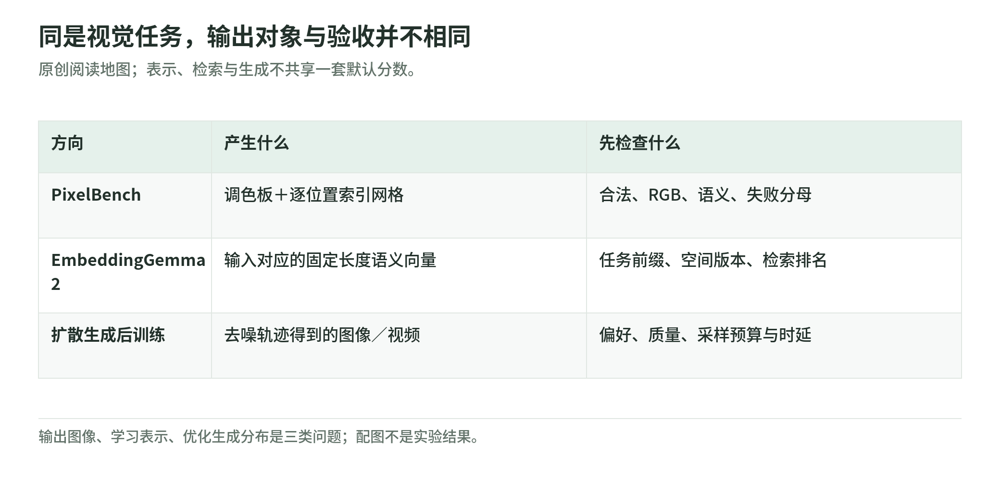

# 视觉表征与多模态：像素、语义向量与学习目标

研究日期：2026-11-04。这里研究“图像怎样成为模型能读写、学习和比较的对象”，不把所有视觉研究都归到扩散生成里。两套读本沿不同方向穿过同一个问题：输出表示怎样约束任务，训练目标怎样塑造表示，评测怎样检验表示有没有用。

## 1. 先分清输出是什么

<!-- illustration: rep-output-contracts-e7bbfc2dcb -->

*图：同是视觉任务，输出对象与验收并不相同。原创阅读地图；表示、检索与生成不共享一套默认分数。*
<!-- /illustration: rep-output-contracts-e7bbfc2dcb -->

| 问题 | 输出与验收 | 阅读入口 |
| --- | --- | --- |
| LLM 能直接写出逐像素的图案吗？ | 调色板＋索引网格；先合法，再检查可识别性 | [PixelBench 专题](pixelbench/README.md) |
| 图、声音、视频和文本能放进同一检索空间吗？ | 固定长度向量；检查相似度排序和指定任务 | [EmbeddingGemma 2 专题](embeddinggemma-2/README.md) |
| 怎样让生成的图像更符合偏好？ | 去噪过程的样本；检查偏好、质量和成本 | [扩散后训练](../diffusion/README.md) |

第一行写的是图像本身的低分辨率表示；第二行输出用于比较的表示，不直接给出一张可见图像；第三行改变生成分布。不能因为三者都涉及“视觉”就互换损失函数、基线或分数。

两篇原文是 [PixelBench v1](https://arxiv.org/html/2611.02540v1) 与 [EmbeddingGemma 2 v1](https://arxiv.org/html/2610.37364v1)。本页的三分法是教学组织，不是作者共同提出的分类。

## 2. 用一张咖啡杯理解区别

以下是假想教学例，不是论文样本：

PixelBench 风格的回答写出“0 是背景、1 是杯身、2 是把手”，随后逐行输出色号。渲染器只查表，不替模型补画杯子。若把手位置写错，图像就真的错了。

Embedding 风格的回答是一串向量。我们希望它与“带把手的杯子”的查询接近、与“没有把手的碗”分开；向量的某一维却不必具有“把手”这个可读名称。向量接近也不自动保证检索结果包含答案，或用户有权看到它。

因此，可以分别检验三个环节：输入是否保留细节，表示是否表达任务需要的信息，评分是否真正衡量这些信息。某个检索编码器能认出杯子，不等于重建了源图所有像素；某个模型写出合法网格，也不等于理解了杯子。

## 3. 两条阅读路线

**像素与辅助监督路线，约 60–90 分钟**：[导读](pixelbench/README.md) → [表示与任务](pixelbench/representation-and-tasks.md) → [指标](pixelbench/metrics-and-results.md) → [分辨率失败](pixelbench/resolution-and-failure-modes.md) → [PRT 配方](pixelbench/prt-training.md)。最后用[离线实验](pixelbench/lab.md)验算分母和相对分数。

**统一表征与检索路线，约 60 分钟**：[导读](embeddinggemma-2/README.md) → [架构](embeddinggemma-2/architecture.md) → [训练配方](embeddinggemma-2/training-recipe.md) → [评测与部署边界](embeddinggemma-2/evaluation-and-deployment.md)。重点是共享骨干、渐进目标、截断维度、量化口径和索引迁移。

**交叉阅读**：先读 PixelBench 的检索指标，再读 EmbeddingGemma 2 的对比学习。前者用已有表示空间给输出打分，后者训练表示空间本身；这两件事不能组成循环自证。

## 4. 和其他方向怎样连接

- [LLM 训练配方](../training/README.md)：把“附加 2k 样本”放回完整数据混合、初始化和更新预算，区分 SFT 与 RL。
- [奖励与裁判](../diffusion/03-rewards-judges-and-advantages.md)：判断一次相似度打分或 VLM 裁判到底衡量什么。
- [权重几何](../weight-space-programming.md)：表示空间与参数空间不是同一空间，沿训练轨迹平均权重也不是任意检查点都能平均。
- [AI 与 Agent 安全](../../security/security-101/09-ai-and-agent-security.md)：检索排序不能代替租户、对象和动作授权；检索材料仍是数据。

## 5. 学习完成的标准

能说清一个输出如何产生、什么使它有效、哪个指标允许比较，以及什么结果还不能推出。再写一份小实验合同：固定输入、目标、预算、分母和失败处理，保留能推翻自己判断的反例。

本组只核验公开材料并运行原创离线教学代码；没有下载模型权重、训练真实模型、重跑论文 benchmark 或部署检索服务。来源版本与尚未核验项分别列在两个读本的来源页。
