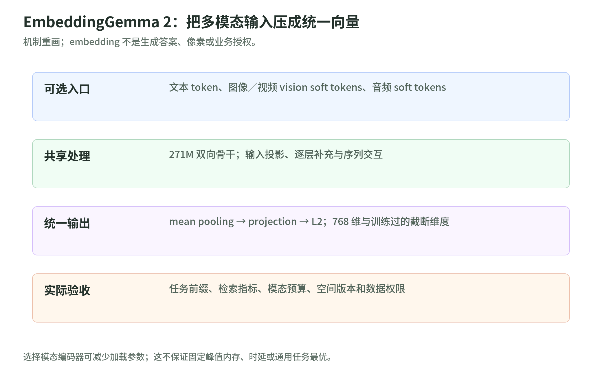

# EmbeddingGemma 2 101：把多模态输入变成可检索的向量

研究日期：2026-11-04。解读对象是 *EmbeddingGemma 2: Unified and Efficient Multimodal Representations*，arXiv:2610.37364v1，提交于 2026-10-27。本文区分作者报告、原创教学推导和工程建议，不把论文成绩写成本地复现结果。[论文身份核验](https://arxiv.org/abs/2610.37364v1)

## 1. 这篇解决什么问题

<!-- illustration: eg2-study-map-1b83f9c4fa -->

*图：EmbeddingGemma 2：把多模态输入压成统一向量。机制重画；embedding 不是生成答案、像素或业务授权。*
<!-- /illustration: eg2-study-map-1b83f9c4fa -->

假设你要在有权访问的维修资料中搜索“轴承摩擦声”：相关条目可能是文字说明、设备照片、录音或教学视频。一个实用入口不应只认关键词，还应让不同格式的候选能够按任务相关性排序。EG2 的输出是共享空间中的固定长度向量，不是维修答案；它支持原生多模态以及交错输入。[Google 官方模型卡](https://huggingface.co/google/embeddinggemma-2)

教学直觉是“给资料安排可比较的位置”。但位置近不等于内容真实，更不等于允许访问。录音和说明书即使被排到一起，也仍需返回原片段、来源和授权范围。

向量不是一张人工标签表：不能把某个坐标简单命名为“故障严重程度”。入门时只需要理解两件事：编码器把复杂资料压缩成数字，检索系统按约定比较这些数字。一个长文件可以按片段产生多个索引项，但每个输入片段仍返回单向量；如何切片是应用选择，不能与模型原生的多向量输出混为一谈。

与 [PixelBench](../pixelbench/README.md) 的阅读对照是：这里关注把输入压缩为表征，后者侧重输出像素的视觉任务。生成像素与检索表征不是同一种质量目标；一个漂亮的输出不能证明近邻排序可靠，一次排序成功也不能证明模型会生成图像。

## 2. 三条主线

第一条是架构：不同入口先转换成 token 表征，再经过共享骨干形成单向量。第二条是训练：先学习教师空间，再调整学生自己的排序几何。第三条是工程：输入预算、输出维度和加载模块分别控制不同成本。具体事实、算例及边界见下面三章，而不是靠“更小、更强”概括全部取舍。

| 想弄明白的问题 | 阅读入口 |
| --- | --- |
| 图像、音频怎样进入同一个骨干？PLE 是什么？ | [架构与输入预算](architecture.md) |
| 为什么蒸馏后还需要对比学习？量化在哪发生？ | [训练配方](training-recipe.md) |
| 分数怎么读？怎样避免索引升级和权限事故？ | [评测与部署](evaluation-and-deployment.md) |
| 哪些已核验，哪些只是建议？ | [来源与核验记录](sources.md) |

建议先看架构，再读训练，最后用评测章检验自己的直觉；只想决定是否值得试用，可以先读评测章。

## 3. 先避开三个误会

“统一空间”不是把所有模态平均拼接。“可截短”不是任意删掉坐标。“同样维度”也不是与旧模型向量兼容。对应的反例分别是：图文关系丢失、截短后尺度改变，以及新旧坐标方向不一致。三章均给出可手算的解释。

本次访问的 Google 总览已以 EG2 为主，并单列第一代。第一代的 308M、2K 上下文和设备宣传不能移植成 EG2 的规格；模型卡中 740M 与论文中 744M 的精度差异也应注明。[Google 总览](https://ai.google.dev/gemma/docs/embeddinggemma)

## 4. 简短自测

问：一次检索把内部录音排到第一位，是否说明用户可以听它，或系统已经给出可信答案？

答：都不能。排序提供候选；应用仍须执行权限检查、定位原始证据，并在需要答案时交给独立的生成与验证环节。

本专题未训练、未下载权重、未运行模型 benchmark、未部署任何模型服务。配图为本 Wiki 原创机制重画，使用本地 SVG 与 PNG，不是作者实测截图。
