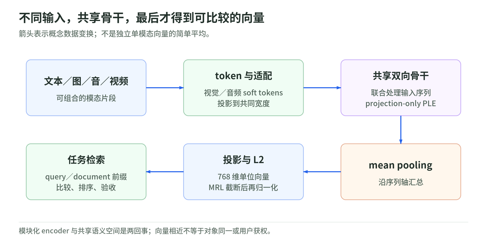

# 架构 101：不同入口如何形成一个向量

研究日期：2026-11-04。[专题首页](README.md) · [训练配方](training-recipe.md) · [评测与部署](evaluation-and-deployment.md) · [来源](sources.md)

## 1. 多种入口，一个共享空间

<!-- illustration: eg2-shared-space-7fbf8b7db9 -->


*图：不同输入，共享骨干，最后才得到可比较的向量。箭头表示概念数据变换；不是独立单模态向量的简单平均。*
<!-- /illustration: eg2-shared-space-7fbf8b7db9 -->

论文的完整模型为 744M；按需加载文本为 271M、文本加视觉为 439M、文本加音频为 577M。271M 包括 embedder，不是仅计 Transformer 层。视觉编码器约 167M，音频编码器约 305M；模块数字已四舍五入，不能相加后反推精确总数。它们共用同一个文本骨干，不是四个独立训练的小模型。[论文 §1](https://arxiv.org/html/2610.37364v1#S1)

以下是原创教学类比：文字、照片和声音像三种输入设备，但进入共同的“工作台”后才能讨论它们的关系。soft token 是编码器输出的连续向量，不是先把照片写成一句话、或先把录音转成文字。所谓共享空间，指最后的结果能用于比较，不意味着入口处理方式相同。

加载规模、计算量和输出大小是三件事。不加载音频模块可以减少驻留权重，但一张高预算图片仍可能产生较长序列；把输出从 768 维截到 256 维，也不等于骨干前向缩短到三分之一。先确定瓶颈在权重、输入序列还是索引，再选择开关。

原创对照：只做文字检索的系统不必为从未出现的音频保存编码器；但若产品后来允许语音查询，必须为新增入口准备处理链路。省略模块是部署选择，不是证明多模态训练对文字没有影响。即使文字输入不加载媒体编码器，共享骨干的参数也已经经历多模态训练。

## 2. 从序列到单向量

EG2 使用 24 层双向骨干，内部维度 512；输出 token 经 mean pooling、512→768 线性投影和 L2 归一化，得到 768 维单向量。视觉、音频适配器把各自输出映射到骨干维度。[论文 §2.1](https://arxiv.org/html/2610.37364v1#S2.SS1)

用原创简式理解这条路径：

```text
输入序列 X → 双向上下文化得到 H
h̄ = 有效位置的 H 求平均
z = 投影(h̄)
e = z / ||z||₂
```

“双向”意味着某个位置可以结合前后内容理解自己，不是只预测下一项。“求平均”发生在上下文化之后；直接平均原始图片特征与文字词向量并不能替代它。教学实现还须排除 padding，否则补齐越长，表示越受无意义位置影响。

例如，两张几乎一样的照片分别配“损坏前”和“损坏后”。只平均两张独立图片向量，可能忽略哪个标签对应哪张；交错序列则让关联有机会被骨干利用。但“有机会”不是保证，仍须检验顺序交换、错误标签和不相关文字。

单向量还有压缩代价：整段视频只留下一个检索入口，不自然保留每个事件的定位。若检索任务需要指出故障发生的秒数，可以索引片段并保留时间戳，而不是要求一个全片向量承担全部细节。

再看一个原创二维玩具：九个背景位置的输出都是 `(1,0)`，唯一异常位置是 `(0,1)`，平均得到 `(0.9,0.1)`。异常信号并非消失，却被背景稀释；归一化只改变长度，不能把它自动恢复成主方向。真实骨干可以用上下文改变这些输出，因此这不是 EG2 的实际性能预测，只说明入口信息更多，不等于平均表示一定更好。

## 3. PLE：逐层接入，不是逐层复制词表

Projection-only PLE 保留从输入表征到每层的投影支路，却移除了专用 PLE token lookup table；该支路经归一化、由层内状态产生的 GELU 门控、回投影后加入残差。[论文 §2.1、§3.1](https://arxiv.org/html/2610.37364v1#S2.SS1)

原创结构简式为“层输出 + 经门控的输入补充”。这里每层有自己的变换，接收的却是共享输入表征，不是为每层、每种媒体再设一张离散词表。这样文字和连续媒体向量都能走这条支路。

可以想象读长说明书：当前理解相当于层状态，原始短语相当于输入支路。重新查阅原始短语不等于重新建立一本词典；门控则使补充随当前理解变化。这个类比只解释信息通路，不声称层在进行人类式查阅。

反例也重要：保留支路并不能保证细节永不遗忘。如果照片在入口已把细小文字压掉，后续 PLE 只能重用已有表征，不能凭空恢复未进入序列的像素信息。

## 4. 输入预算：先算能否容纳

论文与模型卡对应的默认口径是：图片 280 个视觉 soft tokens；视频通常先按 1 fps 取帧，论文训练和评测最多 32 帧、每帧 140；音频每秒 25 个 soft tokens。各模态共用上下文，论文训练总序列长度 L≤8192。这些数字已从 HTML 数学原文核对，不以丢失公式的纯文本推测。[论文 §2.2](https://arxiv.org/html/2610.37364v1#S2.SS2)、[模型卡 Context Limits](https://huggingface.co/google/embeddinggemma-2#context-limits)

原创预算验算：32×140＝4480 个视觉 tokens；若同时保留 32 秒音频，另加 32×25＝800，媒体主体共 5280。还必须留出文字、时间戳、模态分隔符和序列边界；这不是实际 processor 输出长度的保证。

若改为每帧 280，32×280＝8960，单视觉主体就超过 8192。于是“提高每帧质量”可能迫使减少帧数或切片，改变时间覆盖。长视频的截取前段与均匀抽帧也不同：前者可能丢失末尾事件，后者可能漏掉短暂故障。1 fps 和 32 帧是实验设置，不是视频全部信息均被保留的承诺。

预算也不是媒体容量的独立额度：装入文字后，不能再分别装满图片和音频的理论上限。规划时应以最终联合序列计数，而不是把三个最大值相加。

## 5. 输出维度和任务角色

MRL 支持保留 768、512、256、128 个前缀坐标，截短后须重新 L2 归一化；检索中的 query 与 document 使用非对称文本任务前缀，角色不同但共享骨干。[模型卡 Best Practices](https://huggingface.co/google/embeddinggemma-2#best-practices)

搜索查询采用 `task: search result | query: {text}`，无标题文档采用 `title: none | text: {text}`；分类、聚类等对称比较则使用相同任务前缀，不照搬检索角色。[论文附录 A](https://arxiv.org/html/2610.37364v1#A1)

原创算例：单位向量 `(0.6, 0.8)` 保留第一个坐标后，长度变为 0.6，不再是单位向量。若索引用点积近似余弦，漏掉重新归一化会把长度差带入排名；真正显式计算余弦的实现则会在分母处理长度，需明确实际契约。

查询是在表达“要找什么”，文档是在表达“我包含什么”。不能因为同一个模型编码就随意互换前缀；应将任务角色、维度和归一化纳入索引版本。MRL 也不能免除[模型升级时的索引迁移](evaluation-and-deployment.md#index-migration)。

原创应用反例：搜索“退款条件”的短问题，与政策文件中的长段落，承担的是不同角色；如果把文件当查询编码，服务仍可能返回看似合理的分数，问题却不会以格式错误的方式暴露。因而输入契约属于质量控制，不仅是字符串装饰。

## 6. 简短自测

问：减少输出维度会自动减少视频帧数吗？projection-only PLE 是删除全部逐层输入吗？

答：不会，输入和输出预算独立；也不是，删除的是专用查表，投影、门控和残差通路仍保留。
