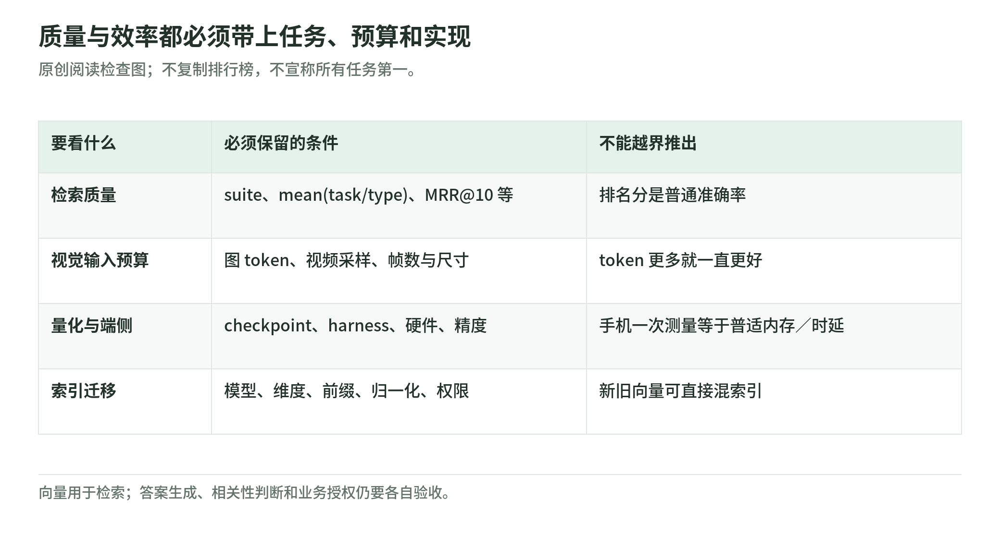

# 评测与部署 101：排序分数不是服务保证

研究日期：2026-11-04。[专题首页](README.md) · [架构](architecture.md) · [训练配方](training-recipe.md) · [来源](sources.md)

## 1. 分数必须连同口径阅读

<!-- illustration: eg2-evaluation-contracts-41b4aa5564 -->

*图：质量与效率都必须带上任务、预算和实现。原创阅读检查图；不复制排行榜，不宣称所有任务第一。*
<!-- /illustration: eg2-evaluation-contracts-41b4aa5564 -->

以下为作者报告，不是本 Wiki benchmark。论文主要评测用 bfloat16；按任务计 EG2 实际加载参数，视觉结果对应 439M 而非完整 744M。[论文 §4.1](https://arxiv.org/html/2610.37364v1#S4.SS1)

| 选择的证据 | 正确读法 |
| --- | --- |
| 英文 MTEB Mean(Task)：EG2 68.46，EG1 69.67 | 英文总体存在回退，不能说全面超越 |
| MMEB-v2 Mean(Task)：59.01 | 视觉、视频、文档混合任务聚合，不是单一准确率 |
| MAEB Mean(Task)：49.87；Mean(Type)：48.65 | 同表 Jina 为 50.14／55.31，两种平均均非最佳 |
| MSEB Retrieval：原生音频 69.54，EG2 经 ASR 57.59 | MRR@10，不是“69.54% 的音频识别正确” |

英文、MMEB、MAEB 来自[论文表 6](https://arxiv.org/html/2610.37364v1#S4.T6)；原生音频与 ASR 的同模型对照来自[表 11](https://arxiv.org/html/2610.37364v1#S4.T11)。

原创口径演示：甲类别有九个任务、乙有一个。若两类分别得 90 和 10，按任务平均是 82，先按类别再平均是 50。数字不同不代表计算错误，而是给类别的权重不同。

MRR@10 给前十名内第一个相关结果的倒数排名打分：原创小例中，三次查询分别在第 1、第 2、前十之外找到相关项，平均为 `(1＋1/2＋0)/3＝0.5`。它区分“排第一”和“排第二”，并不衡量语音转写准确率，也不验证答案真实性。

原生与 ASR 的差距比较的是整条输入路径：转写会改变内容，音频入口又增加加载参数。它不能单独证明某个声音线索贡献了多少，也不意味着每次语音查询都更好。中文带噪维修录音与评测中的语言、内容可能不同；将结论带到新任务时，应先保留这种条件差异，而不是沿用总体分数作服务承诺。

## 2. 预算与消融：别把实验条件抹掉

论文 §3 使用中间配方，不是最终发布模型。表 5 上半部在预算 280→560 时，VisDoc 63.38→67.62，而 Video 48.51→46.52；上下半部还使用不同的中间配方，不能拼成同一个完整扫参实验。[论文 §3、表 5](https://arxiv.org/html/2610.37364v1#S3.T5)

这直接限制“tokens 越多越好”的说法：文档细字可能需要空间细节，视频却同时受帧数、时间覆盖和长度影响。作者提出注意力与 mean pooling 稀释的可能解释；它不是已隔离验证的唯一因果机制。[论文 §3.4](https://arxiv.org/html/2610.37364v1#S3.SS4)

原创排查思路是先固定总长度和抽帧覆盖，再分别改变每帧预算，否则提升空间分辨率与减少时间覆盖会混在一起。消融还能支持局部设计选择，但无法直接量化该机制在任意新数据上的贡献；不要把一个中间检查点的差值加到最终模型分数上。

## 3. 量化与内存：数字必须带设备

表 1 明示 MIEB、MSEB 的浮点和量化实验使用不同 harness，差值不能全归于量化。论文报告 Q4_C 在 Google Pixel 11 Pro 上、含运行时编译开销的峰值为文本 191 MB、图文 447 MB、完整模型 567 MB；这是指定设备与设置的结果，不是所有手机的容量保证。[论文表 1、§2.4](https://arxiv.org/html/2610.37364v1#S2.T1)

模型卡还要求浮点推理采用 bfloat16 或 float32，而非 float16；输出截短后重新归一化。[官方数值精度说明](https://huggingface.co/google/embeddinggemma-2#4-numerical-precision)

原创工程判断：文件大小、常驻内存与峰值内存应分开记录，预处理、激活、工作区和并发都会改变峰值。数值正确性至少应检查向量是否有限、范数是否合约一致；返回了一个数组，不代表排序可用。离线编码也不自动证明原数据、日志和索引都没有外泄。

## 4. 受权检索与版本化迁移

以下是原创方案，不是声称作者已经部署了企业权限系统。以有权使用的设备手册和录音为例，索引项应同时保存原对象标识、页码或时间段、内容版本、租户和访问范围。embedding 提供候选位置，不生成答案，也不执行授权。

查询时先限制可检索的授权范围，取回候选后再次校验当前权限，再交付原片段；撤权和删除应同步到索引及缓存。仅在生成答案前屏蔽正文还不够：标题、摘要和候选数量也可能泄露资料存在。权限判断应来自应用的身份与政策系统，不来自相似度阈值。

同为 768 维不意味着 EG1 与 EG2 向量兼容。原创二维反例：旧系统把查询和正确文档都编码为 `(1,0)`；新系统将所有方向旋转九十度，内部检索仍正确，但新查询 `(0,1)` 与旧文档点积变成零。训练平均与蒸馏也没有提供直接混用旧向量的部署承诺。

建议把模型 revision、processor、任务前缀、输入预算、输出维度、精度及归一化组成索引版本。迁移顺序为：保留旧索引，创建新版本；在受权数据上回填并记录内容版本；对增量变更双路更新；用影子查询比较；满足门槛后切换查询路由；保留旧版本供回滚。

回填不完整时不能静默把旧新向量放进同一近邻空间。切流也必须成对切换查询编码与目标索引；回滚恢复的是这一对配置，不只是模型文件。MRL 可以基于同模型完整向量派生短前缀，但不能因此跳过版本管理和排序验证。

原创故障场景：回填刚处理完某份手册，用户随后撤销共享，而增量任务只更新正文没有更新权限，旧授权就可能随候选返回。解决它需要内容与授权版本共同校验，不是重新训练 embedding。若新增索引尚未处理某次删除，切流也应阻止该对象被交付。

另一个边界是证据粒度：返回全片视频的链接，未必足够支持某个具体回答。索引应让候选能落回原页、原时间段，并保留可审计的引用；生成器若随后改写了内容，应另行检查回答是否由这些证据支持。检索分数不能充当这一检查的替身。

## 5. 一组未来验证计划

以下尚未执行，也不附自动运行命令。先准备有授权的中文文本、带细字图片、短音频和稀有事件视频查询，隔离开发集与持出集，人工标出相关片段；只对同一模型比较 768／256 维、默认／增大视觉预算、原生音频／ASR。若获准量化测试，统一 harness、预处理和精度记录，再比较。

验收同时看分模态检索质量、无法回答的查询、权限泄露、切流／回滚和目标设备的延迟与峰值，不仅看总体平均。费用、权重获取、运行环境和停止门槛须另行批准，本文不预设性能提升幅度。

## 6. 简短自测

问：视频预算翻倍却掉分，能否证明所有大预算都更差？量化表差值能否直接等于量化损失？

答：不能。前者限于该中间配方与预算范围；后者在 harness 不同时混有测量条件差异，应控制变量后验证。
