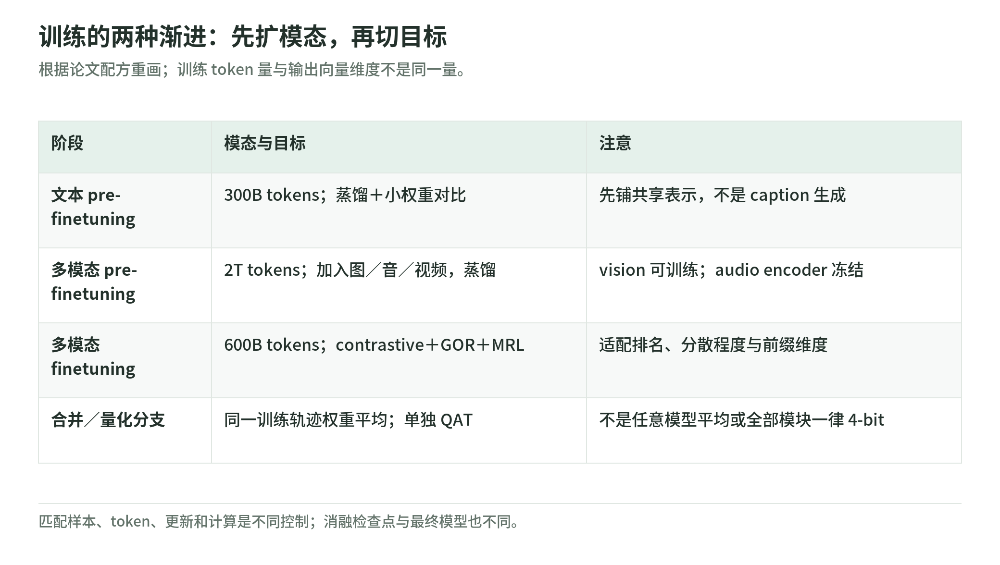

# 训练 101：先学坐标，再学排序

研究日期：2026-11-04。[专题首页](README.md) · [架构](architecture.md) · [评测与部署](evaluation-and-deployment.md) · [来源](sources.md)

## 1. 模态和目标分别渐进

<!-- illustration: eg2-recipe-stages-26e507db47 -->

*图：训练的两种渐进：先扩模态，再切目标。根据论文配方重画；训练 token 量与输出向量维度不是同一量。*
<!-- /illustration: eg2-recipe-stages-26e507db47 -->

论文的三阶段 token 量约为 300B、2T、600B，合计约 2.9T。文本预微调以蒸馏为主，含小权重对比项；多模态预微调只用蒸馏；多模态微调去掉蒸馏，采用对比学习、spread-out／GOR 和 MRL。视觉编码器在两个多模态阶段参与训练，音频编码器冻结。[论文 §2.4](https://arxiv.org/html/2610.37364v1#S2.SS4)

这张表是上述事实的学习导航，不是可直接执行的复现配置：

| 阶段 | 输入范围 | 主要学习问题 |
| --- | --- | --- |
| 文本预微调 | 文本、代码 | 先建立可用的文本表征 |
| 多模态预微调 | 加入图像、音频、视频、交错内容 | 将不同入口放入教师共享空间 |
| 多模态微调 | 多模态任务数据 | 为学生容量和检索目标调整几何 |

原创类比：先沿着地图学地标，再自己规划路线。前两阶段给学生稳定参照，最后阶段不必把每条路线复制成教师的样子。“输入模态渐进”和“目标函数渐进”是两条轴，不能写成三个阶段都使用同一份混合损失。

token 量也不等于独立样本数。一个音频或视频样本可以消耗很多 soft tokens，重复采样还会再次计数；仅凭 2.9T 无法反推数据条数、去重率或总费用。理解配方不要求假装掌握了作者未完全公开的生产流水线。

## 2. 蒸馏学什么，为什么还要离开教师

EG2 的蒸馏直接匹配教师的截短、归一化向量，并覆盖 query、正例和硬负例，不只是模仿相关性分数。教师为 Gemini Embedding 2。[论文 §2.3](https://arxiv.org/html/2610.37364v1#S2.SS3)

原创手算：两个单位向量 u、v 满足 `||u−v||²＝2−2u·v`，所以减小匹配误差会增大方向一致性。匹配“有一点像但不是答案”的负例位置，有助于学习精细区分，而不只是把所有相关资料挤在一起。

但匹配坐标比保持排名要求更强。学生容量有限时，教师的全部距离关系可能难以复制；某些误差对检索无害，另一些会交换第一、第二名。因此最后阶段转向排序目标是可以理解的设计，而不是“蒸馏越久必定越好”。

反例：学生把所有向量同时旋转，内部相似度可以不变，逐向量教师匹配却会变差。两种目标衡量的成功不同；最后阶段的改变，不能解释成两个指标天然等价。

冻结模块与冻结行为也不同。原创推理是：音频入口的特征提取不再更新，但适配器或共享骨干改变后，同一录音的最终向量仍可以移动。反过来，视觉编码器可训练，只说明优化器能更新它，不说明每一种图片信息都获得改善；“允许更新”和“更新有益”需要分开。

## 3. 对比学习：负例不是越多越正确

论文对比项包含硬负例、批内负例和 same-tower negatives；重复 query 或重复正目标会触发 false-negative mask。same-tower 项比较 query-query、target-target，意在防止两种角色分裂成不相交的子空间。[论文式 (2)–(3)](https://arxiv.org/html/2610.37364v1#S2.SS3)

原创简式是：让正确候选在“正确候选加负候选”的竞争中占更大份额。硬负例是容易混淆的错误对象，不是任意不相关的数据。温度控制竞争的尖锐程度，但不能让错误标签变正确。

例如，同一段说明书同时回答“故障如何复位”和“复位按钮在哪里”。若两条训练记录共享正目标，却把彼此当成负例，梯度会要求同一资料既靠近又远离查询。重复屏蔽能解除这类明显冲突，却不是自动识别所有语义同义答案的万能过滤器。

原创数据反例：甲、乙两份手册文字不同，却都包含可接受的复位步骤，简单重复检查可能识别不到它们。若把乙当硬负例，模型就会因为没有被标全的答案而受罚。因此更大的 batch 既能带来更多竞争，也可能带来更多标签冲突；训练规模不能替代数据关系的清理。

same-tower 中的 tower 指 query／target 的训练角色，不意味着 EG2 使用两个互不共享的文本骨干。即使使用同一网络，不同任务前缀仍可能形成角色偏置；增加同侧竞争是在约束几何，而不是撤销检索的非对称语义。

## 4. Spread-out 与 MRL：展开空间，保留有用前缀

论文的 spread-out 项采用 GOR 的二阶项，惩罚批内同侧向量点积的平方；MRL 把目标施加到嵌套维度上。[论文式 (5)、MRL 小节](https://arxiv.org/html/2610.37364v1#S2.SS3)

原创直觉：若大量向量都挤在窄锥里，许多无关资料的方向也很相似，区分余地变小。展开空间是鼓励随机配对总体别太相似，不是要求“轴承噪声”和“轴承故障说明”正交。

可手算的边界是：d 维空间中最多有 d 个两两正交的非零向量；资料数远大于 d 时，全体正交根本不可能。对独立均匀球面方向，点积平方的期望为 1/d，也不是每对点积都等于零。GOR 与正例吸引共同塑形，不能把它写成语义全部抹平的约束。

MRL 则让小前缀在训练中也接受监督。原创反例：若一个普通向量把关键信号全放在末尾，随意截前半段会丢光它；训练过的前缀会承担保留信息的任务。但这不是免费压缩定理，细节丰富的多模态排序仍可能明显退化，必须阅读[分维度结果](evaluation-and-deployment.md)。

可以把小前缀理解为摘要，但不要给某段坐标指定固定语义类别。嵌套监督要求不同长度都能工作，剩余坐标仍可提供额外区分能力。若只看完整维度的训练损失，就无法判断短向量是否真的保住了关键排名。

## 5. 平均与 QAT：两个有明确边界的收尾

最终权重取同一次微调轨迹中较早与最终检查点的无权重平均；不是任意模型平均。QAT 在合并后独立尾阶段进行，以冻结的浮点模型作初始化和蒸馏教师。骨干用 Q4_0／Q4_C；视觉为 W8A8，音频为 8-bit 激活、分层簇的 2／4／8-bit 权重，并非全模型 4-bit。[论文 §2.4](https://arxiv.org/html/2610.37364v1#S2.SS4)

原创反例：两组函数等价的网络若交换了隐藏单元编号，逐参数平均仍可能损坏功能。同轨迹检查点有较一致的参数身份，但这也不保证平均永远获益；应把平均视为作者验证过的选择，而不是跨模型拼装方法。

量化尾阶段的目标又不同：在受限数值表达下接近浮点行为，而非重新学习全部语义。模块精度不同，所以拿总参数数乘以半字节只能得到粗糙假设，不能推出真实设备峰值。

## 6. 简短自测

问：冻结音频编码器是否代表音频样本不参与训练？GOR 是否要求相关资料相互正交？

答：都不是。音频仍可经过可学习适配器和共享骨干提供损失；GOR 控制总体展开趋势，须与保留正例关系的目标共同理解。
