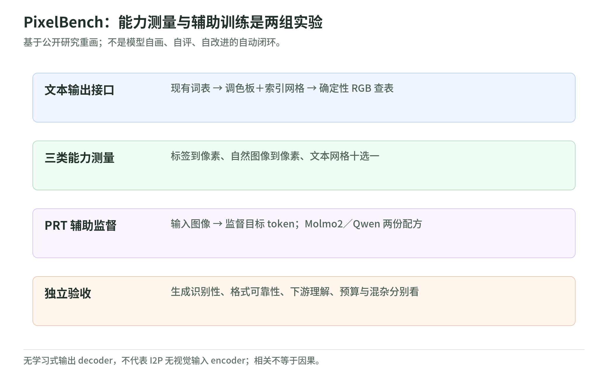

# PixelBench：用文字写像素，也用重建学习视觉

研究日期：2026-11-04。原文是 Haoquan Zhang 等人的技术报告 [PixelBench v1](https://arxiv.org/html/2611.02540v1)，提交于 2026-11-02。本专题基于[项目页](https://haoquanzhang.github.io/pixelbench/)与[公开实现](https://github.com/HaoquanZhang/PixelBench)，不把作者报告写成独立复现。

## 1. 先抓住两个问题

<!-- illustration: pxb-two-questions-4ff58f836e -->

*图：PixelBench：能力测量与辅助训练是两组实验。基于公开研究重画；不是模型自画、自评、自改进的自动闭环。*
<!-- /illustration: pxb-two-questions-4ff58f836e -->

第一问是**能力测量**：已有 LLM 不增加图像输出模块，只用现有文本词表，能否写出低分辨率的逐像素图案，并从这种文本表示认出对象？

第二问是**学习信号**：若训练多模态模型把输入图像重建成调色板与网格，能否给普通视觉理解提供有用的辅助监督？前一问的零样本测量与后一问的 PRT 训练是两组实验，不是“同一个模型先画图再自己改进”的已实现闭环。[原文 §2–4](https://arxiv.org/html/2611.02540v1)

本 Wiki 的直觉：平时说“这里有一只鸟”，可以省掉形状和空间位置；逐行写像素，则必须落实“哪里是什么颜色”。它可能迫使表示保留更多结构，但“可能”需要训练消融检验，不能由一张好看的样本直接证明。

## 2. 一句话结论及其边界

作者报告：强模型能通过文本接口生成可识别的低分辨率像素图；提高分辨率并不总是提高质量；附加像素重建监督在指定训练设置下改善了部分视觉评测。没有证明所有视觉任务都会改善，也没有证明 LLM 已取代专用图像生成器。[原文结果与局限](https://arxiv.org/html/2611.02540v1)

“不需要学习式图像 tokenizer／decoder”只说**输出端**。I2P 接收自然图像时仍使用视觉编码器，不能解读成整条路径都只有文字。[原文任务设计](https://arxiv.org/html/2611.02540v1)

## 3. 专题目录：先机制，再数字

| 章 | 要回答的问题 |
| --- | --- |
| [01 表示与任务](representation-and-tasks.md) | 调色板、网格、确定性渲染分别负责什么？三类任务怎样区分？ |
| [02 指标与结果](metrics-and-results.md) | 500-way 与 100-way 检索、余弦、裁判、无效输出怎样计算？ |
| [03 分辨率与失败](resolution-and-failure-modes.md) | 更多位置为什么可能让全局结构更差？怎么公平比较？ |
| [04 PRT 训练配方](prt-training.md) | Molmo2 与 Qwen 的目标、数据和预算有什么不同？ |
| [05 证据与局限](evidence-and-limitations.md) | 相关、消融和因果分别能支持什么？ |
| [06 离线实验与自测](lab.md) | 手算、测试严格网格、分母和相对聚合；不调用模型 |
| [来源与核验边界](sources.md) | 读了哪个版本？哪些事情没有执行？ |

**20 分钟路线**：本页 → 表示 → PRT 的两种配方对照 → 证据边界。**90 分钟路线**：按章阅读并跑本地标准库实验；这不包含真实模型训练。

## 4. 怎样避免三个常见误读

合法 JSON 只是接口通过，不是画得对。可识别性是语义评价，也不是像素级保真。训练平均分上升还要看分母、对照和负收益任务，不是“每项能力提升”。分别在三个层次设门，才不会把一种成功包装成另一种成功。

“只加 2k 样本”不等于“整个实验只训练 2k 样本”；“无学习式输出解码器”不等于“无视觉输入”；“理解和生成相关”不等于“会画就一定更会理解”。这些都是本文最值得带走的阅读习惯。

## 5. 和领域知识连接

与 [EmbeddingGemma 2](../embeddinggemma-2/README.md) 对读：PixelBench 输出可渲染的栅格，EmbeddingGemma 2 输出用于检索的语义向量。PixelBench 的某些指标又依赖语义编码器，所以要分开被评对象与评分工具。

与 [SFT／RLVR](../../training/rufus-air/data-sft-and-rlvr.md) 对读：PRT 使用监督 token loss，不是拿 VLM 裁判分数做 RL。与[自动研究与 oracle](../../diffusion/04-autoresearch-and-oracles.md)对读：评分改善要接受正确性、持出集和预算检查，不能只保留一种好看的指标。

本专题新增原创机制图与教学例，不转载论文整页图表。不下载权重、不调用付费模型、不启动 GPU 训练；“代码已测试”仅指本 Wiki 的离线教学代码。
