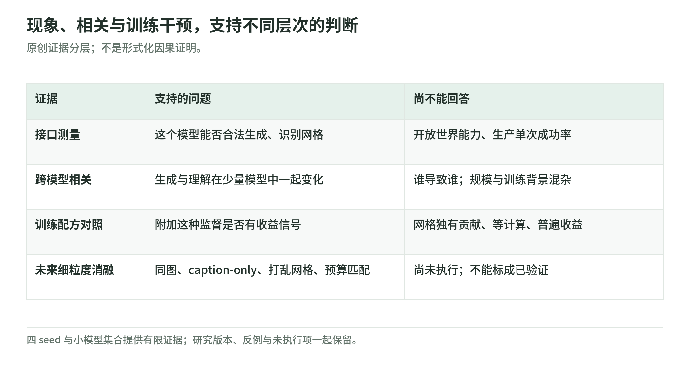

# PixelBench：证据强弱、混杂与复现边界

研究日期：2026-11-04。本文复核 arXiv v1、作者项目页，以及下列固定仓库快照；以下实验数值均为作者报告，不是我们的独立复现。[论文](https://arxiv.org/html/2611.02540v1) · [项目页](https://haoquanzhang.github.io/pixelbench/) · [固定快照](https://github.com/HaoquanZhang/PixelBench/tree/c095bae7434c98e1529dea0754c5ebf61e10534f)

## 1. 先限定问题：文本像素接口，不是新图像 SOTA

PixelBench 的核心是把小图写成“RGB 调色板＋二维颜色索引”，模型使用已有文本词表，渲染器仅查表还原颜色。它研究现有模型能否通过文本表达和读取视觉结构，不是推出新的通用图像生成架构，也没有建立相对现代图像生成系统的 SOTA 结论。[仓库说明](https://github.com/HaoquanZhang/PixelBench/blob/c095bae7434c98e1529dea0754c5ebf61e10534f/README.md)

“无需学习式图像 tokenizer／输出 decoder”不等于“系统没有视觉模块”。T2P 从物体标签生成；I2P 仍由输入侧视觉 encoder 接收自然图像。只有像素理解任务把调色板和网格作为纯文本输入。输出接口的简化，不能被解释成消除了视觉编码器。[论文 §2.2](https://arxiv.org/html/2611.02540v1#S2.SS2)

论文采用何种会议模板，不是录用证据；即使出现 ICLR 模板，也不能写成已获 ICLR acceptance。本次核验只支持将它标记为 arXiv 预印本，所查页面未提供会议录用凭证。[arXiv 元数据](https://arxiv.org/abs/2611.02540)

## 2. 三种证据，不能相互替代

<!-- illustration: pxb-evidence-ladder-c8a092be51 -->

*图：现象、相关与训练干预，支持不同层次的判断。原创证据分层；不是形式化因果证明。*
<!-- /illustration: pxb-evidence-ladder-c8a092be51 -->

第一种是接口能力证据：生成是否合法、图像能否检索到目标、文本网格能否被识别。它能说明模型在该协议中表达视觉内容的能力，但识别分数不是完整的图像质量评估。主生成任务每种各有 100 个输入、三个分辨率；理解集为 600 道十选一题。这些任务规模不能被外推为开放世界视觉能力。[任务与评测协议](https://github.com/HaoquanZhang/PixelBench/blob/c095bae7434c98e1529dea0754c5ebf61e10534f/EVALUATION.md)

第二种是相关证据：跨模型的理解—T2P Pearson `r=.871，n=7`，理解—I2P 为 `r=.930，n=6`，后者不含没有 I2P 结果的 DeepSeek。这里的统计比较单位是模型，不是 600 道题。共同的模型规模、训练背景或指令遵循能力都可能解释关联；这些是待检验混杂，不能据此断言“理解导致生成”，也不能倒推“重建必然改善理解”。[论文表 4](https://arxiv.org/html/2611.02540v1#S2.T3.fig1)

第三种是训练干预证据：PRT 与基线的对照，比相关性更接近“加入这种训练配方是否有效”的问题。但处理组可能同时改变图像暴露、语言监督和计算预算；因此配方有效不等于已定位到像素网格这一机制。应分别判断现象成立、配方收益和机制归因。[项目页后续问题](https://haoquanzhang.github.io/pixelbench/#outlook)

## 3. 综合分的比较集合，也是实验条件

I2P 的 Aggregated 不是准确率：先跨分辨率平均 Top-1、SigLIP cosine、DINO cosine，再在六模型＋三算法的九方法集合内，逐列 min–max 归一化，最后三列等权平均并乘 100。`table.py` 直接实现此公式，任一列跨度为零会报错；它并未强制必须输入九方法。[评测协议](https://github.com/HaoquanZhang/PixelBench/blob/c095bae7434c98e1529dea0754c5ebf61e10534f/EVALUATION.md) · [实现源码](https://github.com/HaoquanZhang/PixelBench/blob/c095bae7434c98e1529dea0754c5ebf61e10534f/pixelbench/table.py)

因此改变参照方法，即使模型原始表现不变，也可能改变综合分，甚至改变综合排序。复现主表应输入相同九份结果，同时保留原始指标，不能把此相对分数跨论文当成绝对标尺。协议还规定无效或缺失输出的 Top-1、cosine 计零，但 MRR 只对有效输出平均；只报 MRR 会掩盖格式失败。[评分口径](https://github.com/HaoquanZhang/PixelBench/blob/c095bae7434c98e1529dea0754c5ebf61e10534f/EVALUATION.md)

## 4. PRT：有收益信号，仍有预算和监督混杂

Molmo2 从 `Molmo2-4B-Pretrain step32000` 开始指令微调，基线使用 OV 500k，处理组为 500k＋2k PRT；不是总共只训练 2k。2k 由 16²／32² 各 1k 条轨迹组成，主比较有四个匹配 seed 对。更新次数是基线 1,190、处理组 1,198，故仍多八次更新。[训练说明](https://github.com/HaoquanZhang/PixelBench/blob/c095bae7434c98e1529dea0754c5ebf61e10534f/training/README.md)

16 个下游基准的主表给出约 `+0.6 pp` 官方评测单位加权收益，以及 `+0.5 pp` 基准等权收益。数量消融的未取一位小数值为 `+0.61／+0.45 pp`；四个 seed 对的基准平均增益仅三个为正。应说“小幅平均收益”，而非“四次均上涨”或“每个基准都改善”。1k、4k、8k 各只有两个 seed，收益也不随数量单调增加。[论文表 6、7 与 §4.2](https://arxiv.org/html/2611.02540v1#S4)

这里的 Example average 并不总以单道问答计数：普通基准按题，MMVP 按题对，MMBench 按同题的全部循环选项，ColorBench-Robust 按原图与九种重着色组成的组；组内必须全对。Benchmark average 才是每个基准等权。两种收益回答不同问题，不能混写成“平均每题提高 0.5%”。[官方单位定义](https://github.com/HaoquanZhang/PixelBench/blob/c095bae7434c98e1529dea0754c5ebf61e10534f/EVALUATION.md)

Molmo2 轨迹同时含 caption、palette explanation 与 grid，网格固定，但前两部分有额外语言监督。作者承认尚无同图 caption-only 对照；长轨迹的 token 占比也超过其约 0.4% 样本占比。因此额外图像、语言内容和优化量尚不能与网格效应分离。[论文附录 D.6](https://arxiv.org/html/2611.02540v1#A4.SS6)

Qwen additive 则比较 FV 64k／1,000 步，与 FV 64k＋Pixel 3k，即 67k／1,047 步；新增 47 次更新，不能把全部增益归因于网格。它覆盖 2B／4B／8B，评测为 13 个基准，不能借用 Molmo2 的 16 基准口径。[训练配方](https://github.com/HaoquanZhang/PixelBench/blob/c095bae7434c98e1529dea0754c5ebf61e10534f/training/README.md) · [评测套件](https://github.com/HaoquanZhang/PixelBench/blob/c095bae7434c98e1529dea0754c5ebf61e10534f/EVALUATION.md)

fixed 控制把 3k FV 替换为 3k Pixel，形成 61k FV＋3k Pixel，总量仍为 64k、1,000 步。它削弱了“仅因多更新”的解释，却同时改变监督组成和图像来源。论文明确目标长度随网格增大，未证明有效 tokens 或 FLOPs 相等；“等样本、等步数”不能升级为“等计算预算”。[论文附录 D.5](https://arxiv.org/html/2611.02540v1#A4.SS5)

## 5. 后续实验：先写清怎样会推翻解释

以下是本次提出的实验，不是已完成的结果；设计依据是作者披露的混杂和表示边界。[作者讨论](https://haoquanzhang.github.io/pixelbench/#outlook)

1. 机制拆分：同一批图像、相同暴露次数，对比 caption-only、caption＋palette、grid-only、完整轨迹及空间打乱网格；匹配监督 tokens 和计算量。若 caption-only 同样有效，或打乱网格仍保留收益，就削弱“空间重建结构是关键”的解释。
2. 预算对照：增加只延长 OV／FV 训练的对照，记录非 padding tokens、图像裁剪数、FLOPs 与 GPU 时间。若预算匹配后差异消失，则原 additive 增益可由额外优化解释，不能宣称网格独有收益。
3. 相关性稳健性：扩大模型集合，加入同家族不同规模和训练阶段的模型，报告留一模型、留一家族及控制规模后的结果。若高相关依赖一个模型或家族，就否定其普遍性；相关保留仍不自动构成因果。
4. 评测与分布检验：保持九方法参照集，换独立视觉 encoder，并对未见概念、复杂布局和文字图像做盲评。若优势只出现在原 encoder 或简单图标中，就应收窄主张至该评分器／分布。
5. 收益与 scaling 分开检验：预注册主要指标，每个数量条件至少八个匹配 seed，冻结官方单位，报告配对差值与置信区间。若区间跨零，小幅收益仍不确定；若数量增加仍无趋势，就不能支持 scaling，但这并不单独否定某一配方有用。

## 6. 复现边界与未执行项

固定代码快照只锁住仓库内容，不锁住外部模型权重、上游训练框架、在线 API／judge 或下游数据版本。仓库提供输入与保存预测，但生成指标重算还需评测 encoder；大规模训练语料、模型权重和各下游 harness 另行取得。复现应记录这些版本、数据清单、seed、完整分组与推理参数。[仓库说明](https://github.com/HaoquanZhang/PixelBench/blob/c095bae7434c98e1529dea0754c5ebf61e10534f/README.md) · [训练依赖](https://github.com/HaoquanZhang/PixelBench/blob/c095bae7434c98e1529dea0754c5ebf61e10534f/training/README.md)

我们仅阅读公开论文、项目页、说明文档与来源台账所列源码；项目页通过 curl 补充核验。未下载权重，未安装或运行项目，未真实训练或 benchmark，未重算保存预测，未调用模型／judge，也未验证训练集去重或上述后续实验。本文能确认公开材料的主张、口径与局限，不能声称结果已被独立复现。

返回[专题导读](README.md)；继续[原创离线实验](lab.md)；查看[完整来源](sources.md)。
