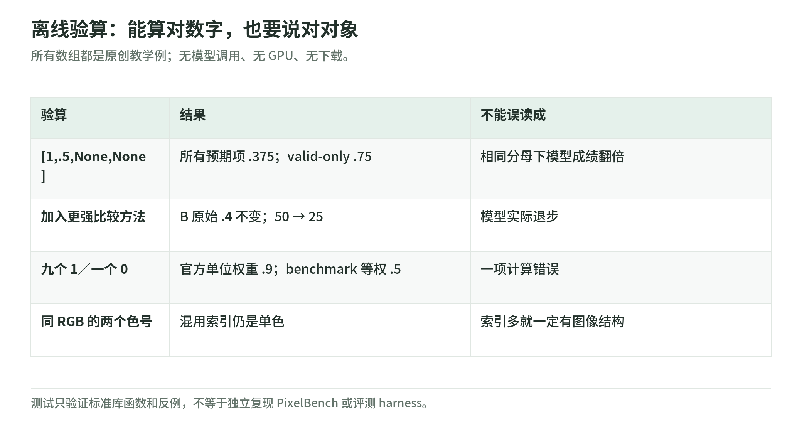

# PixelBench：免费离线实验与阅读自测

研究日期：2026-11-04。下面是本 Wiki 原创的标准库实验，不是 PixelBench evaluator、PIA 算法或模型训练。只操作内存里的小数组，不下载数据，不联网，不调用模型，不写图片或训练检查点。

代码：[pixelbench_lab.py](https://github.com/IanLiYi1996/learning-wiki/blob/main/scripts/pixelbench_lab.py)；测试：[test_pixelbench_lab.py](https://github.com/IanLiYi1996/learning-wiki/blob/main/tests/test_pixelbench_lab.py)。上游接口与分母依据见[来源台账](sources.md)。

## 1. 三张合同，分别验算

<!-- illustration: pxb-lab-contracts-0e119dbc5d -->


*图：离线验算：能算对数字，也要说对对象。所有数组都是原创教学例；无模型调用、无 GPU、无下载。*
<!-- /illustration: pxb-lab-contracts-0e119dbc5d -->

运行位置是仓库根目录，Python 3.9+；不用安装模型框架：

```bash
python scripts/pixelbench_lab.py
python -m unittest discover -s tests -p 'test_pixelbench_lab.py' -v
```

第一张合同是**输出契约**：尺寸与颜色必须合法，查表之后才能讨论图像。第二张是**评分契约**：预期输出、有效输出、真实零分不能混淆。第三张是**比较契约**：相对聚合必须绑定参照方法和原始指标。

这里刻意不用随机数，让每一步都能手算。标准库代码不能证明真实模型会遵守接口，也不能证明作者成绩。

## 2. 4×4 方块：合法、单色、等价表示

示例 `["0000","0110","0110","0000"]` 使用白／黑两色，中间像素 RGB 为 `(0,0,0)`，`square_flat=false`。

将两个 palette 条目都设白色，网格仍混用 0／1，结果 `duplicate_colors_flat=true`。说明单色要检查 RGB，而不是数索引种类。

再交换调色板、反转 0／1，渲染图像完全不变。表示字符串不同与图像不同不是同一事实。测试覆盖两者相等，不假装实现上游完整 canonical encoding。

删一行、添一列、写超出调色板的 2、把索引写成布尔值，都会失败。不自动修复，是为了让原始错误可测；若研究修复流程，须另设实验。

## 3. 0.375 与 0.75：不是谁算错了

```text
scores = [1.0, 0.5, None, None]
expected = 4
valid = 2
coverage = 0.5
all_expected_mean = 0.375
valid_only_mean = 0.75
```

`None` 表示缺失／无效，不是合法零分。所有预期项均值把它们记零；valid-only 均值排除它们。两者描述不同对象，不能只报更大的数。

全无效时：所有预期项均值是 0，valid-only 是 `None`。完全没有预期项时，两种均值都无定义；不要把没有任务包装成成功或失败。

这演示了分母差异，但没有计算真实检索排名或 MRR。上游主分数和 MRR 的实际范围须回到[指标章](metrics-and-results.md)及 evaluator。

## 4. 同一原始成绩，50 变成 25

假设 A／B／C 三方法三列原始指标分别恒为 0.2／0.4／0.6。逐列 min–max 后，B 得 50。加一个三列均为 1.0 的 D，B 得 25；其原始三列仍为 0.4。

测试保留原始值，防止将刻度变化误读为性能退化。若任一列对所有方法相同，函数报错；没有范围就不伪造相对分数。

教学建议：真实实验同时保存原始指标与完整比较集合，不把不同集合的 Aggregated 放进同一折线当作模型学习曲线。

## 5. 位置与统计单位的两个验算

`16²=256`、`32²=1024`、`64²=4096`、`128²=16384`；相对 16² 为 1、4、16、64。只是位置计数，不能替代 tokenizer 输出计数。

再构造两个虚拟 benchmark：第一个九个官方 unit 都得 1，第二个一个 unit 得 0。按官方 unit 加权是 0.9，按 benchmark 等权是 0.5。同样的结果，不同的权重回答不同问题。

一个虚拟成对 unit 成员 `[True,False]`，全员成功规则给 `False`。本实验不实现 MMVP、MMBench 或 ColorBench harness，只说明为何应先定义官方单位，再做加权。

## 6. 八道阅读自测

1. 通过 schema 是否意味着图像画对？答：否。
2. 8 色调色板是否意味着模型实际只用 8 个 token？答：否。
3. 随机十选一的期望准确率？答：10%。
4. I2P 的视觉输入是否被去掉？答：没有。
5. Aggregated=80 是否意味着 80% 正确？答：不是。
6. 理解与生成高相关是否证明训练网格会因果提升理解？答：不能。
7. Molmo2 的 2k PRT 是否使用 benchmark 同款数字 JSON？答：不是，轨迹 grid 使用 a–h 字母。
8. fixed 数据／步数是否充分控制训练 FLOPs？答：不能，须计实际监督 token 和计算。

这些测试证明小机制的约定与反例，不证明任何模型在生产可用。返回[专题导读](README.md)；下一步读[证据与局限](evidence-and-limitations.md)，写一份尚未执行的复现合同。
