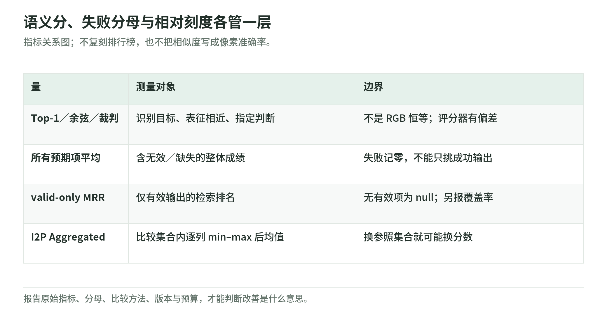

# PixelBench 02：成绩的含义，取决于指标和分母

研究日期：2026-11-04。以下是作者的实验结果与公开代码口径，不是本 Wiki 重新测到的性能。读数字时先问“比较的对象是什么”和“失败有没有进入分母”。[论文](https://arxiv.org/html/2611.02540v1)；[评测实现](https://github.com/HaoquanZhang/PixelBench/blob/c095bae7434c98e1529dea0754c5ebf61e10534f/pixelbench/evaluate.py)

## 1. 四类量，回答不同的问题

<!-- illustration: pxb-score-contracts-e5f1f8b195 -->

*图：语义分、失败分母与相对刻度各管一层。指标关系图；不复刻排行榜，也不把相似度写成像素准确率。*
<!-- /illustration: pxb-score-contracts-e5f1f8b195 -->

| 量 | 在论文里怎样使用 | 不能直接推出什么 |
| --- | --- | --- |
| 检索 Top-1 | T2P：SigLIP-SO400M 的 500-way；I2P：100 个源图候选 | 普通像素级准确率、图像全细节正确 |
| 特征余弦 | I2P 的 SigLIP pooled 表征、DINOv2-Large CLS 表征与源图比较 | 所有像素都相同、颜色完全忠实 |
| VLM 裁判 | T2P 使用 Gemini 3.5 Flash，按提示判断语义 | 无误差、无偏好的客观视觉真理 |
| 格式／单色 | 严格解析、渲染后的单色状态 | 格式通过就有语义理解 |

这些主指标更接近“对象与结构能否被识别”，不是 MSE 式逐像素保真。T2P 的 100 个目标概念也不意味着候选词表只有 100 个：主检索是 500-way。[原文指标与附录](https://arxiv.org/html/2611.02540v1)

原创直觉：两张画都有一只狗，构图、姿态或色彩不同，语义编码器仍可能觉得相近；源图每个位置的 RGB 则会相差很大。哪一种是缺点，取决于任务要的是辨认、图标化还是精确重建。

## 2. 无效输出不能悄悄消失

上游 Top-1、特征余弦和裁判主分数把无效及缺失预测记零；MRR 则只对有效输出平均，无有效项时为 null。API 错误或 token 上限截断会重试，完成但非法的结果保留。因此 MRR 与主分数不能共享一个默认分母，也不能把论文结果当作单次生产调用的成功率或费用。[评测源码](https://github.com/HaoquanZhang/PixelBench/blob/c095bae7434c98e1529dea0754c5ebf61e10534f/pixelbench/evaluate.py)；[调用流程](https://github.com/HaoquanZhang/PixelBench/blob/c095bae7434c98e1529dea0754c5ebf61e10534f/pixelbench/run.py)

原创教学例：计划四个输出，只有两个有效，分数分别为 1 和 0.5。所有预期项记零平均是 $(1+0.5+0+0)/4=0.375$；只看有效项是 0.75。数字都能算对，描述却必须不同。另报有效覆盖率 2/4，才能避免把幸存样本质量说成总体可靠性。

## 3. I2P 聚合分是相对刻度

上游先得到跨分辨率的 Top-1、SigLIP cosine、DINO cosine 三列平均值；对每列在比较集合中做 min–max，再取三列均值，乘 100。论文比较六个模型和三个八色预算的算法基线。[聚合源码](https://github.com/HaoquanZhang/PixelBench/blob/c095bae7434c98e1529dea0754c5ebf61e10534f/pixelbench/table.py)；[原文基线](https://arxiv.org/html/2611.02540v1)

$$
A_m=\frac{100}{3}\sum_{k=1}^{3}
\frac{x_{m,k}-\min_j x_{j,k}}{\max_j x_{j,k}-\min_j x_{j,k}}
$$

其中 $j$ 是本次比较的全部方法，不是某个不变的全世界基准。比较集合改变，分数可以改变；任何一列完全相同，上游会报错，不会假装得到一个有意义的范围。

原创手算：A、B、C 三方法的三列都分别为 0.2、0.4、0.6，B 得 50。新增一个三列都是 1.0 的 D，B 原始成绩仍是 0.4，聚合却变成 25。不是 B 退步，而是参照范围扩大。详见[离线实验](lab.md)。

## 4. 有哪些结果值得记住

像素理解总分中，作者报告 Astra 67.5%、Sol 39.2%、Opus 35.3%；Astra 在 PIA-only 和 Astra-I2P 两个来源分别为 57.3%、77.7%。这是十选一、指定两个来源和分辨率的结果，不是通用视觉理解百分比。[原文理解评测](https://arxiv.org/html/2611.02540v1)

理解与生成成绩的 Pearson 相关为 T2P 0.871（7 个模型）、I2P 0.930（6 个模型）。样本单位是少量模型，而不是 600 个独立模型；共同的规模、训练数据和推理设置可能同时影响两种能力。相关支持继续研究，不证明像素生成训练是提升理解的唯一原因。[原文相关分析](https://arxiv.org/html/2611.02540v1)

此页不复刻一整张排行榜，避免只记名次而忘记接口与预算。训练提升数字在[PRT 章](prt-training.md)单独列，因为它们来自另一批模型、数据和下游 benchmark。

## 5. 基线也需要同一合同

三个算法为 nearest＋median cut、SSIM-optimal＋median cut、reduced PIA。第三种组合 SLIC 区域与加权八色 k-means；它是缩减实现，而不是整个像素化领域所有方法。[算法实现](https://github.com/HaoquanZhang/PixelBench/blob/c095bae7434c98e1529dea0754c5ebf61e10534f/pixelbench/baselines.py)

教学建议：如果改变色数、源图裁剪、候选集合或评分器，就给新实验单独命名。若目标是客户图标，还应加入人类可读性、合法率、时延、费用及版权检查；这属于新的验收，不能从现有排名直接推导采购结论。

## 6. 自测与答案

1. Aggregated=80，能说 80% 图像正确吗？答：不能，它是比较集合相关的归一化聚合。
2. valid-only 平均变好，总体一定变好吗？答：否，合法覆盖率可能下降。
3. 余弦更高，是否一定更像原图每个像素？答：否，比较的是特征，而非 RGB 恒等。

下一章：[分辨率与失败](resolution-and-failure-modes.md)。返回[专题导读](README.md)。
