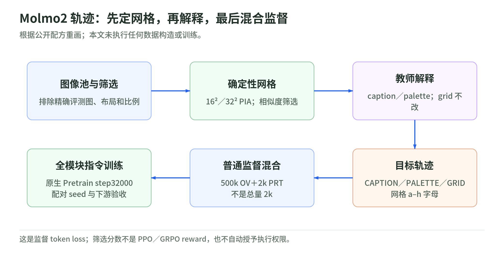
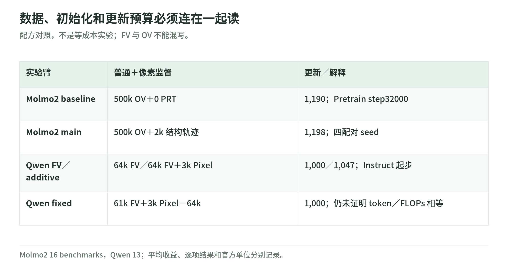

# PixelBench 04：PRT 是辅助监督，不是裁判奖励 RL

研究日期：2026-11-04。PRT（Pixel Reconstruction Tuning）把图像重建目标加入视觉后训练；Molmo2 和 Qwen3-VL 是两份不同配方。以下只解读作者结果和公开实现，没有执行训练。[论文 §4／附录 D](https://arxiv.org/html/2611.02540v1)；[训练说明](https://github.com/HaoquanZhang/PixelBench/blob/c095bae7434c98e1529dea0754c5ebf61e10534f/training/README.md)

## 1. 学习信号来自目标 token

教学直觉：图像输入先被编码，模型按监督目标预测 caption、palette 或 grid 的后续 token。标准自回归监督可以抽象为：

$$
\mathcal L_{\mathrm{sup}}
=-\sum_{t\in\mathcal A}\log p_\theta(y_t\mid x,y_{<t})
$$

$\mathcal A$ 表示有监督的答案位置，具体 mask 和打包以各 trainer 为准。这不是 PPO／GRPO：不根据在线生成样本的 VLM 裁判分数计算策略优势。用于筛选数据的相似度也不是自动变成训练 reward。[Qwen trainer](https://github.com/HaoquanZhang/PixelBench/blob/c095bae7434c98e1529dea0754c5ebf61e10534f/training/qwen.py)；[Molmo2 adapter](https://github.com/HaoquanZhang/PixelBench/blob/c095bae7434c98e1529dea0754c5ebf61e10534f/training/molmo2.py)

以下数据流程是对公开配方的机制重画，不是已经运行的数据管道。

## 2. Molmo2：先构造结构化轨迹

<!-- illustration: pxb-molmo-trajectory-56fac95c20 -->

*图：Molmo2 轨迹：先定网格，再解释，最后混合监督。根据公开配方重画；本文未执行任何数据构造或训练。*
<!-- /illustration: pxb-molmo-trajectory-56fac95c20 -->

作者从原生 **Molmo2-4B-Pretrain step32000** 起步，而不是发布的 Instruct 模型。普通监督基线有 500k LLaVA-OneVision-1.5 指令行，主实验再加 2k PRT，并使用四组配对 seed。[训练说明](https://github.com/HaoquanZhang/PixelBench/blob/c095bae7434c98e1529dea0754c5ebf61e10534f/training/README.md)

PixMo-Cap 初始池有 20k 图；剔除评测图精确匹配、过宽高比和文字密集／多面板样本，生成确定性 PIA-reduced 网格，再用源图／网格 SigLIP2 余弦筛选。16² 留前 40%、32² 留前 80%，主集合每种尺寸 1,000 图。[像素数据构造](https://github.com/HaoquanZhang/PixelBench/blob/c095bae7434c98e1529dea0754c5ebf61e10534f/training/pixels.py)

Gemini 3.8 Flash 为已定的像素目标写 caption 和 palette explanation。教师还看到原图、渲染网格、逐色 mask、人类 caption 和测量提示；它不自由重写确定性 grid。[轨迹构造](https://github.com/HaoquanZhang/PixelBench/blob/c095bae7434c98e1529dea0754c5ebf61e10534f/training/trajectories.py)

训练目标分 `<CAPTION>`、`<PALETTE>`、`<GRID>`；**Molmo2 的网格使用 a–h 字母、按八字母分块，不是生成 benchmark 的数字 JSON 接口**。palette 按使用比例排序。不能把演示里的 JSON 直接当作这份训练目标。

这里的原创教学判断是：caption 提供对象语义，palette 解释提供区域与颜色关系，grid 提供具体空间位置；三者混合可能一起贡献收益。若只想证明像素监督有效，须把 caption／解释额外监督量也控制住。

## 3. Qwen：直接重建，不加解释轨迹

Qwen3-VL 的 2B／4B／8B 从发布的 Instruct 起步。Pixel 目标由图像直接到确定性网格，不含 Molmo2 那样的 caption 与 palette explanation。[训练说明](https://github.com/HaoquanZhang/PixelBench/blob/c095bae7434c98e1529dea0754c5ebf61e10534f/training/README.md)

普通 FV 基线为 64k 样本、1,000 次 optimizer update；additive 加 3k Pixel 后为 67k、1,047 次更新。附录 fixed 控制为 61k FV＋3k Pixel，总数仍 64k、更新仍 1,000。分辨率消融固定源图 ID，各次采样内部不放回。[数据混合代码](https://github.com/HaoquanZhang/PixelBench/blob/c095bae7434c98e1529dea0754c5ebf61e10534f/training/prepare.py)

全参数包括 vision encoder 均训练，bf16、AdamW、DeepSpeed ZeRO-2；4 GPU × 每卡 batch 4 × 累积 4，effective batch=64。[trainer](https://github.com/HaoquanZhang/PixelBench/blob/c095bae7434c98e1529dea0754c5ebf61e10534f/training/qwen.py)

## 4. 两份配方和对照，要分开读

<!-- illustration: pxb-prt-controls-1cbeb78284 -->

*图：数据、初始化和更新预算必须连在一起读。配方对照，不是等成本实验；FV 与 OV 不能混写。*
<!-- /illustration: pxb-prt-controls-1cbeb78284 -->

| 项 | Molmo2 主实验 | Qwen additive／fixed |
| --- | --- | --- |
| 起点 | 预训练 step32000 | 发布的 Instruct |
| 普通监督 | 500k OV | 64k FV；fixed 61k FV |
| 像素监督 | 2k caption／palette／grid | 3k 直接 grid |
| 预算 | 1,190 → 1,198 updates | 1,000 → 1,047；fixed 1,000 |
| 评测 | 16 个 benchmark | 13 个 benchmark |

作者 Molmo2 四 seed 主均值：按官方 evaluation unit 加权 54.2→54.8，**+0.6 个百分点**；按 benchmark 等权 54.1→54.6，+0.5 个百分点。16 项中 11 改善、3 持平、2 略降。不能写成“全部能力提升”。[原文主结果](https://arxiv.org/html/2611.02540v1)

Qwen additive 的 4B：按 example 53.9→56.8（+2.9 pp），按 benchmark 53.6→57.3（+3.7 pp）。它还多了更新；附录 fixed 数据与步数控制可帮助排除一部分混杂，但部分汇总口径与主表不同，不能直接拼接原始总分。[原文附录 D](https://arxiv.org/html/2611.02540v1)

## 5. “2k”不能单独说明成本和因果

Molmo2 全模块使用原生 FSDP2 trainer，配方写明 4 节点×8 A100 80GB；这是 500k 普通监督与辅助数据一起训练的实验，不是便宜的“只学 2k 就达到新能力”。模型、环境与数据要单独获取，本文不提供一键启动脚本。[训练运行条件](https://github.com/HaoquanZhang/PixelBench/blob/c095bae7434c98e1529dea0754c5ebf61e10534f/training/README.md)

原创教学反例：100 个短回答和 100 个 64² 网格，样本数一样，但监督 token、打包效率和 FLOPs 未必接近。固定 steps 也不一定固定计算，所以公平实验应同时记账 examples、supervised tokens、updates、实际训练时间与数据来源。

官方 unit 与一道普通 question 也不总等价：MMVP 是成对题，MMBench 有循环选项，ColorBench-Robust 含重着色组，组内成员全部答对才算该 unit 正确。例均值与 benchmark 均值权重不同。[评测合同](https://github.com/HaoquanZhang/PixelBench/blob/c095bae7434c98e1529dea0754c5ebf61e10534f/EVALUATION.md)

## 6. 自测与答案

1. PRT 是否属于利用裁判 reward 的 RL？答：不是，是监督目标 token 学习。
2. Molmo2 +2k 的总训练量是否 2k？答：否，主基线还含 500k 普通监督。
3. 固定样本数与更新数是否充分控制计算？答：否，网格长度会影响 token 和实际 FLOPs。

下一章：[证据与局限](evidence-and-limitations.md)。返回[专题导读](README.md)。
