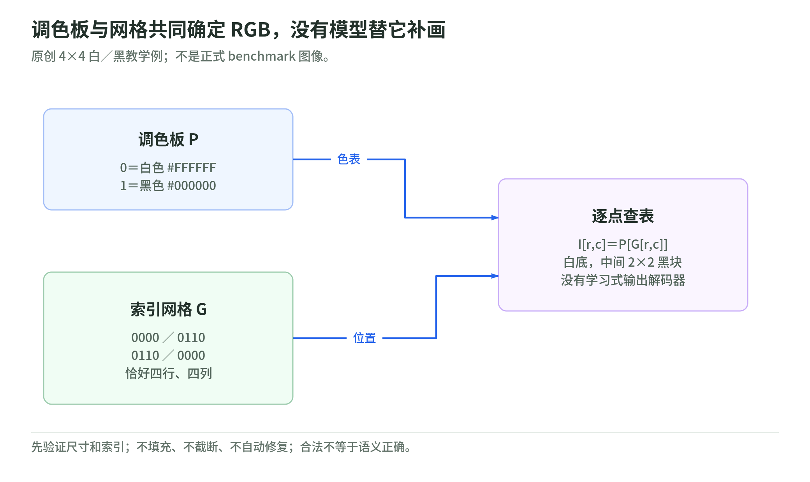
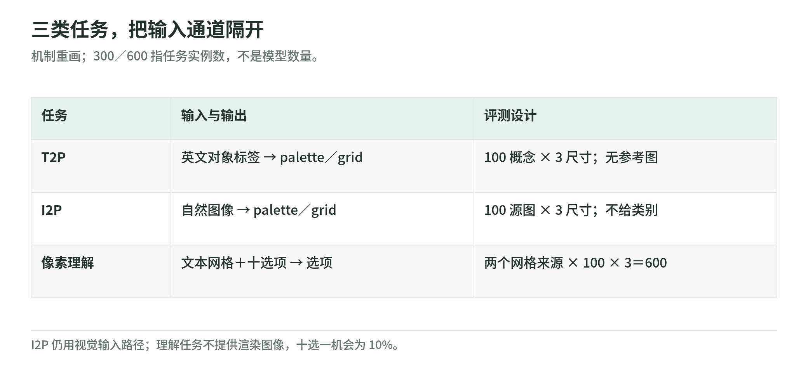

# PixelBench 01：调色板、索引网格与三类任务

研究日期：2026-11-04。先看一个完全可手算的输出契约，再看实验。示例由本 Wiki 构造，不是论文样本；正式实验的生成尺寸是 16²、32²、64²。[原文 §2](https://arxiv.org/html/2611.02540v1)

## 1. 从文字到像素，只查一张表

<!-- illustration: pxb-palette-lookup-080a84fcf0 -->


*图：调色板与网格共同确定 RGB，没有模型替它补画。原创 4×4 白／黑教学例；不是正式 benchmark 图像。*
<!-- /illustration: pxb-palette-lookup-080a84fcf0 -->

假设输出一个 4×4 的黑白方块：

```json
{"palette":["#FFFFFF","#000000"],"pixels":["0000","0110","0110","0000"]}
```

`palette[0]` 是白色，`palette[1]` 是黑色；第二行第二列的字符 `1` 选中黑色。渲染结果是白底、中间 2×2 黑块。用数学记号写：

$$
I_{r,c}=P[G_{r,c}]
$$

这里的 $P$ 是 RGB 查找表，$G$ 是整数网格，$I$ 是输出图像。没有另一个神经网络把“方块”这个概念补画出来；图错了就回到具体色号和位置。

生成契约要求 JSON 对象、2–8 个不透明 `#RRGGBB` 颜色、恰好 S 行、每行 S 个合法索引。公开解析器兼容数字字符串行和整数数组行，拒绝布尔值、越界索引和错误尺寸；不会填充、截断或自动修补。[固定版本 `format.py`](https://github.com/HaoquanZhang/PixelBench/blob/c095bae7434c98e1529dea0754c5ebf61e10534f/pixelbench/format.py)

## 2. 为什么选索引，而不是每个位置写 RGB

下面是原创教学推导：用 8 色调色板时，每个位置只需选 0–7。颜色定义放在共享表里，位置负责结构。理论上索引需要 3 bit，但 JSON 字符串并不是 3-bit 存储；LLM 的 tokenizer 还可能把连续数字组合成 token。因此，信息位数、字符数与实际生成 token 数是三个不同概念。

同理，16×16 有 256 个位置，不意味着一定花 256 个语言 token。换 tokenizer、行分隔、空格、标点，token 成本可能变化；比较延迟或费用必须真正计数。

与 SVG 对比时，可以说 SVG 的“画一个圆”是高层指令，而网格必须逐个位置落实。不能说栅格天然比矢量表示更高级：缩放、结构编辑和图标制作需要不同表示。PixelBench 用这个接口测量特定能力，而不是宣布一种表示适合所有场景。[原文研究定位](https://arxiv.org/html/2611.02540v1)

## 3. 三种任务不要混成一种

<!-- illustration: pxb-task-boundaries-46ac80f0c2 -->


*图：三类任务，把输入通道隔开。机制重画；300／600 指任务实例数，不是模型数量。*
<!-- /illustration: pxb-task-boundaries-46ac80f0c2 -->

| 任务 | 模型看到什么 | 输出什么 | 关键隔离 |
| --- | --- | --- | --- |
| T2P | 英文对象标签 | 调色板＋网格 | 没有参考图 |
| I2P | 自然图像，经视觉输入路径 | 调色板＋网格 | 不给源图的类别标签 |
| 像素理解 | 调色板＋网格的文本序列、十个选项 | 对象选项 | 不给渲染后的图片 |

T2P 使用 100 个概念；I2P 从 100 个 ImageNet 验证类别各取一张图，中心裁剪到 256²。每项都在三种输出尺寸评测，各 300 个输出／模型。理解题分别来自确定性 PIA-reduced 和 Astra-I2P，各源每个分辨率 100 题，共 600 题；十选一随机机会是 10%。[原文任务与数据](https://arxiv.org/html/2611.02540v1)

I2P 不能被描述成“LLM 只读文字就看见图”：它仍依赖输入视觉编码器。理解题的限制则很有价值：读网格时，不让额外图像输入通道替模型完成任务。

## 4. 无效、单色与语义错误分别记录

少一行：接口无效。四行都白色：接口有效，但渲染后为单色。格式正确却画成一个三角形：接口有效、有视觉结构，但语义可能错。这三种失败应分列。

两个调色板条目也可以同为 `#FFFFFF`。即使网格混写 `0` 和 `1`，RGB 渲染仍是单色。上游 `flat` 检查渲染后的 RGB，而不是只看索引是否相同。[验证与单色判断源码](https://github.com/HaoquanZhang/PixelBench/blob/c095bae7434c98e1529dea0754c5ebf61e10534f/pixelbench/format.py)

原创反例：把红与蓝在调色板中互换、同时把网格 0／1 互换，图像可以完全不变。因此，逐字符比较 JSON 会把等价图像判成不同；若要测像素差异，应先规范化或渲染。本文不声称上游用 JSON 字符差异做视觉主指标。

## 5. 任务合同怎样写

教学建议：记录输入来源、输出尺寸、调色板预算、模型版本、模板、采样设置、最大输出长度、重试规则、解析器版本、无效输出处理和评分器。保存原始输出再解析；若另有修复实验，单独报修复率、预算和修复后分数，不替换原始结果。

这份合同能帮助复现，不代表本 Wiki 已运行上游采样。真实调用还涉及数据许可、图像隐私和费用，不能把离线网格实验当作允许上传客户图像的授权。

## 6. 自测与答案

1. 网格有效但没有像目标，算哪一种失败？答：语义失败，不能删出有效输出的分母。
2. I2P 没有学习式输出 decoder，是否意味着没有视觉 encoder？答：否，输出表示与输入路径是两件事。
3. 两个色号 RGB 相同，网格混用它们，是否一定不是单色？答：仍可能单色，须检查 RGB。

下一章：[指标与结果](metrics-and-results.md)。返回[专题导读](README.md)。
