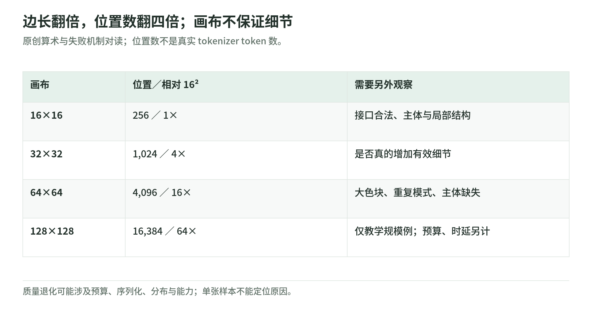

# PixelBench 03：分辨率增大，为什么不一定画得更好

研究日期：2026-11-04。作者观察到：不少模型从低分辨率升高时先改善，再在高分辨率退化；Astra 在这组实验中相对稳健。这里把观测、规模验算和机制假说分开。[原文 §3 与附录](https://arxiv.org/html/2611.02540v1)

## 1. 分辨率增长是平方，不是线性

<!-- illustration: pxb-resolution-cost-2d6c255cc1 -->

*图：边长翻倍，位置数翻四倍；画布不保证细节。原创算术与失败机制对读；位置数不是真实 tokenizer token 数。*
<!-- /illustration: pxb-resolution-cost-2d6c255cc1 -->

| 边长 S | 网格位置 S² | 相对 16² |
| --- | ---: | ---: |
| 16 | 256 | 1× |
| 32 | 1,024 | 4× |
| 64 | 4,096 | 16× |
| 128 | 16,384 | 64× |

表中是原创算术；128² 用于理解规模，不属于三种主评测分辨率。位置数不是 tokenizer 的精确 token 数，也不是 GPU FLOPs 或墙钟时延。网格编码、推理预算和错误处理会一起影响成本。

可以把它想成拼砖：边长翻倍，不仅要多放四倍砖，还得在更长的放置过程中维持同一轮廓。可放置的位置变多与模型能稳健利用这些位置，是两个不同条件。

## 2. 三种失败，看起来不一样

**有效分辨率塌缩**：要求高分辨率，但模型只输出大色块，像先画一张小图再粗暴放大。文件位置数多了，有用细节却没变多。

**局部重复破坏整体**：行或小块重复得很整齐，整体的躯干、轮廓、连接关系失去一致性。局部连续不等于全局正确。

**主体与关键结构缺失**：背景、颜色或纹理有了，对象本身、关键部件或应有关系却没有。这种错误不一定能靠增加画布修复。

这些是作者样本中的归纳，不是所有模型共有的机制证明。[原文失败模式](https://arxiv.org/html/2611.02540v1)

## 3. 序列顺序可能带来什么负担

以下是本 Wiki 的机制假说：网格沿行序列化，二维相邻位置的序列距离并不相同。左右相邻通常较近，上下同列隔着一整行。画面越大，模型越需要同时维护局部邻接与远距离结构。

假想画一个闭合方框：第一行决定顶部宽度，后面的几十行要保持两侧位置，最后一行还要闭合。某一行错位会让后续看起来“接得上上一行”却偏离最初设计。这个例子解释为什么应测全局一致性，不证明上游模型实际按这种策略思考。

同样，模型可能在高分辨率下遇到预算不足、输出长度上限、表示不熟悉或训练分布差异。这些解释彼此并不排斥；看到一张重复纹理不能直接决定哪一个原因占主导。

## 4. 怎样拆开“能力”与“预算”

原创验证计划可以设两个互补实验：

- **同推理预算**：保持采样设置和输出上限，观察扩大画布的整体代价；把截断、重试和无效结果全部记录。
- **尽量充分的输出预算**：按输出格式允许完整网格，单独测每个尺寸；同时计量真实输出 token、调用次数、时延与费用。

第一种回答“固定资源下能交付什么”，第二种更接近“这个表示能表达什么”。两种都需要固定输入图、palette budget、模板、模型版本和评分器，不能把重试后的成绩与一次调用的成绩混合。

还可以增加行列交换、块式序列化、不同数字空格编码、显式布局草稿等实验，但每一种都改变接口条件，须另报成本。这是未来假说，不是原文已完成的结论。

## 5. 高分辨率不应只看一个平均值

记录格式合法率、单色率、主体缺失率与各语义指标；检查失败是否集中在某类形状、细长部件或复杂背景。对同一输入比较尺寸，以免把样本难度变化当作分辨率效果。

若用重建作为训练辅助目标，还应检查更长网格是否导致 token 预算偏向这类数据、挤掉普通指令监督。样本比例相同不意味着梯度或计算贡献相同，这会连接到下一章的训练账本。

本文没有从论文图上重新量化失败比例，没有猜测任何闭源模型的实际隐藏推理机制，也没有运行真实模型的尺寸扫描。

## 6. 自测与答案

1. 16² 到 64²，位置增长多少？答：16×，不是 4×。
2. 输出有 4,096 个位置，是否一定有 4,096 个 token？答：否，需用实际 tokenizer 测量。
3. 更高分辨率结果下降，能单独证明模型“缺少二维理解”吗？答：不能，需排除预算、格式和分布等混杂。

下一章：[PRT 训练配方](prt-training.md)。返回[专题导读](README.md)。
