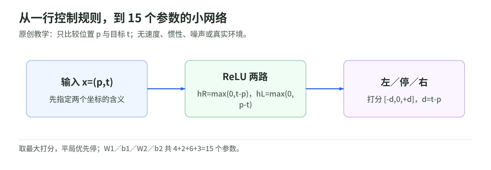

# 本地实验：手写、重排、平均与投影

研究日期：2026-11-03。[解读](weight-space-programming.md) · [专题](README.md)

本页实验由本 Wiki 原创，只用 Python 标准库，不需要 GPU、模型下载、API Key 或网络访问。它们检验小网络的代数，不复现原文的 Astra、Qwen、围棋或 MATH-500 结果。

## 运行方式

在仓库根目录：

```bash
python -B scripts/weight_space_lab.py
python -B -m unittest discover -s tests -p test_weight_space_lab.py -v
```

实现见[教学脚本](https://github.com/IanLiYi1996/learning-wiki/blob/main/scripts/weight_space_lab.py)，测试见[实验测试](https://github.com/IanLiYi1996/learning-wiki/blob/main/tests/test_weight_space_lab.py)。脚本和测试不发布到网页目录；网站保留本页的命令、公式与说明，GitHub 仓库提供源文件。

## 实验 A：把简单程序写进 15 个参数

<!-- illustration: wsp-handwritten-controller-a2778f9502 -->


*图：从一行控制规则，到 15 个参数的小网络。原创教学：只比较位置 p 与目标 t；无速度、惯性、噪声或真实环境。*
<!-- /illustration: wsp-handwritten-controller-a2778f9502 -->

任务：输入位置 `p` 与目标 `t`，输出“左、停、右”三项打分。我们已经指定坐标语义；脚本不是通过数字自动猜出含义。

第一个隐藏单元计算 `max(0, t-p)`，第二个计算 `max(0, p-t)`。输出层将它们组合成 `(-d, 0, d)`。这里用 Argmax，并规定平局优先停住；与原文游戏评测的随机动作采样不同。

先构造输出符号反向的错误版本，再按公式修正。格点是 `p,t ∈ {0,0.1,...,1}`，共 121 个组合。

预期输出：

```text
controller_parameters: 15
bugged_grid: (11, 121)
fixed_grid: (121, 121)
```

解释：错误版本恰好只在位置相等时正确。修好后覆盖全部格点，但没有模拟速度、噪声或运动过程。把它叫作“真实滑块控制成功率 100%”就超出了实验。

实际只改输出矩阵中的 4 个数，即 `4/15` 个参数；比例不是原文的 0.016%。初始参数、修改位置和目标公式都已知，不能把这个验证说成 LLM 自主发现了故障。

## 实验 B：换神经元名字，功能不变

交换隐藏单元的顺序，同时交换下一层对应输入列。输出应该不变：

```text
hidden_permutation_max_error: 0.0
```

如果只交换第一层、忘了交换第二层，这个保证就消失。可以在纸上分别写出两层矩阵，再比较前向结果。

**通过条件**：能指出为什么输出层换的是列，不是把整个输出动作顺序换掉。此例只有隐藏单元置换，不证明任意正交旋转都保持 ReLU 网络不变。

## 实验 C：两个同功能网络，平均却坏了

脚本另构造一维网络，两个版本都计算 `ReLU(x)`，只是隐藏单元次序不同。

```text
relu_at_one: 1.0
equivalent_relu_at_one: 1.0
blind_average_at_one: 0.0
```

平均把第一层抵销成零。这是坐标没有对齐的精确反例，不是实际语言模型合并实验。测试还验证：先恢复一致的隐藏单元顺序，再平均，会恢复此例的正确输出。

**通过条件**：说清参数不同、函数相同、直接平均失败，三者怎样同时成立。

## 实验 D：只投影一列，别宣称删掉全部方向

方向取 `u=(1,0)`，矩阵为 `((2,3),(4,5))`，每一列表示一种输入对输出的贡献。只处理第一列：

```text
partial_projection: ((0.0, 3.0), (4.0, 5.0))
untouched_column_direction_component: 3.0
```

第一列沿 `u` 的分量归零，第二列保持原值。代码没有寻找真实语言模型的行为方向，也不涉及改写真实模型的安全控制。

**通过条件**：能说明“选中列沿某方向的贡献减少”和“整个模型永久不会产生某行为”之间还隔着哪些证据。

## 12 道自测

1. 本课矩阵用列向量还是批量行向量记号？`W1` 的每一行产生什么？
2. 15 参数控制器为何不能只数权重、忘记偏置？
3. `p=0.8,t=0.2` 时，隐藏激活与三个输出分别是什么？
4. 这里“无需训练”是否意味着规格和初始构造都未知？
5. 禁止梯度训练，是否仍可能允许前向评测？
6. 一个输出矩阵写入某方向，是否能直接证明它是某种行为的原因？
7. 重排隐藏神经元时，为什么还需修改下一层对应列？
8. 任意旋转隐藏空间是否都能像置换一样穿过逐元素 ReLU？
9. 两个同架构、同功能网络，参数平均是否必然保持功能？
10. 本例投影第一列后，第二列沿 `u` 的贡献是多少？
11. 根据作者报告，MATH-500 从 7.9% 到 48.1%，增加多少个百分点？这证明了本 Wiki 重跑评测吗？
12. 只改少量参数，是否能省略非目标任务回归或安全评测？

## 参考答案

1. 列向量；每一行与输入做内积，再加该输出的偏置。
2. 共有 `4+2+6+3=15` 个参数；两组偏置也控制计算。
3. 激活 `(0,0.6)`，输出 `(0.6,0,-0.6)`，选左。
4. 不是；教学构造给定任务、架构与语义，并由我们手写公式。
5. 是；梯度和运行反馈是不同权限。
6. 不能；还需预测、干预和替代解释对照。
7. 下一层读取的隐藏坐标已改变；应保持同一条计算路径的含义。
8. 不是；置换只重排坐标，任意旋转一般会改变逐元素 ReLU 的作用。
9. 不保证；实验 C 的反例在 `x=1` 时从 1 变成 0。
10. 仍为 3，因为没有处理第二列。
11. 40.2 个百分点；它只是报告数字的算术，不是本 Wiki 的独立复现。
12. 不能；参数比例不等于功能影响或风险比例。

## 真正复现前，还需补什么

写一页计划，固定：原模型版本、作者日志版本、张量布局、编辑权限、练习／验证／测试划分、解码设置、样本聚合方式、推理成本，以及重建后是否与作者模型相同。

先复现不依赖大模型的矩阵关系，再决定是否承担真实模型下载和评测成本。原始结果和现有核验边界见[来源页](weight-space-programming-sources.md)；本课未执行那一层工作。
