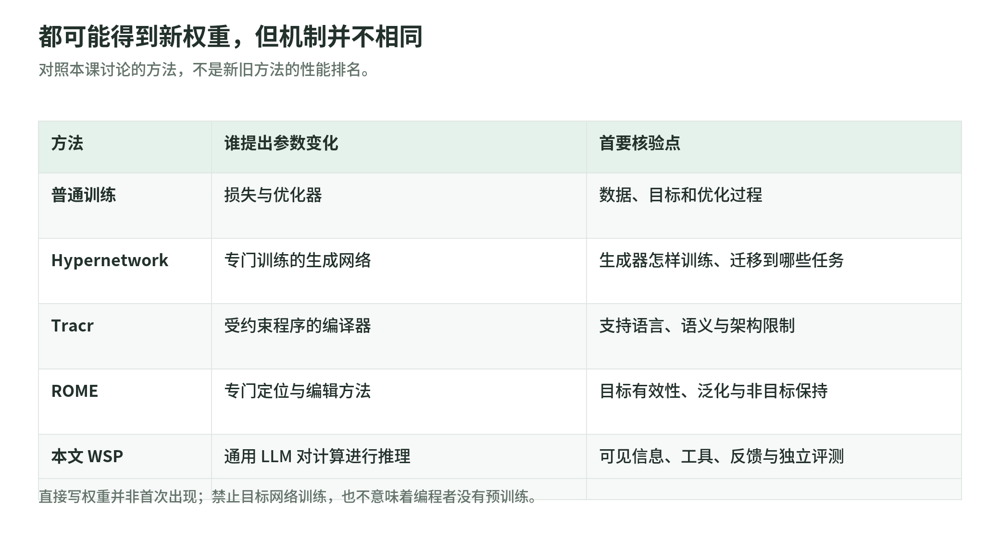
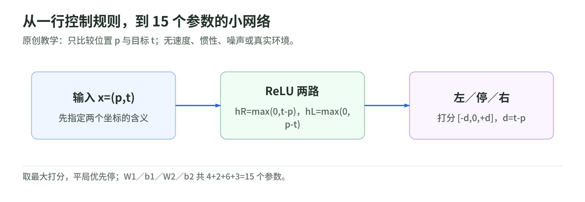
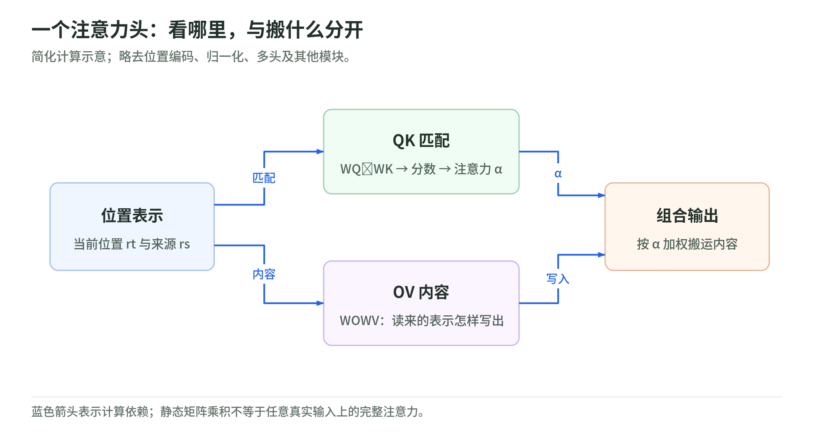
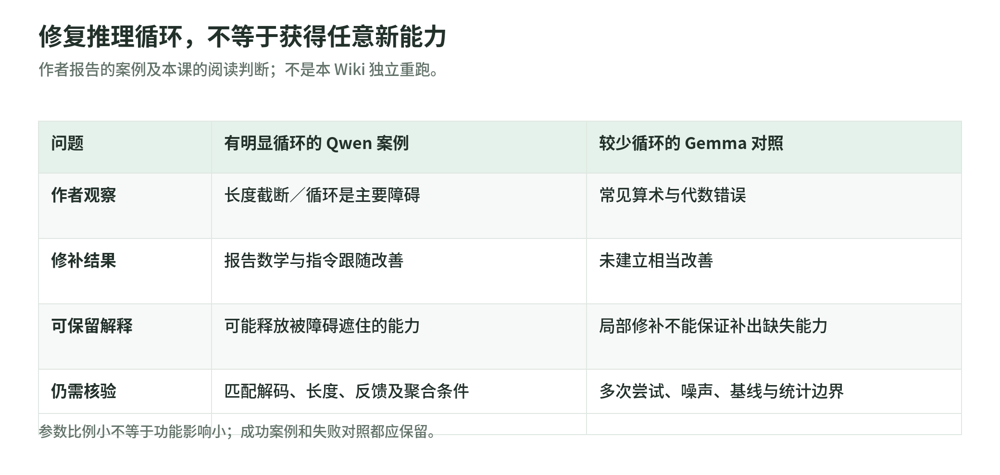
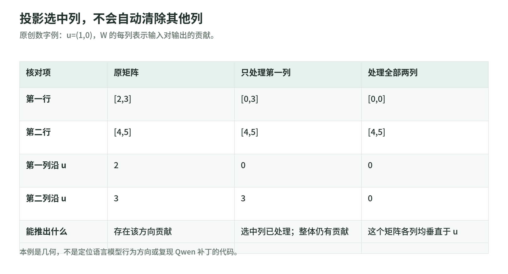
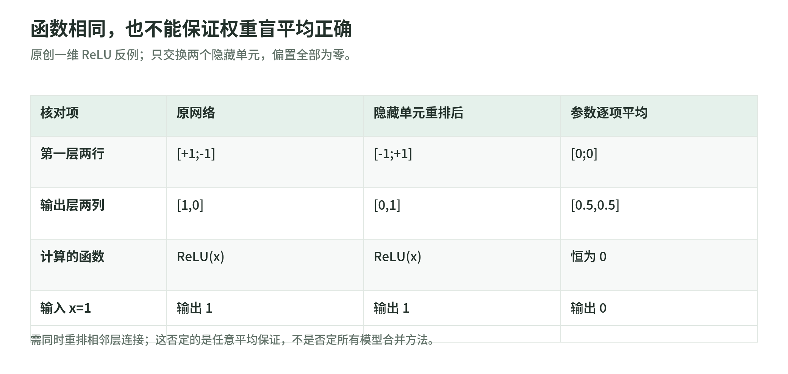
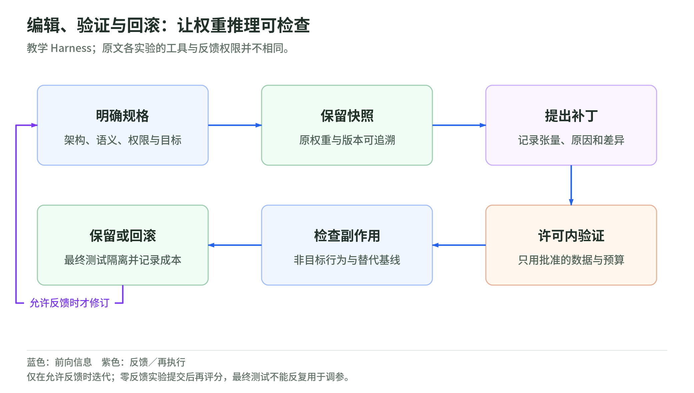

# 权重空间编程：把神经网络当作可以读写的程序

研究读取日：2026-11-03。[专题导读](README.md) · [实验与自测](weight-space-programming-lab.md) · [一手来源与边界](weight-space-programming-sources.md)

这份解读围绕研究博客 Sparks of Weight-Space Programming。一句话抓住它的主张：**让通用大模型根据任务说明，直接理解或改写另一个网络的参数，而不把修改工作交给目标网络的梯度训练。**这是作者报告的早期研究，不是“神经网络从此不用训练”的证明。[BLOG](weight-space-programming-sources.md#blog)

本课的公式、15 参数控制器及几何反例是原创教学内容，不是作者的实验网络。真实模型结果均按其来源归属；本 Wiki 没有独立重跑这些评测。

## 01 先分清：架构、权重和输入含义

<!-- illustration: wsp-computation-contract-3150c159cf -->

*图：读一串权重之前，先恢复计算契约。教学分层；数字、连接、坐标语义与运行结果是不同对象。*
<!-- /illustration: wsp-computation-contract-3150c159cf -->

把网络想成一台由许多可调部件组成的计算装置。架构告诉你部件怎样连接；权重决定具体计算；输入含义告诉你某一维是什么。只有一串数字，不能保证知道它在处理球的位置、词向量还是银行流水。

最小的两层网络可以写成：

$$
h=\operatorname{ReLU}(W_1x+b_1),\qquad
y=W_2h+b_2.
$$

这里统一用**列向量**：矩阵每一行产生一个输出维度。PyTorch 的 `Linear` 保存 `[输出维数, 输入维数]` 的权重；批量输入的接口公式常写成另一种转置形式。两种写法不能混着抄。[PyTorch Linear](https://docs.pytorch.org/docs/2.15/generated/torch.nn.Linear.html)

ReLU 是逐元素取最大值：$\operatorname{ReLU}(z)=\max(0,z)$。有了它，网络不再只是把多个线性矩阵合并成一个矩阵，也可以构造分段计算。[PyTorch ReLU](https://docs.pytorch.org/docs/2.15/generated/torch.nn.ReLU.html)

再区分三个经常混淆的数：

| 对象 | 在一次计算中扮演什么角色 |
| --- | --- |
| 权重 $W$ | 已存储的计算参数 |
| 激活 $h$ | 这次输入经过网络产生的中间结果 |
| 梯度 $\nabla_W L$ | 给定损失下，参数变化的局部影响方向 |

看到了激活，就是获得了某种运行信息；算过前向，不代表算过梯度。反过来，不做梯度下降，也不意味着没有测试、反馈或选择过程。

读一个 Checkpoint 前，至少要有参数名、形状、连接方式、激活函数、输入／输出约定、归一化与位置编码规则。本文把这套资料叫作“计算契约”，是教学整理，不是某个框架的正式格式。

## 02 新意在推理主体，不在“第一次有人写权重”

<!-- illustration: wsp-method-map-77d94826d0 -->

*图：都可能得到新权重，但机制并不相同。对照本课讨论的方法，不是新旧方法的性能排名。*
<!-- /illustration: wsp-method-map-77d94826d0 -->

先看邻近方法，才知道文章究竟把哪里往前推了一步：

| 方法 | 主要机制 | 与本题的区别 |
| --- | --- | --- |
| 普通训练 | 用数据、损失与优化器更新参数 | 通用 LLM 不必直接解释每次参数更新 |
| Hypernetwork | 一个专门的网络生成另一个网络的权重 | 原论文的生成器本身用反向传播训练 |
| Tracr | 将规定语言中的程序编译成 Transformer 权重 | 输入是受约束程序，不是任意自然语言目标 |
| ROME | 定位计算并进行结构化参数修改 | 针对事实关联编辑，有专门定位与评测方法 |
| 让 LLM 写训练代码 | LLM 改训练流程、超参数或数据处理 | 最终更新仍可能由训练算法完成 |
| 本文的 WSP | 通用 LLM 根据规格提出参数级构造或修补 | 实验中限制目标网络训练，允许的工具另行规定 |

HyperNetworks 已研究“网络生成权重”；Tracr 已实现无梯度的程序到权重编译；ROME 已研究直接修改内部计算。不能把这些历史抹去。[HyperNetworks](https://arxiv.org/abs/1609.09106v4) [Tracr](https://arxiv.org/abs/2301.05062v5) [ROME](https://arxiv.org/abs/2202.05262v5)

所以本文值得讨论的是：**一个并非为每个目标任务专门训练的通用推理模型，能否借助已有知识，识别计算机制，再生成合适的参数改动？**“通用”“直接”和“权限条件”都重要。[BLOG](weight-space-programming-sources.md#blog)

这里也允许用 Python 来构造和保存张量。禁止写训练循环，不等于禁止写代码；“从零写目标网络”更不意味着作为编程者的 LLM 没有预训练成本。

## 03 手算：15 个参数怎样变成一个控制程序

<!-- illustration: wsp-handwritten-controller-b7006f5d39 -->

*图：从一行控制规则，到 15 个参数的小网络。原创教学：只比较位置 p 与目标 t；无速度、惯性、噪声或真实环境。*
<!-- /illustration: wsp-handwritten-controller-b7006f5d39 -->

**原创教学任务**：一维轨道上的滑块位置为 $p$，目标位置为 $t$。只需决定向左、停住或向右；没有速度、碰撞、噪声和惯性。这不是游戏或机器人性能实验。

先写普通程序：若 $t>p$ 向右，若 $t<p$ 向左，相等则停。现在把同一个程序表达成网络。

输入 $x=(p,t)^T$，隐藏层采用：

$$
W_1=\begin{bmatrix}-1&1\\1&-1\end{bmatrix},
\qquad b_1=\begin{bmatrix}0\\0\end{bmatrix}.
$$

于是两个隐藏单元是 $h_R=\max(0,t-p)$ 与 $h_L=\max(0,p-t)$。它们分别表示两个方向的非负差距，不是模型从经验中“发现”的含义，而是我们指定的。

输出层按 **左、停、右** 排列：

$$
W_2=\begin{bmatrix}-1&1\\0&0\\1&-1\end{bmatrix},
\qquad b_2=\begin{bmatrix}0\\0\\0\end{bmatrix}.
$$

利用 $\max(0,d)-\max(0,-d)=d$，三个打分恰好为 $(-d,0,d)$，其中 $d=t-p$。取最大打分即可；相等时明确规定优先停住。

例如 $p=0.2,t=0.8$，隐藏激活为 $(0.6,0)$，输出为 $(-0.6,0,0.6)$，选择向右。参数数量是 $4+2+6+3=15$，偏置也算参数。

这说明一件有限但扎实的事：**已知一个简单计算规格，就能将它构造成某种网络的参数。**Tracr 的相关意义也是提供具有已知计算结构的模型，但它处理的是更完整的程序编译体系，不是这几行手算。[Tracr 论文与官方实现](https://github.com/google-deepmind/tracr)

若把输出层的左右方向符号反过来，就产生可解释的错误。我们的脚本在 121 个位置组合上，错误网络只在 11 个“位置相等”案例中正确；修正后全部正确。这只是穷举教学格点，不是泛化分数，更没有证明 LLM 自动发现了修补。

## 04 读权重：不要只盯某一个大数字

<!-- illustration: wsp-qk-ov-paths-274808b152 -->

*图：一个注意力头：看哪里，与搬什么分开。简化计算示意；略去位置编码、归一化、多头及其他模块。*
<!-- /illustration: wsp-qk-ov-paths-274808b152 -->

单个参数通常要放回计算路径才能解释。Transformer Circuits 的框架把注意力头拆成 **QK：决定关注关系** 与 **OV：决定搬运／写入的内容**，并分析头之间的组合。[Transformer Circuits](https://transformer-circuits.pub/2021/framework/index.html)

用本课列向量记号，先忽略位置编码、归一化和其他头。当前位置残差向量为 $r_t$，候选来源位置为 $r_s$：

$$
q_t=W_Qr_t,\quad k_s=W_Kr_s,\quad
q_t^Tk_s=r_t^T(W_Q^TW_K)r_s.
$$

因此 $W_Q^TW_K$ 说明两个位置的表示如何匹配。经过缩放、掩码和 Softmax，才得到实际注意力权重 $\alpha_{ts}$；只读这个乘积，不能假装已经看到了每个真实输入上的注意力分布。

内容则通过另一条路径：

$$
o_t=\sum_s\alpha_{ts}(W_OW_V)r_s.
$$

$W_OW_V$ 帮助理解读来的表示会写成什么。QK 和 OV 同样是矩阵，却回答不同问题。上述关系只是说明部分结构可分析，不是一个完整现代 Transformer 的等价实现。

“归纳头／Induction Head”通常指能利用前文重复模式延续序列的注意力机制。一个头看向上一位置，后面的头又使用这种信息进行匹配，可能构成有意义的组合。静态参数分析可以提出这个假设；对应输入、激活和干预才能进一步检验它。[Transformer Circuits：Induction Heads](https://transformer-circuits.pub/2021/framework/index.html#induction-heads)

读懂简单、结构化路径是有价值的。把一段听起来合理的推理直接升级成“完整理解所有隐藏层”，则跨过了证据边界。

## 05 八个实验：先读权限，再读输赢

<!-- illustration: wsp-observation-budgets-e6d18c8573 -->

*图：无梯度、无前向、无反馈：三个不同限制。原文实验权限的学习分类；详细协议仍需查对应实验与日志。*
<!-- /illustration: wsp-observation-budgets-e6d18c8573 -->

下面只保留原文各实验最关键的性质；精确设置与日志核验见[实验权限矩阵](weight-space-programming-sources.md#experiments)。这些都是作者报告，不是本 Wiki 的独立重跑。

| 实验 | 研究问题 | 阅读时最该保留的条件 |
| --- | --- | --- |
| 1 游戏识别 | 权重能否透露策略任务？ | 同构网络，仍提供网格与动作语义 |
| 2 形状识别 | 权重能否透露生成内容？ | 不允许运行，轮廓解释不等于完整生成行为 |
| 3 字符模型 | 中间层能否透露训练文本特点？ | 可静态 Python 分析，不允许输入前向 |
| 4 控制修补 | 能否修正失败策略？ | 已给场景和一次失败轨迹 |
| 5 游戏策略构造 | 能否从规格直接写策略？ | 给规则与源码；编辑前无环境试跑 |
| 6 围棋策略构造 | 规模与反馈预算怎样影响结果？ | 工具写参数，另设前向反馈预算 |
| 7 迎合行为识别 | 能否区分两种语言模型行为？ | 纯权重失败；放宽到注意力观测后成功 |
| 8 数学模型修补 | 能否改善真实小语言模型？ | 允许练习数据、前向评分与中间激活，不允许梯度训练 |

**阅读判断**：没有候选游戏名称，仍不等于没有任务先验；没有梯度，仍可能有行为反馈；不看生成输出，仍可能看到了运行产生的注意力。它们不是坏实验，而是不同问题，不能合并成“所有实验都只看几个数字”。

另一种常见混读是将若干成功网络、尝试次数或评测回合，当成广泛任务分布上的可靠性估计。复现时应记录选择了哪些任务、多少网络和种子、失败尝试如何计入，以及比较双方的权限是否一致。原文发布日志让这些问题更可查，但可查不等于已查完。[LOGS](weight-space-programming-sources.md#logs)

本次日志核对还发现两处读结果的细节：实验 1 的 Freeway 被答为 Frogger，评分按同类交通穿越游戏接受；实验 3 的复制头标签在博客与评分字段采用了不同阈值。这些不自动推翻实验，但“精确命名全部正确”或“标签完全一致”需要比正文口号更细的定义。[具体评分边界](weight-space-programming-sources.md#logs)

## 06 Qwen 案例：消除障碍，不一定是增加能力

<!-- illustration: wsp-repair-vs-capability-2ac3966c13 -->

*图：修复推理循环，不等于获得任意新能力。作者报告的案例及本课的阅读判断；不是本 Wiki 独立重跑。*
<!-- /illustration: wsp-repair-vs-capability-2ac3966c13 -->

原文最醒目的例子，是对 Qwen3.5-0.8B 的局部修补。作者报告 MATH-500 从 7.9% 到 48.1%，同时循环／触及长度上限明显减少；也报告对较少循环的 Gemma 小模型没有得到已建立的相当改善。[QWEN 与失败对照](weight-space-programming-sources.md#qwen-results)

这是理解标题的关键：修复“总在推理中绕圈、无法交卷”，可能释放已有解题能力；它与教会模型本来不会的代数，是两个命题。失败对照限制了“只要改权重就能增加任意能力”的解释。

作者记录的补丁在第 15、19 层 MLP 各覆盖 64 个输出列；这是带结构的局部改动，不是随机挑选全网络的一小撮数字。覆盖量为 131,072 项，但最终 bf16 保存后的实际位模式变化是 130,188 项：部分变化经舍入后与原值相同。覆盖范围、最终数值差异和行为影响须分别记录。[编辑清单核验](weight-space-programming-sources.md#qwen-results)

按名义规模计算，$131{,}072/800{,}000{,}000\times100\%\approx0.016384\%$。从 7.9% 到 48.1% 则增加 **40.2 个百分点**。这是对报告数字的算术，不是本课重新测到的性能，也不是实际精确参数总数的审计。

本次公开记录核对能对上 MATH-500 的每版 500 题、每题 4 次生成，即 2,000 份答案，正确数 158→962；计分是全部样本的平均准确率，不是 Pass@4。双方使用相同的作者采样协议。它仍不同于说采用了模型卡的默认解码设置。[评分与官方设置的区别](weight-space-programming-sources.md#qwen-results)

研究判断应继续问：

- 修改是否减少长度截断，从而让评分器终于读到答案？
- 提高长度上限、改变解码设置等非权重基线能做到多少？
- 多次样本怎样聚合，平均正确率是否被误读成“多试几次有一次正确”？
- 非数学任务、其他随机种子和新的问题分布是否仍获益？

这些是建议的对照，不是声称作者没有做过任何对应检查。精确已有检查要逐项查日志。

还要分清“50 次前向预算”的计数单位：批量评测调用不等于仅看 50 道题；输入条数、生成 Token 和工具运行都应另计。CPU 上编辑张量也不能据此推导整个实验“没有推理计算成本”。

更重要的是，Qwen 的练习服务还返回隐藏状态、MLP 激活和其他评分信息。因此“编程者能读写权重”成立，不代表“诊断只依靠静态权重”。对照 Gemma 的规模、思考模式、长度上限和答案抽取也不同，不能把它当成只改变“是否循环”一个变量的严格配对实验。[实验权限与对照边界](weight-space-programming-sources.md#experiments)

因此能带走的稳妥判断是：**这是一例值得核验的针对性修补；它不是一般数学能力提升算法的证明。**已有外部执行者重建并重评编辑 checkpoint，但编辑版评测 500 题、基线仅 25 题；这不等于重新复现编辑发现过程或完整配对评测。本 Wiki 也未执行这类模型重评。[CHECKPOINT RELEASE](weight-space-programming-sources.md#checkpoint-release)

## 07 权重几何：小比例、投影和坐标对齐

### 一条方向可以影响许多输出

<!-- illustration: wsp-partial-projection-0456a481a5 -->

*图：投影选中列，不会自动清除其他列。原创数字例：u=(1,0)，W 的每列表示输入对输出的贡献。*
<!-- /illustration: wsp-partial-projection-0456a481a5 -->

先看纯线性代数。设 $u$ 是输出空间的单位向量，一个权重矩阵列 $w_j$ 可拆成沿 $u$ 的分量与垂直分量：

$$
w_j=u(u^Tw_j)+\left[w_j-u(u^Tw_j)\right].
$$

对**选中的列**减去第一项，就删除这些列沿该方向的贡献。若所有列都处理，写成 $W^{\prime}=(I-uu^T)W$；若只处理集合 $S$，其余列保持原样，不能直接宣称 $u^TW^{\prime}=0$。

例如本课令 $u=(1,0)^T$，$W=\begin{bmatrix}2&3\\4&5\end{bmatrix}$。只处理第一列得到 $W^{\prime}=\begin{bmatrix}0&3\\4&5\end{bmatrix}$，第二列仍沿 $u$ 写入 3。脚本检查的就是这个反例。

这是理解“方向级修补”的几何直觉，不是原文 Qwen 修改的逐代码复现，更不是找出真实模型行为方向的通用方法。相关工作研究过方向级行为机制；本课仅介绍概念，不提供绕过真实模型安全控制的操作。[相关方向研究](https://arxiv.org/abs/2406.11717v3)

参数比例也不直接等于功能影响范围：某个矩阵改变的信号，仍会经过后续层和许多输入。需要行为回归，不能用“改得少”替代安全证明。

### 神经元重排之后，功能可以不变

<!-- illustration: wsp-permutation-average-225341ee46 -->

*图：函数相同，也不能保证权重盲平均正确。原创一维 ReLU 反例；只交换两个隐藏单元，偏置全部为零。*
<!-- /illustration: wsp-permutation-average-225341ee46 -->

对逐元素 ReLU，两层网络隐藏单元的置换可写成：

$$
W_1'=PW_1,\quad b_1'=Pb_1,\quad W_2'=W_2P^{-1}.
$$

因为 $\operatorname{ReLU}(Pz)=P\operatorname{ReLU}(z)$，输出保持不变。这是对本课架构的精确推导，**不是任意旋转都能穿过 ReLU**。

构造一维网络：$W_1=(1,-1)^T$，$W_2=(1,0)$，偏置为零，输出是 $\max(0,x)$。交换两个隐藏单元，并同时交换输出层对应列，仍是同一函数。

但将两个版本逐元素平均，第一层变成零，输出恒为零。在 $x=1$ 时，两个原模型都输出 1，平均模型却输出 0。这个反例表明，参数相似度、功能相似度和坐标对齐不是同一个问题。

它没有证明所有模型合并都失败；它只否定“同架构、同功能就可以任意平均”的保证。原文的跨架构移植展望还需另外解决接口、维度和表示语义，不能从这组成功案例直接推出。

## 08 怎样把“解释很像”升级成可信证据

可以把证据按问题分成四层，而不是按叙述是否漂亮评分：

| 层 | 看到了什么 | 仍然缺什么 |
| --- | --- | --- |
| 描述 | LLM 说某组权重像某个机制 | 描述与真实计算的一致性 |
| 预测 | 用描述预测未给出的行为 | 可能只是相关性或可利用的先验 |
| 干预 | 只改提出的部件，行为按预测改变 | 随机改动、替代机制及副作用对照 |
| 稳健性 | 新输入、重排、新种子仍支持机制 | 不能因此覆盖所有分布与部署环境 |

ROME 的项目说明明确把因果追踪、编辑后有效性、表达泛化和非目标事实保持分开评估。它说明“有内部解释”之后，还能怎样验证；并不替本文完成了验证。[ROME 项目说明](https://rome.baulab.info/)

本课建议做的读权重对照包括：去掉文件名提示；交换隐藏单元；改变输入通道名称；固定任务描述；加入相同架构的不同任务网络。这些是研究设计建议，结果可能支持或推翻原假设，都应该记录。

写权重则检查目标效果、非目标行为、改动范数、随机等规模补丁以及跨种子稳定性。平均性能提高，也不能保证每个样本提高。没有梯度的信息泄漏，不代表没有评测集泄漏。

最后，作者材料、他人重建、独立复现和同行评审是不同证据类型。任何一类都不能仅凭“开源了”自动补齐其他几类。

## 09 一个可检验的 Harness 应该约束什么

<!-- illustration: wsp-validation-loop-53ffecd428 -->

*图：编辑、验证与回滚：让权重推理可检查。教学 Harness；原文各实验的工具与反馈权限并不相同。*
<!-- /illustration: wsp-validation-loop-53ffecd428 -->

Harness 在这里指包住研究代理的工具、权限、记录与评测流程。下面是本课的教学设计，不是作者系统的完整实现。

首先分两个主体：**提出参数改动的 LLM**与**被读取／编辑的目标网络**。禁止目标网络训练，不等于编程 LLM 未经过训练。它们的参数、数据、工具权限和成本分开记录。

| 层 | 至少要记录或控制 |
| --- | --- |
| 任务契约 | 架构、输入语义、参数布局、禁止事项 |
| 权重工作区 | 原始快照、允许修改的张量、版本与差异 |
| 工具权限 | 是否允许 Python、前向、激活、梯度、搜索 |
| 数据隔离 | 编辑用训练／练习集、验证集、最终测试集分开 |
| 预算 | 工具调用、样本、Token、生成长度、推理耗时分别统计 |
| 验证与回滚 | 保留原权重，检查目标和非目标行为，失败可恢复 |

“可修改张量白名单”要由可信执行层限制，不能只写在给 LLM 的提示里。对禁止梯度的实验，还需检查实际代码和工具行为；一句“我没有训练”不是审计记录。

并非每次都允许循环反馈。零反馈构造时，应先提交最终权重，再由独立评测执行；允许验证反馈时，可以迭代，但最终测试不应变成反复调参的奖励信号。

本地教学脚本不承担这套真实研究系统的权限隔离。它只验证明确给定的小网络与代数关系；复现真实实验的权限与评测实现，应回到作者代码逐项检查。[LOGS](weight-space-programming-sources.md#logs)

## 10 读完之后：三句话与下一步

第一，**参数可以表示可构造的计算**。这不是说所有训练后的参数都容易阅读，而是简单程序能够被表达成网络。

第二，**可读、可修、可从零写是三种能力**。某个任务的成功，不能自动代替另一个任务的证据；静态权重、激活与行为反馈也必须分开。

第三，**修补阻碍，不等于凭空获得能力**。要看失败对照、匹配条件、未参与编辑的测试和非目标回归，而不只看一个醒目的提升百分比。

接下来先完成[本地实验与 12 道自测](weight-space-programming-lab.md)，再从[一手来源页](weight-space-programming-sources.md)读原始协议。

若进一步做研究，可以分别追问：低反馈条件下，结构化参数分析是否优于等预算黑盒试错？同一机制在重排和新种子下是否成立？局部修补能否保持不相关任务？这些是待设计的研究问题，不是本篇已解决的结论。
