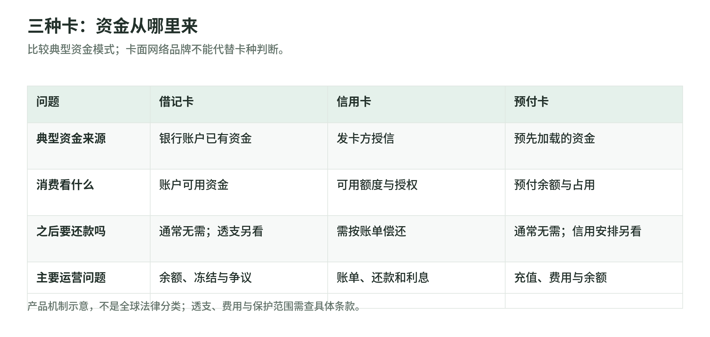
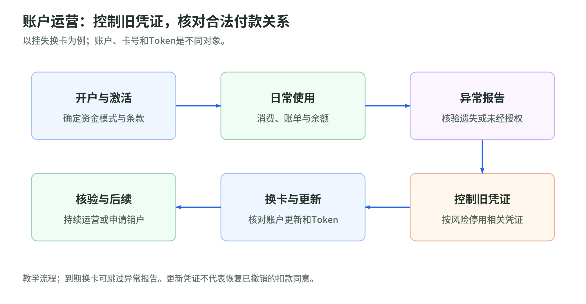

# 13 卡产品与账户运营：刷的是谁的钱，换卡后谁继续负责

买同一杯咖啡，三张外观相似的卡可能做三件不同的事：花银行账户里的钱、借发卡方的钱，或花提前充值的钱。卡面品牌告诉你可能走哪个受理网络，却不能直接回答资金从哪里来。本章先拆资金，再看账单和换卡；金额均为教学假设，美国消费者资料和欧盟法规各有适用边界。

导航：[专题](../README.md) · [主干](../payment-industry-101.md)

## 一、先问资金来源，再问卡长什么样

<!-- illustration: payment-ext-card-funding-d91646e155 -->

*图：三种卡：资金从哪里来。比较典型资金模式；卡面网络品牌不能代替卡种判断。*
<!-- /illustration: payment-ext-card-funding-d91646e155 -->

借记卡通常连接持卡人的银行账户，消费使用账户已有资金；信用卡使用授信，持卡人之后偿还；预付卡通常先把钱装入预付账户，再消费。借记或预付产品也可能附带透支安排，不能简单宣布“永远不会欠钱”。这些是资金机制，不是靠塑料卡、虚拟号码或手机界面识别的分类。[CFPB：三种卡的区别](https://www.consumerfinance.gov/ask-cfpb/what-is-the-difference-between-a-prepaid-card-a-credit-card-and-a-debit-card-en-433/)

假设三种卡都付了100元：借记卡要看银行账户可用资金，信用卡要看剩余授信，预付卡要看已加载余额。三者可能共享受理网络，但用户的还款义务不同。产品评审可以固定问四件事：谁提供消费资金、钱记在哪个账户、何时减少可用金额、用户是否需要还款。不能因为屏幕都显示“余额”，就把这几个数当成同一种资产。

## 二、信用卡的账单、还款、利息和额度

先分清四个数：当前余额包含已入账欠款；账单余额是某次账期结算的金额；最低还款额是当期最低付款要求；可用额度是还能使用的授信。尚未入账的授权也可能占额度，所以“账单没出现”不等于这笔交易没有影响。[Capital One：在途交易与额度](https://capitalone.com/help-center/credit-cards/card-pending-transactions/)

账期结束和还款到期不是同一天。有免息宽限期且满足条件的产品，按期全额偿还可避免购买交易利息；最低还款并不等于全额还款。CFPB也提醒，未全额偿还可能失去宽限期，新购买可能从交易日起计息，现金预借通常另有规则。这是美国消费者说明，不能推广成所有国家、所有卡的统一条款。[CFPB：宽限期](https://www.consumerfinance.gov/ask-cfpb/what-is-a-credit-card-grace-period-en-47/)

假设额度5000元，已入账2000元，另有500元在途占用且无其他调整，可用额度约2500元。再假设账单2000元、最低还款200元：只还200元后仍欠1800元。若另假设已失去免息、这1800元持续30天、年率18%、按365天简单计息且无其他费用，利息约26.63元。这不是账单计算承诺；真实产品还要看每日余额、费用、不同交易利率和还款分配条款。

## 三、预付充值不是借到一笔信用

充值是把资金加载到预付账户，不是发卡方给用户新增授信。有的卡可重复充值，有的不可充值；注册状态也可能影响功能。不要把礼品卡、工资卡和所有预付卡的保护范围混成一套。CFPB的美国说明中，礼品卡与受预付规则覆盖的账户就有差别。[CFPB：选择预付卡](https://www.consumerfinance.gov/consumer-tools/prepaid-cards/choose-the-right-card/)

假设用户充值500元，成功入账后买了80元商品，无费用、无其他占用，教学余额为420元。运营系统仍应分别记录充值请求、到账确认和消费：收到“充值申请”不能直接加可花余额，这是防止账与钱脱节的设计建议。评估产品还要查充值、取现、换卡等费用，以及余额债务人和资金保障安排；不能仅凭卡上有网络标志就保证所有用途和权利相同。

## 四、三方与四方，不等于闭环与开放

典型四方模型的四类关系是持卡人、发卡方、商户和收单方，网络连接并制定规则；三方模型中，卡组织本身提供发卡和收单服务。这里数的是角色关系，不是一次API调用经过几台服务器。欧盟2015/751法规还有特定法律口径：三方体系许可其他服务商发卡或收单，或者存在规定的联名、代理安排时，可按四方体系看待。[欧盟2015/751：第1、2条](https://eur-lex.europa.eu/eli/reg/2015/751/oj/eng)

“开放/闭环”则应先声明语境。本章在预付受理范围语境使用：开放型可在接受相应网络的商户使用，闭环型限某个商户、商户群或交通系统。它回答“哪里能花”，不是“谁兼任发卡与收单”。[CFPB：开放型与闭环型预付卡](https://www.consumerfinance.gov/consumer-tools/prepaid-cards/choose-the-right-card/)

因此，本章把角色结构与受理范围当作两条分析轴；行业有时把三方网络也俗称“闭环”，那是另一个用法，不代表它只能在自营门店消费。研究某个品牌时，应核对具体市场的发卡、收单及合作关系，不能用品牌名替代当地合同，更不能把欧盟交换费法规的分类直接当作全球定义。

## 五、账户生命周期：挂失、换卡与Token更新

<!-- illustration: payment-ext-card-account-lifecycle-48988bb028 -->

*图：账户运营：控制旧凭证，核对合法付款关系。以挂失换卡为例；账户、卡号和Token是不同对象。*
<!-- /illustration: payment-ext-card-account-lifecycle-48988bb028 -->

账户、实体卡、卡号和钱包Token不是同一个对象。发现遗失或未经授权交易，要及时联系发卡方并按其流程停用、换卡和申报争议；不要等账单结算后才报告。CFPB对美国信用卡与借记卡的责任和报告时限分别说明，本文不复制成全球承诺。[CFPB：卡数据泄露后的处理](https://www.consumerfinance.gov/consumer-tools/bank-accounts/watch-accounts-closely-when-card-data-is-hacked/)

换卡不必然终止原有付款关系。Visa Account Updater允许参与方交换新卡号、到期日、账户关闭或联系持卡人等信息；是否有更新取决于发卡方、收单方、商户参与情况，也存在退出与停止更新安排。不要假设所有订阅都会断，也不要保证全部自动续接。[Visa：Account Updater](https://developer.visa.com/capabilities/vau)

EMV支付Token替代PAN，并可限定设备、商户或使用场景；它与商户数据库中的一般令牌不是同一种东西。Token也有控制与替换能力，因此运营不能只更新“新卡号”一个字段。[EMVCo：Payment Tokenisation](https://www.emvco.com/emv-technologies/payment-tokenisation/)

建议把换卡处理拆成核验账户状态、控制旧凭证、发出替换凭证、处理更新通知、核对钱包与商户凭证、持续检查账单。安全挂失与正常到期换卡的目标不同；恢复合法续费，不能顺便恢复已撤销的商户扣款许可。

## 六、易错点：把三个“结束”分开

还了最低额，不表示不再计息；授权撤销，不表示已完成退款；换了卡，不表示已取消合同。前者由账单和利息条款判断，中间要查原交易是否已请款，后者要确认商户收到取消指令。核对时应分别查看账务、支付凭证和服务合同，不只问“卡还能不能刷”。

还有一个常见误会：额度是可借范围，不是用户存款；预付余额是已加载资金，也不应自动叫作银行存款。三方、四方、开放、闭环四个词则必须写清比较维度。这样才能解释“同一张卡为什么能用，却不适合这次交易”。

## 七、自测与参考答案

1. 假设最低还款已付，但账单未还清，能保证没有利息吗？
2. 换卡后某订阅仍扣费，是否必然说明旧卡还有效？
3. 预付卡只能在某商户群使用，能直接推断它采用三方模型吗？

参考答案：1. 不能；要查宽限期、剩余欠款和交易计息条款。2. 不能；可能是参与方更新了账户凭证或Token，应同时核对续费同意和更新记录。3. 不能；受理范围与发卡、收单的角色分工是不同问题。回答时说明证据来自哪个对象，比只报一个术语更重要。

## 公开一手来源

| 标题 | URL | 读取日 | 适用边界 |
|---|---|---|---|
| CFPB — How are prepaid cards, debit cards, and credit cards different? | [官方原文](https://www.consumerfinance.gov/ask-cfpb/what-is-the-difference-between-a-prepaid-card-a-credit-card-and-a-debit-card-en-433/) | 2026-11-02 | 美国消费者教育；资金机制说明，不代替各地产品条款。 |
| CFPB — What is a grace period for a credit card? | [官方原文](https://www.consumerfinance.gov/ask-cfpb/what-is-a-credit-card-grace-period-en-47/) | 2026-11-02 | 美国信用卡宽限期说明；不保证每种产品均有免息。 |
| Capital One — Understanding pending credit card transactions | [官方原文](https://capitalone.com/help-center/credit-cards/card-pending-transactions/) | 2026-11-02 | 该发卡方账户运营说明；不移植具体入账时限。 |
| CFPB — Choose the right card for your situation | [官方原文](https://www.consumerfinance.gov/consumer-tools/prepaid-cards/choose-the-right-card/) | 2026-11-02 | 美国预付及礼品卡语境；开放/闭环指受理范围。 |
| Regulation (EU) 2015/751 | [官方原文](https://eur-lex.europa.eu/eli/reg/2015/751/oj/eng) | 2026-11-02 | 欧盟卡交易交换费法规，第1、2条；法律分类不视为全球统一。 |
| CFPB — Watch accounts closely when card data is hacked | [官方原文](https://www.consumerfinance.gov/consumer-tools/bank-accounts/watch-accounts-closely-when-card-data-is-hacked/) | 2026-11-02 | 美国未经授权交易保护说明；不同卡种与报告时限有别。 |
| Visa — Visa Account Updater Overview | [官方原文](https://developer.visa.com/capabilities/vau) | 2026-11-02 | Visa参与方服务及退出、停止更新机制；不是全网络自动保证。 |
| EMVCo — EMV Payment Tokenisation | [官方原文](https://www.emvco.com/emv-technologies/payment-tokenisation/) | 2026-11-02 | 网络支付Token技术概念；具体生命周期按产品和网络实现。 |
