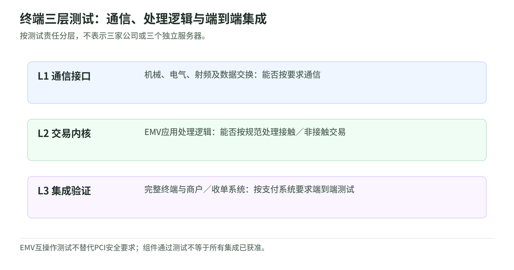
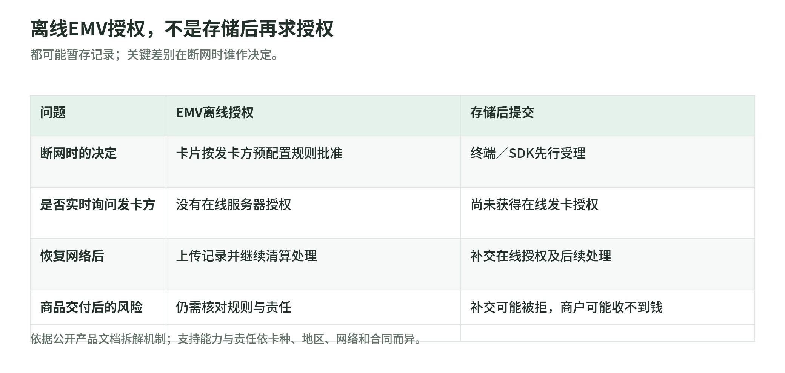

# 14 线下与离线支付：终端说成功，银行一定批准了吗

饭店断网，收银员仍然给你一张“支付成功”的小票，这句话可能代表两种不同的承诺：芯片按规则批准了交易，或商户先放行、联网后再问发卡方。理解线下支付，不能只看刷卡动作；还要问终端读到了什么、谁作出决定、决定发生在何时。本章用公开标准与服务商文档解释边界，示例并非真实交易。

导航：[专题](../README.md) · [主干](../payment-industry-101.md)

## 一、POS、EMV芯片和NFC各做什么

POS可以指整个销售收银系统，支付终端是其中负责受理凭证的部分。插卡通过接触式接口与芯片通信；挥卡、手机或手表靠近终端，可通过NFC完成非接触式EMV通信。NFC是近距离通信能力，不能单凭“手机支持NFC”推导它已具备合规受理能力。[EMVCo：L1与L2说明](https://www.emvco.com/news-publications/what-are-emv-level-1-and-level-2-testing/)

把流程拆成读卡与应用处理、持卡人验证、授权决策、后续请款对账，会比一句“刷卡成功”更清楚。芯片、密码及授权不是同一件事；即使验证了持卡人，仍需按产品与场景决定是否放行。尤其要分清非接触与离线：靠近终端是交互方式，是否联网批准是决策方式，不能从挥卡动作推断其中任何一项。

## 二、L1、L2、L3：三层测试回答不同问题

<!-- illustration: payment-ext-terminal-certification-a76a0b81ec -->

*图：终端三层测试：通信、处理逻辑与端到端集成。按测试责任分层，不表示三家公司或三个独立服务器。*
<!-- /illustration: payment-ext-terminal-certification-a76a0b81ec -->

L1主要看卡或设备与受理设备间能否按要求通信，包括机械、电气、射频等接口。L2主要看处理EMV交易的软件逻辑，常称内核：信息交换后是否按规范处理。硬件能读到芯片，不代表软件已经正确处理交易。[EMVCo：L1与L2](https://www.emvco.com/news-publications/what-are-emv-level-1-and-level-2-testing/)

L3关注完整终端与商户、收单或银行系统的端到端集成，验证部署所需的支付系统要求。EMVCo提供测试框架和工具资格机制，具体支付系统的测试要求仍需核对；不是“拿到一个全球L3证书，所有收单机构都能直接用”。[EMVCo：终端集成测试框架](https://www.emvco.com/news-publications/emvco-encourages-domestic-payment-systems-to-use-terminal-integration-testing-framework/)

采购与升级时，建议分别确认读卡硬件、内核版本、支付应用、收单接入及适用测试证据。组件通过测试，不自动覆盖组合后的所有行为；更换软硬件或连接方式，应向相应受理伙伴确认是否需重新验证。三层不是三家公司，也不是三笔支付费用，而是不同的检查边界。

## 三、SoftPOS让手机受理，也需要安全边界

SoftPOS或TapToMobile让商户利用兼容手机受理非接触支付，无需一定外接读卡器。这里手机是商户收款设备，不是消费者付款钱包；两端都叫“手机支付”，职责却完全不同。[EMVCo：受理设备与TapToMobile](https://www.emvco.com/news-publications/what-are-emv-level-1-and-level-2-testing/)

通用手机同时运行很多应用，受理方案需要考虑设备完整性、应用环境及敏感数据保护。PCI MPoC针对商用现成设备上的移动受理安全，覆盖可组合的支付受理与消费者验证方式；它不能被当作EMV互操作测试的替代品，也不能仅凭一个NFC开关就宣布满足要求。[PCI SSC：MPoC](https://www.pcisecuritystandards.org/standards/mobile-payments-on-cots-mpoc/)

具体方案支持哪些手机、卡种、验证方式和离线能力，还需查产品文档。例如Adyen的移动方案支持范围与专用终端不同，其文档明确移动方案不支持离线EMV。不要把某款POS上的功能直接迁移到所有SoftPOS。[Adyen：离线能力限制](https://docs.adyen.com/point-of-sale/offline-payment)

## 四、离线授权与存储后提交是两种模式

<!-- illustration: payment-ext-offline-modes-eeee654d96 -->

*图：离线EMV授权，不是存储后再求授权。都可能暂存记录；关键差别在断网时谁作决定。*
<!-- /illustration: payment-ext-offline-modes-eeee654d96 -->

EMV离线授权，是卡片在发卡方预先配置的规则下与终端交互并作出批准决定；不是此刻通过网络向发卡服务器实时查询。后续仍要上传记录并清算。支持与否取决于卡片、网络、地区和终端设置，不能默认任何芯片卡都支持。[Adyen：Offline EMV](https://docs.adyen.com/point-of-sale/offline-payment)

存储后提交，即store-and-forward，是终端或SDK在尚未获得在线发卡授权时先接受交易，保存所需资料，联网后再提交。后续请求可能被拒，此时商品可能已交付。二者都会保存记录，却不能因此视为相同的授权机制；“能存交易”不等于“芯片已经批准”。[Stripe Terminal：离线受理后补交](https://docs.stripe.com/terminal/features/operate-offline/overview)

还要分清离线PIN与离线授权。离线PIN说明在哪里核对密码，不能独自证明资金已获批，更不能证明商户已到账。集成设计应保留离线模式、终端交易标识、补交状态与最终支付状态，而不是把临时受理结果永久写成已结算。

## 五、离线承诺的风险与恢复纪律

服务不中断的代价，是商户可能在拿到资金前交货。Stripe Terminal明确把其离线补交失败和防篡改等风险交给商户；Adyen另注明个别地区、卡种存在安排差别。这些属于具体服务边界，不是全球每种离线交易都有相同保证或责任。[Stripe：离线风险](https://docs.stripe.com/terminal/features/operate-offline/overview)；[Adyen：地区例外](https://docs.adyen.com/point-of-sale/offline-payment)

假设一家咖啡店自行规定每笔最多100元、每台最多暂存20笔，它的教学暴露上限约2000元，尚未计算其他损失。这是经营者自定假设，不是卡组织统一限额。建议同时控制累计金额、断网时长和未补交笔数，高价值商品可暂停离线受理。

恢复后先核对暂存笔数，再按原交易标识跟踪补交和最终结果，避免收银员见不到云端记录就另开一笔扣款。Adyen的离线响应可能没有云端PSP参考号，联网后的通知才能补足映射；对账必须能从本地交易走回最终记录。恢复网络也不等于全部补交成功。[Adyen：离线交易对账](https://docs.adyen.com/point-of-sale/offline-payment)

## 六、酒店预授权示例与易错点

假设酒店、收单方案和卡种都支持预授权调整：入住时估计房费与杂费合计1800元，先获得预授权；住宿中发生200元额外消费，申请增加获批额度；退房最终消费2000元，再完成请款。预授权用于预留可用资金或额度，不是酒店已经收到1800元现金。[Adyen：酒店预授权流程](https://docs.adyen.com/point-of-sale/pre-authorisation)

假设住客改用其他方式结账，应按流程取消原预授权，而不是再请款一次。若授权调整未成功，不要把增加的金额当作已获批；授权还会到期，期限和调整资格依网络、行业、卡种和发卡方而异，本文不指定统一天数。[Adyen：限制与取消](https://docs.adyen.com/point-of-sale/pre-authorisation)

易错点是把预授权当成充值、把小票当到账证明、把终端离线受理当发卡方在线批准。酒店这个例子说明“金额尚未确定”如何处理，不表示它一定发生在断网状态；预授权和离线是两个独立维度。

## 七、自测与参考答案

1. 芯片离线核对PIN成功，是否等于发卡服务器实时批准？
2. 存储后提交交易补交被拒，商品已交付，风险是否自动消失？
3. 酒店预授权1800元，最终请款2000元，能省略支持性与调整结果检查吗？

参考答案：1. 不等于；验证位置、授权方式和最终资金结果不同。2. 不会；要按适用合同与网络规则处理拒绝和损失。3. 不能；必须核对业务支持、有效授权额度、调整结果及有效期。三题共同要求是查清“谁在什么时点承诺了什么”。

## 公开一手来源

| 标题 | URL | 读取日 | 适用边界 |
|---|---|---|---|
| EMVCo — What are EMV Level 1 and Level 2 Testing? | [官方原文](https://www.emvco.com/news-publications/what-are-emv-level-1-and-level-2-testing/) | 2026-11-02 | 标准制定组织说明，2025年更新；具体产品与审批流程另核。 |
| EMVCo — EMVCo Encourages Domestic Payment Systems To Use Terminal Integration Testing Framework | [官方原文](https://www.emvco.com/news-publications/emvco-encourages-domestic-payment-systems-to-use-terminal-integration-testing-framework/) | 2026-11-02 | L3职责及框架说明；不是所有网络共用的单一终端许可。 |
| PCI SSC — Mobile Payments on COTS (MPoC) | [官方原文](https://www.pcisecuritystandards.org/standards/mobile-payments-on-cots-mpoc/) | 2026-11-02 | 通用设备受理安全标准；合规项目由支付品牌管理，不代替EMV测试。 |
| Adyen — Offline payments | [官方原文](https://docs.adyen.com/point-of-sale/offline-payment) | 2026-11-02 | Adyen终端与移动方案的模式、限制、风险和对账；地区及卡种有例外。 |
| Stripe — Operate offline | [官方原文](https://docs.stripe.com/terminal/features/operate-offline/overview) | 2026-11-02 | Stripe Terminal先收集后补交的机制与商户风险；不代表所有EMV离线授权。 |
| Adyen — Pre-authorization and authorization adjustment | [官方原文](https://docs.adyen.com/point-of-sale/pre-authorisation) | 2026-11-02 | Adyen支持场景；调整能力、有效期及获批取决于网络、行业和发卡方。 |
