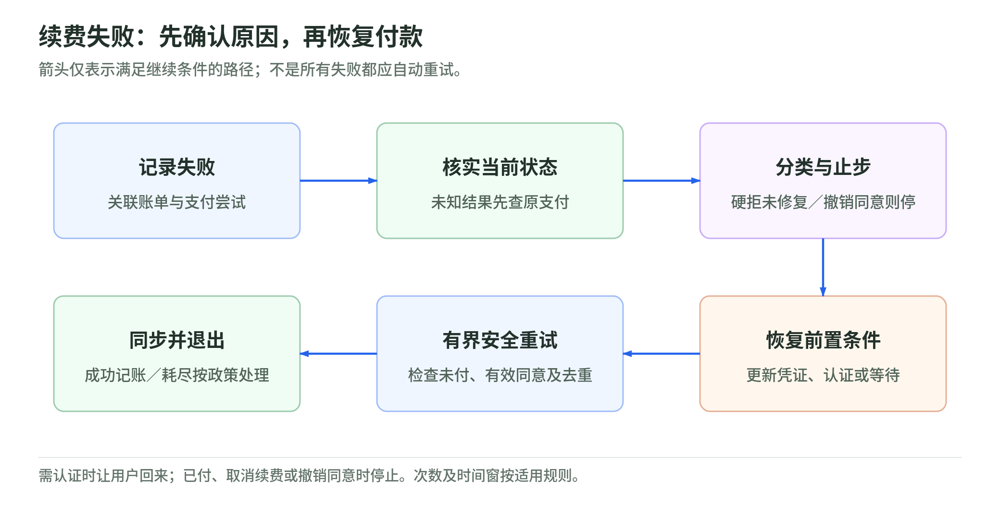

# 15 周期扣款：同意、账单、支付与失败恢复

视频会员每月自动续费，看起来只是一声通知，后台却要分别回答：用户还允许扣吗、这月应收多少、卡能不能付、失败后下一步怎么办。把这些都压进“订阅有效”一个开关，就容易重复扣款或取消后继续续费。本章以银行卡周期扣款为主；银行账户扣款有自己的授权与退回规则，不能照搬。

导航：[专题](../README.md) · [主干](../payment-industry-101.md)

## 一、CIT、MIT与用户同意

CIT是持卡人主动参与发起的交易，例如点击购买，即使使用存卡也可能是CIT。MIT是商户在用户未主动参与本次交易时，依据既有授权或前次交易关系发起，例如月度续费。分类看触发人与依据，不看是否由后端发送API。[Visa Acceptance：CIT/MIT](https://developer.visaacceptance.com/docs/vas/en-us/credentials/developer/ctv/rest/credentials/credentials-intro.html)

保存卡片和允许自动扣费是两个问题。应明确用户同意的用途、金额或计算方式、时间频率、取消政策，并保留同意记录。只同意“下次结账时显示这张卡”，不能推导出同意任何商户离线自动收费。[Stripe：保存与未来使用的同意](https://docs.stripe.com/payments/save-and-reuse)

后续MIT还要按受理伙伴要求标识并关联原交易；同一卡号可以支持不同账单协议，不应只记一份笼统许可。MIT也不全是固定月费，迟延收费、增量授权等需要各自的依据。[Visa Acceptance：关联与类型](https://developer.visaacceptance.com/docs/vas/en-us/credentials/developer/ctv/rest/credentials/credentials-intro.html)

## 二、订阅、账单与支付必须分开

订阅描述套餐、周期和服务关系；账单描述本期应收项目与金额；支付描述某次收款尝试和结果。账单已生成不等于钱已收，订阅显示有效也不保证所有历史账单已付。Stripe分别用Subscription、Invoice和PaymentIntent建模，而且不同收款方式会出现不同状态组合。[Stripe：订阅生命周期](https://docs.stripe.com/billing/subscriptions/overview)

假设云服务月费50元，本月另有20元用量费，账单应收70元。第一次支付失败，账单仍欠70元；恢复支付应关联这张账单，而不是再造一张70元的新账单。这是教学模型，未考虑税费与抵扣。服务是否宽限、暂停或降级，应独立执行约定的权益策略，不能让页面加载完成自动代表支付成功。

建议保存剩余应收、尝试标识和当前权益；支付结果改变账单，账单再影响服务，既能表达“宽限中但未付”，也能防止回调与重试重复收款。

## 三、SCA边界：范围之外与豁免不是同义词

SCA（Strong Customer Authentication，强客户认证）关心认证要求，不是商户自动扣款的许可证。判断续费时，先确认用户同意及交易类型，再看适用认证规则。

在欧盟PSD2语境下，EBA发布的欧委会部门解释性问答区分：有有效委托且无需付款人再次触发、仅由收款方发起的后续交易，可不落入该次SCA要求；但远程建立这种委托本身需要SCA。用户点击购买的存卡交易，不能靠改标MIT绕过认证。[EBA：2018_4031](https://www.eba.europa.eu/single-rule-book-qa/qna/view/publicId/2018_4031)

另一个概念是重复交易豁免。欧盟2018/389第14条要求同金额、同收款人的系列，在创建、修改或首次发起时使用SCA，之后符合条件的交易可不再次应用。它不是所有可变金额订阅的普遍豁免，也不同于真正收款方发起交易的范围分析。[欧盟2018/389：第14条](https://eur-lex.europa.eu/legal-content/EN/TXT/HTML/?uri=CELEX:32018R0389)

这不是全球自动续费法，应查司法辖区、交易结构及适用规则；问答也不具备法律约束力。即使具备MIT依据，仍可能要求用户回来认证；后台不能代替用户完成挑战。[Stripe：用户认证](https://docs.stripe.com/billing/subscriptions/overview)

## 四、换卡后账户更新，不代表同意更新

换卡、到期会让保存的凭证过时。Visa Account Updater可向参与商户提供新卡号、到期日、账户关闭或联系持卡人的通知，但它不保证覆盖每张卡、每个商户，也不能保证更新后的交易获批。[Visa：Account Updater](https://developer.visa.com/capabilities/vau)

更新的是支付账户信息，不是给商户新增服务合同或复活已撤销的许可。恢复前应检查订阅、同意和欠款状态，再确认更新落到了续费实际使用的默认支付方式上。Stripe特别提醒，订阅级默认方式与客户级默认方式有优先级区别；只更新后者可能仍重试旧方式。[Stripe：重试支付方式优先级](https://docs.stripe.com/billing/revenue-recovery/smart-retries)

## 五、续费失败恢复：分类、修复，再安全重试

<!-- illustration: payment-ext-recurring-recovery-6fe0dd196d -->

*图：续费失败：先确认原因，再恢复付款。箭头仅表示满足继续条件的路径；不是所有失败都应自动重试。*
<!-- /illustration: payment-ext-recurring-recovery-6fe0dd196d -->

soft decline通常指条件改变后可能恢复的拒绝，例如暂时无法联系发卡方，或需要补充认证；hard decline强调不能原样持续重试，例如卡已遗失、被盗或授权撤销。标签不是全球固定字典，要结合通道拒绝码、建议码和适用重试规则。未知原因不能擅自解释成余额不足。[Stripe：拒绝码及下一步](https://docs.stripe.com/declines/codes)

特别注意，Stripe的自动账单重试把`authentication_required`也列在不能自动重试的代码中。它不代表永远无法支付，而是需要改变前置条件：让用户完成认证等恢复动作。soft并不等于后台可以盲目重发，hard也不等于永远禁止使用新的合法付款方式。[Stripe：自动重试与禁止代码](https://docs.stripe.com/billing/revenue-recovery/smart-retries)

建议按六步恢复：记录失败、核对账单与现有支付、分类并识别停止条件、恢复凭证或认证条件、按批准的次数和时间窗重试、同步账单与权益。若用户撤销同意、续费已取消，或硬拒原因未解决，应停在分类阶段；需要认证就通知用户回来；余额或可用性问题也要遵守通道建议，不能高频撞库式尝试。

网络超时属于“结果未知”，不能先假设未扣到钱。先查询原支付或等待可信通知；同一API操作的网络重发使用相同幂等键。已确认失败后另作一次业务尝试，则按API语义建立新尝试，仍绑定同一账单；不能永久复用一个缓存失败结果的键。Stripe的API v1会保存已执行请求结果并在相同键重发时返回它。[Stripe：幂等请求](https://docs.stripe.com/api/idempotent_requests)

假设70元账单首次因需要认证失败，用户回来完成认证并支付后，立即终止该账单后续重试，更新付款记录与权益。若结果未明确，则保留待核查状态。重试耗尽后如何暂停或催收属于产品政策；应预先告知并有退出路径，不是支付失败就无限扣下去。

## 六、取消与易错点：停止续费不等于退钱

取消订阅决定未来服务与续费何时结束；退款是处理已成功支付的资金。假设用户本月已付50元，选择月底取消，通常表达“不再续下一期”，并不自动撤销这笔50元；若需退还，要依据合同及适用法律另走退款或账务调整。Stripe取消界面也分别提供取消时间与退款选项。[Stripe：取消与退款](https://docs.stripe.com/billing/subscriptions/cancel)

取消时还要核对未付账单、用量费用和已经排队的重试。不能认为改一个订阅状态就自动完成全部账务清理，也不能把停用卡片当作正式取消服务。客服确认应写清生效日、未来扣费是否停止、已收款是否退款、既有欠款如何处理；这些是不同答案。

## 七、自测与参考答案

1. 用户点击“用已保存的卡再买一次”，必然是MIT吗？
2. 收到要求认证的拒绝，可以只在后台每分钟重试吗？
3. 用户取消下月续费，本月已付金额会自动退款吗？

参考答案：1. 不是；主动触发的存卡购买通常是CIT。2. 不可以；先引导用户完成认证，再按规则处理，并核对是否已支付。3. 不会自动成立；取消生效与已收款退款应分别确认。三题都在检查同意、业务状态与支付状态是否被错误合并。

## 公开一手来源

| 标题 | URL | 读取日 | 适用边界 |
|---|---|---|---|
| Visa Acceptance Solutions — Introduction to Credentialed Transactions | [官方原文](https://developer.visaacceptance.com/docs/vas/en-us/credentials/developer/ctv/rest/credentials/credentials-intro.html) | 2026-11-02 | CIT/MIT及凭证协议关联；具体处理字段依处理商与网络支持。 |
| Stripe — Save a customer’s payment method without making a payment | [官方原文](https://docs.stripe.com/payments/save-and-reuse) | 2026-11-02 | Stripe存卡与未来扣费集成说明；法律及卡网络要求仍由商户核对。 |
| Stripe — How subscriptions work | [官方原文](https://docs.stripe.com/billing/subscriptions/overview) | 2026-11-02 | Stripe对象、状态与认证恢复；不是所有平台通用的状态机。 |
| EBA — 2018_4031 Applicability of SCA to card payments initiated by the payee only | [官方原文](https://www.eba.europa.eu/single-rule-book-qa/qna/view/publicId/2018_4031) | 2026-11-02 | 欧委会部门非约束性解释，由EBA于2019年发布；非全球法律意见，需核后续法律变化。 |
| Commission Delegated Regulation (EU) 2018/389 — Article 14 | [官方原文](https://eur-lex.europa.eu/legal-content/EN/TXT/HTML/?uri=CELEX:32018R0389) | 2026-11-02 | 原始公布文本中重复交易豁免条款；仅据此解释机制，实施需核修订及本地适用。 |
| Visa — Visa Account Updater Overview | [官方原文](https://developer.visa.com/capabilities/vau) | 2026-11-02 | 参与方账户更新服务；不重新授予商户扣费许可。 |
| Stripe — Stripe decline codes | [官方原文](https://docs.stripe.com/declines/codes) | 2026-11-02 | Stripe归一化代码及建议；不可当作所有发卡网络的统一拒绝码。 |
| Stripe — Automate payment retries | [官方原文](https://docs.stripe.com/billing/revenue-recovery/smart-retries) | 2026-11-02 | Stripe自动账单重试、停止代码和默认方式优先级；不沿用其次数作为全球规则。 |
| Stripe — Idempotent requests | [官方原文](https://docs.stripe.com/api/idempotent_requests) | 2026-11-02 | Stripe请求去重语义；文中缓存失败说明限定API v1，不保证无限期去重。 |
| Stripe — Cancel subscriptions | [官方原文](https://docs.stripe.com/billing/subscriptions/cancel) | 2026-11-02 | Stripe取消、尾款和退款功能；消费者权利由合同及适用法律另定。 |
