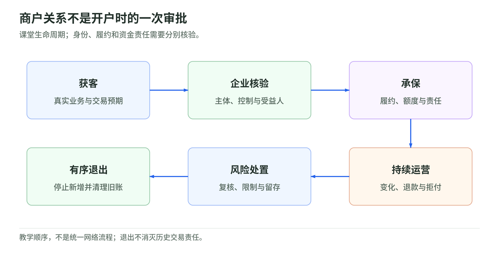
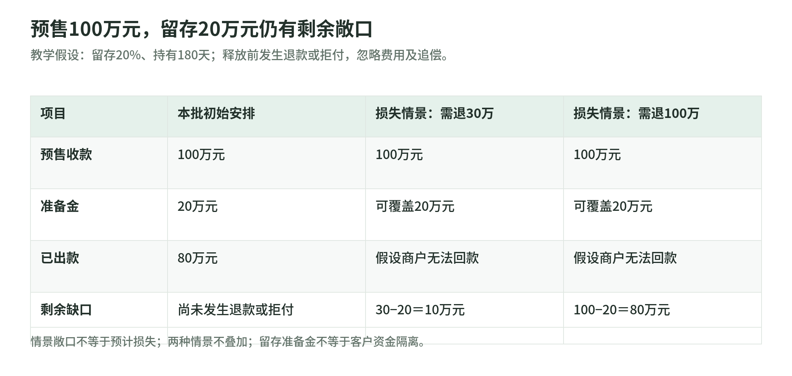

# 16 商户生命周期：从获客到退出

[专题](../README.md) / [主干](../payment-industry-101.md)

研究读取日：2026-11-02。本章是公开资料支持的课堂框架，不是开户承诺、全球统一承保政策或法律意见；金额和比例均为教学假设。

## 从获客到 KYB：先知道为谁收钱

<!-- illustration: payment-ext-merchant-lifecycle-5ffabb57b5 -->

*图：商户关系不是开户时的一次审批。课堂生命周期；身份、履约和资金责任需要分别核验。*
<!-- /illustration: payment-ext-merchant-lifecycle-5ffabb57b5 -->

销售问“这家店能带来多少交易”，运营还要问“它是谁、卖什么、谁控制它、钱付给谁”。课堂上把商户关系拆成获客、核验、承保、运营、风险处置、退出六步；增长目标不能代替后面五步的责任。

KYB 是企业身份与业务核验的常用简称。营业执照只能证明某个主体存在，不能单独解释股权链、实际控制人、经营活动和账户用途。FATF 第10项建议将客户身份、受益所有人、关系目的和持续尽调放在一起；受益所有人关注最终拥有或控制主体的自然人，不能直接拿联系人或登记股东名单替代。[FATF Recommendations，第10项与术语表](https://www.fatf-gafi.org/content/dam/fatf-gafi/recommendations/FATF%20Recommendations%202012.pdf.coredownload.inline.pdf)

白话例子：甲公司申请收款，却展示乙公司的店铺、要求结算给丙。不能只检查三个名字有没有拼错，应让申请方说明代理、集团或销售关系并提供证据。哪些信息必须收集、何时简化或加强核验，由适用地区、主体身份和风险决定；FATF 是国际标准，不是直接对所有 PSP 生效的一张材料清单。

## 承保与 MCC：核验通过不等于可以放量

支付承保不是给商户买保险，而是判断是否接受其交易与后续损失风险。身份真实的旅行社也可能经营失败；客户付款真实，也可能因未履约而拒付。OCC 的商户处理手册讨论营业历史、财务状况、销售记录、履约和拒付风险，要求银行按风险设置准入与审批。本章借用分析方法，不将美国银行检查要求外推为所有 PSP 的法定义务。[OCC Merchant Processing](https://www.occ.treas.gov/publications-and-resources/publications/comptrollers-handbook/files/merchant-processing/pub-ch-merchant-processing.pdf)

MCC 是商户类别代码，不是“安全评分”。类别信息要与实际商品、销售渠道和业务说明匹配；同一类商户也有不同交付周期、客单价和资金实力。教学承保记录应说明营业模式、禁限业务判断、预计交易量、预售比例、交付时点及损失承担者。把一家预售半年后服务的店与即时交货的店放进同一限额，只看类别就漏掉了时间风险。

审批结果也应有条件：先给多大规模、何时复核、出款周期如何设置、谁能批准例外。教学上将销售提交资料与风险审批分开，避免“已经谈好费率”变成放行理由。

课堂还可用一张责任卡衔接岗位：销售负责收集说明，核验人员解释身份疑点，承保人员决定风险条件，运营人员跟踪变化，财务人员核对留存与出款。每次交接留下依据、未解决问题和下一次复核时间。这个设计没有指定行业统一组织架构，只是让“资料有人看过”变成“具体问题有人负责”。

## PayFac 与子商户：便利入口不消除责任

Mastercard 将 PayFac 定义为由收单机构注册、代表子商户便利交易的服务提供者。因此，“平台能分账”并不足以证明它处于这一网络安排；应核对收单关系、注册、子商户合同和适用规则。[Mastercard：Find a payment facilitator](https://www.mastercard.com/gb/en/business/support/payment-facilitators.html)

课堂责任表可分三层：子商户解释真实业务并履约；PayFac 按安排完成接入、管理及风险工作；收单机构承担其网络关系下的义务。具体职责可能委托执行，不能从品牌或一个 API 推断全部转移。

再问“负余额落在谁身上”。Stripe Connect 文档区分平台自身余额与连接账户余额，并说明退款、拒付造成的负余额责任取决于支付类型和集成配置。这个实例提醒我们：子商户有独立账户，不代表平台绝不承担损失；服务商承担某类风险，也不代表平台自身交易免责。[Stripe：Risk and liability management with Connect](https://docs.stripe.com/connect/risk-management)

## 持续监控：看业务有没有变样

开户只是建立初始假设。课堂监控按商户跟踪交易量、客单价、退款、拒付、交付延迟、账户变更及所有权变化，并与承保时声明比较。销售突然翻倍可能是正常促销，也可能让未交付订单快速堆积，不能只凭增长或一条告警定性。

白话例子：原来卖现货家具，后来改为收订金、三个月后交货。即使公司名称没变，信用敞口也变了。教学处置链是告警、补充证据、复核额度与出款安排、记录决定、再观察；异常调查不等于自动认定欺诈。FATF 的持续尽调与 Stripe 对交易风险、账户风险的区分，分别支持身份行为审视和损失能力审视，二者不应压成同一个分数。[FATF 第10项](https://www.fatf-gafi.org/content/dam/fatf-gafi/recommendations/FATF%20Recommendations%202012.pdf.coredownload.inline.pdf)、[Stripe Connect](https://docs.stripe.com/connect/risk-management)

监控练习可再按收款批次列出已交付、待交付、已退款、争议中四类金额，避免只盯最新一个月的销售额。待交付订单从十万元增到一百万元，即使暂时没有拒付，情景敞口也会改变。反过来，一笔争议不能简单除以刚缩小的当天交易量就判定全店失控；课堂应先统一观察窗口、分子分母和订单范围，再解释变化。

## 滚动准备金：预售敞口的金额例子

<!-- illustration: payment-ext-merchant-reserve-34f10807f1 -->

*图：预售100万元，留存20万元仍有剩余敞口。教学假设：留存20%、持有180天；释放前发生退款或拒付，忽略费用及追偿。*
<!-- /illustration: payment-ext-merchant-reserve-34f10807f1 -->

滚动准备金通常按每批新交易留存一部分，在约定持有期后逐批释放，用来应对潜在退款或争议等风险；比例、期限和调整条件依服务商安排而异，不存在本章可给出的统一标准。[Stripe：Reserves – Frequently asked questions](https://support.stripe.com/questions/reserves-frequently-asked-questions)

假设商户本批收到100万元预售款，三个月后履约；约定留存20%、持有180天，忽略全部费用、其他余额和追偿。本批准备金20万元，出款80万元。若释放前发生互不重复的退款或拒付合计30万元，准备金只能覆盖20万元，仍缺10万元；若全部100万元需退还且商户不能回款，缺口为80万元。它们是情景敞口，不是预计必然损失。

预售纠纷可能围绕未来交付事件发生，所以不能把付款后经过若干天当作责任自动结束。Stripe 的争议文档提示未来服务场景可能有不同计时起点；具体期限必须核对网络和交易情形。[Stripe：How disputes work](https://docs.stripe.com/disputes/how-disputes-work)

滚动准备金也不同于客户资金隔离：前者围绕商户风险及出款安排，后者围绕资金权利和机构破产时的保护。英国 FCA 说明适用支付及电子货币机构可以按规定采用隔离或保险、担保等保护方式；“扣住20%”不能证明其余资金已合规保护，也不能证明该20%的法律地位。[FCA：Safeguarding requirements](https://www.fca.org.uk/firms/emi-payment-institutions-safeguarding-requirements)

做金额练习时，应逐批记录留存日、拟释放日、已扣款和剩余余额；不要把今天留的新准备金当成旧批次已经安全履约的证明。本例也没有把退款与同一交易的拒付算两次，更没有把留存额当作服务商收入。

## 限制结算与退出：关入口不等于结清责任

限制应写清对象：延迟商户出款、降低额度、追加准备金、停止新支付，是不同动作。暂停出款并不自动暂停新收款；新订单继续增加时，旧风险未必缩小。Stripe Connect 的控制能力依风险责任配置而异，不能假设每个平台都能操作同样按钮。[Stripe Connect 风险与责任](https://docs.stripe.com/connect/risk-management)

教学退出清单包括停止新增、处理未履约订单、保留合法所需的争议证据、对清账款、依合同及适用规则复核剩余准备金和最后出款。应记录决定理由、授权者和复核条件。解约不是删除旧交易，更不是保证以后不会出现退款、拒付或追偿。

## 自测与参考答案

1. 有执照且受益所有人已核验，能否直接提高预售额度？
2. 本例留存20万元、退款或拒付30万元，缺口多少？是否已完成资金隔离？
3. 子商户银行已收到出款，平台能否关闭账户后不再管争议？

参考答案：

1. 不能；还需审视履约、财务能力、交付时间和风险责任。
2. 缺10万元；留存比例本身不能证明资金保护安排。
3. 不能据此推断；历史交易责任须按网络、合同和集成配置处理。

## 公开一手来源与适用边界

| 标题 | URL | 读取日 | 适用边界 |
| --- | --- | --- | --- |
| FATF Recommendations：第10项、受益所有人定义 | [官方文本](https://www.fatf-gafi.org/content/dam/fatf-gafi/recommendations/FATF%20Recommendations%202012.pdf.coredownload.inline.pdf) | 2026-11-02 | 读取到的PDF封面为2025年10月更新；用于基础尽调概念，不声称是2026完整最新版或统一PSP开户清单 |
| OCC Comptroller’s Handbook: Merchant Processing | [官方手册](https://www.occ.treas.gov/publications-and-resources/publications/comptrollers-handbook/files/merchant-processing/pub-ch-merchant-processing.pdf) | 2026-11-02 | 美国银行监督与商户处理框架；不是全球非银行PSP规则 |
| Mastercard: Find a payment facilitator | [官方定义](https://www.mastercard.com/gb/en/business/support/payment-facilitators.html) | 2026-11-02 | Mastercard网络下注册及角色定义；具体义务仍需核对网络规则 |
| Stripe: Risk and liability management with Connect | [官方文档](https://docs.stripe.com/connect/risk-management) | 2026-11-02 | Connect配置、交易类型及责任示例；不代表所有PayFac模式 |
| Stripe: Reserves – Frequently asked questions | [官方说明](https://support.stripe.com/questions/reserves-frequently-asked-questions) | 2026-11-02 | 服务商准备金机制；本章20%、180天均为假设 |
| Stripe: How disputes work | [官方文档](https://docs.stripe.com/disputes/how-disputes-work) | 2026-11-02 | 主要为卡争议；期限、费用和其他支付方式须分别核对 |
| FCA: Safeguarding requirements for payment institutions and electronic (e-money) institutions | [官方指引](https://www.fca.org.uk/firms/emi-payment-institutions-safeguarding-requirements) | 2026-11-02 | 英国适用机构及相关资金；不能将准备金等同隔离或全球统一保障 |
