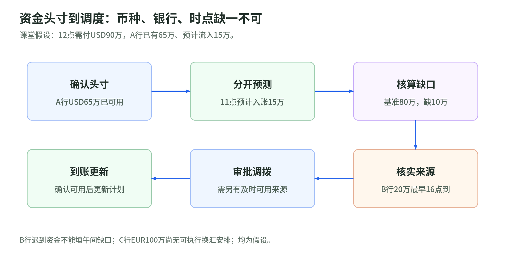
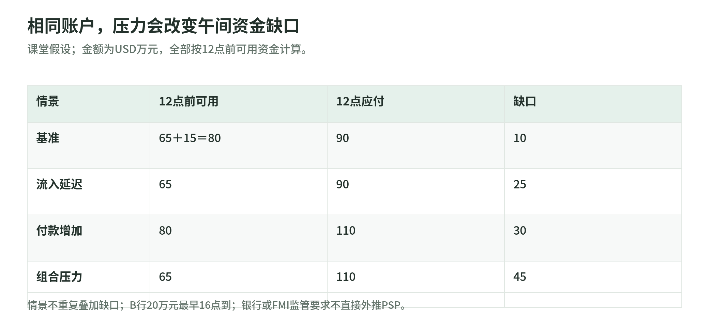

# 17 资金管理与流动性：钱够不够，还要问在哪里、何时可用

[专题](../README.md) / [主干](../payment-industry-101.md)

研究读取日：2026-11-02。金额、时点和压力场景均为课堂假设；银行、金融市场基础设施（FMI）要求与 PSP 分析框架分别标明，不提供投资或融资建议。

## 资金头寸：按币种、银行和时间拆开

<!-- illustration: payment-ext-treasury-positions-f4fa5d3246 -->

*图：资金头寸到调度：币种、银行、时点缺一不可。课堂假设：12点需付USD90万，A行已有65万、预计流入15万。*
<!-- /illustration: payment-ext-treasury-positions-f4fa5d3246 -->

资金管理关心“指定时刻能用哪些钱满足哪些义务”，不是把全球余额换成一个总数。课堂头寸表至少记录币种、账户和银行、已确认可用余额、预计流入、已承诺流出、受限金额、转移耗时及截止时间。尚未收到的钱应列预测，不应伪装成已到账。

假设上午10点，A行已有USD65万元、预计11点入账15万元；B行另有USD20万元，但最早16点才能转到付款账户；C行有EUR100万元，尚无可执行换汇安排。12点必须支付USD90万元，基准预测可用80万元，缺10万元。账面美元合计多、欧元也多，仍不能证明午间能付出去。

同币种余额也不能未经核验就合并：它们可能属于不同法律主体、用途受限，或调拨来不及。BCBS 的银行流动性指标区分币种、可用资源、时点义务和日内使用量；这里借其观察维度，不复制银行监管比例。[BCBS：Liquidity monitoring metrics，SRP50](https://www.bis.org/committees/bcbs/basel-framework/standard/srp/50/inforce/2019-12-15/published/2019-12-15)

教学表格还应把本金、费用、保证金与客户相关资金分别标识，先核实用途再纳入可调度资源。不能为了让总余额好看，就把受限资金改名为备用现金。每个数旁边写上信息来源和更新时间；银行流水、服务商可用余额、内部预测出现差异时，先查差异，不直接选最大的那个数。

## 预注资与净额：时间安排和金额算法是两回事

预注资是先把资金放到指定余额或结算安排，再执行出款。它减少逐笔等待资金的需要，却把资金提前占用在特定位置。后注资则可能先执行、后按约定补款，依赖伙伴的信用与合同。Wise 文档将注资模型和注资方法分开，后注资并非对所有集成都开放。[Wise：Funding a transfer](https://docs.wise.com/guides/product/send-money/funding)

净额讲的是可抵销义务如何计算。课堂例：同一有效抵销安排下应付100、应收70，只需净付30；若70必须下午才收到且不能提前抵销，上午的需求仍可能是100。减少最终结算额，不代表任何时点都无需资金或信用支持。

批量又是第三件事：把多笔支付合为一笔银行付款，不必然发生应收应付抵销。Wise 的 bulk settlement 将多笔转账汇总资金安排，并单独说明净额退款模式；不能因为名字有 settlement 就把所有批量都叫净额。[Wise：Bulk settlement](https://docs.wise.com/guides/product/send-money/funding/bulk-settlement)

## 日内调度：日终平衡不等于中午不断粮

上午付100、下午收100，日终净流量为零，午间仍要取得100。这像食堂晚上会收到营业款，但中午买菜的钱必须先有。银行监管的日内工具会观察最大累计净流出、日初可用流动性、总支付及指定时点义务，而不只看日终余额。[BCBS SRP50，日内指标](https://www.bis.org/committees/bcbs/basel-framework/standard/srp/50/inforce/2019-12-15/published/2019-12-15)

教学调度分为预测缺口、核实可用来源、审批调拨、执行、确认到账、更新头寸。调拨指令已发送不等于目标银行已经可用；应保留原计划与实际时点，比较误差。可调迟的付款与合同限定时点的付款分开排队，不能一律靠延迟出款修补缺口。

回到午间例子，补足十万元只是填平基准缺口，并没有为预计流入落空留余量。课堂调度单可以同时写基准需求、压力余量、补款成本及最迟确认时间；如果资金尚未确认，就继续显示未解决缺口。额度承诺也要区分可撤销与确定可用，不能把“伙伴愿意商量”写成已经取得的现金。

英格兰银行对 CHAPS 流动性节约机制的研究说明，支付安排能改变银行日内资金需求，但不能据此保证普通 PSP 可用同样机制。[Bank of England：CHAPS Liquidity Saving Mechanism](https://www.bankofengland.co.uk/quarterly-bulletin/2014/q2/how-has-the-liquidity-saving-mechanism-reduced-banks-intraday-liquidity-costs-in-chaps)

全天候支付还应核对补款、支持与操作窗口。FedNow 运行时间页面分别说明即时支付、流动性管理转账及标准工作时段下的活动；“支付一直开着”不能推导所有资金来源和支持活动都无限可用。[Federal Reserve：FedNow Service Operating Hours](https://www.frbservices.org/resources/financial-services/fednow-service-resources/fednow-service-operating-hours/)

## 伙伴集中：有备用接口，还需要备用资金

课堂上分别计算某银行承载的余额、出款量、币种覆盖和替代恢复时间。接口故障是操作问题，存款不可取回可能是信用问题，某币种暂时拿不到是流动性问题；同一个事件可以同时触发三者。

如果所有美元都在A行，接好了B行API也不等于有备用美元。替代路径需事先核实账户、授权、可用额度、实际资金和到账耗时；两家伙伴依赖同一底层银行，也可能共同失效。这是课程的依赖分析，不是要求每个PSP必须有固定数量伙伴。

PFMI 第7原则要求适用 FMI 管理参与者、结算银行、代理行、托管行和流动性提供方等带来的风险，并在相关币种保持足够流动资源。本章仅借其责任链提醒，不宣称全部 PSP 都是 FMI，也不将其压力覆盖要求直接套用。[CPMI-IOSCO：PFMI，第7原则](https://www.bis.org/committees/cpmi/pfmi/overview)

## FX：报价价差不等于风险敞口

价差是客户报价与相应基准或成交价的差；净敞口则要看实际持有、已承诺收付和对冲。假设收客户USD100，承诺付EUR90：成交成本是USD99时，暂有USD1的毛差额；若尚未锁定成本、欧元上涨使成本变为USD103，就变成USD3缺口。这里忽略费用及其他收入，不是实际报价。

课堂可先按币种与到期日匹配收付，评估自然抵销；剩余确定义务再讨论是否提前换汇或用远期锁定汇率。远期金额、币种和日期若与真实义务不匹配，或订单取消，仍可能留下风险。对冲改变敞口，不是免费增加收入。

还要分开汇率波动和FX结算风险：即便价格锁定，付出一种币种后未收到另一种币种，仍有本金、重置成本及流动性问题。BCBS 的外汇风险指引给出远期定义并讨论这些结算风险；付款对付款机制针对交付本金风险，并不消除全部市场与操作风险。[BCBS：Foreign exchange risks](https://www.bis.org/committees/bcbs/basel-consolidated-guidelines/module/rma/20)

## 压力测试：算缺多少、何时缺、谁来处理

<!-- illustration: payment-ext-liquidity-stress-e0de39ade9 -->

*图：相同账户，压力会改变午间资金缺口。课堂假设；金额为USD万元，全部按12点前可用资金计算。*
<!-- /illustration: payment-ext-liquidity-stress-e0de39ade9 -->

延用头寸例，基准午间缺10万元；若预计15万元延迟到下午，缺口升至25万元；若12点付款增至110万元且流入如期，缺30万元；两项同时发生则缺45万元。这些场景独立或组合计算，不能把缺口重复相加。

再测A行不可用、周末流入放缓、汇率跳变及调拨路径失败。输出应包括最大缺口、持续时间、到期义务、可实际执行的补款方案、负责人和升级条件，而非只写“准备充足”。B行16点才能到账的钱，不能拿来填12点的缺。

演练可由一人扮演财务、一人扮演运营：财务报告哪些钱已经可用，运营列明哪些付款不能延期，再由授权者选择已核实方案。演练结束记录缺口何时发现、通知何时送达、补款何时可用和哪些假设失真。这样测的是实际应对能力，不只是表格上的一个静态余额。

BCBS 工具讨论银行自身、对手方及市场压力；PFMI 对适用 FMI 有相应资源与压力要求。这里的 PSP 演练是教学改编，具体最低资源、融资权限和资金用途仍需按其法律身份、网络和合同核对。[BCBS SRP50](https://www.bis.org/committees/bcbs/basel-framework/standard/srp/50/inforce/2019-12-15/published/2019-12-15)、[PFMI 第7原则](https://www.bis.org/committees/cpmi/pfmi/overview)

## 自测与参考答案

1. 有USD85万元确认余额和预计USD15万元流入，是否保证12点能付90万元？
2. 汇总十笔出款一次补款，是不是一定发生净额抵销？
3. 本例流入延迟且付款升至110万元，午间缺口多少？锁汇能解决吗？

参考答案：

1. 不保证；还要核对账户位置、用途、到账和调拨时间。
2. 不是；批量是合并操作，净额需要可抵销义务及有效安排。
3. 110−65＝45万元；锁汇不能自动补足该时点现金。

## 公开一手来源与适用边界

| 标题 | URL | 读取日 | 适用边界 |
| --- | --- | --- | --- |
| BCBS: Liquidity monitoring metrics, SRP50 | [官方框架](https://www.bis.org/committees/bcbs/basel-framework/standard/srp/50/inforce/2019-12-15/published/2019-12-15) | 2026-11-02 | 银行监管观察指标；不直接构成所有PSP资源或报告要求 |
| Wise Platform: Funding a transfer | [官方文档](https://docs.wise.com/guides/product/send-money/funding) | 2026-11-02 | Wise具体注资模型；币种、伙伴资格及合同限制另核 |
| Wise Platform: Bulk settlement | [官方文档](https://docs.wise.com/guides/product/send-money/funding/bulk-settlement) | 2026-11-02 | 批量与净额退款产品示例；不代表所有净额结算法律安排 |
| Bank of England: How has the Liquidity Saving Mechanism reduced banks’ intraday liquidity costs in CHAPS? | [官方研究](https://www.bankofengland.co.uk/quarterly-bulletin/2014/q2/how-has-the-liquidity-saving-mechanism-reduced-banks-intraday-liquidity-costs-in-chaps) | 2026-11-02 | 2014年CHAPS银行研究；不是当前所有PSP可用的节约工具 |
| Federal Reserve: FedNow Service Operating Hours | [官方运行时间](https://www.frbservices.org/resources/financial-services/fednow-service-resources/fednow-service-operating-hours/) | 2026-11-02 | FedNow运行及支持活动；不据此推断其他系统或资金设施窗口 |
| CPMI-IOSCO: Principles for Financial Market Infrastructures | [官方原则](https://www.bis.org/committees/cpmi/pfmi/overview) | 2026-11-02 | 适用FMI的国际标准；普通PSP不自动属于该范围 |
| BCBS: Foreign exchange risks | [官方指引](https://www.bis.org/committees/bcbs/basel-consolidated-guidelines/module/rma/20) | 2026-11-02 | 银行FX结算风险与术语；本章报价、对冲讨论为简化课堂模型 |
