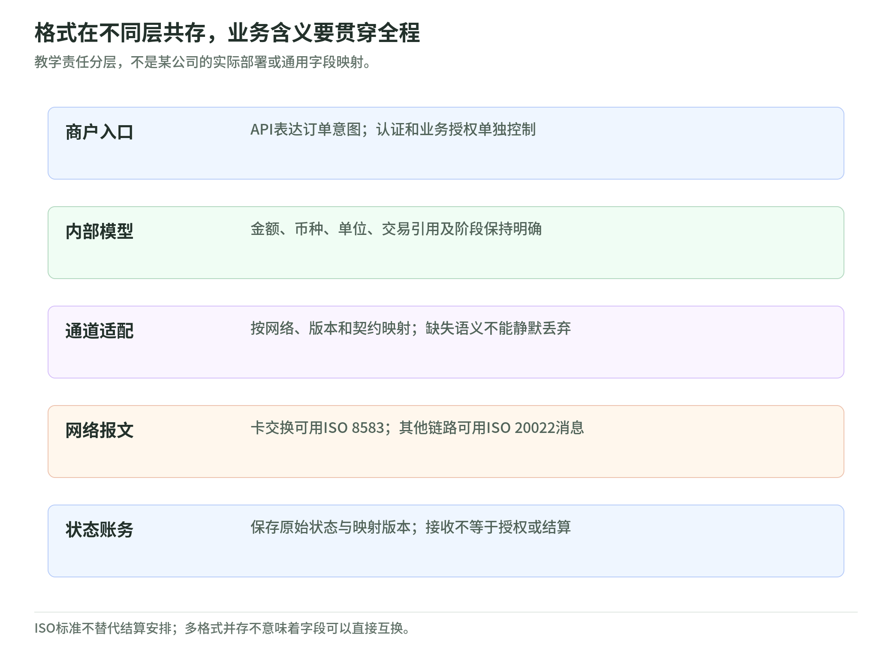
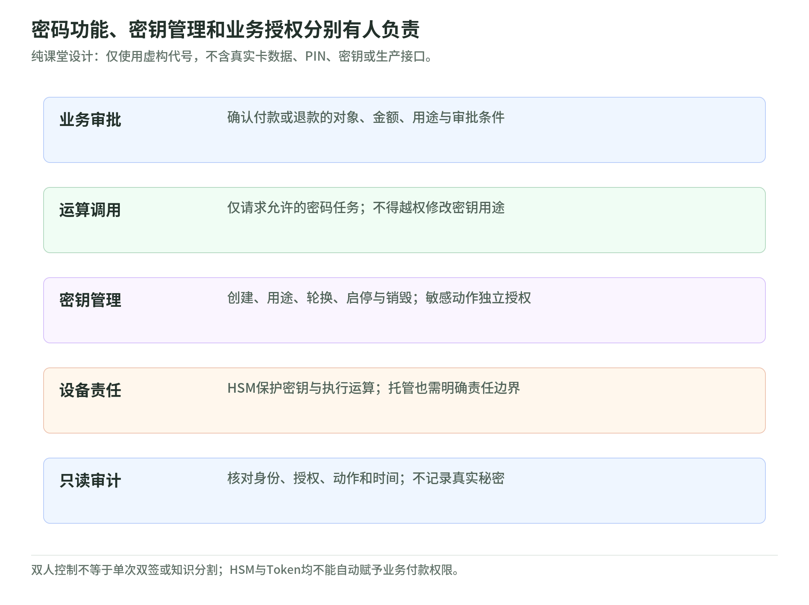

# 18 报文与支付安全：格式、密码功能和责任边界

[专题](../README.md) / [主干](../payment-industry-101.md)

研究读取日：2026-11-02。本章只做课堂设计：不处理真实卡号、PIN、密钥或生产凭证，不给出绕过控制、安全攻击及秘密操作步骤。

## 报文分层：ISO 8583 与 ISO 20022 不是二选一

<!-- illustration: payment-ext-message-layers-60b35c3dba -->

*图：格式在不同层共存，业务含义要贯穿全程。教学责任分层，不是某公司的实际部署或通用字段映射。*
<!-- /illustration: payment-ext-message-layers-60b35c3dba -->

一条支付指令可从商户API进入内部业务模型，再经通道适配成为网络报文；响应还要回到本方状态机和账务。不同层可以使用不同格式，“公司用了哪种ISO”并不能回答每一段链路如何工作。

ISO 8583:2023 的公开摘要说明，它规定收单方与发卡方交换卡金融交易相关报文的共同接口、结构和格式；传输方法与结算方式不在其范围内。这里不是只指首次发起付款的一条消息。因此，收到8583报文不能证明资金已结算。[ISO：ISO 8583:2023](https://www.iso.org/standard/79451.html)

ISO 20022 是金融行业消息方案，包含数据字典、业务过程和消息定义，覆盖支付、证券、卡及外汇等领域，不应只把它理解为“新版XML”。某支付系统使用其消息定义，并不自动改变商户端API或整个卡授权链。[ISO 20022：About ISO 20022](https://www.iso20022.org/about-iso-20022)

课堂架构可以同时有卡通道和账户支付通道，各自按接口契约适配。选择标准与版本是具体业务和网络问题，不是用一个格式替代所有系统。

## 字段映射：保留含义，不能只改名字

教学映射表至少写源字段、业务含义、目标字段、转换规则、必填条件及无法表达时的处理。先问“这个金额是什么”：授权金额、清算金额、结算金额、手续费和退款金额不能因为都叫amount就互换。

课堂订单示例是30.50元；若某接口以分计量，整数3050须连同CNY和单位规则理解。换成无小数或不同小数位的币种时，不能机械乘100。还应核对时间与时区、商户或参与者身份、原交易引用、字符串长度及字符集。此例只表达金额，不含支付凭证。

映射不可表达的信息要显式报错、补充保存或进入人工复核，不能静默截断后宣称“等价”。Swift 的ISO 20022到MT翻译说明讨论截断及缺失数据处理；这是具体迁移实例，不是8583到20022通用逐字段映射表。[Swift：ISO 20022 to MT Translation](https://www.swift.com/de/node/308151)

课程练习可用自定义订单代号和合成字段验证来回转换。往返字节一样不等于业务正确；源值和目标值恰好同名，也不等于双方采用同一定义。

例如课堂输入把“付款人”和“最终付款人”列成两项，目标格式却只有一项，适配器就应说明无法完整表达，而不是挑一个名字覆盖另一个。金额的正负方向也要说明是本方应收还是应付；用同一个负号同时表示退款、拒付和费用，后续账务很容易失去动作含义。测试材料应让每项转换都能解释原因。

## 状态码：接收、批准和结算分开

状态必须带来源、阶段与时间。传输接收成功只表示接收方认可某层请求；业务批准可能只批准授权；资金结算则是另一项义务。ISO 8583 明确不规定结算方式，ISO 20022 的业务模型也不能被一个HTTP成功响应替代。[ISO 8583 摘要](https://www.iso.org/standard/79451.html)、[ISO 20022 业务方案](https://www.iso20022.org/about-iso-20022)

教学状态机可以保留“已接收、处理中、授权获批、结算确认、未知”等本方状态，同时保存通道原始代码和映射版本。这不是任何网络的正式码表；生产映射须核对消息类型、版本和实现指南，不能见到某个数字就跨通道断言成功。

白话例子：发出退款后接口超时，本方只知道没有收到确认。它既不证明退款失败，也不证明钱已退给客户。课堂先标未知，再用合成查询事件推进状态；不要把一次重试当作一笔全新的退款。

状态练习还要覆盖重复通知与迟到通知：同一合成事件出现两次，不应产生两笔退款；较早阶段的通知晚到，不应覆盖已经核实的较晚阶段。保留事件顺序和处理依据，才能解释最终状态怎样形成。这里验证业务模型，没有提供任何网络真实状态码，也不承诺所有通道采用相同顺序。

## HSM 与 PCI PIN：设备功能不是全套责任

HSM 是保护密钥及执行密码运算的专用安全模块。课堂可把它当成受控“保险柜加工间”：应用提交被允许的任务，不能由此推断应用获得任意密钥或明文数据。设备安全和业务授权是两个层面。

PCI PIN 的范围是PIN及关联密钥的安全管理、处理与传输，覆盖创建、传送、加载、使用和管理等生命周期环节。不是每种PSP业务都处理PIN，也不能用“有一台HSM”证明全部PCI要求满足。[PCI SSC：PIN Security](https://www.pcisecuritystandards.org/standards/pin-security/)

PIN Block 是按相应格式组织、用于保护和处理 PIN 的数据块，不是允许业务人员查看的明文密码。课堂上只记录“执行了哪类验证、是否成功、由谁授权调用”等合成元数据，不把 PIN、密钥或可解出秘密的材料写入日志。密码验证成功也不替代余额检查或付款审批；卡片离线验证 PIN 与发卡侧在线验证的区别，回看[第 14 课](14-in-person-and-offline-payments.md)。具体 PIN 保护及密钥控制要求仍以适用标准、网络和方案为准。[PCI SSC：PIN Security](https://www.pcisecuritystandards.org/standards/pin-security/)

教学密钥台账还应记录用途、责任人、允许调用者、启停条件、轮换、撤销或销毁及证据保留。AWS Payment Cryptography 的客户操作文档说明，服务提供安全密钥存储和用途约束，客户仍负责密钥属性与访问配置；生成、导入、删除和轮换各有管理动作。这是托管服务责任实例，不是所有HSM产品功能保证。[AWS：Customer operations](https://docs.aws.amazon.com/payment-cryptography/latest/userguide/cryptographic-details-customerops.html)

## 双人控制与权限分隔：不能只画两个小人

<!-- illustration: payment-ext-cryptographic-duties-2d1297b117 -->

*图：密码功能、密钥管理和业务授权分别有人负责。纯课堂设计：仅使用虚构代号，不含真实卡数据、PIN、密钥或生产接口。*
<!-- /illustration: payment-ext-cryptographic-duties-2d1297b117 -->

双人控制要让敏感操作不能由一人独立完成；不同人的独立授权与留痕才有意义。知识分割则关注一人不掌握完整秘密，和两个人签字不是同一概念。本课不演示密钥组件、不安排真实密钥仪式。

AWS 的公开运维说明描述HSM的双人控制、设备责任链和审计等安排；客户文档又强调应用方配置访问的责任。硬件方管好设备，不等于客户调用权限正确；两个人审批了密钥，也不等于每笔业务付款合法。[AWS：Internal operations](https://docs.aws.amazon.com/payment-cryptography/latest/userguide/cryptographic-details-internalops.html)、[AWS：Customer operations](https://docs.aws.amazon.com/payment-cryptography/latest/userguide/cryptographic-details-customerops.html)

课堂角色可以拆为业务审批者、密码运算调用者、密钥管理员、审计者。调用者不能改密钥用途，管理员不自动获得付款审批权，审计者只读证据；异常授权设到期与复核。权限表还要列租户、环境和动作，而不是一个“管理员=true”包办。

课堂审阅可以逐项问：谁提出变更，谁独立授权，谁执行，谁能读取证据，谁能撤销权限？把这些动作都交给同一身份，再补一条“需要双人控制”的备注，模型仍未实现分隔。证据应记录代号和决定，而不是复制秘密；更换岗位后也要重新核对权限，不让旧职责一直延续。

## Token 权限与安全课堂：替代值不是通行证

支付Token、服务商保存的对象引用和API访问凭证不是同一类东西。EMV支付Token可以受商户、设备或支付场景约束，替代PAN并不代表任意主体都能跨场景使用。拥有Token也不能替代订单授权、额度、用途及业务审批。[EMVCo：EMV Payment Tokenisation](https://www.emvco.com/emv-technologies/payment-tokenisation/)

API权限另行控制。Stripe的密钥文档说明，密钥用于认证请求并确定可访问资源，应按集成所需授予服务端权限。因此“能查订单”和“能退款或出款”应分开；不能把支付Token当成API密钥，也不能把可读权限当成可付款权限。[Stripe：API keys](https://docs.stripe.com/keys)

课堂只用本地合成对象：订单代号、金额币种、虚构Token标签、密钥代号与角色矩阵；不生成看似可用的卡号，不填写真实PIN或密钥，不连接生产接口。验收可以检查映射缺字段会否显式失败、未知状态是否保留、未授权动作是否被拒、日志是否只留必要元数据。上述检查属于设计与防御验证，不含攻击方法。

## 自测与参考答案

1. 使用ISO 20022，是否意味着卡授权链必须停用ISO 8583？
2. 合成请求amount=3050、状态为已接收，能否宣布付出30.50元？
3. HSM已托管且取得支付Token，应用是否自动可以退款？

参考答案：

1. 不是；两者范围及链路位置不同，须按具体网络接口核对。
2. 不能；先确定币种与单位，并区分接收、授权和结算状态。
3. 不能；仍须业务授权、API权限、Token适用条件及正确密钥配置。

## 公开一手来源与适用边界

| 标题 | URL | 读取日 | 适用边界 |
| --- | --- | --- | --- |
| ISO 8583:2023 — Financial-transaction-card-originated messages | [官方摘要](https://www.iso.org/standard/79451.html) | 2026-11-02 | 仅引用公开范围摘要；不声称读取付费全文或提供完整字段码表 |
| ISO 20022: About ISO 20022 | [官方说明](https://www.iso20022.org/about-iso-20022) | 2026-11-02 | 标准方案与业务模型；具体网络须另查消息版本和实现指南 |
| Swift: ISO 20022 to MT Translation | [官方说明](https://www.swift.com/de/node/308151) | 2026-11-02 | CBPR+与MT翻译、数据截断实例；不是8583到20022通用映射规范 |
| PCI SSC: PIN Security | [官方标准范围](https://www.pcisecuritystandards.org/standards/pin-security/) | 2026-11-02 | PIN及相关密钥生命周期；不等于全部PCI合规或所有PSP都处理PIN |
| AWS Payment Cryptography: Customer operations | [官方文档](https://docs.aws.amazon.com/payment-cryptography/latest/userguide/cryptographic-details-customerops.html) | 2026-11-02 | 托管服务的客户密钥及访问责任示例；不是所有HSM的统一契约 |
| AWS Payment Cryptography: Internal operations | [官方运维说明](https://docs.aws.amazon.com/payment-cryptography/latest/userguide/cryptographic-details-internalops.html) | 2026-11-02 | 公开的设备、双人控制与审计职责；不提供真实密钥操作 |
| EMVCo: EMV Payment Tokenisation | [官方技术说明](https://www.emvco.com/emv-technologies/payment-tokenisation/) | 2026-11-02 | EMV支付Token域约束；不推广为任意Token的统一权限模型 |
| Stripe: API keys | [官方文档](https://docs.stripe.com/keys) | 2026-11-02 | Stripe认证与权限机制示例；角色矩阵和安全演练为合成课堂设计 |
