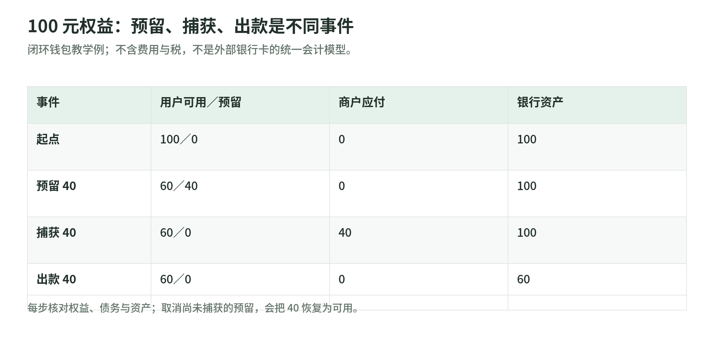
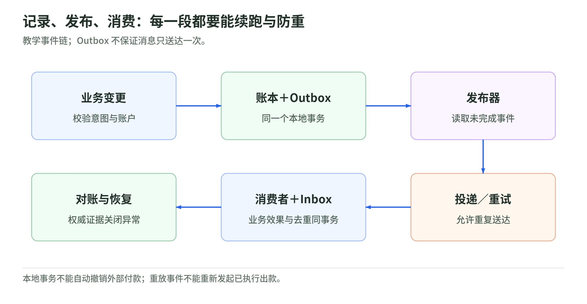

# 19 账本与工程实战：让钱、状态和消息对得上

<a id="lesson-19"></a>

研究读取日：2026-11-02。[专题导读](../README.md) · [主干第 09 课](../payment-industry-101.md#lesson-09)

本课把“使用账本、幂等和对账”的原则推进到设计练习。所有账户、金额和架构均为教学假设，不是生产系统、会计政策或上线认证。

## 1. 先把一笔钱的几种状态拆开

小林有 100 元钱包余额，预订 40 元商品。系统不能同时回答“余额 100，可以再花 100”和“已承诺支付 40”。至少需要区分：

| 状态 | 白话意思 | 本例 |
| --- | --- | ---: |
| 总权益 | 在本模型中尚属于用户的权益 | 授权后仍为 100 |
| 可用 | 允许用于新支出的部分 | 60 |
| 预留／冻结 | 被特定支付意图占用、暂不能另花 | 40 |
| 商户应付 | 已转成对商户的债务 | 捕获后为 40 |
| 银行现金 | 平台相应金融账户的实际资产 | 不因内部预留立即改变 |

这些是本课的教学账户，不是行业统一字段。服务商的 `pending` 可能指待结算、待决策或预留资金，必须核对定义。TigerBeetle 的两阶段转账就区分预留和后续确认、撤销或过期；不能把该产品实现当成所有银行卡授权的会计规则。[来源：Two-Phase Transfers](https://docs.tigerbeetle.com/coding/two-phase-transfers/)

## 2. 一个能检查借贷的闭环余额例子

<!-- illustration: payment-ext-ledger-states-b8a5a4ebf2 -->


*图：100 元权益：预留、捕获、出款是不同事件。闭环钱包教学例；不含费用与税，不是外部银行卡的统一会计模型。*
<!-- /illustration: payment-ext-ledger-states-b8a5a4ebf2 -->

**假设平台已有银行资产 100 元，同时对用户负债 100 元；暂不考虑费用和税。** 这不是外部银行卡授权直接在 PSP 账上发生的统一分录。

| 事件 | 借方 | 贷方 | 银行现金变化 |
| --- | --- | --- | --- |
| 预留 40 | 用户可用余额负债 40 | 用户预留余额负债 40 | 0 |
| 捕获 40 | 用户预留余额负债 40 | 商户应付款 40 | 0 |
| 给商户实际出款 | 商户应付款 40 | 银行资产 40 | −40 |

若在捕获前取消：借用户预留余额负债 40，贷用户可用余额负债 40。若已经捕获，则需要退款或调整事件，不能再把旧授权当成“尚未使用”。

每组分录借贷相等，但仍需检查业务对象、金额、币种和事件是否正确。重复记录一笔本身平衡的出款，一样会造成损失。

## 3. 多币种不能只给一个总余额

金额记录应至少携带：整数或精确十进制金额、币种、使用的单位／精度、账户、业务事件和有效时间。不要把浮点数 `0.1 + 0.2` 的机器结果作为金融金额的唯一依据。

不同提供方的金额接口有具体约定。Stripe 说明 API 金额单位及零小数币种、特殊币种规则；不能把“所有金额乘 100”写成通用转换器。[来源：Supported currencies](https://docs.stripe.com/currencies)

跨币种交易应记录原币、本币、汇率、报价时点、费用和舍入差额。**不能用“100 USD + 100 JPY = 200”作为账本平衡。** TigerBeetle 的建模文档区分账户所属 ledger，并说明转账的 ledger 约束；本课据此提醒按货币／业务语义设计账本，而非推荐某个数据库为唯一选择。[来源：Data Modeling](https://docs.tigerbeetle.com/coding/data-modeling/)

教学例：原金额 10.01，费率假设为 1.5%，精确费用为 0.15015。系统需明确采用何种舍入、记入多少、剩余差额归哪里。税务与会计政策需要另行决定，不由教程拍板。

## 4. 并发：两笔都“读到余额足够”怎么办

若可用余额 60，两条请求同时各要预留 40，仅在应用里各读一次余额，会有重复承诺的风险。

可选的实现机制包括行锁、原子条件更新、版本检查或专门账本的余额约束。PostgreSQL 官方文档解释了行级锁与死锁；采用锁还应确定一致的锁定顺序，并正确处理重试，不能认为“加事务”便消除了所有竞争。[来源：Explicit Locking](https://www.postgresql.org/docs/current/explicit-locking.html)

以下是**概念伪代码，不是可直接上线的实现**：

```text
BEGIN
  验证支付意图、请求参数与唯一业务键
  以原子方式检查并占用可用余额
  追加同币种平衡分录
  写入待发布事件 outbox
COMMIT
```

外部通道调用不在这个本地事务里自动回滚。通道已处理而本地超时，仍必须先查结果、按同一意图重试或进入待调查状态。

## 5. Outbox 与 Inbox：不要赌两次写入一起成功

<!-- illustration: payment-ext-outbox-inbox-04ee0c6e25 -->


*图：记录、发布、消费：每一段都要能续跑与防重。教学事件链；Outbox 不保证消息只送达一次。*
<!-- /illustration: payment-ext-outbox-inbox-04ee0c6e25 -->

数据库记了“已捕获”，消息却没发出，商户不履约；先发出消息，数据库却回滚，也可能造成另一种错误。

Transactional Outbox 将业务变更与待发布事件放在同一数据库事务里，之后由发布器投递。它解决本地双写窗口，**不保证外部消息只送一次**。AWS 的模式说明也要求考虑重复事件与消费者幂等。[来源：Transactional outbox pattern](https://docs.aws.amazon.com/prescriptive-guidance/latest/cloud-design-patterns/transactional-outbox.html)

消费者可以使用 Inbox／已处理事件表：在自身事务中检查事件是否已处理，写入结果和去重记录。需要结合业务对象版本处理乱序，不能仅按收到时间覆盖状态。这里的 Inbox 是教学设计，不是说所有支付平台都使用同名表。

## 6. 调整、重放与恢复：不要删历史来修账

发现错误后，保留原始事件，再追加可追溯的纠正分录；记录原因、审批、关联流水和处理人角色。重放历史事件时，不能重新发起已经执行的外部付款。

教学恢复检查表：

| 故障点 | 恢复后必须确认 |
| --- | --- |
| 通道批准，响应丢失 | 原意图只有一笔经济效果，结果可查 |
| 账本提交，发布器崩溃 | 事件可以续投，消费者能防重 |
| 出款提交，余额状态未更新 | 用权威银行／通道证据核对，不能盲目再付 |
| 两个区域同时处理 | 不重复消费余额；明确写入所有权或协调机制 |
| 恢复到较旧快照 | 重新对账并追回遗漏事件，不凭快照宣布完成 |

RPO 是可接受的数据丢失目标，RTO 是恢复时间目标；设定它们还不够，演练需检验钱和账是否一致。本表是设计检查清单，不是承诺“多活”架构必然满足某个数值。

## 7. 自测与参考答案

1. 为什么借贷相等仍可能重复付钱？
2. 本地事务回滚，能否自动撤销已被银行执行的出款？
3. 为什么 Outbox 之后消费者仍需防重？

**参考答案**：① 重复的错误事件也可以生成平衡分录，需要业务键和资金证据约束。② 不能，本地数据库与外部金融系统有独立结果。③ 发布确认可能丢失，投递与恢复可能重复，消费者必须控制经济副作用。

<a id="public-sources"></a>

## 8. 来源与适用边界

所有来源读取日均为 2026-11-02。产品文档用于核验机制，不表示本课架构已通过生产认证。

| 来源 | 支持内容 | 边界 |
| --- | --- | --- |
| [TigerBeetle：Two-Phase Transfers](https://docs.tigerbeetle.com/coding/two-phase-transfers/) | 预留与确认／撤销／过期的区别 | 产品级机制，不替代会计政策 |
| [TigerBeetle：Data Modeling](https://docs.tigerbeetle.com/coding/data-modeling/) | Account、Transfer、ledger 等建模约束 | 不是所有账本的统一数据模型 |
| [Stripe：Supported currencies](https://docs.stripe.com/currencies) | 金额单位、币种及特殊接口规则 | 只适用于相应 Stripe 接口 |
| [PostgreSQL：Explicit Locking](https://www.postgresql.org/docs/current/explicit-locking.html) | 并发锁与死锁处理 | 本次读取页面为 PostgreSQL 18 文档 |
| [AWS：Transactional outbox](https://docs.aws.amazon.com/prescriptive-guidance/latest/cloud-design-patterns/transactional-outbox.html) | 双写、原子记录、重复投递 | 架构模式，不是实际公司部署证据 |
