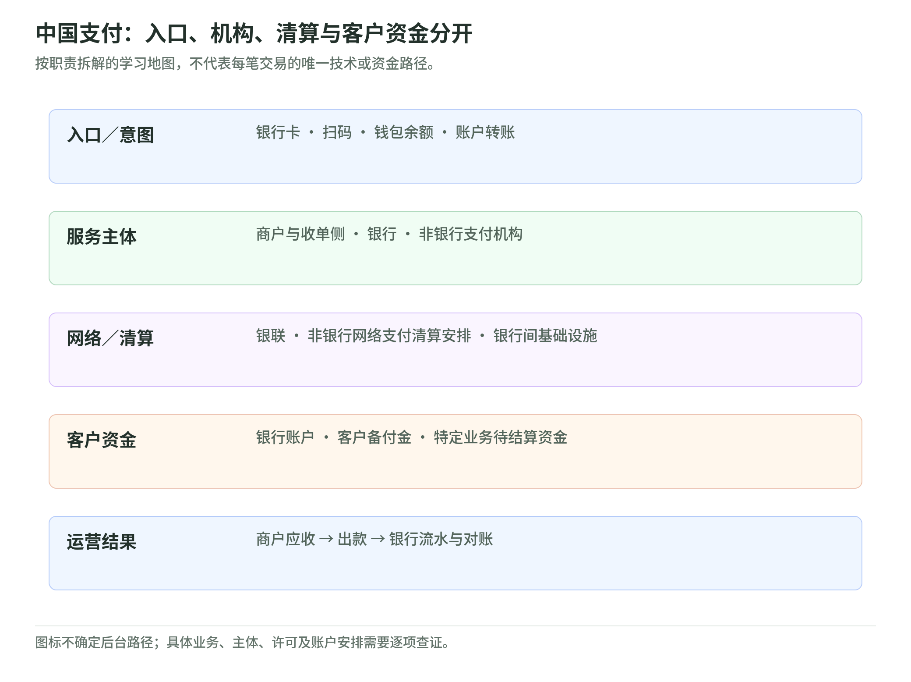
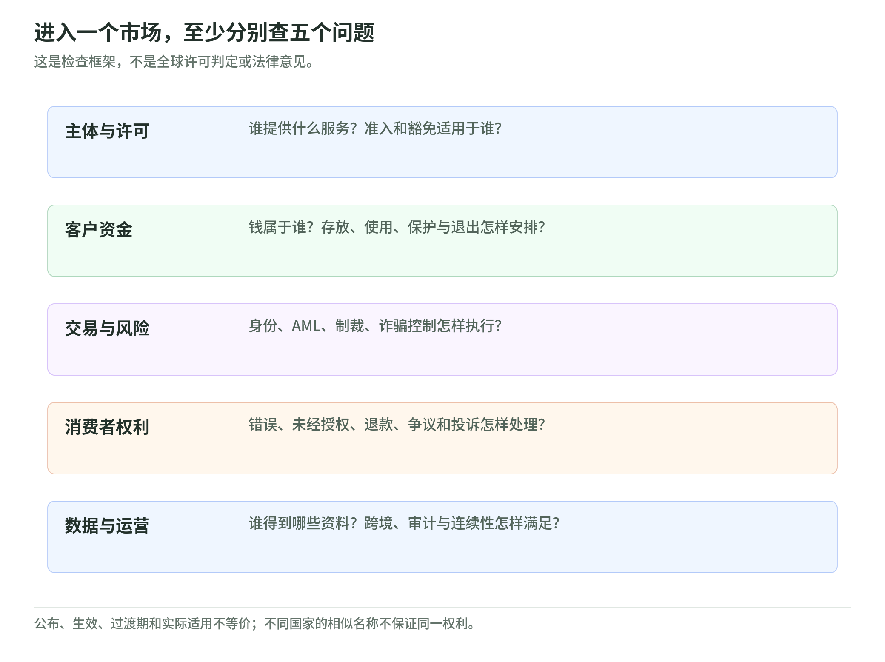

# 20 中国支付体系与地区监管：一张图看责任，再逐项查规则

研究读取日：2026-11-02。[专题导读](../README.md) · [主干第 06 课](../payment-industry-101.md#lesson-06)

本课提供国内链路与地区对照的学习方法，不是申请牌照、处理争议或跨境传输数据的法律意见。已公布、已生效、过渡期与实际适用是不同状态；遇到具体项目，必须重新查文本及监管解释。

## 1. 中国支付的五组主体，不是五个必经服务器

<!-- illustration: payment-ext-china-responsibilities-48a55013bd -->

*图：中国支付：入口、机构、清算与客户资金分开。按职责拆解的学习地图，不代表每笔交易的唯一技术或资金路径。*
<!-- /illustration: payment-ext-china-responsibilities-48a55013bd -->

| 主体 | 从什么角度理解 |
| --- | --- |
| 用户与商户 | 发起指令、接受商品、形成收付款权益 |
| 银行 | 银行账户、发卡／收单等业务及相应资金义务 |
| 非银行支付机构 | 在许可范围提供相应支付服务，承担客户／商户关系 |
| 清算机构 | 按规则连接参与者并办理相应清算事项 |
| 人民银行及银行间系统 | 监管、相关账户与支付基础设施责任 |

银联官方介绍说明其银行卡与受理网络定位；非银行支付机构则需依据许可的业务类型与地域范围开展业务。**银行、支付机构、卡网络、清算机构不能仅凭品牌图标互相替代。**[来源：银联企业概况](https://www.unionpay.com/upowhtml/cn/templates/upOverview/upOverview.html) [来源：非银行支付机构监督管理条例](https://app.www.gov.cn/govdata/gov/202312/17/510339/article.html)

## 2. 两条常见学习路径：刷卡和钱包支付

**银行卡购买的责任示意**：持卡人 → 商户／收单侧 → 卡网络 → 发卡侧，批准结果返回；后续再进行清算、结算及商户出款。国内案例要落实具体收单、转接与资金安排，不能直接把海外 PSP 的产品状态套过来。

**绑定银行账户的非银行支付示意**：用户向支付机构提交指令，支付机构与银行及合资格清算安排协作，再形成商户侧收款和结算记录。“网联”指向非银行网络支付清算的一类基础设施角色，不是一个消费者的钱包余额。

中国银行的 2019 年公告记录了其完成网络支付“断直连”。它能说明后台连接与用户入口是不同层次，**不能据此声称已核验 2026 年所有平台的每条路径**。[来源：中国银行公告](https://www.boc.cn/ebanking/bi2/201901/t20190107_14545670.html)

这两条是课堂责任示意，不要求每个箭头由独立公司执行。钱包余额支付、充值、提现及绑定卡支付，也应分别建模。

## 3. 客户备付金：为什么不是公司的自由现金

人民银行公开的《非银行支付机构客户备付金存管办法》区分客户备付金、集中存管账户及特定业务待结算资金，规范其存放、归集、使用和划转。这里用其公开文本解释资金责任，不写成“所有款项都沿唯一账户链移动”。[来源：客户备付金存管办法](https://www.pbc.gov.cn/zhengwugongkai/attachDir/2025/11/2025111914411687312.pdf)

**假设例**：某平台银行／保障账户中看到 1,000 万元，其中 950 万元对应客户或商户资金，50 万元才是本例的自有资金。看到账户总额，不能把 1,000 万元全部算成收入或可投资现金。

客户资金保护、经营风险准备金、监管资本和银行存款保险回答不同问题。英国制度的 safeguarding 也不能未经核对就与中国备付金制度画等号。

## 4. 国内银行间系统与 CIPS：定位不同

国内银行间转账还需要区分大额、小额与网上支付跨行清算等基础设施及其业务范围。学习时先分清逐笔／批量、全额／净额，再查运行窗口、限额和参与者规则；**“大额”不是简单等于“大订单支付产品”**。

参与银行的公开介绍将大额系统与实时全额、小额系统与批量净额机制联系起来。该资料只用于基本机制，不沿用历史运行时间或金额门槛。[来源：建设银行支付系统介绍](https://www.ccb.com/chn/2013-06/24/article_2021122017175829970.shtml)

CIPS 官方说明跨境批发清算定位及混合结算、流动性安排。它与国内零售钱包、金融报文网络是不同分析层次。[来源：了解 CIPS](https://www.cips.com.cn/kjjqgs/jrcips/index.shtml)

## 5. 地区矩阵：许可、客户资金与消费者权利分开

<!-- illustration: payment-ext-regulatory-questions-8602964f5e -->

*图：进入一个市场，至少分别查五个问题。这是检查框架，不是全球许可判定或法律意见。*
<!-- /illustration: payment-ext-regulatory-questions-8602964f5e -->

下面是**学习检查表，不是完整现行法律对照表或准入判定**：

| 地区 | 首先核对什么 | 最危险的误读 |
| --- | --- | --- |
| 中国 | 银行／非银行主体、支付许可业务与地域、客户资金及清算责任 | 有支付 API 就可以跨主体开展全部业务 |
| 美国 | FinCEN 的联邦 MSB 登记与相关州层面许可、业务豁免及实际关系 | 登记在册就等于获得所有州的资金转移许可 |
| 英国 | FCA 下的支付／电子货币制度、授权类别与客户资金安排 | 支付机构的受保障余额都等于银行存款保险 |
| 欧盟／EEA | 支付与电子货币主体、用户保护与开放银行框架，以及改革的实施阶段 | 将提案、政治协议或已公布文本当成已经适用 |
| 新加坡 | MAS 的许可类别、支付服务种类及规模边界 | 一个牌照标签自动涵盖所有支付活动 |

FinCEN 登记和 Texas 的州级许可页面分别体现美国不同监管层次；不能用单一州例子推导全部美国地区规则。[FinCEN](https://www.fincen.gov/resources/money-services-business-msb-registration) [Texas Department of Banking](https://dob.texas.gov/money-services-businesses)

英国 FCA、新加坡 MAS 和欧盟委员会分别提供本地框架入口。欧盟委员会的时间线包含 PSD2 改革的政治协议与分阶段适用信息；本表没有断言 PSD3／PSR 的全部实施日程已完成核验。[FCA](https://www.fca.org.uk/firms/payment-services-regulations-e-money-regulations) [MAS](https://www.mas.gov.sg/regulation/payments/licensing-for-payment-service-providers) [European Commission](https://finance.ec.europa.eu/consumer-finance-and-payments/payment-services/payment-services_en)

## 6. 争议与数据：资金许可不是全部合规

一笔真实用户付款仍可能涉及诱导诈骗、商品争议或错误收款人。应分别查适用的退款、未经授权交易、错误转账与投诉机制，不把银行卡 chargeback 扩展为所有账户付款的统一权利。

支付系统还会传递身份、设备、订单和受益人信息。数据处理的合法基础、目的、最少必要范围、访问权限、保留期限及跨境安排，应单独评估。EDPB 的指引说明，向 EEA 外转移个人数据还需要符合相应跨境规则；不等于付款跨境后就能任意复制客户资料。[来源：EDPB 国际数据转移](https://www.edpb.europa.eu/sme/be-compliant/international-data-transfers_en)

教学例：从新加坡处理欧洲商户付款时，应画两张图——**钱经过谁**与**数据交给谁**。资金路径合规不自动证明数据路径合规，反过来也一样。

## 7. 自测与参考答案

1. 支付品牌的图标能否证明具体清算机构与资金账户？
2. 为什么平台账上有钱，不一定可以拿来支付自身成本？
3. 为什么 FinCEN 登记不能代替所有州的许可判断？

**参考答案**：① 不能，应按产品、法人、资金来源和网络核对。② 其中可能对应客户／商户权益或受限制资金，需要区分所有权与使用条件。③ 联邦登记和州层面的准入是不同问题，且需核对业务与豁免条件。

## 8. 来源与适用边界

以下均为公开一手／监管资料，读取日为 2026-11-02；历史文本用于基础机制，不假称最新全文法规汇编。

| 来源 | 支持内容 | 边界 |
| --- | --- | --- |
| [国务院条例](https://app.www.gov.cn/govdata/gov/202312/17/510339/article.html) | 中国非银行支付机构、许可与业务责任 | 2023 公布的条例，不代替全部后续实施规则 |
| [人民银行备付金办法](https://www.pbc.gov.cn/zhengwugongkai/attachDir/2025/11/2025111914411687312.pdf) | 备付金与账户、存管与划转 | 文本标示 2021 制定，具体使用需查适用版本 |
| [银联](https://www.unionpay.com/upowhtml/cn/templates/upOverview/upOverview.html)／[中国银行](https://www.boc.cn/ebanking/bi2/201901/t20190107_14545670.html) | 网络定位与历史后台连接演进 | 不采用覆盖规模或推导所有当前路径 |
| [建设银行](https://www.ccb.com/chn/2013-06/24/article_2021122017175829970.shtml)／[CIPS](https://www.cips.com.cn/kjjqgs/jrcips/index.shtml) | 基础设施机制与跨境定位 | 不复用历史窗口／限额，也不称所有支付都经 CIPS |
| [FinCEN](https://www.fincen.gov/resources/money-services-business-msb-registration)／[Texas](https://dob.texas.gov/money-services-businesses) | 联邦登记与州许可层次 | 美国例子，非全部州的逐项核验 |
| [FCA](https://www.fca.org.uk/firms/payment-services-regulations-e-money-regulations)／[MAS](https://www.mas.gov.sg/regulation/payments/licensing-for-payment-service-providers) | 英国及新加坡框架入口 | 不把某地规则外推全球 |
| [欧盟委员会](https://finance.ec.europa.eu/consumer-finance-and-payments/payment-services/payment-services_en)／[EDPB](https://www.edpb.europa.eu/sme/be-compliant/international-data-transfers_en) | 支付制度与数据跨境分开 | 对具体适用日期／传输合法性需另行核对 |
