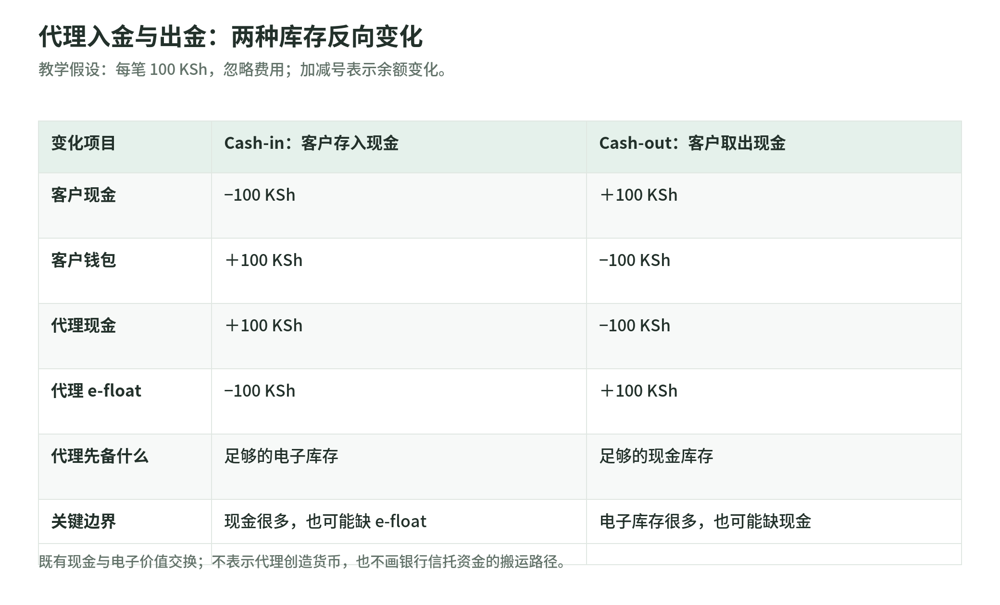

# 21 现金、Mobile Money 与本地支付方式

[专题](../README.md) / [主干](../payment-industry-101.md)

研究读取日：2026-11-02。下面的余额与交易均为教学假设；机制可迁移，地区法律、费用和时效不能直接迁移。

## 1. 现金进出系统：钱与记录都要交接

阿明领到现金工资，想给外地家人汇钱。他需要的不是一个漂亮二维码，而是把手里的纸币变成可远程转移的余额。Cash-in 是现金入金；Cash-out 是余额换回现金。GSMA 的定义把二者分别描述为客户用现金增加钱包余额、用电子货币换取现金，不把点击“充值”本身当成交易完成。[GSMA 定义](https://www.gsma.com/mobile-money-metrics/)

在教学模型里，交钱和记账是两项动作：柜台收到了钱，客户余额却没增加，是待查差错；余额扣掉了但现金没交付，也不是正常完成。应留下金额、双方身份、交易编号和交接证据。所引肯尼亚 M-PESA 客户条款标注 2022 年 6 月，要求入金经过身份核验，并在代理日志签字。[M-PESA 客户条款，§7](https://www.safaricom.co.ke/images/Downloads/CUSTOMER_TERMS_March_2012.pdf)

ATM 是现金服务入口，不是一种独立货币；所引条款也将参与 ATM 网络列入现金服务点。支票则不是纸币：它进入银行的支票处理流程，银行可电子传递票据信息，资金何时可提取另受可用性规则约束。不要把“已交支票”当成已经拿到现金。[M-PESA §1](https://www.safaricom.co.ke/images/Downloads/CUSTOMER_TERMS_March_2012.pdf)、[美联储 Check 21 FAQ](https://www.federalreserve.gov/paymentsystems/regcc-faq-check21.htm)

## 2. Mobile Money：手机号不是银行账户

Mobile Money 在这里指 GSMA 口径的移动货币服务：手机用于转账和收付款，服务可触达没有正式银行账户的人，并有广泛的实体代理服务点。把银行账户搬到手机上操作的手机银行，不在这一统计定义内；绑卡钱包也不能仅因使用手机就归入这类服务。[GSMA 服务定义](https://www.gsma.com/mobile-money-metrics/)

手机号常是识别用户或收款人的入口，但不自动证明谁欠用户钱。所引肯尼亚 M-PESA 条款将账户定义为电子货币记录，对应由受托人持有的等额现金；Safaricom 提供发行、管理和赎回服务，条款同时明确 M-PESA 不是银行。[M-PESA §1、§2](https://www.safaricom.co.ke/images/Downloads/CUSTOMER_TERMS_March_2012.pdf)

所以研究钱包时要沿着“用户—服务合同—受托资金—兑付渠道”读下去。手机号、SIM 卡和 PIN 是访问与认证工具，不能代替资金权利说明。手机上的银行贷款、储蓄等合作产品，也要单独看对应银行和产品合同，不能混成一个钱包余额。[M-PESA §1、§6](https://www.safaricom.co.ke/images/Downloads/CUSTOMER_TERMS_March_2012.pdf)

## 3. 代理的两种头寸：现金与 e-float

<!-- illustration: payment-ext-agent-cash-and-efloat-0175d569e8 -->

*图：代理入金与出金：两种库存反向变化。教学假设：每笔 100 KSh，忽略费用；加减号表示余额变化。*
<!-- /illustration: payment-ext-agent-cash-and-efloat-0175d569e8 -->

街边代理要同时备两种“库存”：保险柜里的现金，以及代理账户里的电子价值 e-float。入金业务消耗电子库存，出金业务消耗现金库存；两者不能仅看合计。[GSMA《Managing a Mobile Money Agent Network》](https://www.gsma.com/mobilefordevelopment/wp-content/uploads/2012/03/manage.pdf)

假设忽略费用，代理起初有现金 1,000 肯尼亚先令（KSh）和 e-float 1,000。阿明拿 100 现金入金：阿明现金减 100、钱包加 100；代理现金变 1,100、e-float 变 900。随后另一位客户取出 100：客户钱包减 100、现金加 100；代理收到电子价值，现金与 e-float 又各回到 1,000。这是既有现金与电子价值的交换，不是代理凭空创造了 100 余额。

关键反例：代理手里有 5,000 现金、却只有 20 e-float，仍无法在上述预付库存模型中完成 100 入金；反过来，电子余额充足、现金见底，也办不了 100 出金。它可能要向运营方、合作银行或负责流动性的上级代理再平衡。GSMA 手册列举这些安排，但不是每个市场都采用同一种结构。[GSMA 代理管理手册](https://www.gsma.com/mobilefordevelopment/wp-content/uploads/2012/03/manage.pdf)

这个例子只展示代理与客户之间的库存变化，不表示每笔入金都立即往信托银行搬一次纸币，也不解释全系统电子货币发行和银行信贷创造。

## 4. 佣金为何存在：代理提供的是现金可得性

代理要垫库存、花时间核验客户，并承担再平衡的成本。运营方支付佣金，是购买这些服务；它不是客户交进来的全部本金，更不是代理的净利润。客户手续费与代理佣金也是两项不同的账：某种入金对客户免费，代理仍可能由运营方付佣金。[GSMA《Incentivising a Network of Mobile Money Agents》](https://www.gsma.com/mobilefordevelopment/wp-content/uploads/2012/03/incentivise.pdf)

教学假设：某店一天办理 40 笔业务，每笔平均佣金 5，毛佣金为 200；如果交通再平衡花 60，还须扣人工与其他成本。不能拿当天经手的 20,000 当收入，也不能拿现金柜里的增加额当利润。实际佣金可能分档、分润或延后结算，需查当前合同，不套用历史手册中的费率。

设计佣金还会改变行为：只奖励开户，可能养出大量不用的账户；分档不合理，可能诱发拆单。GSMA 手册将这些列为激励设计风险。评价网络时，除了门店数量，还要问“用户到店时，钱能不能真的存进去、取出来”。[GSMA 代理激励手册](https://www.gsma.com/mobilefordevelopment/wp-content/uploads/2012/03/incentivise.pdf)

## 5. 本地缴费凭证：boleto 不等于便利店现金

两种方式看起来都像“先拿一张付款单”，但入口和规则不同。巴西 boleto 是缴费凭证，用户可通过银行、ATM、授权机构或网银付款，因此不能统称为纯现金支付。Stripe 的巴西接入说明中，凭证生成后仍须付款，确认异步返回，通常在下一营业日；这不是所有巴西通道的统一时效承诺。[Stripe Boleto](https://docs.stripe.com/payments/boleto)

日本 Konbini 示例则要求用户带付款代码、确认号码和现金到便利店完成付款。提交结账表单只会生成指引：Stripe 的 `checkout.session.completed` 在此场景不意味着已付款，商户须等待异步付款成功事件再履约。[Stripe Konbini：Checkout](https://docs.stripe.com/payments/konbini/accept-a-payment.md?payment-ui=checkout)

假设阿明下单后拿到凭证就关闭网页，商户不能据此发货。教学状态应至少分成“凭证已生成—待付款—付款确认—履约”，另有过期、失败和异常核对分支。期限与确认延迟也不是同一个钟：Konbini 文档指出，期限前已打印有效缴费单的客户，可能在期限后才在收银台付完，系统因此设有缓冲处理。不能本地计时器一响就断言绝不会再收到钱。[Stripe Konbini：Expiration and cancellation](https://docs.stripe.com/payments/konbini/accept-a-payment.md?payment-ui=checkout)

据此做一个纸上演练：订单过期，库存已经释放，付款通知稍后才来。不要直接覆盖成“订单成功”，而要先把收到的款项与原凭证匹配，核对商品还能否交付，再决定恢复订单、退款或人工处理。凭证重新生成时也保留新旧关系，避免旧凭证的款项被算到新订单。这是由异步机制推导的工程建议，不是所有通道共用的退款规则。

## 6. 从汇钱到工资、政府出款和账单

阿明可以把余额转给家人，家人再去代理取现，这是 P2P 转账与 cash-out 两笔业务。也可以用余额缴账单，或向支持的商户付款，不必每次取出现金。GSMA 分开统计转账、缴账单、商户支付、批量出款和现金转换，不宜把它们混成一种“扫码交易”。[GSMA 指标定义](https://www.gsma.com/mobile-money-metrics/)

组织端的路径不同：企业批量向员工钱包发工资；政府或发展组织也可发放救助款，这些都属于 GSMA 所定义的批量出款。运营方例子是 Safaricom B2C：公开文档将它定义为企业向客户手机号付款，并区分接收请求的应答与后续结果回调。这证明产品能力，不代表某个政府或企业已经全面采用。[GSMA 批量出款定义](https://www.gsma.com/mobile-money-metrics/)、[Safaricom B2C](https://developer.safaricom.co.ke/apis/BusinessToCustomer)

据此可以推导一个运营风险：发薪日如果大量收款人同时取现，钱包入账顺畅仍可能遇到代理现金不足。工程上应分开记录组织出款、收款人入账、现金兑付和佣金对账；本地凭证支付则另核对订单号、通道记录与最终结算。入口再方便，也不会让代理库存、付款期限和资金交接责任消失。

再假设一次出款回调丢失：组织界面显示等待，员工已收到余额。直接重新打一笔，可能把一份工资变成两份。教学处理是先按原业务编号核查结果，再依据明确状态决定重试或调查。把“请求超时”“支付失败”“尚未核实”分开，才能让财务知道哪些只是缺通知，哪些真的少了钱；这不是在宣称某个运营方默认提供同一种幂等保证。

## 7. 自测与参考答案

1. 代理有 2,000 现金、50 e-float，能否按第 3 节模型办理 100 入金？为什么？
2. 商户收到 Konbini 的 `checkout.session.completed`，是否应该发货？
3. 工资已进钱包、员工却取不到现金，是否足以说明工资没到账？代理经手本金是否就是收入？

参考答案：

1. 不能；现金充足不等于电子库存充足，应先补足 e-float。
2. 不应；这里只证明已生成凭证，应等待可核验的异步付款成功结果。
3. 不足以；入账与代理现金兑付是两个环节。代理收入主要看合同佣金，经手本金不是收入。

## 8. 一手来源与核验边界

下表为本章实际读取的一手来源；读取日统一为 2026-11-02。法律与产品条款只用于解释相应市场，不构成法律意见。

| 标题／发布方 | URL | 读取日 | 适用与时间边界 |
| --- | --- | --- | --- |
| Mobile Money Metrics／GSMA | [原页](https://www.gsma.com/mobile-money-metrics/) | 2026-11-02 | 读取官方页面公开索引，原站直连受限；只引定义，不引用普及数量，不等于全球法律分类。 |
| M-PESA Customer Terms & Conditions／Safaricom | [官方 PDF](https://www.safaricom.co.ke/images/Downloads/CUSTOMER_TERMS_March_2012.pdf) | 2026-11-02 | 读取官方 PDF 公开索引；页内标注 June 2022，文件名 March 2012 不是版本日期。只讲肯尼亚所引条款，不冒称最新。 |
| Managing a Mobile Money Agent Network／GSMA | [原文 PDF](https://www.gsma.com/mobilefordevelopment/wp-content/uploads/2012/03/manage.pdf) | 2026-11-02 | 2010 年历史手册；读取官方文档公开索引，直连受限。说明双库存与再平衡，不当现行结构或费率。 |
| Incentivising a Network of Mobile Money Agents／GSMA | [原文 PDF](https://www.gsma.com/mobilefordevelopment/wp-content/uploads/2012/03/incentivise.pdf) | 2026-11-02 | 2010 年历史激励手册；只引佣金经济与行为风险，不沿用其中价格。 |
| Frequently Asked Questions about Check 21／美联储 | [原页](https://www.federalreserve.gov/paymentsystems/regcc-faq-check21.htm) | 2026-11-02 | 页面更新于 2013-08-06；美国制度说明，不引用历史处理速度或推导全球支票时效。 |
| Boleto payments／Stripe | [原页](https://docs.stripe.com/payments/boleto) | 2026-11-02 | Stripe 巴西接入的付款渠道、异步确认与凭证期限，不代表所有 boleto 实现。 |
| Konbini payments — Checkout／Stripe | [官方 Markdown](https://docs.stripe.com/payments/konbini/accept-a-payment.md?payment-ui=checkout) | 2026-11-02 | 读取 Checkout 分支；日本现金付款、事件与过期缓冲，不泛化为所有便利店合同。 |
| Business To Customer (B2C)／Safaricom Daraja | [原页](https://developer.safaricom.co.ke/apis/BusinessToCustomer) | 2026-11-02 | 读取公开文档索引；只引 B2C 机制。文档区分沙盒与生产资格，不以测试成功证明上线。 |
