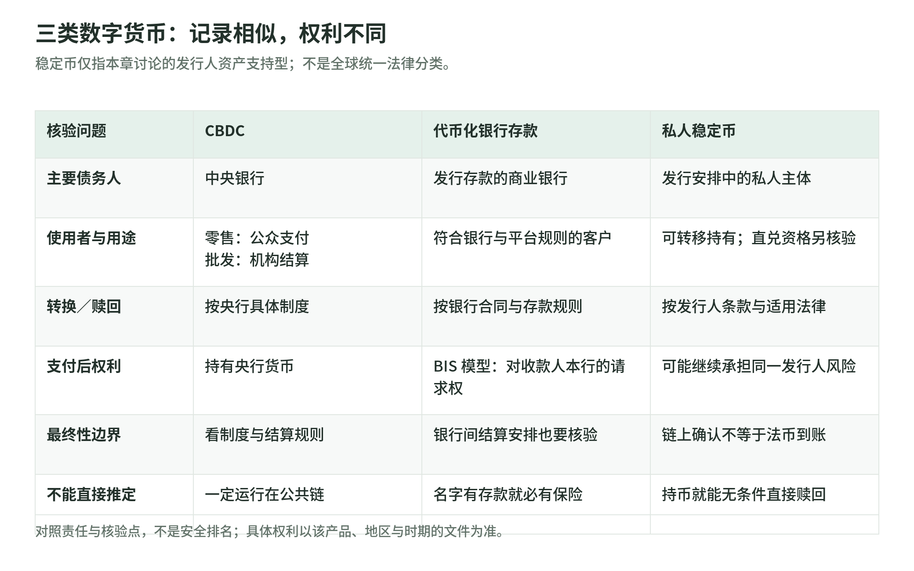
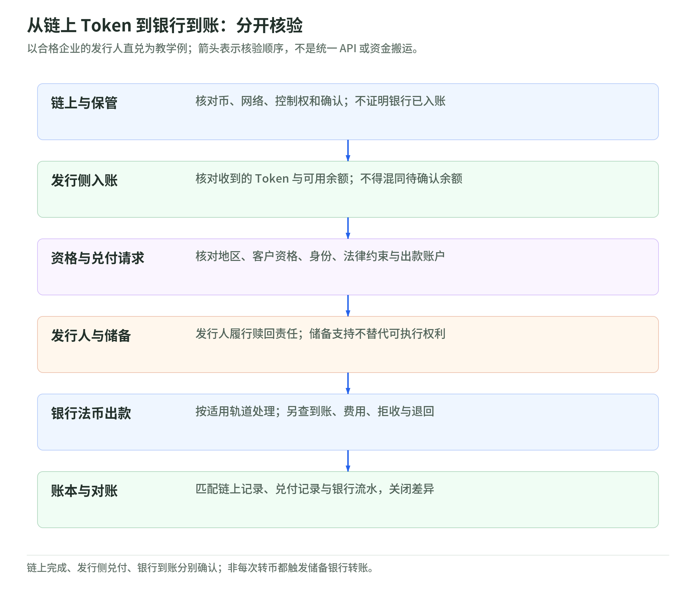

# 22 CBDC、代币化存款与稳定币

[专题](../README.md) / [主干](../payment-industry-101.md)

研究读取日：2026-11-02。数字人民币段落明确限定在 2021 年白皮书；案例为教学假设，不将研究蓝图、原型或沙盒当作生产部署。

## 1. 同样是数字余额，先问谁承担责任

小林收到一笔“数字钱”，屏幕显示 100。先别问链上每秒能跑多少笔，问三个问题：这 100 是谁的负债？向谁、按什么条件换回其他形式的钱？支付完成后，谁仍对小林负有义务？技术记录和法律权利需要分别核验。

Tokenisation，即代币化，是把价值或权利放到可编程平台上表示，并附上转移规则；不是给余额加上 Token 标签就产生央行担保。[BIS 2023 第三章](https://www.bis.org/publ/arpdf/ar2023e3.htm) 将代币化银行存款与私人稳定币区分讨论，特别关注二者是否保持货币按面值流通的“一致性”。[BIS Bulletin 73](https://www.bis.org/publ/bisbull73.htm)

央行研究 CBDC 也不等于已决定发行。2020 年央行联合报告强调，新安排须维护货币与金融稳定，与现有货币共存并促进创新；这是一组设计原则，不是普及数量或上线证明。[央行联合报告：基础原则](https://www.bis.org/publ/othp33.htm)

## 2. 三类数字货币：先认债务人

<!-- illustration: payment-ext-digital-money-claims-8a77bffc36 -->

*图：三类数字货币：记录相似，权利不同。稳定币仅指本章讨论的发行人资产支持型；不是全球统一法律分类。*
<!-- /illustration: payment-ext-digital-money-claims-8a77bffc36 -->

CBDC 是央行数字货币，核心是央行负债。零售 CBDC 面向公众日常支付；批发 CBDC 面向银行等机构的结算需求。区分点是使用者与用途，不是“零售跑公链、批发跑私链”。人民银行 2021 年白皮书明确作出这一分类，并将当时的数字人民币定位为零售 CBDC。[人民银行白皮书，§2.1](https://www.pbc.gov.cn/en/3688110/3688172/4157443/4293696/2021072014364791207.pdf)

商业银行代币化存款，债务人仍是发行存款的商业银行。BIS 的模型中，小林从甲行向乙行客户付款，甲行减少小林存款，乙行增加收款人存款，银行间另以央行货币结算。收款人最终持有的是对乙行的请求权，不是被迫接受甲行债务。[BIS 2023 年度经济报告，第三章](https://www.bis.org/publ/arpdf/ar2023e3.htm)

私人稳定币不能一概而论。本章聚焦有发行人、宣称资产支持并提供赎回的类型，不把它与算法稳定币混在一起。其持有人需要追索发行安排中的主体，而不是中央银行；转币可以转移对同一发行人的权利，二级市场成交价却未必始终等于面值。[BIS 2023 第三章](https://www.bis.org/publ/arpdf/ar2023e3.htm)、[BIS Bulletin 73](https://www.bis.org/publ/bisbull73.htm)

因此，代币化存款的转换路径要读银行合同；CBDC 的兑换与接受范围要读该央行制度；稳定币的赎回要读发行人条款。存款保险也不能只凭名字推定：Circle 的 USDC 条款就明确排除相应存款保险保护。[Circle USDC Terms，§13](https://www.circle.com/legal/usdc-terms)

## 3. 数字人民币分层运营：这是 2021 年设计说明

本节使用人民银行工作组 2021 年 7 月发布的《中国数字人民币的研发进展》英文原版，不把它称为“2026 年最新实施规则”。白皮书当时说明：数字人民币是央行发行的数字形式法定货币，采用集中管理与双层运营，主要定位于 M0，与实物人民币并存。[人民银行白皮书，§2.1](https://www.pbc.gov.cn/en/3688110/3688172/4157443/4293696/2021072014364791207.pdf)

分工不是“央行直接经营所有用户柜台”：人民银行负责发行、注销、互联互通和钱包生态管理；指定运营机构主要提供兑换服务，运营机构与相关商业机构共同提供流通和零售支付服务。银行 App 是接触用户的渠道，不能据此把里面的数字人民币归为该银行自己的存款负债。

白皮书还描述按身份核验强度区分钱包权限和限额。这里应分清两个“层”：双层运营是机构职责；钱包分级是客户核验与使用约束，不是同一件事。[人民银行白皮书，§3.3—§3.4](https://www.pbc.gov.cn/en/3688110/3688172/4157443/4293696/2021072014364791207.pdf)

本节只讲历史设计，不能用它推定今天的余额收益、限额、机构名单或覆盖人数。其他后续规则即使发生变化，也应另查带日期的新文件。

## 4. 赎回与法律权利：持币不等于随时直兑

小林收到 100 USDC，想直接要求发行人给银行账户打 100 美元。币进入钱包并不自动让他成为发行人的合格直兑客户。读取日可见的 Circle 条款更新于 2026-10-15，且只适用于欧洲经济区（EEA）之外的持有人；其直接赎回要求符合资格并开立状态良好的 Circle Mint 账户，还受条款、适用法律和可能的费用约束。[Circle USDC Terms，§2、§4](https://www.circle.com/legal/usdc-terms)

教学上要把两条路分开：“向发行人赎回”与“卖给交易所或经纪商”。后者涉及另一个交易对手及其报价、收费与出款规则。Circle 也不保证第三方平台上的 USDC 价格一直等于 1 美元。[Circle USDC Terms，§13](https://www.circle.com/legal/usdc-terms)

法律核验还应问：发行主体是谁，储备如何持有，自己有什么赎回权，冻结或破产时向谁主张权利。不要将“有储备”直接写成“每个持币者均可立即拿回现金”。CPMI-IOSCO 对系统重要稳定币安排的指导，专门讨论治理、相互依赖、结算最终性和货币结算；它不是给所有稳定币发的安全认证。[CPMI-IOSCO 2022 指导](https://www.bis.org/cpmi/publ/d206.htm)

## 5. 从链上 Token 到银行兑付：职责不会消失

<!-- illustration: payment-ext-token-to-bank-redemption-00793cf39e -->

*图：从链上 Token 到银行到账：分开核验。以合格企业的发行人直兑为教学例；箭头表示核验顺序，不是统一 API 或资金搬运。*
<!-- /illustration: payment-ext-token-to-bank-redemption-00793cf39e -->

假设一家符合资格的企业收到 100 USDC 后申请赎回。它先核对币种、网络和可支配余额；Circle Mint 文档描述的路径是，外部钱包转币后达到所需确认数，余额才记入 Mint 账户，再创建向关联银行账户的出款请求。发行侧扣减相应余额，通过适用银行支付轨道转出法币；银行也可能拒收并触发退回。[Circle：铸造与赎回机制](https://developers.circle.com/circle-mint/concepts/how-minting-works)

这里至少有三个“完成”：链上转移完成、发行人处理赎回、银行收款完成。链上确认解决该网络的转移记录，不替银行入账签字。收款企业应匹配链上交易、发行侧兑付记录与银行流水，费用另记；不能把链上手续费当成全程成本，也不能把每次转币说成每次都在银行搬了储备现金。

结算最终性是按适用规则确定转移何时最终完成，不只是界面显示绿色。BIS 在其代币化存款蓝图中，以央行货币结算支持最终性；CPMI-IOSCO 则要求相关系统重要稳定币安排认真处理这一责任。两种架构不能凭“不可逆”三个字就视为法律效果相同。[BIS 2023 第三章](https://www.bis.org/publ/arpdf/ar2023e3.htm)、[CPMI-IOSCO 指导](https://www.bis.org/cpmi/publ/d206.htm)

据此设计系统时，应保存各环节状态与失败原因。账本可区分链上待确认、余额可用、兑付处理中、银行拒收和对账关闭；这些是教学职责边界，不是统一 API 字段规范。

再做一个教学反例：出口商和买家约定以美元银行到账为交付条件，买家只给了一张链上交易截图。出口商此时应先核对币与收款权，再追踪兑付和银行流水，不能替合同改成“看到截图就交货”。若双方本来约定接受稳定币本身，则付款条件又不同。确定接受哪种资产与权利，是业务和合同选择；程序不能偷偷代替双方决定。

## 6. 不一定跑公共链，也别把原型当上线

“币”不意味着必须使用公共区块链。人民银行 2021 白皮书描述的是集中式与分布式架构结合的技术框架，运营机构可依需要选择技术路线；它并没有把数字人民币等同于公众可自由参与验证的公链。[人民银行白皮书，§3.6](https://www.pbc.gov.cn/en/3688110/3688172/4157443/4293696/2021072014364791207.pdf)

BIS 2023 年提出将央行货币、代币化存款和资产结合的统一账本蓝图，也讨论通过接口衔接既有系统的路径。蓝图描述可能怎样运作，不证明全球银行已经统一迁移；跨境互联还需处理不同法律、货币和监管安排。[BIS 2023 第三章](https://www.bis.org/publ/arpdf/ar2023e3.htm)

读项目材料时，可以建立一张证据卡：谁发布、哪一天、属于研究／原型／试点还是生产、谁可参加、真实资金如何兑付、失败由谁处理。这样即使暂不追逐最新项目，也能避免把实验完成说成商业普及，把代码可执行说成法律权利已经确定。

## 7. 自测与参考答案

1. 银行运营的数字人民币钱包，是否意味着币是该银行的负债？
2. 小林持有 100 USDC，是否必然能直接向 Circle 换得银行到账 100 美元？
3. 代币转移已确认，是否证明法币已入银行？写着“prototype”的报告能否证明生产部署？

参考答案：

1. 不能据此认定；在所引 2021 年设计中，央行发行、运营机构提供服务，渠道与债务人不同。
2. 不必然；须核对地区、直兑资格、账户、条款与费用，也要区分第三方出售路径。
3. 都不能。网络确认、赎回与银行入账分开核验；原型证明的是对应实验，不是生产运行。

## 8. 一手来源与核验边界

下表来源读取日统一为 2026-11-02；历史资料按原发表期使用，不用来推定今日规模。本章不是法律或投资意见。

| 标题／发布方 | URL | 读取日 | 适用与时间边界 |
| --- | --- | --- | --- |
| Central bank digital currencies: foundational principles and core features／央行联合报告、BIS | [官方发布页](https://www.bis.org/publ/othp33.htm) | 2026-11-02 | 2020-10-09 的原则研究；本章引用发布页摘要，不声称研究国家均已发行。 |
| Blueprint for the future monetary system／BIS 年度经济报告第三章 | [原文 HTML](https://www.bis.org/publ/arpdf/ar2023e3.htm) | 2026-11-02 | 2023 年蓝图与模型；代币化存款案例是设计说明，不是生产部署统计。 |
| Stablecoins versus tokenised deposits: implications for the singleness of money／BIS Bulletin 73 | [官方发布页](https://www.bis.org/publ/bisbull73.htm) | 2026-11-02 | 2023-04-11；引用公开要点，观点属作者，不等于所有央行的制度决议。 |
| Progress of Research & Development of E-CNY in China／人民银行数字人民币研发工作组 | [官方英文原文 PDF](https://www.pbc.gov.cn/en/3688110/3688172/4157443/4293696/2021072014364791207.pdf) | 2026-11-02 | 2021 年 7 月白皮书；实际读取官方英文版，不代表 2026 最新实施规则。URL 末尾为官方数字文件名。 |
| USDC Terms／Circle | [原页](https://www.circle.com/legal/usdc-terms) | 2026-11-02 | 页面标注 2026-10-15；只讨论其 EEA 外条款，地区附则、其他稳定币另查。 |
| How minting and redemption works／Circle | [原页](https://developers.circle.com/circle-mint/concepts/how-minting-works) | 2026-11-02 | Mint 产品机制与账户、链上及银行出款边界；不把沙盒等待时间当真实资金时效。 |
| Application of the PFMI to stablecoin arrangements (final version)／CPMI-IOSCO | [官方发布页](https://www.bis.org/cpmi/publ/d206.htm) | 2026-11-02 | 2022-07-13 指导；范围为系统重要安排，须由有关当局判定并在当地落实，不是全球通用持币保障。 |
