# 支付行业 101：从一杯咖啡到全球资金网络

研究整理：2026-11-02。依据：支付网络、中央银行、标准组织、监管及服务商的公开一手资料。

阅读顺序：白话直觉 → 原理 → 商业 → 风险 → 工程。预计分几次阅读，不要求一次背完术语。

> 先记一句话：支付不是“把一个数字从屏幕 A 搬到屏幕 B”，而是让多个主体对一笔交易的授权、资金责任和账务记录达成一致，并按规则完成价值转移。

## 目录

1. [支付是什么：先搭一张地图](#lesson-01)
2. [一笔银行卡支付的一生](#lesson-02)
3. [商户受理生态：六种角色](#lesson-03)
4. [商业模式：100 元怎么分](#lesson-04)
5. [钱包、Token、发卡与虚拟卡](#lesson-05)
6. [银行账户支付与实时支付](#lesson-06)
7. [跨境与企业支付](#lesson-07)
8. [风控、争议、安全与合规](#lesson-08)
9. [支付系统怎样避免错账](#lesson-09)
10. [怎样研究一家支付公司](#lesson-10)
11. [新场景：嵌入式支付、稳定币与代理](#lesson-11)
12. [把全图拼起来：电商平台案例](#lesson-12)

各课后的“检查理解”可先自己回答，答案见[学习路线](learning-roadmap.md)。术语不熟时，查[速查表](glossary.md)，不要被缩写打断主线。

<a id="lesson-01"></a>

## 01 支付是什么：先搭一张地图

### 从买咖啡开始

<!-- illustration: payment-three-flows-f69c56e672 -->
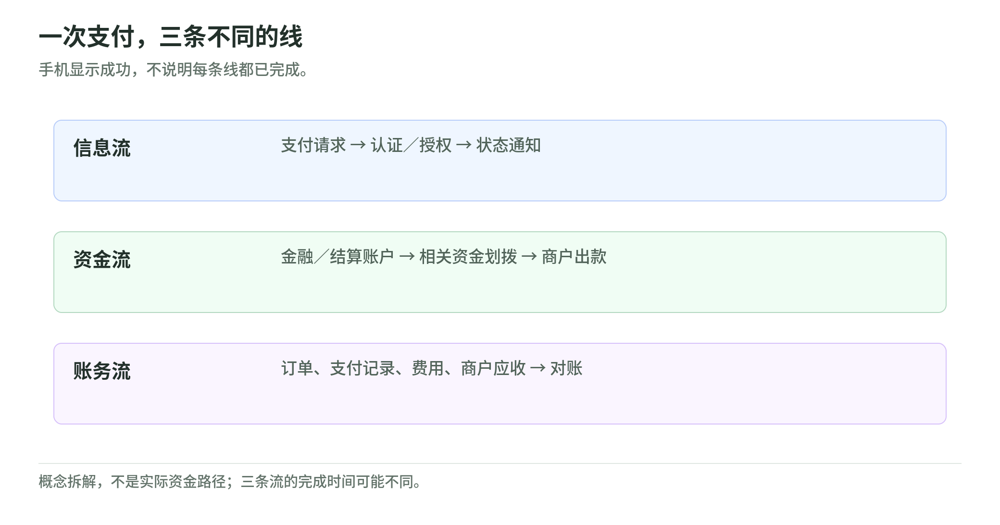

*图：一次支付，三条不同的线。手机显示成功，不说明每条线都已完成。*
<!-- /illustration: payment-three-flows-f69c56e672 -->

小林拿手机买一杯 30 元咖啡，手机显示“支付成功”，店员出杯。对人来说只有一秒钟；对支付行业来说，至少有三种事情发生：

1. **信息流**：发送“谁向谁付多少”，并获得处理结果。
2. **资金流**：相关金融账户或结算账户的资金按安排转移。
3. **账务流**：记录订单、欠款、手续费、商户应收和后续调整。

三条流可能在不同时间完成。显示成功、订单完成、服务商余额可用和商户银行到账，不应压成一个“成功”字段。这里是教学拆解；清算、结算等正式术语以 CPMI 定义为准。[CPMI](sources.md#cpmi)


### 钱、账户、凭证、网络：四件不同的东西

**钱**回答“用什么价值支付”。商业银行存款、现金和符合某种安排的电子货币，不是同一种法律关系。银行账户余额通常是银行对客户的负债，而不是一个给客户单独放纸币的抽屉。这里采用英国央行的基础解释，不把它直接当作所有钱包或数字资产的法律定义。[MONEY](sources.md#money)

**账户**回答“谁对谁记着多少”。银行给客户记账户，钱包也可能给用户记余额，PSP 给商户记待结算余额；它们可能对应不同的债务人和保障安排。

**凭证**回答“用什么发起授权”。卡号、Token、银行账号、收款别名、二维码等都可能参与支付。但“有一个二维码”不说明底层是卡、账户还是钱包余额。EMVCo 的二维码规范本身就区分不同模式，并支持具体支付程序的数据组织。[QR](sources.md#qr)

**网络／Rail**回答“支付按哪套规则完成”。银行卡网络、批量账户支付、实时账户支付、钱包内部账务和区块链是不同路径。

类比：钱是货物；账户是货物归属记录；凭证是取货或发货条件；Rail 是运输路线。类比只帮助入门，不替代法律或技术定义。

### 三维分类：角色 × 产品 × 场景

<!-- illustration: payment-industry-map-1ae93f30b4 -->
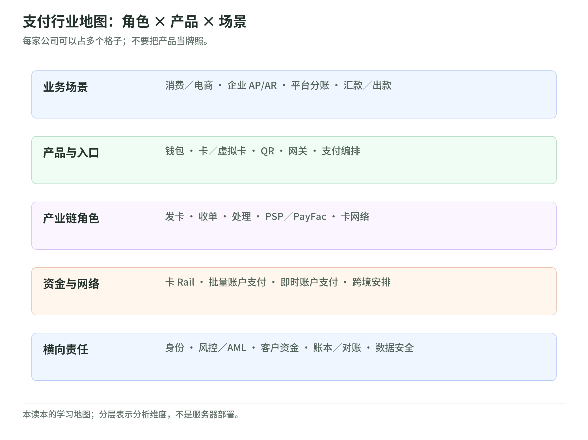

*图：支付行业地图：角色 × 产品 × 场景。每家公司可以占多个格子；不要把产品当牌照。*
<!-- /illustration: payment-industry-map-1ae93f30b4 -->

把三个维度分开，才能避免分类混乱。不要把所有名词排成一列：

| 维度 | 例子 | 含义 |
| --- | --- | --- |
| 角色 | Issuer、Acquirer、Processor、PSP | 谁承担什么责任 |
| 产品 | Wallet、Virtual Card、Gateway、Orchestration | 给客户什么能力 |
| 场景 | 零售、电商、B2B、跨境、Payout | 谁因为什么需要付款 |

“跨境虚拟卡 PSP”是三个维度的组合，不是一张自动包含全部责任的牌照。


### 一个够用的行业全景

本读本按八类建立学习地图：卡网络、商户受理、钱包、发卡、跨境、A2A／实时支付、B2B、风险与基础设施。研究时再问两条横轴：**它控制客户关系，还是提供底层能力？它只传信息，还是承担资金、结算或损失责任？**

同一家公司可以站在多个格子里，技术服务商也可能依赖银行伙伴承担持牌责任。品牌名字不能替代逐项拆解。

**检查理解 1**：扫同一个二维码，为什么可能使用完全不同的支付网络？

<a id="lesson-02"></a>

## 02 一笔银行卡支付的一生

### 先理解四方模型

<!-- illustration: payment-card-path-c3314323e3 -->
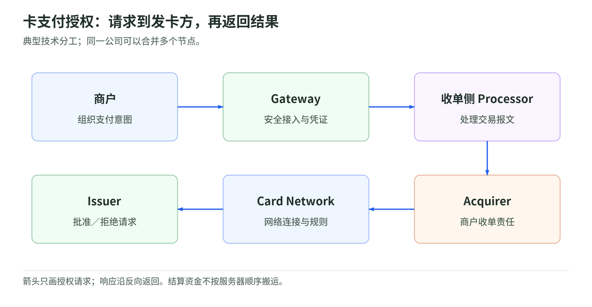

*图：卡支付授权：请求到发卡方，再返回结果。典型技术分工；同一公司可以合并多个节点。*
<!-- /illustration: payment-card-path-c3314323e3 -->

小林在咖啡店刷卡：

- **持卡人**使用发卡机构提供的卡产品。
- **商户**出售商品并受理支付。
- **发卡方 Issuer**管理持卡人的卡账户，决定是否批准支付。
- **收单方 Acquirer**为商户侧提供收单关系和相关责任。
- **卡网络**连接发卡与收单，并提供规则和网络能力。

“四方”计数通常不把卡网络算作那四个主体；不是只有四台服务器。Visa 的公司披露将卡网络与发卡、收单的职能分开。[VISA-2025](sources.md#visa-2025)

典型技术链还会插入 Gateway、Processor、PSP。它们可能合并部署，不能把课程图看作每笔交易必须经过六家独立公司。


授权链路是业务报文的路径；资金结算可能使用其他账户安排，不是钞票沿同样的服务器一站站移动。

### 六个阶段，每个都问不同的问题

<!-- illustration: payment-card-lifecycle-abd149c1bc -->
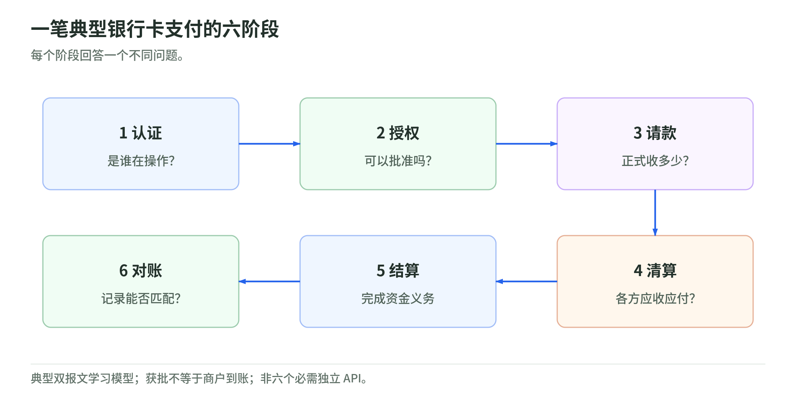

*图：一笔典型银行卡支付的六阶段。每个阶段回答一个不同问题。*
<!-- /illustration: payment-card-lifecycle-abd149c1bc -->


| 阶段 | 白话问题 | 典型结果／边界 |
| --- | --- | --- |
| Authentication 认证 | 是不是可信的用户在操作 | 3DS 等结果；不是发卡授权结果 |
| Authorization 授权 | 这笔交易现在可以批准吗 | 获批／拒绝，通常涉及额度或余额控制 |
| Capture 请款 | 商户要不要正式收这笔钱 | 捕获此前授权；也可能采用自动捕获 |
| Clearing 清算 | 各方应收应付与费用是多少 | 交换并处理金融交易记录 |
| Settlement 结算 | 按规则什么时候转移资金 | 完成相关资金义务 |
| Reconciliation 对账 | 三套记录是否一致 | 订单、支付记录、财务记录、银行流水匹配 |

这是典型双报文卡支付的学习模型。不是所有交易都分六个独立 API 调用；单报文、预授权、部分捕获等安排会不同。Adyen 文档明确区分授权、捕获、结算与商户付款，并提示“Settled”不等于商户已经收到银行付款。[CARD-LIFE](sources.md#card-life)

### 为什么需要先授权、后请款

酒店不知道最终房费，租车不知道是否有附加费用，电商可能在发货后才请款。授权可以先确认可支付能力，捕获再把实际金额送入后续处理。

反过来，授权后订单取消，可以撤销／取消尚未捕获的支付。已经捕获后再退钱，一般进入退款流程，而不是把旧订单记录删除。具体可捕获期限、部分捕获和取消条件取决于提供方与卡规则。[CARD-LIFE](sources.md#card-life)

### “请求超时”不是“交易失败”

教学例：收单侧已经拿到发卡批准，但商户等响应超时。商户若立即把请求当新付款重发，可能创建第二笔交易。

正确的学习心智是：**不知道结果是未知，不是失败**。工程上需要支付标识、状态查询、幂等和异步确认。幂等能力有服务商规定的适用范围和保存期，不能当成无限期的魔法。[IDEMPOTENCY](sources.md#idempotency)

### 付款后的三类反向动作

| 动作 | 白话理解 | 不可混淆之处 |
| --- | --- | --- |
| 取消／授权撤销 | 不再使用尚未捕获的授权 | 不是已入账资金的退款 |
| Refund 退款 | 商户主动发起退还 | 可能失败或延迟，不是删掉交易 |
| Dispute／Chargeback 争议／拒付 | 持卡人通过发卡机构提出争议 | 有证据、责任和时限规则；不是所有支付方式都一样 |

拒付常与欺诈有关，但也可能涉及未收到商品、重复扣款或服务争议。不能把所有拒付都算成“被盗卡”。[DISPUTES](sources.md#disputes)

**检查理解 2**：授权成功后，商户是否已经拿到可自由使用的银行现金？

<a id="lesson-03"></a>

## 03 商户受理生态：六种角色

### 为什么商户不直接接卡网络

<!-- illustration: payment-acceptance-roles-27455a0911 -->
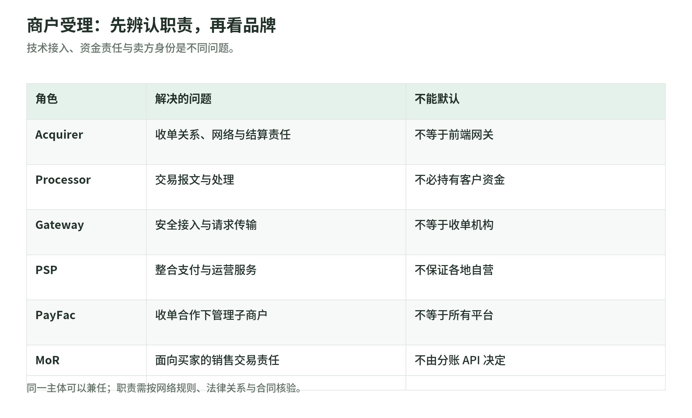

*图：商户受理：先辨认职责，再看品牌。技术接入、资金责任与卖方身份是不同问题。*
<!-- /illustration: payment-acceptance-roles-27455a0911 -->

教学直觉：一家咖啡店需要“能收钱、能查账、有人处理问题”，而不是自行实现所有网络、密钥、商户审核与结算规则。不同角色把这些能力打包。


| 角色 | 核心职责 | 不应默认它做什么 |
| --- | --- | --- |
| Acquirer 收单机构 | 商户收单关系、网络责任与结算安排 | 不一定提供最前端的结账界面 |
| Processor 处理机构 | 授权、清算等交易报文处理 | 不一定持有客户资金；有发卡侧与收单侧处理 |
| Gateway 网关 | 安全接入、支付请求与凭证传输 | 不因名字带“支付”就承担收单责任 |
| PSP 支付服务商 | 组合支付方式、接入、运营等服务 | 不能默认每个国家都自营收单 |
| PayFac 支付便利商 | 按网络安排管理子商户及其支付服务 | 不等于任何 SaaS 平台；需收单合作与相应规则 |
| MoR 交易销售责任主体 | 以约定身份承担面向买家的销售、退款等责任 | 不等于仅代传支付请求；具体责任看合同 |

这些角色是理解职责的工具，不是互斥的公司分类。PayFac 角色需要结合网络规则，不是“做一个商户注册页面”就成立；MoR 的销售责任也不能用技术接入方式推断。[PAYFAC](sources.md#payfac) [MOR](sources.md#mor)

### Gateway 与支付编排不是同一层

Gateway 主要解决接入；**Orchestration 编排**解决“接了多个 PSP 后，如何统一选择和操作”。

可以优化路由、统一 Token／状态、管理不同支付方式、观测成功率、整合对账。但“统一 Token”并不意味着凭证在所有收单渠道之间天然可移植；权限和 Token 类型必须确认。[TOKEN](sources.md#token)

下面是教学决策顺序，不是某家厂商的承诺：

1. 先过滤合法、支持该支付方式和币种的候选通道。
2. 再看用户所在地区、成功率、可用性、延迟与总成本。
3. 最后考虑受规则允许的重试，而不是无限轮询每条通道。

便宜的通道未必最终便宜：少量额外拒绝可能损失订单；重复尝试可能增加费用和欺诈信号。编排还引入接入维护、Token 管理和对账复杂度，需要净收益评估。

### 平台收款、分账、商户付款是三个问题

电商平台从买家收 100 元，约定商家分到 90 元：

- **Charge／收款**：买家的一笔支付。
- **Transfer／分配或转移**：平台体系中如何形成商家权益。
- **Payout／出款**：可用余额何时进入商家的外部银行账户。

在 Stripe Connect 等产品中，收款与 Transfer 可以分离；退款或拒付后的责任与资金处理取决于所选模型。账上分给商家，不等于商家银行已经收到。[CONNECT](sources.md#connect)

**检查理解 3**：一个插件替平台接通支付 API，是否自然成为 PayFac 或 MoR？

<a id="lesson-04"></a>

## 04 商业模式：100 元怎么分

### 先把三个数字分开

<!-- illustration: payment-fee-split-2480dc8902 -->
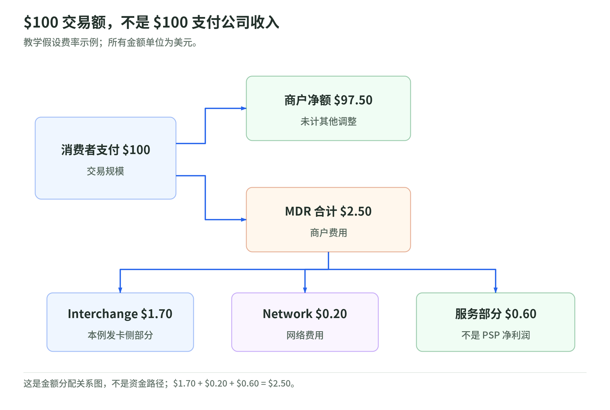

*图：$100 交易额，不是 $100 支付公司收入。教学假设费率示例；所有金额单位为美元。*
<!-- /illustration: payment-fee-split-2480dc8902 -->

小林支付 100 元，这是交易额。商户支付手续费 2.50 元，这是商户成本。某个 PSP 最后确认多少收入，要看合同、分配与会计口径。

下面是一个 **100 美元教学假设例**，不是任何地区的统一费率：


| 项目 | 教学金额 | 怎么理解 |
| --- | ---: | --- |
| 消费者支付 | $100.00 | 交易规模，不是 PSP 收入 |
| 商户支付 MDR | $2.50 | 商户折扣费率对应的费用 |
| 商户净额 | $97.50 | 未考虑税、退款、准备金等调整 |
| MDR 中 Interchange | $1.70 | 在这一模型中流向发卡侧 |
| 网络费用 | $0.20 | 卡网络相关费用 |
| 收单／PSP 服务部分 | $0.60 | 不是净利润，仍有成本 |

**Interchange 不等于卡组织收入**。Visa 的官方解释指出，它是通常由收单侧支付给发卡侧的交易相关费用，商户 MDR 还可以包含其他服务成本。[INTERCHANGE](sources.md#interchange)

实际费用还受卡种、地区、商户类别、线上线下、跨境与合同影响。费率举例不适合直接用于报价。

### 支付公司怎样赚钱

| 商业层 | 可能收入 | 需要检查的扣减／成本 |
| --- | --- | --- |
| 卡网络 | 支付量相关服务、交易处理、跨境、增值服务 | 客户激励，网络与研发投入 |
| 收单／PSP | 商户服务费、处理费、FX、增值服务 | 交换费、网络与合作方成本、风险损失 |
| Gateway／编排 | 处理或 API 费、订阅、优化服务 | 接入与运维，依赖底层 PSP |
| 发卡平台 | 处理／平台费、消费收入分成 | 发卡伙伴、网络、服务和风险成本 |
| 跨境服务 | 转账／收付费、FX 价差、企业服务 | 资金成本、合作银行、合规与流动性 |
| 钱包 | 商户服务、资金相关或其他产品收入 | 客户资金责任、基础设施、获客与风险 |

这是分析框架，不保证每家公司都采用这些收入项。Visa 的收入披露可以核验网络公司的服务、处理、国际交易、其他收入及客户激励结构。[VISA-2025](sources.md#visa-2025)

### Take Rate：一定带上分子和分母

`收入获取率 = 选定收入 / 同口径支付量`

但要先问：是 Gross Revenue、Net Revenue、Gross Profit 还是某个业务分部？分母是 TPV、Processed Volume、跨境金额，还是仅可收费部分？

**固定报告期教学计算**：Adyen 2025 全年结果披露净收入 €2,364.2m、处理量 €1,394.3bn。二者相除约为 **0.1696%，即 16.96 bps**。这是本读本自行算出的净收入／处理量比例，不是官方统一报价、MDR 或未来预期。报告还指出剔除一个大体量客户后，处理量增速不同，说明交易组合会影响解释。[ADYEN-2025](sources.md#adyen-2025)

1 bps = 0.01 个百分点。2.50% = 250 bps，而不是 2.5 bps。

### 收入增长，为什么利润可能不增长

<!-- illustration: payment-economics-bridge-bb9a6913ce -->
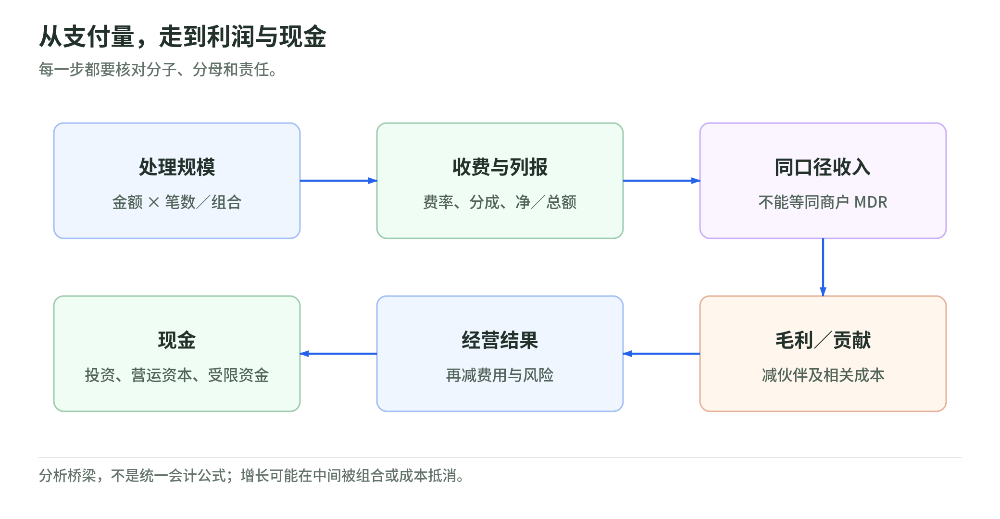

*图：从支付量，走到利润与现金。每一步都要核对分子、分母和责任。*
<!-- /illustration: payment-economics-bridge-bb9a6913ce -->


教学例，所有数字为假设：

| 指标 | 时期 A | 时期 B |
| --- | ---: | ---: |
| 支付量 | 1 亿元 | 1.5 亿元 |
| 同口径收入率 | 0.60% | 0.40% |
| 服务收入 | 60 万元 | 60 万元 |
| 可变成本与风险损失 | 25 万元 | 35 万元 |
| 本例贡献金额 | 35 万元 | 25 万元 |

交易量涨 50%，服务收入没涨，贡献金额反而下降。可能的解释包括大客户议价、低费率产品占比增加、跨境比例下降或风险成本变化。**这些只是候选解释，需要证据。**

完整财务还要看收入确认、总额／净额列报、毛利定义、员工与销售费用、资本支出、营运资本、商户资金和现金。不能把商户结算余额当成公司的自由现金，也不能把 EBITDA 当现金流。

**检查理解 4**：为什么比较两家支付公司的 Take Rate，首先要看会计和业务口径？

<a id="lesson-05"></a>

## 05 钱包、Token、发卡与虚拟卡

### “钱包”不是一个统一的资金模型

<!-- illustration: payment-wallet-models-dcbb42919c -->
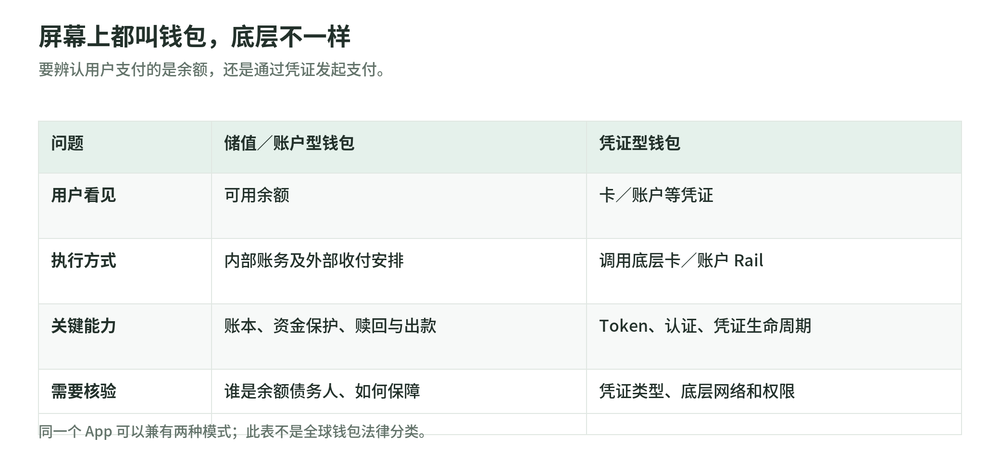

*图：屏幕上都叫钱包，底层不一样。要辨认用户支付的是余额，还是通过凭证发起支付。*
<!-- /illustration: payment-wallet-models-dcbb42919c -->


**储值／账户型钱包**：用户形成由某个主体管理的余额；消费、充值、提现都需要账户与账本。客户资金保障、赎回权和余额性质取决于制度。

**凭证型钱包**：保存或调用支付凭证，底层仍可走银行卡或银行账户。Apple Pay 文档说明设备使用 Device Account Number，而不是把真实卡号作为普通商户支付数据；这不意味着 Apple 为每笔卡消费另建一个储值余额。[APPLE-PAY](sources.md#apple-pay)

一家 App 可以同时提供两种模式，外加贷款或理财。分析时按资金来源拆解，而不是按图标拆解。

### Tokenization：把敏感卡号替换成受约束的凭证

EMV 支付 Token 可以替代 PAN，并对其使用进行特定场景约束，例如设备、商户或支付场景。它不是“把卡号随便加密成另一串数字”。[TOKEN](sources.md#token)

也要区分：

- **网络支付 Token**：用于相应支付网络，并有生命周期和约束机制。
- **服务商 Vault Token**：在特定服务商环境中引用其保存的凭证。
- **区块链 Token**：另一套数字资产概念，不是银行卡 Token。

使用 Token 会降低部分敏感数据暴露面，但不能直接推出整个系统没有 PCI DSS 责任。安全范围要按实际数据、系统及规范判断。[PCI](sources.md#pci)

### 发卡：不是只生成一串号码

<!-- illustration: payment-issuing-path-290e16f09f -->
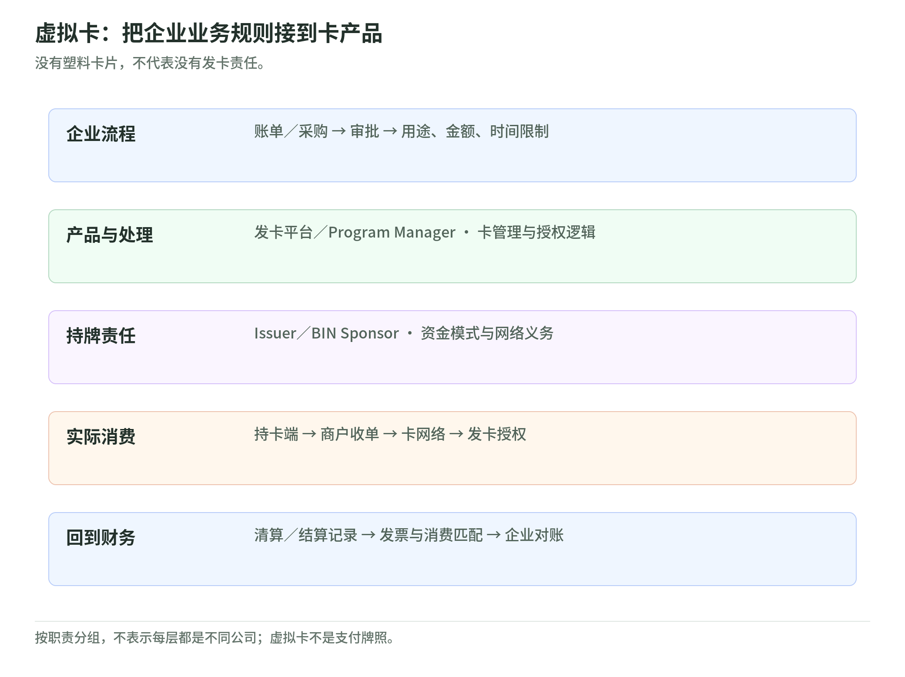

*图：虚拟卡：把企业业务规则接到卡产品。没有塑料卡片，不代表没有发卡责任。*
<!-- /illustration: payment-issuing-path-290e16f09f -->


| 角色 | 负责什么 |
| --- | --- |
| Program Manager 项目管理方 | 客户产品、运营和伙伴组合；职责按合同 |
| Issuer／BIN Sponsor 发卡侧 | 卡发行相关持牌与网络责任 |
| Issuer Processor 发卡处理方 | 授权、交易与卡管理的技术处理 |
| 发卡平台 | 给企业或 Fintech 提供 API、控制和集成能力 |

Marqeta 的 JIT Funding 文档展示一种实时参与授权和资金安排的产品模式，但不能外推成所有虚拟卡的统一资金模式。[JIT](sources.md#jit)

### 虚拟卡为什么适合 B2B

企业要给酒店供应商付一次账单，可以把一张卡的限额设为账单金额，限制商户类别、有效时间和使用频次。卡不需要塑料载体，重点是**支付凭证与业务规则绑定**。

Stripe Issuing 的控制文档列出消费金额与商户类别等限制，并提醒控制对授权的具体适用边界。[CARD-CONTROLS](sources.md#card-controls)

常见价值：企业差旅、供应商付款、广告支出和一次性采购更容易带上用途与审批上下文。并不意味着卡能在所有商户使用，或一定比账户转账便宜。

**检查理解 5**：虚拟卡、Token 和储值钱包，分别改变了支付体系的哪一层？

<a id="lesson-06"></a>

## 06 银行账户支付与实时支付

### A2A 是“谁对谁”，实时是“多久完成”

<!-- illustration: payment-account-rails-f07f8deaa5 -->
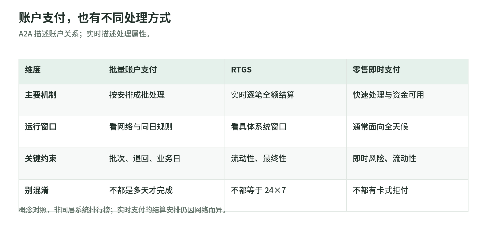

*图：账户支付，也有不同处理方式。A2A 描述账户关系；实时描述处理属性。*
<!-- /illustration: payment-account-rails-f07f8deaa5 -->

**A2A／Account-to-Account**描述账户之间的支付。**实时／即时支付**描述处理与可用性的属性。银行账户支付可以批量执行，也可以实时执行，两者不等价。[CPMI](sources.md#cpmi) [FAST-PAYMENTS](sources.md#fast-payments)


### Push 与 Pull：谁先发起也很重要

- **Push／信用转账**：付款方发起向收款方付款。
- **Pull／借记收款**：收款方根据授权安排发起扣款请求。

信用转账里的“信用”不意味着借贷。直接借记适合约定的周期收款，但授权、退回与撤销规则需看本地制度。不要把银行卡自动续费和账户直接借记当成同一个网络。[CPMI](sources.md#cpmi)

### 三类机制，而不是一张全球排行榜

| 机制 | 白话理解 | 重点关注 |
| --- | --- | --- |
| 批量账户支付／ACH 类 | 将指令按安排批量处理 | 截止时间、批次、退回与业务日；也可能有同日服务 |
| RTGS 实时全额结算 | 每笔按其全额逐笔结算 | 结算最终性、流动性；常见于大额或关键资金 |
| 零售即时支付 | 快速处理并使收款人获得资金可用性 | 全天候运行、欺诈与流动性；结算机制因系统而异 |

不要认为所有 RTGS 都 24×7，或所有即时支付都用同一种 RTGS 机制。服务窗口和最终性看具体网络规则。[FAST-PAYMENTS](sources.md#fast-payments) [FEDWIRE](sources.md#fedwire)

### 各地区的入口怎样理解

美国 FedNow 是美联储的即时支付基础设施，不是一个消费者钱包或数字货币；另有 The Clearing House 运营的 RTP 网络。二者的账户与流动性安排不同，不能因都使用现代报文标准就推断天然互通。ACH 的同日服务也不等于这两种逐笔即时网络。[FEDNOW](sources.md#fednow) [RTP](sources.md#rtp) [ACH](sources.md#ach)

巴西 Pix、印度 UPI、新加坡 PayNow 不能简单看作同一个产品复制到三国；运营主体、账户接入、别名体系和底层安排不同。[PIX](sources.md#pix) [UPI](sources.md#upi) [PAYNOW](sources.md#paynow)

记一个很有用的细节：PayNow 是通过手机号、身份证号等别名发起新加坡元支付的服务，建立在 FAST 相关基础设施上。**用户看到的入口，不必等于结算网络。**[PAYNOW](sources.md#paynow)

在欧洲，SEPA 是欧元支付的一套协调框架，SCT、SDD 和 SCT Inst 分别涉及信用转账、直接借记与即时信用转账。**Scheme／支付方案规则和实际清算结算基础设施也不是同一层。** 开放银行的 PISP 帮用户从另一个提供方的账户发起支付，不能因此推断它自己保管资金，或者一定使用某条即时网络。PISP 说明这里采用英国 FCA 的例子。[SEPA](sources.md#sepa) [OPEN-BANKING](sources.md#open-banking)

### 把中国熟悉的体验放回地图

观察支付宝或微信里的支付时，也先问用户用了余额、绑定银行卡还是其他金融产品，再查具体处理和结算安排。不能把一个 App 里所有支付都画成“钱包内部转账”，更不能把余额宝等金融产品直接当作支付账户余额。这里是产品拆解方法，不是对这些平台全部产品的审计结论。

中国银联提供银行卡网络及相关产品。涉及银行账户的非银行支付机构网络支付，还需要辨认银行、支付机构和清算机构之间的安排。中国银行 2019 年公告记录了其网络支付业务“断直连”的完成，说明**用户支付体验保持相似，后台连接可以改变**；不以这份历史公告宣称已经核验 2026 年所有交易路径。[CHINA-NETWORK](sources.md#china-network)

### 更快也带来新的风险

账户支付可以减少某些卡网络费用，但不是免费：还可能有网络费、服务商费、账户验证、欺诈、资金与运营成本。

速度快意味着错误或诈骗付款之后，事后追回的时间更少。需要收款人核验、交易前风险控制、异常行为识别和明确的退款／争议安排。结算最终性不表示用户永远没有追偿权；相应制度必须单独看。[FAST-PAYMENTS](sources.md#fast-payments)

**检查理解 6**：为什么“实时到账”不说明它具有银行卡同样的拒付机制？

<a id="lesson-07"></a>

## 07 跨境与企业支付

### 跨境不是唯一一条 Rail

<!-- illustration: payment-cross-border-dbe620a4bc -->
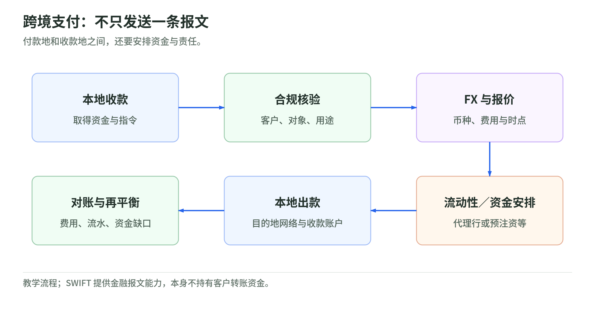

*图：跨境支付：不只发送一条报文。付款地和收款地之间，还要安排资金与责任。*
<!-- /illustration: payment-cross-border-dbe620a4bc -->

跨境描述交易两端位于不同辖区，可能涉及不同币种、法律、参与者和支付网络。银行卡跨境购买、个人汇款、企业付供应商和平台给海外卖家出款，其机制不一样。


一个有用的教学拆解：

1. 在付款地取得资金与支付指令。
2. 核验客户、收款人、用途及合规条件。
3. 确定换汇与费用安排。
4. 在付款与收款地之间安排流动性和结算。
5. 通过目的地支付网络向收款人付款。
6. 汇总状态、费用、汇率和银行流水并对账。

### SWIFT 不替银行保管你的转账资金

SWIFT 是金融报文网络，帮助机构安全交换指令和信息；它本身不持有客户资金，也不管理客户账户。[SWIFT](sources.md#swift)

代理行模式中，银行可能通过其他银行及往来账户完成付款。**Nostro／Vostro 是同一个往来账户从不同银行立场看的叫法**：我方在对方银行的账户，和对方眼中的我方账户。别把它想象成一种新币。

更好的报文格式和追踪能力可以改善可见性，但不会自动消除币种兑换、制裁筛查、资金不足、营业窗口和收款数据错误。[CROSS-BORDER](sources.md#cross-border)

中国的 CIPS 是批发类跨境支付清算基础设施，官方说明其人民币跨境支付定位，并列出实时全额与定时净额的混合安排。它和金融报文网络的职责不能简单一一对应。因此“CIPS 就是中国的 SWIFT”不是一个足够准确的入门解释。[CIPS](sources.md#cips)

### 本地收款 + 本地付款，为什么能更快

教学例：服务商已在两个国家备有资金。小林在 A 国付入本地账户；服务商在 B 国使用当地资金向收款人付款；之后再做资金再平衡。

从用户视角像“跨境的钱立刻到了”，但背后有**预注资、流动性管理、伙伴银行和后续再平衡**。不能得出“不再需要跨境资金安排”。

这类产品的护城河往往同时包含覆盖、合规、伙伴质量、资金效率和对账，而不只是一个转账 API。这里是综合研究的分析结论，不是某家厂商的固定运营方式。[CROSS-BORDER](sources.md#cross-border)

### 跨币种还有一项风险：交了钱，另一种钱没收到

**PvP／Payment-versus-Payment**把两种货币的最终交割关联起来：一边交割，以另一边也完成为条件。它用于缓解外汇结算的本金风险，不等于一般转账“看起来同时到”，也不等于所有跨境汇款都经过同一 PvP 系统。预注资可提供流动性，但不是 PvP 的同义词。[PVP](sources.md#pvp)

最终性也不是 UI 上的一行文字：它是按系统规则与适用法律确定的不可撤销、无条件转移或义务解除时点。跨境各环节的最终性要分别核验。[PFMI](sources.md#pfmi)

### FX 价差：报价要有比较基准

教学例：参考汇率为 1 美元 = 7.20 元，客户得到 7.16 元。相对参考的差额为 `0.04 / 7.20 ≈ 0.556%`。

这只是自拟价差计算。参考价的时点、可执行性、方向、金额、明确费用和收款金额都会影响比较；不能只看“免手续费”广告。

### B2B 支付为什么需要 AP 和 AR

**AP／应付**关心“谁批准账单、何时付给供应商”；**AR／应收**关心“哪位客户付了哪张发票，还欠多少”。

一个付款 API 通了，不等于企业流程通了：

| 业务信息 | 用途 |
| --- | --- |
| 供应商与收款账户 | 验证真实对象，减少错误付款 |
| 发票与订单 | 明确为何付款 |
| 审批与预算 | 决定谁有权付款 |
| 币种、期限、税与费用 | 决定付多少、什么时候付 |
| 银行及支付流水 | 确认是否完成 |
| ERP／总账匹配 | 消除“钱到了但不知道抵哪张账”的问题 |

虚拟卡、账户转账或跨境平台是支付执行方式；AP／AR 软件把付款嵌入经营流程。例如 BILL 官方文档列出了多种企业付款方式；该表是教学归纳，不是一个统一产品规格。[BILLPAY](sources.md#billpay)

**检查理解 7**：一家跨境公司说“用了本地付款网络”，为什么仍要研究流动性与资金保护？

<a id="lesson-08"></a>

## 08 风控、争议、安全与合规

### 五个问题分别由谁回答

<!-- illustration: payment-risk-controls-217731c286 -->
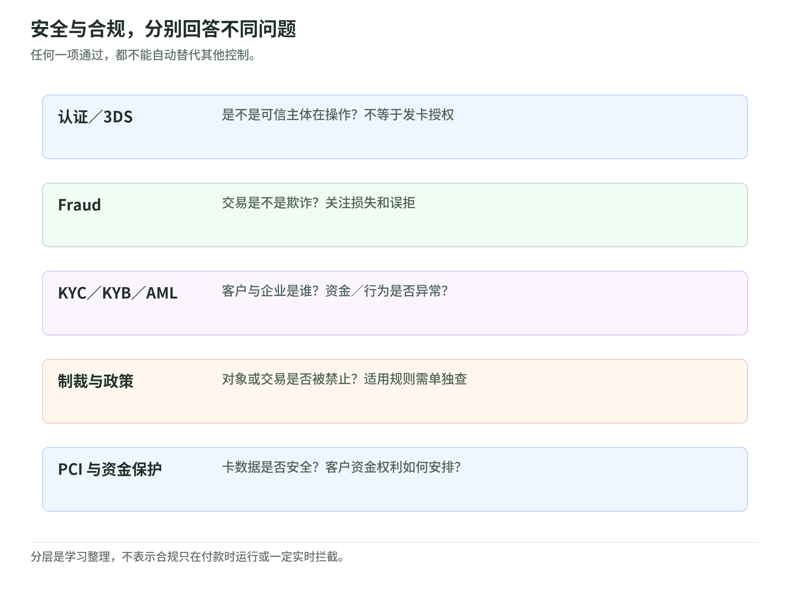

*图：安全与合规，分别回答不同问题。任何一项通过，都不能自动替代其他控制。*
<!-- /illustration: payment-risk-controls-217731c286 -->


| 问题 | 常见控制 | 不等于什么 |
| --- | --- | --- |
| 谁在操作 | Authentication、3DS、设备／会话验证 | 不等于付款获批 |
| 是否有欺诈风险 | Fraud detection、行为与交易策略 | 不等于 AML 全流程 |
| 客户／企业是谁 | KYC／KYB、受益所有人识别 | 不等于交易一定真实合法 |
| 资金与交易是否异常 | AML 监控、调查、报告 | 不等于每次都实时拦截 |
| 是否涉及禁止对象 | 制裁筛查与政策执行 | 不等于一般信用评分 |

EMV 3DS 用于卡不在场场景的持卡人认证，可能有无感流程或挑战流程；发卡方支付授权仍是另一项判断。不要因为“3DS 通过”就承诺无欺诈或无拒付。[3DS](sources.md#3ds)

FATF 的客户尽职调查框架包含识别客户、核验身份、识别受益所有人等要求；本地法律与产品风险决定落地。不能把某家 API 的“验证成功”标签当作全球监管豁免。[FATF](sources.md#fatf) 美国 FinCEN 的 CDD 说明也强调风险理解与持续监测；美国 OFAC 的制裁说明用于提醒“实名”和“允许交易”不同，不能外推为全球同一套规定。[CDD](sources.md#cdd) [SANCTIONS](sources.md#sanctions)

### Fraud 与 AML 的直觉区别

被盗卡买手机：重点是未经授权使用与损失，属于欺诈控制关注的问题。

本人使用真实账户，通过复杂交易隐藏非法资金来源：身份可能是真的，依然可能涉及反洗钱风险。

真实用户被骗子诱导转账：不是盗用登录密码的唯一模型；付款前授权真实，也可能是诈骗。

这些是教学案例，不是法律定性。控制应该组合，而不是认为验证身份证后就不需要再看交易。

### PCI DSS 管的是卡数据安全，不是支付牌照

PCI DSS 为支付卡账户数据安全提供基线要求。是否触及数据环境、如何缩小范围、采用哪种验证方式，需要按实际系统判断。外包处理可以改变范围，但不自动取消商户或服务商全部责任。[PCI](sources.md#pci)

因此：

- “上云”不等于合规认证自动覆盖应用。
- “数据加密”不等于已经满足全部控制。
- “用了 Token”不等于所有系统都出范围。
- “取得支付牌照”不等于可以忽略卡数据安全。

### 客户资金保护，不能简化成“钱放银行所以安全”

某些制度要求电子货币或支付机构对客户资金采用 safeguarding 安排。英国 FCA 提示，这与银行存款的 FSCS 保护不一样；资金追回还可能受破产处理影响。这是**英国制度例子**，不能当作全球统一规定。[SAFEGUARDING](sources.md#safeguarding)

研究钱包、PSP 或跨境公司时，至少问：

1. 客户的债务人是谁，资金账户以谁的名义开立？
2. 是否分隔保管，有什么赎回或取回安排？
3. 是否有存款保险，保障谁，范围与条件是什么？
4. 公司破产、伙伴银行故障时，权利与运营怎样处理？

### 争议不是只有一个损失数字

拒付会同时影响资金、手续费、证据提交、客服与商户经营。退款、拒付和准备金也会改变商户应收与可用余额。

风控不是一味降低拒付：过严的策略可能拒绝好客户。应按支付方式和客群衡量批准率、误拒、损失与处理成本，同时定义分母与时间窗口。[DISPUTES](sources.md#disputes)

**检查理解 8**：为什么 KYC、3DS、PCI 和 safeguarding 不能互相替代？

<a id="lesson-09"></a>

## 09 支付系统怎样避免错账

### 先画责任，不急着选数据库

<!-- illustration: payment-engineering-b59a0d18eb -->
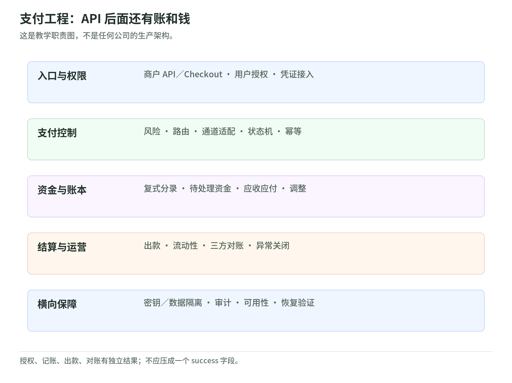

*图：支付工程：API 后面还有账和钱。这是教学职责图，不是任何公司的生产架构。*
<!-- /illustration: payment-engineering-b59a0d18eb -->


教学架构可分为：

- **入口与身份层**：商户 API、收银台、用户认证和权限。
- **支付控制层**：支付对象、风险决策、路由、通道适配与状态机。
- **账务层**：复式分录、待处理资金、商户应收、费用及调整。
- **结算运营层**：出款、流动性、对账、调查和异常工作台。
- **横向基础设施**：密钥／卡数据隔离、审计、可用性与可观测性。

这是一张学习用架构，不是任何公司的部署图。不同产品可合并或拆开，但资金责任不能因此消失。

### 订单、支付、余额和会计记录是四种对象

一张订单可能尝试两次支付；一笔支付可能部分捕获、分几次退款；一笔入账可能暂不可出款；同一个商业事件可以对应多条会计分录。

因此不要用 `order.status = paid` 替代所有财务状态。应保留稳定标识，并建立订单、支付尝试、通道流水、账本条目与银行流水的对应关系。

### 复式记账：任何钱都要有去向

下面是**模拟 PSP 的简化会计教学例**，不是发卡行或商户的统一会计分录，也不是收入确认意见。

100 元收款结算至模拟 PSP 的银行账户；它应付商户 97.50 元，应付伙伴费用 1.90 元，自身服务部分为 0.60 元：

```text
借：银行资产                100.00
  贷：商户应付款             97.50
  贷：伙伴费用应付款          1.90
  贷：示例服务收入            0.60
```

出款时：

```text
借：商户应付款               97.50
  贷：银行资产               97.50
```

支付伙伴费用时：

```text
借：伙伴费用应付款            1.90
  贷：银行资产                1.90
```

本例强调两点：总借贷相等；银行里的一部分现金对应商户或伙伴债务，不是 PSP 自由所有。生产账务还需处理未结算应收、收入确认时点、准备金、退款、拒付、FX、税、费用与舍入等。

### 幂等：避免“同一个意图”多收一次

幂等键应该绑定稳定的业务意图，并结合请求参数与服务商规则。网络超时后，用同一个键重试或查询，不要随便创建新支付。

还需要数据库唯一约束、通道流水去重和状态检查，因为外部 API 的幂等不等于系统中每个副作用都幂等。Stripe 的文档说明其幂等键保存与参数检查规则；本读本不把其规则当作行业统一标准。[IDEMPOTENCY](sources.md#idempotency)

### Webhook：可能重复，也可能乱序

Stripe 文档明确提示事件可能重复发送，且不保证按产生顺序交付。[WEBHOOKS](sources.md#webhooks)

教学处理方式：

1. 验证签名与事件来源，不相信浏览器自己声称“成功”。
2. 用事件 ID 去重，并以支付对象／交易 ID 关联。
3. 快速接受后异步处理，保留重试和失败队列。
4. 对关键变化查询权威支付对象，避免旧事件覆盖新状态。
5. 写账本与业务副作用时继续去重、审计。

不要把这叫“网络保证 exactly-once”。更现实的目标是：消息可能多次送达，但业务效果可验证地只发生一次。

### 对账：把三条流重新拼回去

每个结算周期，匹配：

`订单／平台记录 ↔ PSP 或网络报表 ↔ 银行实际流水`

异常包括：已授权未捕获、已扣未收到确认、已结算未出款、重复记录、未知费用、金额／币种不符、退款未到账、跨期差异。

不能只用“每日总额相等”判定没问题。两笔相反方向的错账可能正好抵消。逐笔或可解释分组的匹配、时间差解释与异常关闭证据同样重要。

### 高可用不止是“API 不宕机”

关注授权延迟、通道成功率、积压事件、对账未平数量、出款准时率、余额与分录约束、密钥和权限审计。

跨区／多活必须考虑重复付款与一致性，不能只按网站流量复制应用。恢复演练应验证“账不丢、不重、可追溯”，而不是只验证首页打开。

这一节的架构与工程要求是基于机制的教学设计；不是任何企业已采用这些技术的证据。

**检查理解 9**：为什么“数据库提交成功 + 收到一次 Webhook”仍不足以证明资金账正确？

<a id="lesson-10"></a>

## 10 怎样研究一家支付公司

### 第一页只回答四个问题

先依次回答：

1. 谁付款，谁收款？
2. 钱走什么网络？
3. 公司控制什么环节，责任由谁承担？
4. 靠什么收入项赚钱？

第二页再看规模、财务和技术。避免先背一串公司标签，再把产品硬塞进分类。

### 给每个产品画一条“责任链”

例如一家提供企业账户、跨境汇款与虚拟卡的平台，至少分三条：

- 企业账户：账户法律主体、资金保障、银行伙伴。
- 汇款：本地收款、FX、目的地出款和流动性。
- 卡产品：发卡主体、处理、授权控制与费用分成。

一个官网展示三种产品，不代表三种产品都由同一个法人、同一张牌照或同一个核心系统执行。

### 核心指标要有定义

| 指标 | 问什么 | 常见坑 |
| --- | --- | --- |
| TPV／Processed Volume | 处理了多少金额 | 净额、退款、币种转换和业务范围不同 |
| Transaction Count | 处理了多少笔 | 支付、授权尝试、退款不能乱加 |
| Authorization Rate | 多少尝试获批 | 重试会改分母；认证失败是否纳入需说明 |
| Net Revenue／Gross Profit | 获得了多少服务经济价值 | 列报和成本分类不同 |
| Take Rate | 每单位交易量保留多少收入 | 分子与分母不匹配 |
| Fraud Loss | 最终承担多少损失 | 谁承担、何时认定、回收是否扣除 |
| Chargeback Ratio | 争议压力有多大 | 按笔或金额、规则与观察窗不同 |
| Cost per Transaction | 每笔处理成本是多少 | 只算服务器费还是全部可变成本 |
| Payout Timeliness | 资金是否按承诺到达 | 已发起与收款可用不是一个状态 |
| Reconciliation Breaks | 未匹配项是否可解释 | 总额相等不代表逐笔准确 |

这是研究检查表，不是所有机构的统一指标定义。

### 从业务问题到技术需求：中间要有证据

| 业务信号 | 技术假设 | 必须验证 |
| --- | --- | --- |
| 授权率低 | 风控校准、凭证更新、路由优化 | 失败原因、客群、网络规则 |
| 新地区扩张 | 本地通道、合规与账务扩展 | 法人／牌照、合作伙伴、系统负责人 |
| 对账慢 | 数据质量、自动匹配、异常工作台 | 真实未平项、错误率、人工流程 |
| 出款慢 | 银行连接、流动性与处理窗口改善 | 原因究竟是技术、资金还是制度 |
| 成本压力 | 平台现代化、FinOps、运营辅助 | 成本归因、预算、ROI 和迁移风险 |

业务信号只能提供工作负载与技术机会的线索，不是具体企业已采用某家云服务、已有预算或批准项目的证据。**Budget、Owner、Architecture、ROI** 四项仍需验证。

### 一个研究输出模板

```text
产品与客户：
交易关系与网络：
法律主体、牌照／合作方及资金责任：
收费项与收入列报：
固定报告期的指标与计算：
增长／利润变化的候选解释：
已证实的系统或产品事实：
技术需求假设：
需要补充的项目证据：
一手来源与读取日期：
```

**检查理解 10**：如果利润率下降，能否直接推断这家公司需要上云降本？

<a id="lesson-11"></a>

## 11 新场景：嵌入式支付、稳定币与代理

### 改变体验，不等于替代底层责任

**嵌入式支付**把支付放进经营软件，例如预约、订阅、ERP 或平台工作流。商户少切换一个系统，但收单、风控、资金责任、对账和争议仍需有人承担。它是产品交付与分销模式，不是一条全新的结算网络。

**BNPL／先买后付**增加信用与还款安排。研究时要分开商户收款、消费者债务、融资来源和违约责任；不能仅按结账按钮把它当作钱包。美国 CFPB 的入门说明把它作为分期贷款解释；具体监管与保护取决于市场，本读本不做全球规则概括。[BNPL](sources.md#bnpl)

### 稳定币：新增资金轨道，也新增责任链

<!-- illustration: payment-new-layers-a9a4a20367 -->
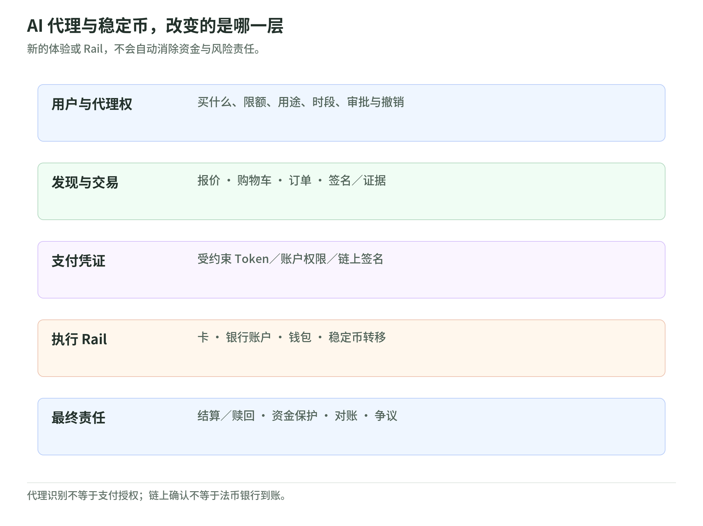

*图：AI 代理与稳定币，改变的是哪一层。新的体验或 Rail，不会自动消除资金与风险责任。*
<!-- /illustration: payment-new-layers-a9a4a20367 -->


稳定币可以成为跨境或数字场景中的转移工具，但需要再问：

- 稳定币持有人对谁有何种权利？
- 储备、托管和赎回怎样安排？
- 交易在哪条链完成，最终性如何定义？
- 如何合规入金、出金及向本地商户付款？
- 私钥丢失、链拥堵、合约风险和地址错误由谁承担？

FSB 对全球稳定币安排的建议涉及治理、风险、赎回、监管与跨境协作。它是国际政策建议，不等于每个司法辖区已经采用相同法律。[STABLECOINS](sources.md#stablecoins)

因此“链上转账完成”不自动等于法币赎回完成、收款银行到账或贸易义务全部清偿。

例如 Circle 的 USDC 条款区分持有／转移和符合资格者向发行方赎回，另有地址冻结、错地址、私钥及银行处理等风险。此处仅作产品条款例子，不把 USDC 与所有稳定币混同，也不对其安全性作投资判断。[USDC](sources.md#usdc)

### AI 代理支付：代理权比“会点付款按钮”更重要

如果 AI 帮你订机票，至少有四层：

1. **用户授权**：准许哪类商品、金额、商户、时段和条件？
2. **代理执行**：怎样发现商品、报价、下单并保留证据？
3. **支付凭证**：代理能使用什么 Token 或受约束凭证？
4. **底层结算**：仍由卡、账户或其他 Rail 完成。

Visa 的官方代理支付资料展示了 Trusted Agent Protocol 等信任与识别方向；不应把产品公告解释为所有商户已经支持代理支付。[AGENT-PAYMENTS](sources.md#agent-payments)

Google 的 AP2 公告讨论以签名委托连接用户意图与购物车，并面向多种支付方式。这说明代理授权层与资金轨道可以分开设计，不意味着代理支付必须用稳定币。本文只说明公开设计方向，不宣称协议已统一、全部生产可用或法律责任已经解决。[AP2](sources.md#ap2)

教学设计原则：**授予有限支付能力，不把无限支付权交给一句提示词**。金额上限、用途限制、幂等、审批、撤销、审计和争议证据仍然需要。

尤其不能把模型生成的“付款成功”当账务证据，也不能让商户网页或工具返回的文本修改用户授权。外部内容是数据，不是支付权限来源。

### 如何判断趋势不是营销词

问三件事：改变了哪一层？谁承担新增风险？有哪些可验证的生产支持、接口或法律安排？

“AI”“实时”“链上”“全球账户”都不能替代这三问。

**检查理解 11**：代理能够自动下单后，用户的金额与用途控制还应在哪里执行？

<a id="lesson-12"></a>

## 12 把全图拼起来：电商平台案例

以下是**完整教学案例**，不是公司真实部署。某平台连接国内消费者与不同地区的卖家，准备支持卡、钱包、账户支付和海外卖家出款。

### 第一步：产品地图

买家付款是 Acceptance；平台管理多个商家是商户／平台模式；给卖家打钱是 Payout；海外涉及 Cross-border；给采购员工发卡则是 Issuing。不要让一个“支付模块”标签掩盖这些不同责任。

### 第二步：先定责任，再定连接

平台只是代理商户接入，还是成为 PayFac？谁是卖家、谁是 MoR？谁承担拒付？谁持有与保护商户资金？有没有当地自营资格，还是使用伙伴？

这些选择会改变合同、财务、风险和系统设计。不能先写完分账代码，再把法律主体补在最后。

### 第三步：把三条流画出来

| 流 | 平台必须追踪 |
| --- | --- |
| 信息 | 订单、认证、授权、状态通知、退款、争议 |
| 资金 | 收款、待结算、准备金、手续费、平台分成、出款、FX |
| 账务 | 买家支付、商家应收、平台收入、伙伴应付、银行流水 |

一笔订单若采用分批发货，可能不再是“一笔订单＝一笔请款＝一次出款”。在建数据模型时就要明确。

### 第四步：交易与异常脚本

用模拟 100 元订单验证：

1. 正常认证、授权、捕获、结算与商家出款。
2. 授权获批但商户响应超时；同一意图重试不重复收费。
3. 商品缺货，在捕获前取消。
4. 捕获后部分退款；手续费退还规则需按合同确定。
5. 商家余额不足时发生拒付，责任方如何承担。
6. 海外出款因收款账户数据错误被退回，如何冲正与补付。
7. Webhook 重复和乱序；恢复之后账本仍完整。

这是测试清单，不证明任何一个 PSP 都具有相同接口或处理政策。

### 第五步：用经济模型筛产品

假设年交易规模 1 亿元，不能据此推断收入 1 亿元。需结合支付方式组合、费率、合作方成本、退款与欺诈、FX 和服务收入。

同样，便宜的账户通道若增加用户放弃率，或即时出款需要更多预注资，都可能抵消直观看到的单笔优势。评估的是**风险与运营调整后的净效果**。

### 第六步：给技术项目明确成功条件

不要只写“搭一个现代化支付平台”。写可验证指标：

- 每个支付意图不重复收费，所有异常有明确状态。
- 所有账务分录可追溯，金额与币种约束经过检查。
- 出款延迟、对账未平项和风险损失有指标与负责人。
- 用户与商户权限、卡数据范围、密钥和审计边界清晰。
- 故障恢复能证明不丢账、不重账。

具体阈值要来自业务基线、网络规则和合同 SLA，不用行业 101 随便承诺。

## 最后，把领域压缩成八句话

1. 支付连接的是授权、资金责任与账务，不只有 API。
2. 角色、产品和场景分开，才能理解一家公司。
3. 授权不等于捕获，结算不等于商户银行到账。
4. 交易额、商户手续费、服务收入和利润是四个数。
5. 钱包界面不决定底层资金模型，虚拟卡也不是牌照。
6. 实时、账户支付、跨境和二维码描述不同维度。
7. 欺诈、AML、认证、数据安全和资金保护各有责任。
8. 新体验可以改变入口，资金、风控、账本与证据仍要完整。

## 主干之后：继续补全十个领域

这份连续读本保留 01–12 课。接下来进入[13–22 课覆盖地图](README.md#extension-map)：卡产品与账户运营、线下与离线受理、订阅、商户生命周期、流动性、报文与密码安全、可靠账本、中国与监管、现金与移动货币、CBDC／代币化存款／稳定币。

建议从[第 13 课：卡产品与账户运营](chapters/13-card-products-and-operations.md)顺序读；具体岗位路线与补全后的纸上实验见[学习路线](learning-roadmap.md)。

继续：[术语速查](glossary.md) · [学习与自测](learning-roadmap.md) · [来源](sources.md) · [专题导读](README.md)
