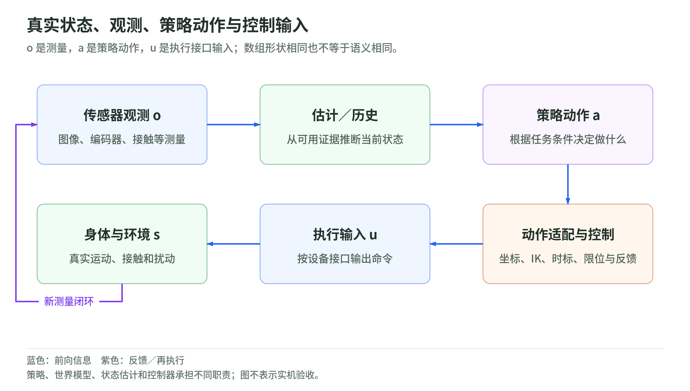

## 01 系统的数学模型：状态、观测、动作与反馈

### 1.1 先确定研究的是哪个系统

<!-- illustration: physical-feedback-1710f6c92b -->

*图：真实状态、观测、策略动作与控制输入。o 是测量，a 是策略动作，u 是执行接口输入；数组形状相同也不等于语义相同。*
<!-- /illustration: physical-feedback-1710f6c92b -->

机器人上的“AI”不是独立于身体的函数。它的输出要经过执行器，作用于环境；环境改变后，传感器再产生输入。要研究这一过程，先写出状态，而不是先选择模型名称。

一个取放任务的状态可以包含关节位置、关节速度、杯子位姿、杯子速度、夹爪状态和接触状态。记为 $s_t$。这不是要求把所有量都直接测出来，而是定义“哪些量足以决定后续运动”。如果只记录关节位置，同一姿态下“正在向前运动”和“正在向后运动”就会被误认为同一状态；它们下一时刻的位置不同。动力学中的状态空间表示从这一步开始。[MIT 状态空间与欠驱动系统](https://underactuated.mit.edu/intro.html)

连续时间模型可以写成：

$$
\frac{d s(\tau)}{d\tau}=f(s(\tau),u(\tau),w(\tau)).
$$

$\tau$ 是连续时间，$u$ 是实际进入动力学模型的控制输入，$w$ 是外部扰动。对某些机构，$u$ 是力矩；对封装了底层伺服的设备，建模接口可能是速度或位置目标。必须说明建模边界，不能把“策略输出的位移”和“动力学方程中的力矩”直接代入同一个位置。

在采样周期 $\Delta t$ 下，用离散模型表示：

$$
s_{t+1}=F_{\Delta t}(s_t,u_t,w_t),\qquad
o_t=h(s_t,v_t).
$$

$F_{\Delta t}$ 是在这个时间跨度上的状态转移，$o_t$ 是观测，$h$ 是测量模型，$v_t$ 是测量噪声。观测可以混合图像和数值；图像不要求先变成完整的三维世界状态才能进入策略。

这两个方程有不同任务：第一个说明“设备受命令后怎样运动”，第二个说明“我们能看到运动的哪些部分”。世界模型主要学习某种转移或预测关系，状态估计主要利用测量与历史推断状态，策略主要决定下一步动作。

### 1.2 为什么当前图像通常不是完整状态

马尔可夫性质是说：给定充分的当前状态与控制，未来不再需要整个过去。它是对状态定义及模型的条件，而不是对一张相机图片的保证。

杯子被遮挡、接触力未测量、执行器有延迟，都会让观测不足以确定当前状态。如果模型把身体或环境的记忆漏掉了，历史仍会影响未来。加入历史帧、循环网络或状态估计，是尝试补足信息；它们不自动证明状态已充分。

部分可观测问题中，可以维护 belief，也就是在已有信息下，对状态的概率分布：

$$
b_t(s)=p(s_t=s\mid o_{0:t},u_{0:t-1}).
$$

这里的 $o_{0:t}$ 包含到当前时刻的观测，$u_{0:t-1}$ 包含已经作用于环境的控制。belief 不是“机器人自己的主观意见”，而是一种处理未完全观测状态的数学表示。[MIT POMDP 与 belief](https://underactuated.mit.edu/belief.html)

在已知转移与观测模型、满足相应条件独立假设时，更新分成两步：

$$
\bar b_t(s)=\int p(s\mid s',u_{t-1})b_{t-1}(s')\,ds',
$$

$$
b_t(s)=
\frac{p(o_t\mid s)\bar b_t(s)}
{\int p(o_t\mid \tilde s)\bar b_t(\tilde s)\,d\tilde s}.
$$

第一步把上次状态分布推到现在；第二步用新测量重新分配概率，分母负责归一化。离散状态把积分换成求和。第 4 章的 Kalman／EKF 是在特定模型和分布假设下，把这种更新近似为均值与协方差的运算。

实际代码未必存一个完整分布。历史窗口、循环隐藏状态和高斯估计都可以承担部分记忆功能，但表达能力、模型假设和计算成本不同。

### 1.3 策略动作与控制输入是两个接口

设任务条件为 $g$，可用历史为 $h_t$。随机策略写成 $\pi_\theta(a_t\mid h_t,g)$；确定性策略则直接输出 $a_t=\pi_\theta(h_t,g)$。

例如 $a_t$ 是三维末端位移与夹爪指令。执行层需要把它解释成目标，再根据估计状态产生控制：

$$
u_t=C(a_t,\hat s_t,\mathcal R).
$$

$\hat s_t$ 是状态估计，$\mathcal R$ 是机构、单位、限位和执行接口等配置。$C$ 可以包含 IK、轨迹插值和反馈控制。如果策略直接输出力矩，也应说明它是否已与设备限幅、驱动接口等条件对齐。ros2_control 的硬件状态与命令接口使这个边界具体化。[ros2_control 架构](https://control.ros.org/jazzy/doc/getting_started/getting_started.html#architecture)

因此，同为一个长度为 7 的数组，可能是“六维末端增量加夹爪”，也可能是“七个关节目标”。长度只是形状，含义还要靠字段和约定。第 6、10、12 章会把这件事追到模型、训练样本和运行系统。

### 1.4 一个反馈稳定性的完整推导

考虑本书自创的理想一维积分器：

$$
x_{t+1}=x_t+\Delta t\,u_t,\quad
u_t=K(x^\star-x_t).
$$

$x^\star$ 是不变目标，$K$ 是比例增益。定义误差 $e_t=x^\star-x_t$，代入：

$$
e_{t+1}=(1-K\Delta t)e_t.
$$

反复代入就得到 $e_t=(1-K\Delta t)^t e_0$。误差趋于零的条件是：

$$
|1-K\Delta t|<1
\quad\Longleftrightarrow\quad
0<K\Delta t<2.
$$

这给出了三个可以直接检查的事实。乘子在 0 与 1 之间时，误差单调缩小；在 −1 与 0 之间时，误差正负交替但缩小；绝对值超过 1 时，误差增长。第 14 章程序会验证不同增益下的结果。

这里的结论只针对理想模型。加入惯性、时延、饱和或接触，递推关系会改变，不能把这个增益范围当成真实机械臂的调参标准。它说明的是：控制器的表现由控制律、被控对象和采样方式共同决定。

### 1.5 时间与不确定性怎样进入系统

传感器读数带有采集时间。假设测量延迟 $\ell$ 个周期，模型实际收到的可能是：

$$
o_t=h(s_{t-\ell},v_t),
$$

而控制器现在要作用于 $s_t$。若把旧测量当当前状态，误差不只是图像噪声。需要对齐时刻、预测到当前时刻或在控制设计中显式考虑延迟。实时系统还要看截止时间和抖动，不能只看平均计算耗时。[ROS 2 实时系统说明](https://design.ros2.org/articles/realtime_background.html)

可以把每条运行记录分成采集时间、接收时间、推理开始／结束、命令生效时间和反馈时间。它们用来回答不同问题：图像是否新鲜、GPU 是否等待、命令是否按预计时刻执行。第 12 章给出异步推理与动作有效期的具体处理。

### 1.6 训练目标为何不等于任务成功

训练优化某个可计算目标；执行改变环境。行为克隆中的动作误差、强化学习中的回报、规划器中的轨迹代价，分别定义了不同问题。即使一个目标下降了，也仍要检查它是否与真实任务判据一致。

本书把“条件与变量”“算法目标”“执行接口”“评测判据”分开写。读后面的每个算法时，都可以沿这四项检查：模型看见了什么，优化了什么，输出怎样执行，怎样确认任务完成。

### 本章来源

- [MIT 状态空间与欠驱动系统](https://underactuated.mit.edu/intro.html)
- [MIT POMDP 与 belief](https://underactuated.mit.edu/belief.html)
- [ros2_control 架构](https://control.ros.org/jazzy/doc/getting_started/getting_started.html#architecture)
- [ROS 2 实时系统说明](https://design.ros2.org/articles/realtime_background.html)
