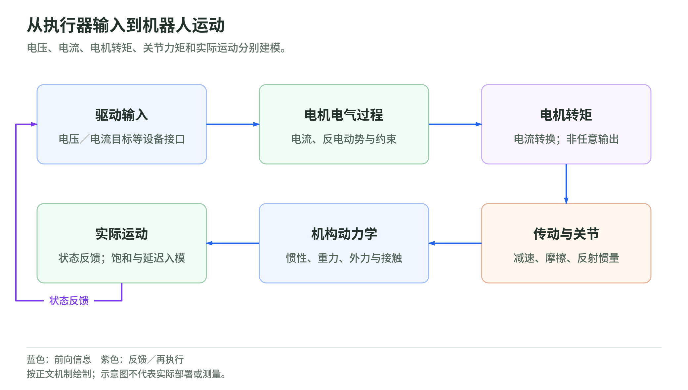

## 03 动力学与接触：力如何变成运动

### 方程的适用范围与外力方向

几何学把关节配置变成位姿，动力学则回答“在当前配置和速度下，这些力产生什么加速度”。先考虑固定基座、刚性连杆、理想关节、n 个独立广义坐标的机构，不含碰撞瞬间、传动弹性或关节摩擦。其方程为：

$$
M(q)\ddot q+C(q,\dot q)\dot q+g(q)=\tau+J(q)^\top f.
$$

$q,\dot q,\ddot q,\tau,g$ 均为 $(n,)$；$M,C$ 为 $(n,n)$。$M$ 是惯性矩阵，$C\dot q$ 是速度耦合力，$g$ 是移到左侧的重力项，$\tau$ 是执行器施加的广义力；转动关节分量是力矩，移动关节分量是力。$f\in\mathbb R^m$ 是环境作用于机器人的外力，$J\in\mathbb R^{m\times n}$ 将关节速度映射到该力对应的接触速度。左侧是产生加速度及抵消偏置所需的广义力，右侧是实际可得到的驱动力。若 f 定义成“机器人推环境的力”，右侧符号必须反转。[Modern Robotics §8.1：动力学结构](https://modernrobotics.northwestern.edu/nu-gm-book-resource/chapter-8-1-lagrangian-formulation-of-dynamics-part-1-of-2/)、[MIT：Manipulator Control](https://manipulation.csail.mit.edu/force.html)

多点接触时，令局部计数 $k$ 为接触点数量，不是环境时间或扩散步；逐点的 $(3,)$ 力堆成 $(3k,)$，雅可比堆成 $(3k,n)$。若接触还能传递力矩，可改用六维 wrench，必须与角分量在前的 twist 排序配对。固定基座且每个关节直接受控时可令控制输入 $u=\tau$；策略动作 $a$ 若是目标位置，并不直接等于 $\tau$。接口中还存在低层控制器。

$$
M(q)\dot v+h(q,v)=Bu+J_c(q)^\top f_c,\qquad
\dot q=N(q)v.
$$

这里为自由基座推广：$q\in\mathbb R^{n_q}$，$v,\dot v,h\in\mathbb R^{n_v}$，$u\in\mathbb R^{n_a}$；$M$ 为 $(n_v,n_v)$，$B$ 为 $(n_v,n_a)$，$N$ 为 $(n_q,n_v)$。$h$ 合并速度与重力偏置，$J_c$ 是接触雅可比，$f_c$ 为堆叠接触力。直觉是电机只能作用于受控关节，自由基座不是凭空多出六个电机。四元数配置也不能与三维角速度逐项对应。[MIT：Multi-Body Dynamics，广义速度部分](https://underactuated.mit.edu/multibody.html)

### 从能量推出惯性，而不是把质量填在对角线上

令动能为 $E_{\mathrm{kin}}$、势能为 $U$、拉格朗日量为 L：

$$
E_{\mathrm{kin}}=\frac12\dot q^\top M(q)\dot q,\qquad
L=E_{\mathrm{kin}}-U,\qquad
\frac{d}{dt}\frac{\partial L}{\partial\dot q_i}-\frac{\partial L}{\partial q_i}
=\tau_i+(J^\top f)_i.
$$

$i$ 是关节索引，偏导数取其它配置或速度分量不变。第一项是广义动量的变化，第二项扣除机构形状变化和势能变化的贡献。质量不变并不意味着 M 不变：同一根杆绕不同关节、处于不同姿态，惯性耦合不同。[Modern Robotics §8.1.3：质量矩阵](https://modernrobotics.northwestern.edu/nu-gm-book-resource/8-1-3-understanding-the-mass-matrix/)

从各杆质心速度直接构造 M，可看清其来源：

$$
M(q)=\sum_i\left(m_iJ_{v,i}^\top J_{v,i}
+J_{\omega,i}^\top I_i^WJ_{\omega,i}\right),\qquad
g(q)=\frac{\partial U}{\partial q},\qquad
U=\sum_i m_i g_0 z_i(q).
$$

$m_i$ 为杆质量；$J_{v,i},J_{\omega,i}$ 均为 $(3,n)$，分别映射到质心线速度、角速度；$I_i^W$ 是表达在世界系的 $(3,3)$ 质心转动惯量。世界 z 轴向上，$g_0>0$ 为重力加速度大小，$z_i$ 为质心高度。两类动能逐杆相加后收集 $\dot q$ 的二次项，便得到对称 M；物理有效、无冗余的坐标下 M 正定。转动惯量必须明确“关于哪个点、表达在哪个系”，不能把 CAD 的惯量矩阵不经转换直接填入。[Modern Robotics §8.2：刚体惯量](https://modernrobotics.northwestern.edu/nu-gm-book-resource/8-2-dynamics-of-a-single-rigid-body-part-1-of-2/)

速度偏置可以由 M 的导数得到：

$$
(C\dot q)_i=\sum_{j,k}\Gamma_{ijk}\dot q_j\dot q_k,\qquad
\Gamma_{ijk}=\frac12\left(
\frac{\partial M_{ij}}{\partial q_k}
+\frac{\partial M_{ik}}{\partial q_j}
-\frac{\partial M_{jk}}{\partial q_i}\right).
$$

$j,k$ 遍历关节，$\Gamma$ 为 $(n,n,n)$ 的 Christoffel 系数数组。直觉是：关节匀速旋转时，杆上的点仍有向心加速度；多个关节同时动还产生交叉项。C 的矩阵表达不唯一，应核对 $C\dot q$，不要因两个库的 C 元素不同就判断其中一个错误。[Modern Robotics §8.1，Part 2：速度乘积项](https://modernrobotics.northwestern.edu/nu-gm-book-resource/8-1-lagrangian-formulation-of-dynamics-part-2-of-2/)

一个自创、已归一化的局部算例，忽略偏置与外力，设某构型的惯性矩阵与关节力矩为：

$$
M=\begin{bmatrix}2&1\\1&2\end{bmatrix},\qquad
\tau=\begin{bmatrix}3\\0\end{bmatrix},\qquad
\ddot q=\begin{bmatrix}2\\-1\end{bmatrix}.
$$

三个数组分别是 $(2,2)$、$(2,)$、$(2,)$，直接相乘可核验 $M\ddot q=\tau$。第二关节没有施加驱动力矩，却出现加速度，原因是第一关节通过耦合项带动它；“每个关节一个独立质量块”无法解释这一现象。这些数值不是某台设备的参数。

### 执行器与传动：电压不是关节力矩

<!-- illustration: actuator-dynamics-347def529c -->

*图：从执行器输入到机器人运动。电压、电流、电机转矩、关节力矩和实际运动分别建模。*
<!-- /illustration: actuator-dynamics-347def529c -->

前面的 $\tau$ 是关节侧广义力，电机驱动器却面对电压、电流和转子。以恒定磁场、线性参数的简化 DC 等效模型为例：

$$
L\dot i+Ri+k_e\omega_m=v_m,\qquad
\tau_m=k_ti.
$$

$i$ 为绕组电流，$L$ 为电感、R 为电阻；$\omega_m$ 为转子角速度，$v_m$ 为电机端等效电压，$k_e$ 为反电动势常数，$k_t$ 为力矩常数，$\tau_m$ 为电磁转矩。点号表示连续物理时间的导数，$dt$ 仍专指采样周期；电压 $v_m$ 也不同于广义速度 v。输入电压先用于克服电阻压降和随转速增长的反电动势，余量才改变电流；电流才近似决定电磁转矩。不能把电压指令直接填到机械动力学右侧。[MathWorks 官方：DC 电机电磁方程推导](https://www.mathworks.com/help/control/getstart/linear-lti-models.html)

若固定 $\omega_m$ 和电压，电流以电气时间尺度 $L/R$ 变化；稳态电流为 $(v_m-k_e\omega_m)/R$。转速升高时，维持同样电流需要更高电压；电压饱和后，电流环也无法任意兑现力矩要求。此模型没有完整描述三相换相、dq 轴耦合、磁饱和、齿槽转矩或逆变器开关；无刷电机可在明确的等效与闭环假设下使用它，但不能宣称它是所有电机的完整模型。[MathWorks 官方：DC Motor 的等效模型与假设](https://www.mathworks.com/help/simscape-electrical/ref/dcmotor.html)

定义减速比 $N>0$，将传动方向的符号吸收到所定义的轴正向，准稳态传动关系为：

$$
\theta_m=N\theta_j,\qquad
\omega_m=N\dot\theta_j,\qquad
\tau_j\approx\eta N\tau_m,\qquad
E_{\mathrm{rotor}}=\frac12J_m(N\dot\theta_j)^2
=\frac12(N^2J_m)\dot\theta_j^2.
$$

$\theta_m,\theta_j$ 为电机和关节角，$\theta_j$ 是 q 的对应分量；$\eta$ 为当前传动方向下的效率，$J_m$ 为转子轴向惯量，$\tau_j$ 为近似传递到关节的力矩。前两式假设刚性、无间隙传动；第三式忽略转子加速与其它损失，不能当作瞬态净输出力矩的精确关系。最后一式由动能等价推出关节侧反射惯量 $N^2J_m$：减速既放大力矩，也放大关节“感到”的转子惯性。[Modern Robotics §8.9：传动与反射惯量](https://modernrobotics.northwestern.edu/nu-gm-book-resource/8-9-actuation-gearing-and-friction/)

若电机壳体运动及轴间耦合可忽略，独立关节的反射惯量可近似加入 M 的对角线；更完整的多体模型必须包含安装连杆的运动。不能一边从驱动力矩扣掉转子加速项，一边又把同一反射惯量加进 M，造成重复计算。效率不是储能惯量的替代项，反向回驱和正向驱动的损耗关系也不一定相同。摩擦应另建模，尤其零速附近的静摩擦不能只用粘性阻尼代表。

电流—速度—位置级联可理解为三层不同单位的误差变换：位置环接收 $\theta_j^d$，与测得角度比较后产生速度参考；速度环比较参考与估计速度，产生电流或转矩参考；电流环比较参考与实际电流，产生受限的电压/PWM。电流环一般是最快的内环，外环依赖其跟踪近似；并非所有驱动模式都启用三环，力矩模式可只保留电流内环，某些位置控制器也不采用独立速度环。[maxon 官方：电流内环的职责](https://support.maxongroup.com/hc/en-us/articles/6726327972252-Meaning-and-impact-of-Cogging-torque-and-Ripple-torque)

在 n 个独立驱动的等效实现中，$i,\omega_m,v_m$ 为 $(n,)$，L、R、常数和 N 可存为逐轴 $(n,)$ 参数。一次驱动更新先读取电流与编码器并估速，再计算启用的外环参考和内环电压，施加电压、电流及参考速率限制，更新积分器状态；仿真还需积分电气状态与含反射惯量的机械状态，输出实际 i、关节力矩和限制标志。若模型从理想力矩输入改成电压输入，真实状态 s 就必须增加电流状态，控制输入 u 的单位也须随接口改变。对小 $L/R$ 直接使用较大的机械步长做显式积分会数值不稳定；只有声明内环足够快时，才可消去电流动态并采用理想力矩近似。

电流饱和限制瞬时转矩，电压饱和限制高速下的电流跟踪，绕组铜耗约为 $i^2R$，热状态使持续可用力矩随时间变化。许多驱动器用包含冷却过程的电流平方热估计做降额，因此“峰值力矩边界”不能当作无限持续边界；外层积分器还应知道实际饱和状态，见控制章的 anti-windup。[maxon 官方：电流平方热负荷与限流](https://support.maxongroup.com/hc/en-us/articles/4412763373970-maxon-controllers-I2t-Limitation-Motor-winding-protection)

回差则破坏 $\theta_m/N=\theta_j$。令 $\delta=\theta_m/N-\theta_j$ 为折算后的相对角，理想间隙模型在 $|\delta|\le b$ 时不传递齿面弹性转矩，越过半间隙 b 后才啮合。运动反向时，电机侧编码器已在变化，负载侧可能仍未动；因此提高编码器分辨率并不等于消除了输出角误差。若要表达回差与柔性，必须分别保留电机侧、负载侧状态，不能继续强制刚性角度等式。[maxon 官方：传动弹性、回差与速度测量](https://support.maxongroup.com/hc/en-us/articles/360016541693-Speed-measurement-and-Accuracy-of-speed-control)

### 正动力学、逆动力学与限幅

正动力学输入 $q,\dot q,\tau,f$，输出 $\ddot q$：组装右侧减去偏置，解 M 的线性系统。程序不必显式形成 $M^{-1}$；正定模型可以用 Cholesky 求解，若分解失败，应先检查质量、惯量和约束冗余。

逆动力学输入 $q,\dot q,\ddot q_d$ 及外力，返回所需 $\tau$。递归 Newton–Euler 对树状机构先从基座向末端传播各杆位姿、六维速度和加速度，再反向累加惯性 wrench、外力及子杆 wrench，投影到关节轴获得力矩。两趟各处理一次连杆，不必存储上述三维 $\Gamma$；各杆中间数组为 $(6,)$，关节输出为 $(n,)$。[Modern Robotics §8.3：递归逆动力学](https://modernrobotics.northwestern.edu/nu-gm-book-resource/8-3-newton-euler-inverse-dynamics/)

$$
\tau_{\mathrm{req}}=M\ddot q_d+C\dot q+g-J^\top f,\qquad
\tau_{\mathrm{act},i}=\min\!\left(\tau_{\max,i},\max(\tau_{\min,i},\tau_{\mathrm{req},i})\right).
$$

$\tau_{\mathrm{req}}$ 为所需力矩，$\tau_{\mathrm{act}}$ 为限幅后的实际力矩，$\tau_{\min},\tau_{\max}$ 为模型给定边界。直觉是动力学逆解给出需求，不保证执行器能做到。只裁剪指令而继续按原加速度预测，会让规划、估计与控制内部模型不一致；应把边界写进优化，或用实际输入重算预测。传动摩擦、转子惯量、负载质量若未包含，都属于明确的模型误差，而不是某个控制增益可自动修复的项。

### 单边接触、摩擦锥与互补约束

先采用无黏附、无接触力矩的点接触。局部法向指向物体可离开表面的方向，$f_n$ 是压缩反力大小，$f_t=(f_{t1},f_{t2})$ 为切向力：

$$
\phi(q)\ge0,\qquad f_n\ge0,\qquad \phi(q)f_n=0,\qquad
\|f_t\|_2\le\mu f_n.
$$

$\phi$ 是带符号间隙，零表示接触、正值表示分离；$\mu$ 是摩擦系数。这组互补条件说“有间隙就没有反力，有反力就必须接触”，但接触时也允许零反力。摩擦锥限制切向力，不等于“摩擦总取 $\mu f_n$”：静止时实际摩擦可在锥内部；滑动时还需反向于滑速的耗散律。互补条件本身不是完整的碰撞与摩擦模型。[MIT：Multi-Body Dynamics，Contact 与 Complementarity 部分](https://underactuated.mit.edu/multibody.html)

对 QP，可用四条线性不等式形成内接摩擦棱锥：

$$
\epsilon_1f_{t1}+\epsilon_2f_{t2}\le\mu f_n,\qquad
(\epsilon_1,\epsilon_2)\in\{-1,1\}^2.
$$

$\epsilon_1,\epsilon_2$ 独立取正负；四式等价于 $|f_{t1}|+|f_{t2}|\le\mu f_n$，是圆锥的保守子集。若分别限制 $|f_{t1}|$、$|f_{t2}|$ 不超过 $\mu f_n$，角点合力却可能超出真实圆锥。圆锥原式为二阶锥约束，不应直接称作线性 QP。[Modern Robotics §12.2.1：摩擦锥与内接棱锥](https://modernrobotics.northwestern.edu/nu-gm-book-resource/12-2-1-friction/)

已知接触集合、并假定各点不滑动时，可以把互补问题简化为：

$$
\begin{bmatrix}M&-J_c^\top\\J_c&0\end{bmatrix}
\begin{bmatrix}\ddot q\\f_c\end{bmatrix}
=
\begin{bmatrix}\tau-C\dot q-g\\-\dot J_c\dot q\end{bmatrix}.
$$

$J_c\in\mathbb R^{3k\times n}$，$f_c\in\mathbb R^{3k}$，整个系统为 $(n+3k,n+3k)$。下半式保证接触点加速度为零，接触力成为维持约束所需的未知数。假设静止接触已经成立，还须核验非负法向力与摩擦约束；违反时不能保留“不滑动”假设。

一次活动集求解可先按间隙和相对速度提出候选接触，求上述系统，移除要求负法向力的点，将超过摩擦界的点改为滑动模式，再重新组装求解。需要上限、模式循环检测和残差检查；这是模式已简化后的迭代，不保证为任意多接触问题找到唯一解。重复接触点会产生相关约束，导致力不唯一或矩阵奇异。

### 碰撞冲量与离散仿真的边界

刚性碰撞在理想瞬间改变速度，不应用有限加速度公式硬套：

$$
M(q)(v^+-v^-)=J_c^\top P_c.
$$

$v^-,v^+$ 为碰撞前后广义速度，$P_c$ 是接触冲量，单位牛顿秒；短瞬间可将 q、M、J 视为不变。冲量等于力的时间积分，求出它还需恢复系数、摩擦和接触模式条件，不能把 $P_c$ 原样当牛顿力输入下一帧。[MIT：Multi-Body Dynamics，Impulsive Collisions](https://underactuated.mit.edu/multibody.html)

自创一维简化例：质量 m 的粒子距平面 z，朝远离平面的速度为 v，非接触净力为 u。采用半隐式、无反弹时间步：

$$
v_{\mathrm{free}}=v+\frac{dt}{m}u,\qquad
P=\max\!\left(0,-m\left(v_{\mathrm{free}}+\frac{z}{dt}\right)\right),\qquad
v^+=v_{\mathrm{free}}+\frac{P}{m},\qquad
z^+=z+dt\,v^+.
$$

$dt$ 为采样周期，P 是本步法向冲量，$z^+,v^+$ 是下一步位置与速度。公式令自由预测不穿透时 P 为零，否则产生恰好阻止步末穿透的冲量。它是无摩擦、单点、无恢复的离散近似，不解析步内准确碰撞时刻，也不可扩展成任意三维接触的通用公式。

另一类模型允许微小穿透，用弹簧阻尼近似法向力；这会产生刚性微分方程，大步长可导致数值发散。无论采用哪类模型，都应记录方程残差、法向符号、摩擦裕量、积分误差与接触状态；细分时间步只能检查离散误差，不能证明参数或接触模型正确。[MIT：Multi-Body Dynamics，Compliant Contact Models](https://underactuated.mit.edu/multibody.html)

### 实际读取来源

- [Modern Robotics §8.1，Part 1](https://modernrobotics.northwestern.edu/nu-gm-book-resource/chapter-8-1-lagrangian-formulation-of-dynamics-part-1-of-2/)：核验拉格朗日动力学结构；注意官方页面地址含 `chapter-8-1`。
- [Modern Robotics §8.1，Part 2](https://modernrobotics.northwestern.edu/nu-gm-book-resource/8-1-lagrangian-formulation-of-dynamics-part-2-of-2/)：核验速度乘积项及 C 的非唯一性。
- [Modern Robotics §8.1.3](https://modernrobotics.northwestern.edu/nu-gm-book-resource/8-1-3-understanding-the-mass-matrix/)：核验惯性矩阵的能量解释。
- [Modern Robotics §8.2，Part 1](https://modernrobotics.northwestern.edu/nu-gm-book-resource/8-2-dynamics-of-a-single-rigid-body-part-1-of-2/)：核验刚体惯量。
- [Modern Robotics §8.3](https://modernrobotics.northwestern.edu/nu-gm-book-resource/8-3-newton-euler-inverse-dynamics/)：核验递归正反向传播。
- [Modern Robotics §8.9](https://modernrobotics.northwestern.edu/nu-gm-book-resource/8-9-actuation-gearing-and-friction/)：读取减速传动、转子反射惯量和摩擦部分。
- [Modern Robotics §12.2.1](https://modernrobotics.northwestern.edu/nu-gm-book-resource/12-2-1-friction/)：核验静摩擦、滑动摩擦及圆锥的内接多面体近似。
- [MathWorks：Linear Models，DC 电机数学推导](https://www.mathworks.com/help/control/getstart/linear-lti-models.html) 与 [DC Motor 模型说明](https://www.mathworks.com/help/simscape-electrical/ref/dcmotor.html)：读取电气、转矩、反电动势及模型边界；不采用程序版本或设备参数。
- [maxon：电流内环说明](https://support.maxongroup.com/hc/en-us/articles/6726327972252-Meaning-and-impact-of-Cogging-torque-and-Ripple-torque)、[电流平方热负荷](https://support.maxongroup.com/hc/en-us/articles/4412763373970-maxon-controllers-I2t-Limitation-Motor-winding-protection)、[速度测量与回差](https://support.maxongroup.com/hc/en-us/articles/360016541693-Speed-measurement-and-Accuracy-of-speed-control)：仅读取驱动原理，不转述产品选择或实机调参建议。
- [MIT Underactuated Robotics：Multi-Body Dynamics](https://underactuated.mit.edu/multibody.html)：读取广义速度、持续接触、冲量、互补及柔顺接触部分。
- [MIT Robotic Manipulation：Manipulator Control](https://manipulation.csail.mit.edu/force.html)：读取外力符号、轨迹跟踪与摩擦约束部分。本文矩阵数值与一维接触例为独立构造，不是实机配置。
