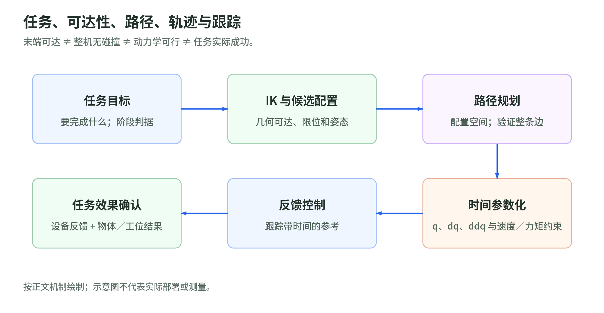
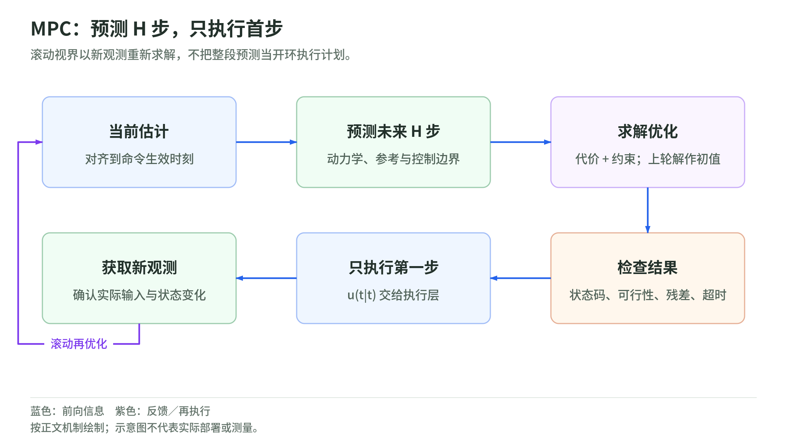

## 05 规划与控制：搜索、优化、PID、MPC 与全身控制

### C-space：规划的是整台机器人的配置

逆运动学回答“哪个 q 能到达末端目标”，碰撞检测回答“这个 q 下哪些几何体相交”，规划回答“怎样从起点连续走到终点”。三者不能互相代替：末端可达，不意味着肘部不撞桌子；两个无碰撞 IK 解之间，也可能没有可行路径。

$$
\mathcal C_{\mathrm{free}}=
\left\{q\in\mathcal C\mid q_{\min}\le q\le q_{\max},\
d_\ell(q)\ge\epsilon_\ell\ \text{对所有待检查几何对 }\ell\right\}.
$$

$\mathcal C$ 为配置空间，$q_{\min},q_{\max}$ 为关节边界；$d_\ell$ 是第 $\ell$ 对机器人—环境或机器人自身几何体的带符号距离，$\epsilon_\ell$ 为模型指定的间隙。自由空间把复杂机器人压缩成一个配置点，但每次检查都需通过 FK 放置全部相关连杆。无限转动关节具有周期拓扑；有限转角关节不能为追求“最短角差”跨过其边界。[Modern Robotics §10.2.1：C-space 障碍](https://modernrobotics.northwestern.edu/nu-gm-book-resource/10-2-c-space-obstacles/)

固定基座规划器输入起点 $(n,)$、目标配置或目标集合、关节边界和碰撞几何，输出路径节点 $(L,n)$、边连接与状态码。节点检查不等于边检查：端点都在自由空间，线性插值仍可穿过薄障碍。边验证需要连续碰撞检测，或有依据的自适应细分；仅均匀检查若干点并不能保证整段无碰撞。还须明确哪些物体随机器人运动、哪些几何对被排除检查，不能把所有近邻杆的真实碰撞都忽略。

### A* 与 RRT：搜索如何逐轮推进

A* 在离散图上保存累计代价 D、启发式 h 和父节点：

$$
D_j^{\mathrm{candidate}}=D_i+c_{ij},\qquad
F_j=D_j+h_j.
$$

$i,j$ 是节点编号，$c_{ij}\ge0$ 是边代价，$D_i$ 是已知起点到 i 的最小累计代价，$h_j$ 是到目标的代价下界，$F_j$ 是优先队列排序键。直觉是优先展开“已经花费加预计剩余”较小的候选，而不是只追离目标最近的点。[Modern Robotics §10.2.4：A*](https://modernrobotics.northwestern.edu/nu-gm-book-resource/10-2-4-graph-search/)

具体步骤为：

1. 起点 D 置零，其它置无穷；将起点放入按 F 排序的队列。
2. 弹出最小 F 的有效记录；重复入队的旧记录若已被更小 D 替代，应跳过。
3. 若弹出的是目标，沿父节点回溯；不是“首次发现目标”就立即返回。
4. 遍历邻居并验证整条边；候选 D 更小时，更新 D、父节点和队列记录。
5. 队列为空表示该离散图无解，不代表连续配置空间一定无解。

若 h 不高估真实剩余代价且允许必要的节点重开，可得到图上的最短路径；若不重开已关闭节点，通常还要求启发式一致性。设自创图中起点 A 直接到 G 的代价为 5，A 到 B 为 1，B 到 G 为 2，取 h 为零。首次展开 A 已发现 G，但继续展开 B 后才找到代价 3 的路径，说明正确的终止时机。顶点配置存为 $(V,n)$，D 和父节点各为 $(V,)$；邻接表不能把所有未验证的近邻连接自动当作可通行边。

RRT 不先铺满高维网格，而逐次生长树：

1. 树根为起点；在允许的配置空间采样 $(n,)$ 的 $q_{\mathrm{sample}}$，并保留抽样目标区域的机会。
2. 用尊重关节周期和物理尺度的距离，找最近树节点。
3. 从最近节点向样本生成一段有限长度局部路径；机械臂可用局部插值。
4. 检查新节点、关节边界及整段碰撞；有效才存储节点和父边。
5. 当新节点进入目标区域，或到目标的完整连接验证通过，回溯返回；否则继续，达到预算后返回未找到。

树节点为 $(V,n)$，父索引为 $(V,)$。对于不能横向平移的车，直线插值可能违反运动约束，局部扩展应通过控制输入积分；这时搜索变量是含速度的状态 s，不只是 q。基本 RRT 不保证最短路径，有限次失败也不是无解证明；概率完备性依赖采样覆盖、可行局部扩展等条件。[Modern Robotics §10.5，Part 2：RRT](https://modernrobotics.northwestern.edu/nu-gm-book-resource/10-5-sampling-methods-for-motion-planning-part-2-of-2/)

### 路径到轨迹：还缺一条时间规律

<!-- illustration: planning-control-5b6a9a044b -->

*图：任务、可达性、路径、轨迹与跟踪。末端可达 ≠ 整机无碰撞 ≠ 动力学可行 ≠ 任务实际成功。*
<!-- /illustration: planning-control-5b6a9a044b -->

搜索得到的折线只决定“经过哪里”。令路径参数为 $\sigma\in[0,1]$，不用 s，以免与真实状态冲突：

$$
q(t_{\mathrm{phys}})=q(\sigma(t_{\mathrm{phys}})),\qquad
\dot q=q'(\sigma)\dot\sigma,\qquad
\ddot q=q''(\sigma)\dot\sigma^2+q'(\sigma)\ddot\sigma.
$$

$t_{\mathrm{phys}}$ 是连续物理时间，撇号表示对 $\sigma$ 求导，点号表示对物理时间求导；$q,q',q''$ 都是 $(n,)$。第一项加速度来自路径弯曲，第二项来自沿路径加减速。因此给每个路径点随意附上时间，并不一定满足关节加速度或力矩边界。[Modern Robotics §9.4，Part 1：时间参数化](https://modernrobotics.northwestern.edu/nu-gm-book-resource/9-4-time-optimal-time-scaling-part-1-of-3/)

无障碍、已经验证的单段运动可采用首尾速度与加速度为零的时间规律：

$$
\sigma=10\zeta^3-15\zeta^4+6\zeta^5,\qquad
\zeta=t_{\mathrm{phys}}/T,\qquad 0\le t_{\mathrm{phys}}\le T.
$$

T 为运动时长，$\zeta$ 为归一化时间；多项式的首尾一、二阶导数都为零。它只解决时间边界条件，既不保证最短时间，也不自动满足力矩限幅。实现要沿轨迹计算 $q,\dot q,\ddot q$ 和逆动力学力矩，检查边界，再调整时长或重新求解时间规律。延长 T 会降低速度及惯性项，但不会消除重力所需力矩；静态不可行构型不是放慢就能通过。

多段折线在拐点不光滑，即使时间插值光滑，也可能要求瞬时改变运动方向。可先平滑几何路径再重新验证碰撞，或直接优化轨迹。局部轨迹优化每轮计算代价、约束和导数，解 SQP/内点子问题，接受符合下降或可行性条件的步，再重新线性化；它依赖初值，不能代替全局绕障搜索。只在优化节点满足距离约束，也不能保证节点之间有效。[Modern Robotics §10.7：非线性优化](https://modernrobotics.northwestern.edu/nu-gm-book-resource/10-7-nonlinear-optimization/)

最终向控制器交付采样时刻 $(L,)$ 以及 $q_d,\dot q_d,\ddot q_d$ 三个 $(L,n)$ 数组，明确插值规则。控制器跟踪的是带时间的参考，而不是“下一个无碰撞点”。

### PID：积分器也有状态，饱和和延迟必须进入模型

以下 t 为离散控制环境步，$dt$ 为采样周期，k 留给扩散章。对理想关节力矩接口，一种离散 PID 为：

$$
e_t=q_{d,t}-\hat q_t,\qquad
u_t^{\mathrm{raw}}=u_t^{\mathrm{ff}}+K_pe_t+z_t+K_d\dot e_t,\qquad
u_t^{\mathrm{act}}=\operatorname{clip}(u_t^{\mathrm{raw}},u_{\min},u_{\max}).
$$

$e_t$ 是 $(n,)$ 位置误差，$\hat q_t$ 为估计关节配置，$u^{\mathrm{ff}}$ 为前馈力矩，$z_t$ 为积分项的力矩贡献，$\dot e_t$ 为速度误差；各 u 为 $(n,)$，增益通常为 $(n,n)$ 对角矩阵。比例项响应当前误差，微分项抑制相对运动，积分项积累恒定偏差所需的补偿。控制输入单位由接口决定；若实际接口是位置参考，不能将此力矩式原样下发。[Modern Robotics §11.4，Part 2：PID 的作用与边界](https://modernrobotics.northwestern.edu/nu-gm-book-resource/11-4-motion-control-with-torque-or-force-inputs-part-2-of-3/)

直接采用差分微分会放大编码器噪声；优先使用一致的速度估计，或对差分做低通处理并计入滤波延迟。目标阶跃导致误差微分跳变，可以对测量值微分，单独处理参考速度，以避免 derivative kick。每轮积分必须乘实际经过的采样周期，不能把“循环次数”当时间。

饱和时仍不断积分，会在目标变化后长期保持过大输出。以 back-calculation 为例：

$$
z_{t+1}=z_t+dt\left[K_ie_t+
K_{\mathrm{aw}}\left(u_t^{\mathrm{act}}-u_t^{\mathrm{raw}}\right)\right].
$$

$K_i$ 把误差变成积分力矩变化率，$K_{\mathrm{aw}}$ 是 $(n,n)$ 的回算增益，量纲为每秒；括号中的差值表示控制器要求但执行器没实现的部分。超上界时该差为负，把积分贡献拉回可实现范围。另一做法是条件积分：只在未饱和、或误差将输出带回范围时累积。若后面还有电流、热或速率限制，应追踪相应实际输出，不能仅检查最外层的 clip。[MathWorks 官方：回算与条件积分](https://www.mathworks.com/help/simulink/slref/anti-windup-control-using-a-pid-controller.html)

采样本身也能改变稳定性。对于数学上的标量积分器和零阶保持比例控制：

$$
q_{t+1}=q_t+dt\,u_t,\qquad
u_t=K_pe_t,\qquad
e_{t+1}=(1-dt\,K_p)e_t.
$$

$q_t,u_t,e_t$ 为标量，参考固定，$K_p$ 在此速度接口下量纲为每秒。误差逐步缩小要求 $|1-dt\,K_p|<1$；连续时间的“正增益可收敛”不能直接替代离散分析。这只是教学模型，不是机器人增益选择公式。若反馈或执行再延迟一步，误差还依赖 $e_{t-1}$，系统阶数和稳定条件随之改变。

程序应把观测时间、计算耗时、通信和保持延迟都计入闭环模型；不能只看平均周期。逆动力学可给出前馈，但模型误差、饱和和时延仍需反馈处理；理想模型下的误差线性化也不是实际跟踪保证。[Modern Robotics §11.4，Part 3：计算力矩控制](https://modernrobotics.northwestern.edu/nu-gm-book-resource/11-4-motion-control-with-torque-or-force-inputs-part-3-of-3/)

### MPC：优化未来多步，只执行第一步

<!-- illustration: mpc-horizon-c57d1b26e1 -->

*图：MPC：预测 H 步，只执行首步。滚动视界以新观测重新求解，不把整段预测当开环执行计划。*
<!-- /illustration: mpc-horizon-c57d1b26e1 -->

在时刻 t，MPC 从当前估计 $\hat s_t$ 出发预测 H 步，状态维度 d、输入维度 $n_u$：

$$
\begin{aligned}
\min_{\{s_{t+j|t},u_{t+j|t}\}}\quad&
\sum_{j=0}^{H-1}
\left(
\|s_{t+j|t}-s^d_{t+j}\|_{Q_c}^2
+\|u_{t+j|t}-u^d_{t+j}\|_{R_c}^2
+\|\Delta u_{t+j|t}\|_{W_c}^2
\right)
+\|s_{t+H|t}-s^d_{t+H}\|_{P_c}^2\\
\text{约束}\quad&
s_{t|t}=\hat s_t,\quad
s_{t+j+1|t}=\mathcal F(s_{t+j|t},u_{t+j|t},dt),\\
&u_{\min}\le u_{t+j|t}\le u_{\max},\quad
\Delta u_{\min}\le\Delta u_{t+j|t}\le\Delta u_{\max},\\
&s_{t+j|t}\in\mathcal S_{\mathrm{adm}},\quad
s_{t+H|t}\in\mathcal S_f.
\end{aligned}
$$

$s_{t+j|t}$ 是基于 t 时信息对未来第 j 步的预测，u 同理；$s^d,u^d$ 为参考。范数 $\|x\|_W^2=x^\top Wx$，$Q_c,P_c$ 为 $(d,d)$ 权重，$R_c,W_c$ 为 $(n_u,n_u)$ 权重，区别于估计章的噪声协方差。$\Delta u$ 为相邻输入变化，首项相对上一周期实际输入计算；$\mathcal S_{\mathrm{adm}}$ 包含状态、碰撞等约束，$\mathcal S_f$ 是可选终端集合。直觉是同时权衡跟踪误差、输入需求与变化速度，并把模型和边界写成必须满足的关系。[MIT：轨迹优化与 MPC](https://underactuated.mit.edu/trajopt.html)

直接转录时，状态数组为 $(H+1,d)$，输入为 $(H,n_u)$。每轮先预测或对齐估计到指令生效时刻，用上轮解前移作为初值，求解本轮问题，核查约束残差与求解状态，只取 $u_{t|t}$；下一步用新观测再求解，而不是把整段开环执行完。

线性动力学、凸二次代价和线性约束可构成 QP；非线性机械臂、避障或接触模式选择一般不是单个凸 QP。SQP 型非线性 MPC 每轮线性化动力学和约束，求增量子问题，再评价原非线性轨迹。有限迭代或超时的输出必须标注可行性，不能把“最后一次迭代有数值”当作成功。终端设计关系到稳定性和递归可行性，缩短预测窗口、忽略不确定性或软化约束均会改变问题含义；状态协方差不会自动被 MPC 使用。[MIT：MPC 的滚动视界与递归可行性](https://underactuated.mit.edu/trajopt.html)

### WBC QP：把任务要求分配成可实现的全身力与运动

全身控制 WBC 通常负责当前周期的多任务协调，不负责搜索整个绕障路径或自动决定下一次落脚点。对于自由基座，采用第 03 章的广义速度 v；在当前 $q,v$ 和已知不滑动点接触集合下，选决策变量为：

$$
z=\begin{bmatrix}\dot v\\u\\f_c\end{bmatrix},\qquad
\min_z\ 
\frac12\sum_r
\|J_r\dot v+\dot J_rv-\ddot x_r^d\|_{W_r}^2
+\frac12\|u\|_{R_u}^2+\frac12\|f_c\|_{R_f}^2.
$$

$\dot v\in\mathbb R^{n_v}$ 为广义加速度，u 为 $n_a$ 个受控关节的力矩，$f_c\in\mathbb R^{3n_c}$ 为 $n_c$ 个点的接触力。任务 r 可为质心、末端或姿态的局部运动；$J_r$ 为 $(m_r,n_v)$，$\ddot x_r^d\in\mathbb R^{m_r}$ 是带反馈的目标任务加速度，$W_r$ 为 $(m_r,m_r)$ 权重。$R_u,R_f$ 的尺寸与各输入匹配。目标是用全身自由度折中各任务，并约束所需力，而不是把各个关节 PID 输出简单相加。[DFKI/ARC-OPT 官方：WBC 任务、模型、约束与求解器](https://arc-opt.github.io/Documentation/)

$$
M\dot v+h=Bu+J_c^\top f_c,\qquad
J_c\dot v+\dot J_cv=0,\qquad
u_{\min}\le u\le u_{\max},\qquad
A_ff_c\le b_f.
$$

M 为 $(n_v,n_v)$，h 为 $(n_v,)$，B 为 $(n_v,n_a)$，$J_c$ 为 $(3n_c,n_v)$；$A_f,b_f$ 编码非负法向力及线性化摩擦棱锥。第一式要求全身动力学成立，第二式维持已存在的不滑动接触，后两式限制执行器和地面可提供的力。当前 q、v 固定后，这些系数已知；若权重半正定且约束均线性，就是一个决策维度 $n_v+n_a+3n_c$ 的凸 QP。圆摩擦锥原式则需要锥优化，不是该线性 QP。[ARC-OPT 官方：动力学、接触与执行器约束接口](https://arc-opt.github.io/wbc/namespacewbc.html)

每个周期先用估计更新 M、h、J 与接触坐标，再把参考轨迹转换为任务加速度，组装 QP，求解并验证原始/对偶残差，输出 u 和预测接触力。活动集法通过增加被违反约束、移除不满足乘子条件的约束迭代；内点法通过屏障与 Newton 步迭代。两者都需要状态码及限时处理。接触切换时约束维度会变，不能盲目复用上轮接触力或活动集。

大权重不等于严格任务优先级：加权和仍会牺牲主任务换取其它收益，严格优先级需层级优化或显式优先约束。目标互相冲突时，应说明放松了哪些任务，不应静默放松动力学。QP 所用接触模式若实际已滑动或离地，计算出的“可行力矩”也不再对应真实系统。这里还假设内层驱动足够快，可近似实现 u；电流与热饱和造成的时变边界需从执行器模型传入。

### 阻抗：规定接触后如何让步

位置跟踪与接触响应的区别，在于外力出现时是否允许偏移。以三维平移误差为例，目标阻抗关系为：

$$
e=p-p_d,\qquad
M_{\mathrm{imp}}\ddot e+D_{\mathrm{imp}}\dot e+K_{\mathrm{imp}}e=f_{\mathrm{ext}}.
$$

p、$p_d$ 为实际与参考位置，$f_{\mathrm{ext}}$ 是环境作用于机器人的 $(3,)$ 外力；$M_{\mathrm{imp}},D_{\mathrm{imp}},K_{\mathrm{imp}}$ 为 $(3,3)$ 虚拟惯量、阻尼和刚度，使用 imp 下标以区别于 PID 增益。直觉是把末端表现成弹簧—阻尼—质量：在静止参考、静力平衡下，位移由 $K_{\mathrm{imp}}^{-1}f_{\mathrm{ext}}$ 决定，而非无限对抗环境。[MIT：间接力控制与阻抗](https://manipulation.csail.mit.edu/force.html)

实际实现可先产生弹簧阻尼反馈 wrench，再用位置雅可比转置映射到关节，并配合重力或动力学补偿；仅规定刚度、阻尼而没有塑形惯量，属于刚度控制这一阻抗子类，不应声称任意实现了 $M_{\mathrm{imp}}$。导纳控制则把测得的力通过虚拟动力学变成运动参考，两者接口不同。姿态阻抗也必须在局部旋转误差坐标中表达。

接触仍受摩擦、力矩与驱动边界约束，阻抗不能替代碰撞规划；时延、力测量噪声和离散实现也会改变能量交换。章节中的模型均用于解释控制计算，未给出实机增益、接触刚度或操作阈值。

### 实际读取来源

- [Modern Robotics §10.2.1：C-Space Obstacles](https://modernrobotics.northwestern.edu/nu-gm-book-resource/10-2-c-space-obstacles/)：读取配置空间、连通性与碰撞检查说明。
- [Modern Robotics §10.2.4：Graph Search](https://modernrobotics.northwestern.edu/nu-gm-book-resource/10-2-4-graph-search/)：核验 A* 的更新和终止步骤；本文三节点算例为自创。
- [Modern Robotics §10.5，Part 2](https://modernrobotics.northwestern.edu/nu-gm-book-resource/10-5-sampling-methods-for-motion-planning-part-2-of-2/)：核验 RRT 扩展及局部动力学规划。
- [Modern Robotics §9.4，Part 1](https://modernrobotics.northwestern.edu/nu-gm-book-resource/9-4-time-optimal-time-scaling-part-1-of-3/)：核验路径导数与时间规律的区分。
- [Modern Robotics §10.7](https://modernrobotics.northwestern.edu/nu-gm-book-resource/10-7-nonlinear-optimization/)：核验轨迹优化转录及局部性质。
- [Modern Robotics §11.4，Part 2](https://modernrobotics.northwestern.edu/nu-gm-book-resource/11-4-motion-control-with-torque-or-force-inputs-part-2-of-3/) 与 [Part 3](https://modernrobotics.northwestern.edu/nu-gm-book-resource/11-4-motion-control-with-torque-or-force-inputs-part-3-of-3/)：核验 PID、前馈和计算力矩的假设。
- [MathWorks：Anti-Windup Control](https://www.mathworks.com/help/simulink/slref/anti-windup-control-using-a-pid-controller.html)：读取回算、条件积分与实际输出跟踪说明，不使用文档中的设备参数。
- [MIT Underactuated Robotics：Trajectory Optimization](https://underactuated.mit.edu/trajopt.html)：读取直接转录、非线性求解、MPC、递归可行性部分。
- [DFKI/ARC-OPT：官方 WBC 文档](https://arc-opt.github.io/Documentation/) 与 [约束接口文档](https://arc-opt.github.io/wbc/namespacewbc.html)：核验职责、任务权重/优先级和约束类型。本文 QP 为基于第 03 章方程的通用构造，不绑定具体软件版本。
- [MIT Robotic Manipulation：Manipulator Control](https://manipulation.csail.mit.edu/force.html)：读取间接力控制、刚度与阻抗部分；不引用其链接的论文或产品操作建议。
