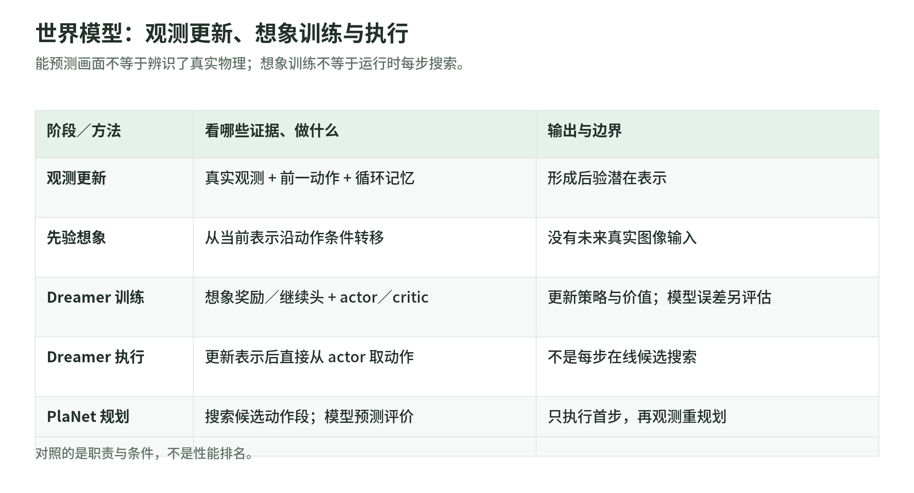

## 09 世界模型：状态预测、想象学习与模型误差

### 09.1 预测“采取动作之后”，不是只续写视频

世界模型学习观测、动作与后续结果之间的关系；策略则选择动作，两者不是同一个输出接口。本章沿用 $s_t$ 为真实状态、$o_t$ 为观测、$a_t$ 为策略动作。模型内部记忆和潜变量另记为 $h_t,z_t$，联合表示 $y_t=(h_t,z_t)$，不把它们改名为真实状态。即使潜变量能预测训练图像，也不等于已经辨识出质量、摩擦或接触力。

无动作的视频预测可利用背景或行为习惯续写，但不能据此评估“同一观测下换一个动作”的结果。用于决策的模型必须显式接收动作，并核对动作坐标、尺度、采样周期和实际控制器。相同策略动作在不同增益、不同限幅或执行延迟下产生不同控制输入 $u_t$；若这些因素变化却未被记录，模型面对的是遗漏条件，而不只是网络容量不足。[PlaNet §2–3](https://arxiv.org/pdf/1811.04551v5)明确以动作条件的潜在转移进行规划。

### 09.2 RSSM 的六个部件与训练数据

典型 learned latent world model 使用编码器、循环记忆、随机转移、解码器、奖励头和继续头。以 Dreamer 的 RSSM 思路写成：

$$
e_t=E_\psi(o_t),\qquad
h_t=F_\psi(h_{t-1},z_{t-1},a_{t-1}),\qquad
p^{\rm post}_t=P_\psi(z_t\mid h_t,e_t),\qquad
p^{\rm prior}_t=T_\psi(z_t\mid h_t).
$$

这里 $\psi$ 为世界模型参数，$E_\psi$ 编码图像及本体观测，$e_t$ 是特征；$F_\psi$ 是循环更新，$P_\psi$ 给出看到当前观测后的后验，$T_\psi$ 给出未看当前观测的先验。训练通常从后验采样 $z_t$；想象未来没有真实 $o_t$，只能从先验采样。循环记忆保存历史，随机潜变量表示条件分布，二者不是互相替代的“两个状态名字”。[DreamerV3 v2 式 1](https://arxiv.org/pdf/2301.04104v2)与 [作者 RSSM 实现](https://github.com/danijar/dreamerv3/blob/main/dreamerv3/rssm.py)分别给出架构和 observe／imagine 的差别。

训练批为序列而非独立帧：图像可为 $B\times T\times H_I\times W_I\times3$，动作 $B\times T\times d_a$，奖励、terminal 和 reset 为 $B\times T$。$B$ 是批大小，$T$ 是序列长度，$H_I,W_I$ 是图像高宽。若 $z_t$ 由 $n_z$ 个各有 $C_z$ 类的离散变量组成，其 logits／one-hot 批张量为 $B\times T\times n_z\times C_z$；$h_t$ 为 $B\times T\times d_h$，拼接给头的特征宽度为 $d_h+n_zC_z$。这些是配置符号，不固定某个 checkpoint 的维度。DreamerV3 使用离散分布并经 straight-through 估计传递采样梯度；该梯度是估计，不是离散采样的普通导数。[原文 World model learning](https://arxiv.org/pdf/2301.04104v2)说明采样处理。

三个输出头可写为：

$$
\widehat o_t\sim D_\psi(\cdot\mid y_t),\qquad
\widehat r_{t-1}\sim R_\psi(\cdot\mid y_t),\qquad
\widehat c_t\sim C_\psi(\cdot\mid y_t),\qquad
c_t=1-d_t.
$$

这里 $D_\psi$ 重建当前观测，$R_\psi$ 预测到达该观测时的奖励，$C_\psi$ 是 Bernoulli 继续头；$d_t=1$ 表示到达 $t$ 时刻的转移真正终止。为与第 08 章“$r_t$ 在执行 $a_t$ 后获得”统一，奖励索引特意写为 $t-1$；初始观测的奖励不计。工程 buffer 常把奖励与到达观测放在同一行，需要做这个索引转换。所读 [agent.py](https://github.com/danijar/dreamerv3/blob/main/dreamerv3/agent.py)明确移位前一动作，并区分 `is_terminal`、`is_last`、`is_first`；跨 episode 必须 reset 记忆，不能把上一段尾部动作接到新初始帧。

### 09.3 模型 loss：既保留信息，也让未来可预测

仅重建图像会允许后验记住很多先验预测不到的细节；仅压低先验／后验差异又可能丢掉决策信息。Dreamer 将预测项和两条不同梯度路径的 KL 项结合。下面按本书索引写出其损失结构：

$$
\mathcal L_{\rm pred,t}=
-\log D_\psi(o_t\mid y_t)
-\log R_\psi(r_{t-1}\mid y_t)
-\log C_\psi(c_t\mid y_t),
$$

$$
\mathcal L_{\rm dyn,t}=\max\!\left(\kappa,
\operatorname{KL}[\operatorname{sg}(p^{\rm post}_t)\|p^{\rm prior}_t]\right),
\qquad
\mathcal L_{\rm rep,t}=\max\!\left(\kappa,
\operatorname{KL}[p^{\rm post}_t\|\operatorname{sg}(p^{\rm prior}_t)]\right),
$$

$$
\mathcal L_{\rm model}=\mathbb E_{\rm replay}\sum_t
\left(\beta_{\rm pred}\mathcal L_{\rm pred,t}
+\beta_{\rm dyn}\mathcal L_{\rm dyn,t}
+\beta_{\rm rep}\mathcal L_{\rm rep,t}\right).
$$

这里 KL 衡量后验到先验的分布差异，$\operatorname{sg}$ 停止该分布参数路径的梯度；$\kappa$ 是 free-nats 阈值，$\beta$ 是损失权重。假设分布支撑匹配、对数概率可计算；序列 padding 应排除，初始无前一奖励的目标也应处理。dyn 项把后验作为固定目标训练预测分布；rep 项固定先验路径，让后验更可预测。共享循环特征仍可能通过未停止的路径收到梯度，因此不能简单说某项“只更新一个独立模块”。[DreamerV3 v2 式 2–3](https://arxiv.org/pdf/2301.04104v2)给出这种 KL balancing。

`max` 的作用不是把小 KL 增大到一：当 KL 低于 $\kappa$ 时该项是常数，停止继续压缩的梯度。所读 v2 使用 $\kappa=1$ nat、$\beta_{\rm pred}=1,\beta_{\rm dyn}=1,\beta_{\rm rep}=0.1$；它们是该版本配置，不是所有世界模型的定理。[rssm.py 的 loss](https://github.com/danijar/dreamerv3/blob/main/dreamerv3/rssm.py)可核对停止梯度和阈值位置。上式是训练结构，不应把带 free-nats 和改权重后的目标称作原始 ELBO 的精确数值。

负对数形式还需落实到输出分布。固定方差高斯重建等价于带尺度的平方误差；继续头是二分类交叉熵；奖励／价值的数量级可能跨多个范围。DreamerV3 使用 symlog 压缩带符号数值，以及用于奖励和 critic 的 two-hot 分布目标，而不是所有头直接做原单位 MSE：

$$
\operatorname{symlog}(x)=\operatorname{sign}(x)\log(1+|x|),\qquad
\operatorname{symexp}(v)=\operatorname{sign}(v)(e^{|v|}-1).
$$

这里 $x,v$ 是标量，两个函数互逆；大正负数都被压缩，零附近近似保持尺度。two-hot 把标量目标分配到相邻两个分箱，权重和为一，再用软标签交叉熵训练、按分箱位置取预测期望。所读原文前面的损失概述与后面的 Robust predictions 需一起读，不能仅按一个“-log”符号推断高斯输出。[DreamerV3 Robust predictions、式 8–11](https://arxiv.org/pdf/2301.04104v2)给出具体变换。

### 09.4 想象 actor-critic 与执行时规划

<!-- illustration: world-model-roles-628345e92b -->


*图：世界模型：观测更新、想象训练与执行。能预测画面不等于辨识了真实物理；想象训练不等于运行时每步搜索。*
<!-- /illustration: world-model-roles-628345e92b -->

模型训练后可有两种用途。规划在执行时评估候选动作段：从当前后验开始，沿先验滚动、累计奖励，搜索后执行首个动作，再利用新观测重规划。PlaNet 用 CEM 反复采样动作段、保留高回报候选、拟合下一轮采样分布，不需要逐帧解码图像。[PlaNet §2、Algorithm 2](https://arxiv.org/pdf/1811.04551v5)是这一具体实现。

DreamerV3 则主要把模型用于训练：从 replay 的后验表示出发，actor 采动作，先验产生想象状态，奖励和继续头提供信号，critic 估计想象 horizon 之后的回报。执行时更新当前表示并直接从 actor 取动作，不在每个环境步运行候选搜索。[DreamerV3 Critic learning](https://arxiv.org/pdf/2301.04104v2)明确区分这一执行方式。因而“用了世界模型”不能推出“实时运行 MPC”，生成画面也不是想象训练所必需的输出。

令一条想象序列为 $\widetilde y_0,\ldots,\widetilde y_H$，可用 bootstrap 的 $\lambda$-return：

$$
R_i^\lambda=\widehat r_i+\gamma\widehat c_{i+1}
\left[(1-\lambda)V_\phi(\widetilde y_{i+1})
+\lambda R_{i+1}^\lambda\right],\qquad
R_H^\lambda=V_\phi(\widetilde y_H).
$$

这里 $H$ 是想象步数，$i=0,\ldots,H-1$，$\widehat r_i$ 是到达下一想象表示后的奖励预测，$\widehat c_{i+1}\in[0,1]$ 是继续概率，$\gamma$ 是环境步折扣，$\lambda$ 混合一步价值与更长回报，$\phi$ 为 critic 参数。本式已按本书的奖励时间索引重写；预测继续概率是概率权重，不是提前断言真实场景已安全终止。critic 的监督是这些停止梯度的想象回报，而非世界模型里自带的“正确价值”。[DreamerV3 式 5](https://arxiv.org/pdf/2301.04104v2)给出相应训练思路。

actor 可用 log-prob 乘停止梯度的优势，再加熵正则。所读 DreamerV3 v2 对离散和连续动作都使用 REINFORCE，并用平滑的第 5／95 百分位回报范围缩放大回报，分母至少为一，避免把稀疏奖励噪声放大；不能笼统说“连续 Dreamer actor 都通过动力学反传”。想象 actor 更新也不应通过它自己制造的回报去任意改世界模型参数。[原文 Actor learning、式 6–7](https://arxiv.org/pdf/2301.04104v2)与 [agent.py](https://github.com/danijar/dreamerv3/blob/main/dreamerv3/agent.py)是核对入口，后者 main 还包含修订，不当作 v2 的冻结实现。

```text
# 原创骨架；仅说明监督与时间对齐，不调用真实机器人
batch = replay.sample_sequences()
post_states = observe(batch.obs, previous_actions, batch.reset)
update_world_model(reconstruction, arrival_reward, continuation,
                   balanced_KL, valid_sequence_mask)
starts = stop_gradient(sample_nonterminal(post_states))
imagined = rollout_prior(starts, actor, H)  # 不读取未来真实图像
returns = lambda_returns(imagined.reward, imagined.continue, critic)
update_critic(stop_gradient(returns))
update_actor(log_prob_actions, stop_gradient(returns-values), entropy)
# 执行侧：观测更新 posterior -> actor 动作；不是上述训练循环
```

### 09.5 一步误差如何变成规划误差

真实 rollout 与模型 rollout 从第二步起输入就可能不同。为了看清累积，考虑在同一物理坐标上比较确定性转移 $F$ 和模型 $\widehat F$；假设同一动作序列下，真实转移关于状态的 Lipschitz 常数为 $L_F$，模型在所访问区域的一步误差上界为 $\epsilon$：

$$
e_{j+1}\le L_F e_j+\epsilon,\qquad
e_N\le\epsilon\sum_{j=0}^{N-1}L_F^j
=
\begin{cases}
N\epsilon,&L_F=1,\\
\epsilon(L_F^N-1)/(L_F-1),&L_F\ne1.
\end{cases}
$$

这里 $e_j$ 是预测与真实状态的同单位范数误差，初始误差 $e_0=0$，$N$ 为预测步数，$\epsilon\ge0$。递推由加入并减去 $F(\widehat s_j,a_j)$、再用三角不等式得到；这是本书的误差分析，不是 Dreamer 的性能保证。潜变量不可直接与真实状态相减，实际应在可比的解码物理量或任务指标上检查；模型分布外时也未必存在该 $\epsilon$ 上界。

自创例：一维物体每步移动量被模型多估 2 mm，且误差不被衰减。十步后位置偏 20 mm，而插入容差只有 5 mm；每步预测看起来都很接近，计划仍会失败。若某区域对误差放大，取 $L_F=1.1,\epsilon=2$ mm，十二步的上界约为 42.8 mm；接触切换等非平滑区域甚至不满足全局 Lipschitz 假设。短 horizon、频繁重新观测能减少开环累积，却不能纠正系统性的动作／坐标错误。

规划器或 actor 还会主动选择模型给高奖励的动作，可能进入模型误差最大的区域。评估应分开做：真实动作条件的一步预测、多步开环预测、不同动作下的响应、奖励与终止预测、以及策略诱导分布上的闭环结果。PlaNet 的 latent overshooting 对多步一致性加训练信号，但不是对所有动作序列的误差认证。[PlaNet §4](https://arxiv.org/pdf/1811.04551v5)讨论这一目标。

物理一致性也不能靠视频观感判定。应核查可解码关节是否越限、旋转是否有效、接触是否穿透、静止物体是否无因漂移，以及当前动作改变时预测是否相应改变。未显式建模的摩擦、外力或传感器遮挡应作为不确定性／覆盖问题处理；一般神经潜在模型没有自动获得守恒律、刚体约束或可执行性证书。世界模型是从经验学习的决策工具，其验证必须最终落回真实单位、时间对齐和独立任务条件。

### 本章实际阅读的一手来源

- [PlaNet v5](https://arxiv.org/pdf/1811.04551v5)：§2–4、Algorithms 1–2，动作条件 RSSM、CEM 规划与多步 overshooting。
- [DreamerV3 v2](https://arxiv.org/pdf/2301.04104v2)：World model learning、Critic learning、Actor learning、Robust predictions，式 1–11；使用该开放预印本，不把后来的出版修订默认为相同。
- [Dreamer RSSM](https://github.com/danijar/dreamerv3/blob/main/dreamerv3/rssm.py)：后验／先验、离散潜变量形状、KL 停止梯度与 free nats。
- [Dreamer agent.py](https://github.com/danijar/dreamerv3/blob/main/dreamerv3/agent.py)：序列动作移位、terminal／reset、想象训练与 policy 路径；仅静态阅读访问日 main。
