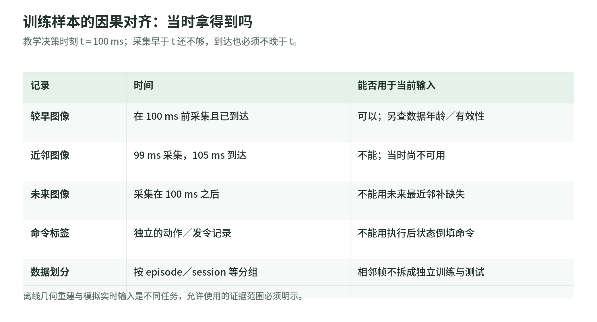

## 10 数据工程：时间对齐、动作语义、采样与训练样本

### 10.1 Episode 首先是一份接口契约

用 $s$ 表示环境与机器人状态，$o$ 表示策略实际获得的观测，$a$ 表示策略动作，$u$ 表示交给控制系统的输入，$q$ 专指关节位置。编码器读数属于 $s$ 的测量，目标关节位置属于 $u$；二者数值相近，也不能合并为一个 `joint_positions` 字段。ROS 2 的 `JointState` 定义位置、速度、力矩及其单位；`Image` 的时间戳指图像采集时间，光学坐标系也有明确轴向约定。[关节状态定义](https://github.com/ros2/common_interfaces/blob/jazzy/sensor_msgs/msg/JointState.msg)、[图像定义](https://github.com/ros2/common_interfaces/blob/jazzy/sensor_msgs/msg/Image.msg)

下面是原创教学 schema，不冒充某个标准数据格式。例子仅有两个转动关节；真实 schema 应显式区分转动关节与移动关节的单位。流各自保存，不强迫相机和机器人逐行一一对应。

```json
{
  "schema_version": "teaching-1.0",
  "episode_id": "session07-traj003",
  "split_group": "session07",
  "time": {
    "unit": "ns",
    "clock": "recorder_monotonic",
    "device_to_recorder_clock_map": "clockmap-v3"
  },
  "calibration": {
    "version": "calib-v4",
    "camera_frame": "camera_optical",
    "robot_frame": "base",
    "K": [600, 0, 320, 0, 600, 240, 0, 0, 1],
    "T_base_camera_translation_m": [0.4, 0.0, 0.7],
    "T_base_camera_quaternion_wxyz": [1, 0, 0, 0]
  },
  "joint_order": ["j0", "j1"],
  "joint_types": ["revolute", "revolute"],
  "camera": [{
    "exposure_start_ns": 1008000000,
    "exposure_end_ns": 1012000000,
    "t_capture_ns": 1010000000,
    "t_available_ns": 1016000000,
    "frame": "camera_optical",
    "rgb_ref": "frames/000031.png"
  }],
  "measured_state": [{
    "t_sample_ns": 1018000000,
    "t_available_ns": 1020000000,
    "q_rad": [0.100, -0.200],
    "dq_rad_s": [0.02, -0.01],
    "ee_frame": "base",
    "ee_position_m": [0.35, 0.02, 0.18],
    "ee_quaternion_wxyz": [1, 0, 0, 0],
    "source": "encoder_and_fk"
  }],
  "policy_action": [{
    "t_decision_ns": 1021000000,
    "representation": "delta_joint_position",
    "delta_q_rad": [0.002, -0.001],
    "anchor_state_sample_ns": 1018000000,
    "duration_ns": 20000000
  }],
  "cmd": [{
    "t_sent_ns": 1022000000,
    "t_apply_estimated_ns": 1024000000,
    "valid_until_ns": 1044000000,
    "mode": "joint_position_target",
    "q_target_rad": [0.102, -0.201],
    "source_action_index": 0,
    "apply_time_evidence": "estimate_not_hardware_ack"
  }],
  "termination": {"reason": "success", "is_truncated": false}
}
```

此处 $a$ 是关节增量，$u$ 是转换后的关节目标；不能用执行后 $q$ 的变化倒填 `cmd`。发送、估计应用、硬件确认是不同事件。`K` 的焦距及主点以像素表达，`T_base_camera` 将相机坐标映射到基座坐标。图像的曝光中点只是本 schema 的约定，滚动快门还需行曝光模型；外参版本、四元数分量顺序、关节排列必须随数据保存。所有设备时钟先映射到记录器时钟，并记录映射误差，不能直接比较两台机器各自的单调时钟。

### 10.2 异频对齐：因果性由“当时能否拿到”决定

<!-- illustration: causal-alignment-dfe84b4c7f -->


*图：训练样本的因果对齐：当时拿得到吗。教学决策时刻 t = 100 ms；采集早于 t 还不够，到达也必须不晚于 t。*
<!-- /illustration: causal-alignment-dfe84b4c7f -->

设相机采样间隔为 $\Delta t_c$，机器人状态间隔为 $\Delta t_r$，策略决策时刻为 $t$。这些间隔是数据属性，不是控制频率建议。对每个决策，先按可获得时间筛选，再按采集时间选最近的过去样本：

$$
j^*(t)=\arg\max_{j:\ t_j^{\mathrm{capture}}\le t,\ t_j^{\mathrm{available}}\le t}
t_j^{\mathrm{capture}}.
$$

$j$ 是样本编号，$t_j^{\mathrm{capture}}$ 是采集时间，$t_j^{\mathrm{available}}$ 是该样本完成传输与必要处理、可以被策略读取的时间。不存在合格样本时应标记缺失，而不是取下一帧。ROS 2 的 `ApproximateTime` 会依据时间戳匹配消息，但“匹配得近”并不自动证明部署因果性；上述双重条件是训练管线额外施加的契约。[ROS 2 同步器源码](https://github.com/ros2/message_filters/blob/jazzy/include/message_filters/sync_policies/approximate_time.h)

教学例中，相机每约 $33$ ms 采一次，状态每 $5$ ms 采一次，策略在 $100$ ms 决策。图像 $99$ ms 采集、$105$ ms 到达，即使时间差仅 $1$ ms，也不能放进该次 $o$；应取此前已经到达的图像。每个观测同时携带“数据年龄”和有效性位，避免把陈旧图像伪装成新图像。

对齐算法应依次执行：校正时钟与乱序；按决策时刻筛选可用记录；检查最大年龄和同步误差；组装图像与状态历史；最后从独立命令流生成标签。观测历史不能越过 episode 边界。消息丢失不能通过填充“未来最近邻”消失。

位置线性插值要求两端样本均已经可用；否则使用过去样本零阶保持，或仅依赖过去数据的预测器，并注明其误差。若为了几何配准重建历史图像时刻的状态，可以用在当前决策前已收到的两个状态点插值；这不等于允许使用当前决策之后收到的数据。速度不宜无条件由差分位置推导，因为差分会放大测量噪声。

姿态应在旋转空间插值：先把两个单位四元数统一到同一半球，再作 SLERP。令 $\mathbf r_0,\mathbf r_1$ 为姿态四元数，$\alpha$ 为区间比例，$\theta=\arccos(\mathbf r_0^\top\mathbf r_1)$，则

$$
\mathbf r(\alpha)=
\frac{\sin((1-\alpha)\theta)}{\sin\theta}\mathbf r_0+
\frac{\sin(\alpha\theta)}{\sin\theta}\mathbf r_1.
$$

$\alpha\in[0,1]$；接近 $\theta=0$ 时需要数值稳定分支。符号 $\mathbf r$ 用来避免把姿态四元数与关节位置 $q$ 混淆。直接线性插值四元数分量不保持单位长度，归一化后的线性插值也不是一般意义上的恒角速旋转；机器人关节角经过跨周边界时亦须先处理角度周期性。Isaac Lab 固定版本源码展示了半球处理和球面插值。[Isaac Lab v2.2.0 姿态工具](https://github.com/isaac-sim/IsaacLab/blob/v2.2.0/source/isaaclab/isaaclab/utils/math.py)

### 10.3 动作的时间尺度就是动作语义的一部分

关节增量、关节速度和绝对目标不能只改字段名。若 $a_t$ 表示持续 $\Delta t$ 的关节增量，则平均速度为

$$
\bar v_t=\frac{a_t}{\Delta t},\qquad
q_{\mathrm{target}}=q_{\mathrm{anchor}}+a_t.
$$

$\bar v_t$ 是目标增量对应的名义平均关节速度，不是执行后的实测速度；$q_{\mathrm{anchor}}$ 是 schema 指定的参考关节位置。相同 $0.02$ rad 增量在 $20$ ms 与 $100$ ms 中分别对应 $1$ rad/s 与 $0.2$ rad/s；把所有轨迹重采样成相同长度却保留原增量，会改变任务运动语义。只有明确采用分段常速度假设，才能按新旧持续时间之比缩放增量；绝对位置目标和夹爪开关不适用该规则。

末端增量还须注明平移在基座轴还是工具轴表达、旋转采用旋转向量还是群上的相对旋转、参考位姿来自测量还是上一目标。旋转组合应按约定左乘或右乘，不能把欧拉角逐项相加当通用姿态更新。把连续动作离散成 token 时，要保存量化区间、边界处理和时间尺度；均匀位置量化步长 $\epsilon$ 的单次舍入误差至多为 $\epsilon/2$，但连续增量的累积误差不能据此当成单次误差。这里的算例与边界规则均为本章推导。

### 10.4 Chunk 标签、归一化与数据泄漏

令 episode 有 $N$ 个动作，以 $i$ 为起点，长度 $H$ 的 chunk 标签为 $A_i=(a_i,\ldots,a_{i+H-1})$。其第 $\ell$ 项有效位为 $m_{i,\ell}=\mathbf1[i+\ell<N]$，其中 $\ell=0,\ldots,H-1$。末尾可补零或重复值，但必须携带 mask；不能把下一条轨迹的开头拼到当前轨迹末尾。以均方误差为例：

$$
\mathcal L=
\frac{\sum_i\sum_{\ell=0}^{H-1}
m_{i,\ell}\|\hat a_{i,\ell}-a_{i+\ell}\|_2^2}
{\sum_i\sum_{\ell=0}^{H-1}m_{i,\ell}}.
$$

$\hat a_{i,\ell}$ 是预测动作；无效项只作为张量占位，不参与分子、分母。实际实现还须在访问数组前处理越界，不能先计算不存在的动作再乘零。这个 mask 是标签有效性，不等于 Transformer 的注意力 mask；观测窗口仍须独立满足因果条件。

连续动作可按 $\tilde a_d=(a_d-\mu_d)/\max(\sigma_d,\varepsilon)$ 归一化。$d$ 是动作维度，$\tilde a_d$ 是归一化动作，$\mu_d,\sigma_d$ 分别是仅从训练集有效标签统计的均值和标准差，$\varepsilon>0$ 防止除零；二值夹爪应保留独立编码。统计量、单位和 schema 版本要一起冻结。训练后的验证与测试既不更新统计量，也不能先用全量数据拟合归一化再拆分。

必须先按完整轨迹及必要的采集会话、物体实例等分组拆分，再生成重叠窗口。否则相邻 chunk 共享图像与动作，测试集实际包含训练片段。合成轨迹若由同一真实示范衍生，继承其拆分组；同一源视频的裁剪也不能跨集合。PyTorch 的 `Dataset`、`Sampler` 与 `random_split` 提供索引机制，但不会替项目识别这些语义分组；归一化流式统计还要防止多 worker 重复计数。[PyTorch 2.9 数据加载](https://docs.pytorch.org/docs/2.9/data.html)

### 10.5 真实、合成与人类视频如何成为动作监督

真实遥操作需要同时记录人的接口输入、转换后的机器人命令与执行状态，并声明训练到底预测哪一层。合成数据需要一个确实运行过的控制过程：记录仿真动作、转换器、执行器模型和反馈，而不是给渲染图像附上凭空动作。Isaac Lab Mimic 的数据生成流程以机器人示范及其末端轨迹、子任务信息为基础，变换后由动作转换与仿真执行生成新轨迹；这些标签只在对应动作接口下有效。[Isaac Lab v2.2.0 Mimic](https://isaac-sim.github.io/IsaacLab/v2.2.0/source/overview/teleop_imitation.html)

普通人类视频没有机器人命令。可先做视觉表示学习；若要产生动作标签，则需要姿态与物体跟踪、尺度及坐标估计、机器人重定向、接触与逆运动学约束，再通过机器人或仿真执行检验。由相邻机器人状态训练的逆动力学模型也只能生成带模型假设的伪标签，接触遮挡、动作不可辨识和一对多解必须保留置信度与来源。所有伪标签都应与实测命令分开评测；视频“看起来完成”不是可执行动作监督的证据。这是依据前述接口契约得出的工程结论，不是对某套系统准确率的宣称。

### 本章实际读取的一手来源

- [ROS 2 Jazzy JointState](https://github.com/ros2/common_interfaces/blob/jazzy/sensor_msgs/msg/JointState.msg)：状态字段、关节单位和采样时间；不是命令定义。
- [ROS 2 Jazzy Image](https://github.com/ros2/common_interfaces/blob/jazzy/sensor_msgs/msg/Image.msg)：采集时间戳与光学坐标系。
- [ROS 2 Jazzy ApproximateTime](https://github.com/ros2/message_filters/blob/jazzy/include/message_filters/sync_policies/approximate_time.h)：匹配队列与时间戳算法，不提供训练因果性保证。
- [Isaac Lab v2.2.0 math.py](https://github.com/isaac-sim/IsaacLab/blob/v2.2.0/source/isaaclab/isaaclab/utils/math.py)：实际读取 `quat_slerp` 实现，确认四元数顺序、半球选择及数值分支。
- [PyTorch 2.9 data](https://docs.pytorch.org/docs/2.9/data.html)：Dataset、采样、随机拆分和多 worker 的职责。
- [Isaac Lab v2.2.0 Teleoperation and Mimic](https://isaac-sim.github.io/IsaacLab/v2.2.0/source/overview/teleop_imitation.html)：机器人示范到合成动作轨迹的生成链；重点读取 “How it works” 与动作转换 helpers。以上访问日期均为 2026-10-27。
