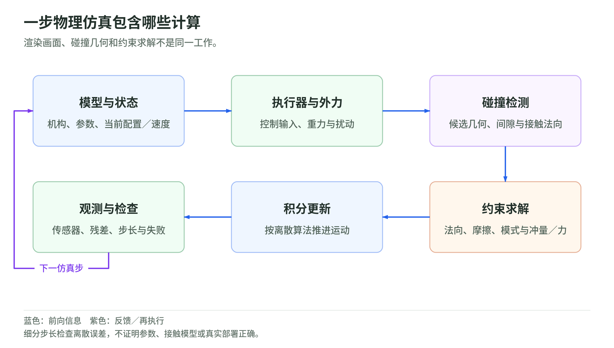

## 11 物理仿真：积分、碰撞、约束求解与 Sim-to-Real

### 11.1 一步仿真不是“把物体移到下一帧”

<!-- illustration: simulation-step-99fdc0fa1f -->

*图：一步物理仿真包含哪些计算。渲染画面、碰撞几何和约束求解不是同一工作。*
<!-- /illustration: simulation-step-99fdc0fa1f -->

沿用 $s$ 为状态、$o$ 为观测、$a$ 为策略动作、$u$ 为控制输入、$q$ 为关节位置。仿真先把 $a$ 转成执行器接受的 $u$，再求动力学、接触与积分，最后按传感器模型生成 $o$。以下是本章用于说明计算链的简化动力学表达：

$$
M(q)\dot v+b(q,v)
=\tau_{\mathrm{act}}(u,s)+\tau_{\mathrm{pass}}(q,v)+J(q)^\top\lambda.
$$

$v$ 是广义速度，$\dot v$ 是加速度，$M$ 是质量矩阵，$b$ 包含科氏、离心及重力项；$\tau_{\mathrm{act}}$ 是执行器广义力，$\tau_{\mathrm{pass}}$ 是未计入 $b$ 的弹簧、阻尼等被动力，$J$ 是约束速度雅可比，$\lambda$ 是接触或关节约束力。$s$ 还可包含执行器内部状态。位置控制输入不是物理上的瞬移：必须经过驱动增益、力矩限制或执行器动态。MuJoCo 的计算文档分别定义执行器、被动力与约束力的职责。[MuJoCo 3.3.5 计算框架](https://mujoco.readthedocs.io/en/3.3.5/computation/index.html#general-framework)

设物理步长为 $h$，显式 Euler 与半隐式 Euler 在普通标量关节坐标中分别是：

$$
\begin{aligned}
\text{显式：}\quad
v_{t+h}&=v_t+h\dot v_t,&q_{t+h}&=q_t+hv_t,\\
\text{半隐式：}\quad
v_{t+h}&=v_t+h\dot v_t,&q_{t+h}&=q_t+hv_{t+h}.
\end{aligned}
$$

$t$ 是物理时间；半隐式用更新后的速度更新位置，但并不意味着所有力都在未来时刻隐式求解。自由体姿态应在旋转流形上积分，不能把四元数分量与角速度直接相加。MuJoCo 3.3.5 的 `Euler` 也不能简单等同于“纯显式”：该版本不提供显式 Euler，且 `Euler` 默认对关节阻尼作隐式处理；`implicit`、`implicitfast` 有各自的速度导数近似。[MuJoCo 积分器](https://mujoco.readthedocs.io/en/3.3.5/computation/index.html#numerical-integration)

原创教学算例：一维无阻尼弹簧满足 $m\ddot x=-\kappa x$，其中 $x$ 是位移，$m$ 是质量，$\kappa$ 是弹簧刚度，固有角频率 $\omega=\sqrt{\kappa/m}$。显式 Euler 的离散特征值模长为 $\sqrt{1+(h\omega)^2}>1$，会持续增加振幅；半隐式在线性、无阻尼、恒步长的这个特殊系统中满足 $0<h\omega<2$ 时具有有界振荡。取 $m=1$ kg、$\kappa=10^4$ N/m，得到 $\omega=100$ rad/s；$h=5$ ms 对应 $h\omega=0.5$，$25$ ms 对应 $2.5$。这只是稳定性演示：满足上界不保证相位、能量或接触误差足够小，也不能推广为任意机器人稳定定理。

一个策略区间 $\Delta T$ 分成 $n_{\mathrm{sub}}$ 个子步，令 $h=\Delta T/n_{\mathrm{sub}}$，可以更细地解析快速动态；须明确每子步是否更新碰撞、执行器和控制器，而不是仅把渲染帧数提高。先对 $h$ 做收敛检查，再调整求解容差，不能用更软接触掩盖过大步长。Isaac Sim 区分物理时间步和渲染时间步，墙钟运行速度也不等于模拟时间速度。[Isaac Sim 5.1.0 仿真时间](https://docs.isaacsim.omniverse.nvidia.com/5.1.0/physics/simulation_fundamentals.html#simulation-timeline)

### 11.2 碰撞检测只提供几何，不直接决定接触力

Broad phase 用包围盒、空间结构等筛掉不可能相交的物体对；narrow phase 对剩余几何计算距离、接触点与法向；随后才构造接触约束并求力或冲量。碰撞点数量和法向会改变约束矩阵，因此几何简化不是只影响外观。MuJoCo 3.3.5 使用 sweep-and-prune、包围层次和类型相关的窄相检测；这里描述的是该版本，不把实现推广到所有引擎。[MuJoCo 碰撞计算](https://mujoco.readthedocs.io/en/3.3.5/computation/index.html#collision-detection)

渲染 mesh 与 collision proxy 应分别登记。一个有孔零件若只取单个凸包，孔会被填平；凸分解保留更多凹结构，却增加几何体和接触计算；薄壁、棱边、尺度以及碰撞过滤表必须单独检验。Isaac Sim 5.1.0 官方例子展示凸包、凸分解与 SDF 代理的差异，并说明接触偏移决定何时开始生成约束。[Isaac Sim 碰撞代理](https://docs.isaacsim.omniverse.nvidia.com/5.1.0/physics/simulation_fundamentals.html#convex-hull)

离散检测可能遗漏一步内穿过薄壁的物体；子步或连续碰撞检测处理的是时间离散问题，不能补回错误的孔洞形状。MuJoCo 碰撞源码中的 “CCD” 还可能指 convex collision detection，不能仅凭缩写把它当成时间上的 continuous collision detection。[MuJoCo 凸几何碰撞](https://mujoco.readthedocs.io/en/3.3.5/computation/index.html#convex-collisions)

### 11.3 约束求解器包含物理假设，不只是迭代次数

理想无黏附刚性接触可用非穿透互补关系说明：

$$
g_n\ge0,\qquad \lambda_n\ge0,\qquad g_n\lambda_n=0.
$$

$g_n$ 是法向间隙，$\lambda_n$ 是法向接触力；分离时没有压力，有压力时处于接触。冲击的离散求解还须换成速度、冲量及恢复系数条件，不能把这组三式当作完整碰撞算法。求解 $J M^{-1}J^\top$ 所描述的约束耦合，意味着夹持中的一个接触会影响其他接触与关节，不能逐个独立“把穿透推回去”。

这也不是 MuJoCo 全部接触的原样方程：其默认软约束通过正则化凸优化允许有限约束偏差，放松严格互补。PGS、CG 与 Newton 求解同一框架的不同形式；摩擦锥和软化参数改变的可能是动力学本身，不只计算速度。[MuJoCo 接触与求解器](https://mujoco.readthedocs.io/en/3.3.5/computation/index.html#constraint-solver)

干摩擦的简化库仑锥为 $\|\lambda_\parallel\|_2\le\mu\lambda_n$。$\lambda_\parallel$ 是切向力，$\mu$ 是摩擦系数；静止时锥内可维持不滑，滑动时摩擦抵抗切向相对速度。多面体锥是对圆锥的离散近似；静、动摩擦、扭转及滚动摩擦是否独立建模，必须查具体引擎与版本，不能只复制一个“摩擦值”。MuJoCo 的 `condim` 决定可用接触维度，椭圆锥与金字塔锥的软接触结果亦不完全相同。[MuJoCo 接触参数](https://mujoco.readthedocs.io/en/3.3.5/computation/index.html#contact)

配置时把 `solver`、迭代上限、终止容差、warm start、接触参数及物理步长一起版本化。MuJoCo 的 `solref` 正值格式使用时间常数与阻尼比，`solimp` 描述约束阻抗；这些数不是可跨引擎直接照搬的材料刚度。应同时记录穿透、约束残差、滑移、能量漂移和任务误差。增加迭代次数主要减小数值求解误差，不会让错误惯量或摩擦模型变成真实材料。[MuJoCo 约束参数](https://mujoco.readthedocs.io/en/3.3.5/modeling.html#solver-parameters)

### 11.4 柔性物体与数字孪生：必须辨识哪些参数

柔性物体不只是给刚体更软的接触：内部要表示拉伸、弯曲或体积变形，质量分布与边界条件随离散网格进入运动方程。更细网格和更大弹性模量会引入更快的模态，使积分与自碰撞更困难。MuJoCo 3.3.5 的 `flex` 使用可变形单元并生成接触、约束和被动力，而 `skin` 只服务可视化；不同柔体算法不能被假定为同一种材料模型。[MuJoCo 可变形对象](https://mujoco.readthedocs.io/en/3.3.5/modeling.html#deformable-objects)

OpenUSD 是表示、组织与交换场景的层，不是积分或接触求解器。Isaac Sim 的 USD Physics／PhysX schema 用来表达物理属性，运行时由仿真后端解释；同一表示进入不同后端，仍可能产生不同动态。[Isaac Sim 物理 schema](https://docs.isaacsim.omniverse.nvidia.com/5.1.0/physics/simulation_fundamentals.html#physics-in-usd-schemas)

“数字孪生”在本章采用严格工程工作定义：场景绑定特定真实对象、校准版本及验证记录。参数包至少覆盖质量与惯量、质心、关节零位与阻尼、执行器增益与饱和、摩擦与接触、相机内外参，以及采样和通信延迟。几何复制得准确并不意味着这些参数已确定。

原创辨识流程是：用已有且获授权的日志确定待辨识参数和可观测量；建立带噪声的时间模型；拟合；在独立轨迹上检查误差及不确定性。可写为

$$
\theta^*=\arg\min_\theta
\sum_t\|y_t-\hat y_t(\theta)\|_W^2+R(\theta).
$$

$\theta$ 是模型参数，$y_t$ 是实测输出，$\hat y_t$ 是同输入条件下的预测输出，$W$ 是按量纲和噪声设置的权重矩阵，$\|e\|_W^2=e^\top We$，$R$ 是物理先验或正则项。只见到恒速段就很难区分质量、摩擦与控制增益；时钟偏移也可能被误拟合成执行器迟滞。保存候选参数及置信范围，而不是仅保存一个最低损失值。

### 11.5 DR 应覆盖不确定性，也要覆盖 latency gap

Domain randomization 是定义参数分布 $p(\theta)$，不是把所有数无边界地乱改。本章教学配置可令正质量乘子 $r_m=\exp z$，其中 $z$ 来自截断正态分布；摩擦用有界分布，外参误差在旋转空间扰动。边界来自辨识不确定性或明确的压力测试条件，不是通用推荐范围。质量与惯量、相机安装位置与遮挡等相关变量应联合采样；材料与装配误差通常在 episode 开始固定，传感器噪声与延迟则按时间相关过程变化。Isaac Sim 5.1.0 提供 reset／interval 随机化门控，以及直接、加法和比例修改语义。[Isaac Sim 物理 DR](https://docs.isaacsim.omniverse.nvidia.com/5.1.0/py/source/extensions/isaacsim.replicator.domain_randomization/docs/index.html)

Latency gap 可用教学离散模型表达：

$$
s_{t+h}=F_\theta(s_t,u_{t-d_u}),\qquad
o_t=G_\theta(s_{t-d_o})+\eta_t.
$$

$F_\theta$ 是带参数的状态转移，$G_\theta$ 是观测映射，$d_u,d_o$ 分别是控制与观测延迟，$\eta_t$ 是传感器噪声。实际实现需要时间队列，非整数步延迟须指定保持或插值规则；还要包含抖动、丢帧、执行器带宽与策略计算时间。仿真每步立即获得真值、立即执行动作，而运行系统依据旧图像输出新目标，是不同的闭环问题。应分别留出未见参数与延迟组合评测；DR 覆盖和碰撞逼真都不是整机安全证明。

### 本章实际读取的一手来源

- [MuJoCo 3.3.5 Computation](https://mujoco.readthedocs.io/en/3.3.5/computation/index.html)：重点读取动力学、积分、接触、求解器与碰撞节，核对特定引擎的数学假设。
- [MuJoCo 3.3.5 Modeling](https://mujoco.readthedocs.io/en/3.3.5/modeling.html)：重点读取 `solref`／`solimp` 与 deformable objects，区分接触软化、材料模型和视觉皮肤。
- [Isaac Sim 5.1.0 Physics Simulation Fundamentals](https://docs.isaacsim.omniverse.nvidia.com/5.1.0/physics/simulation_fundamentals.html)：物理／渲染时间、USD 属性、碰撞代理与接触偏移。固定版本仅用于可复查引用，不表示部署选型建议。
- [Isaac Sim 5.1.0 Domain Randomization API](https://docs.isaacsim.omniverse.nvidia.com/5.1.0/py/source/extensions/isaacsim.replicator.domain_randomization/docs/index.html)：随机化时机和修改语义；本章概率分布、辨识流程与算例为原创工程推导。以上访问日期均为 2026-10-27。
