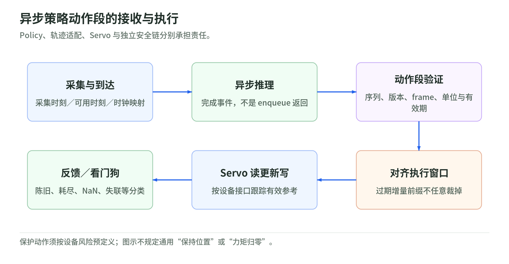

## 12 运行系统：通信、调度、GPU 推理与故障处理

### 12.1 运行接口传递的不只是张量，还有时限

沿用 $s$ 为状态、$o$ 为策略观测、$a$ 为策略动作、$u$ 为控制输入、$q$ 为关节位置。部署链是“带时间戳的 $o$ → 推理得到 $a$ → 校验与转换得到 $u$ → 控制器和执行器”，反馈再改变 $s$。`publish()` 返回、GPU enqueue 返回、驱动器收到命令，都不等于动作已完成。

ROS 2 topic 用于持续发布／订阅流，service 用于短时请求与响应，action 用于带反馈、结果及取消机制的长任务；ROS 的 action 协议不要与策略动作 $a$ 混为一谈。取消请求是否获准、任务是否停止，仍须读取协议状态与执行反馈。[ROS 2 topics](https://raw.githubusercontent.com/ros2/ros2_documentation/jazzy/source/Concepts/Basic/About-Topics.rst)、[services](https://raw.githubusercontent.com/ros2/ros2_documentation/jazzy/source/Concepts/Basic/About-Services.rst)、[actions](https://raw.githubusercontent.com/ros2/ros2_documentation/jazzy/source/Concepts/Basic/About-Actions.rst)

QoS 的 reliability 决定是否尝试可靠交付与重传，history/depth 决定保留多少样本，lifespan 定义消息过期，deadline 表达预期消息间隔并产生违约事件。Reliable 不意味着“在截止时间前到达”；deadline 事件不为 CPU、网络或 GPU 预留执行时间。发布端与订阅端 QoS 不兼容还可能根本不建立连接。[ROS 2 Jazzy QoS 定义](https://raw.githubusercontent.com/ros2/ros2_documentation/jazzy/source/Concepts/Intermediate/About-Quality-of-Service-Settings.rst)

原创配置原则是按消息语义选择：只消费最新图像的链路可使用有界小队列和允许丢帧的策略；要求历史窗口的应用应另建带时间戳的缓存。可靠命令流仍要限制队列并检查有效期，不能让断联前命令在恢复后继续排队执行；持久化历史也不能替代命令确认。记录日志与在线控制可使用不同缓存，避免为了完整记录拖慢控制。即使队列深度为一，也不消除当前正在执行的旧回调、设备队列和传输延迟。

Executor 决定何时运行回调，callback group 决定哪些回调可并行；增加线程数并不自动消除互斥组、锁竞争或优先级反转。应把耗时推理、日志与控制更新隔离，明确共享快照和队列容量；实时能力还取决于操作系统调度、内存分配、阻塞调用和最坏执行时间。[ROS 2 Jazzy Executors](https://raw.githubusercontent.com/ros2/ros2_documentation/jazzy/source/Concepts/Intermediate/About-Executors.rst)

### 12.2 Policy、轨迹适配与 Servo 是不同层

`ros2_control` 的主循环按 `read → update → write` 运行：读硬件状态，更新控制器，写控制输入。源码把实际测得的循环间隔传入这些阶段，不能假设配置周期永远精确实现。[ros2_control Jazzy 主循环](https://github.com/ros-controls/ros2_control/blob/jazzy/controller_manager/src/ros2_control_node.cpp)

本章所称 servo 是低层反馈追踪，不特指某个同名产品。策略提供目标或 chunk，适配层检查坐标、单位、限幅及连续性，轨迹层生成时间化参考，servo 根据实测 $q$ 纠偏，驱动器还可能有自己的电流／速度环。模型给出关节位置不是直接输出电机力矩；若模型学的是力矩，也必须与硬件接口的力矩语义一致。控制层不应等待一次模型推理完成才更新反馈；它消费已验证、未过期的参考，参考耗尽则进入预定义故障状态。这里是职责设计，没有通用推荐控制频率。

### 12.3 GPU 异步执行：CPU 结束调用不代表设备完成

典型推理路径经过主机图像缓冲、解码与预处理、H2D 拷贝、显存输入、GPU kernels、D2H 输出及反归一化。H2D／D2H 分别指 host-to-device／device-to-host。独立显存设备上的 CPU 指针不能直接当 GPU 输入；共享或映射内存也不意味着数据搬运与一致性成本消失。[CUDA 12.8.1 内存与并发](https://docs.nvidia.com/cuda/archive/12.8.1/cuda-c-programming-guide/index.html#asynchronous-concurrent-execution)

CUDA stream 内操作有序，不同 stream 的相对先后须用事件或依赖明确规定。异步提交允许 CPU 继续工作；拷贝与计算能否重叠还取决于硬件能力、page-locked 主机内存和调度条件。`non_blocking=True` 不是“零拷贝”或“必然重叠”的承诺。输入缓冲在拷贝完成前不得被覆盖；输出在设备完成前不得发布；多缓冲也须保存每个槽的完成事件与生命周期。[PyTorch 2.9 CUDA semantics](https://docs.pytorch.org/docs/2.9/notes/cuda.html#cuda-streams)、[CUDA 拷贝重叠条件](https://docs.nvidia.com/cuda/archive/12.8.1/cuda-c-programming-guide/index.html#overlap-of-data-transfer-and-kernel-execution)

Warmup 应覆盖实际输入 shape、推理 profile 和内存路径，把首次上下文建立、分配及首次执行与稳态分开报告。GPU 时间用正确同步的 CUDA events，整条链用主机单调时间及设备映射时间；仅在 Python 函数前后计时可能只量到提交开销。Profiling 还应查看 CPU 等待、拷贝、kernel、显存峰值及隐式同步，并说明 profiler 自身开销。[PyTorch 异步计时](https://docs.pytorch.org/docs/2.9/notes/cuda.html#asynchronous-execution)、[PyTorch Profiler](https://docs.pytorch.org/docs/2.9/profiler.html)、[TensorRT 性能方法](https://docs.nvidia.com/deeplearning/tensorrt/latest/performance/best-practices.html)

### 12.4 一个端到端延迟预算算例

定义 $L_{\mathrm{e2e}}=t_{\mathrm{apply}}-t_{\mathrm{capture}}$，其中 $t_{\mathrm{capture}}$ 是曝光中点，$t_{\mathrm{apply}}$ 是控制输入实际应用时间。下面完全是教学假设，不是硬件测量、行业事实或频率建议；假设各阶段串行且这些数是分配额度：

| 阶段 | 假设额度 |
| --- | ---: |
| 曝光中点到数据可用 | 8 ms |
| 传输、反序列化与排队 | 4 ms |
| 预处理 | 3 ms |
| H2D | 2 ms |
| GPU 推理 | 18 ms |
| D2H 与动作校验 | 2 ms |
| 等待控制更新及写出、应用 | 5 ms |
| 合计 | 42 ms |

若应用允许观测到应用最多 $50$ ms，则剩余 $8$ ms 是抖动余量，不是实时保证。即便 GPU 减少 $6$ ms，图像排队增加 $15$ ms，总延迟仍恶化。存在并行时应沿依赖链计算关键路径，不能把重叠阶段重复相加；也不能把各段 p99 相加叫作整链 p99。应直接统计同一请求的整链分布、超时率和冷启动，并把硬件确认缺失的 `t_apply` 标为估计值。

### 12.5 异步 Chunk：过期比“没算完”更危险

<!-- illustration: runtime-chunk-f3d7cc0987 -->

*图：异步策略动作段的接收与执行。Policy、轨迹适配、Servo 与独立安全链分别承担责任。*
<!-- /illustration: runtime-chunk-f3d7cc0987 -->

推理线程读取不可变观测快照，附带 `episode_epoch`、`request_seq`、`t_obs`、`model_version`；完成后发布带 `t_ready`、每项计划执行时间和 `valid_until` 的 chunk。控制线程通过有界双缓冲或队列消费，不等待 GPU。一个原创接收条件为：

$$
\mathrm{accept}=
(e=e_{\mathrm{active}})\land
(r>r_{\mathrm{last}})\land
(t<t_{\mathrm{expiry}})\land
(t-t_{\mathrm{obs}}\le A_{\max})\land V.
$$

$e$ 是轨迹／任务世代，$r$ 是请求序号，$r_{\mathrm{last}}$ 是最后接受的序号，$t$ 是核验时刻，$t_{\mathrm{expiry}}$ 是有效期，$t_{\mathrm{obs}}$ 是输入观测的采集时刻，$A_{\max}$ 是允许的最大观测年龄，$V$ 表示版本、维度、单位、坐标、数值有限性及其他适用校验通过。时间必须在同一已校准时基下比较。此条件只是软件接收门，不是安全证明；写出和应用时还需再次核验时限。

设 chunk 有 $H$ 项，每项间隔 $\Delta t$，计划时刻 $\tau_\ell=t_0+\ell\Delta t$。$t_0$ 是计划起点，$\ell=0,\ldots,H-1$。计算迟到时不能把已经过期的前缀从头补执行；绝对目标可按有效窗口选择剩余项，但增量动作还须根据训练时的参考规则重建剩余目标。若当前实测 $q$ 已偏离规划锚点，应拒绝或重新规划，不能盲目跳过 delta。较早请求较晚完成时也要丢弃，防止旧结果覆盖新结果。长 chunk 降低模型调用次数，却可能延长基于旧 $o$ 的开环区间；“整块还有尾巴”不等于每项仍有效。

看门狗至少监测观测年龄、最后有效 chunk、控制循环进度、反馈更新与推理错误。原创状态机可定义 `INIT → READY → RUNNING`；观测陈旧或参考不足进入 `DEGRADED`，无有效参考进入 `PROTECTIVE`，版本不匹配、NaN、硬件反馈失效或设备错误进入锁存 `FAULT`。各状态的输出行为须按具体设备风险评估预先定义，不能通用地规定“保持位置”或“全部力矩归零”。恢复需要健康条件、重新对齐和授权，不能仅收到一条新消息就自动继续。看门狗自身应避免依赖被监控的 GPU 线程；软件状态机也不替代独立安全链。

Trace 至少关联 `trace_id/request_seq` 与 `t_capture/t_receive/t_preprocess_done/t_h2d_done/t_infer_start/t_infer_done/t_validated/t_write/t_apply_ack`，同时保存时钟映射误差、frame、模型／engine 版本、队列深度和状态转换原因。`t_infer_done` 要来自完成事件，不是 enqueue 返回时刻；CUDA 异步错误的报告位置也可能晚于出错操作。[PyTorch 异步执行与错误](https://docs.pytorch.org/docs/2.9/notes/cuda.html#asynchronous-execution)

### 12.6 INT8 与 Engine：优化也要维护语义

以 TensorRT 的对称 INT8 为例，换用 $\gamma$ 表示 scale，避免与状态 $s$ 冲突：

$$
z=\operatorname{roundEven}
\left(\operatorname{clip}\left(\frac{x}{\gamma},-128,127\right)\right),
\qquad \hat x=\gamma z.
$$

$x$ 是高精度数值，$\gamma>0$ 是量化尺度，$z$ 是 INT8 整数，$\hat x$ 是反量化值，`roundEven` 是就近舍入、相等时取偶数。小 $\gamma$ 提高分辨率却更容易饱和，大 $\gamma$ 扩大范围却增加舍入误差；权重可按通道设置 scale，必须核对轴与导出布局，而不是任意给每项一个比例。[TensorRT INT8 数学](https://docs.nvidia.com/deeplearning/tensorrt/latest/inference-library/quantized-types-schemes.html)

PTQ 用代表性校准数据估计量化参数，QAT 在训练中模拟量化误差。校准必须走部署时相同的裁剪、颜色、归一化和观测历史管线，覆盖接触转换、暗光等适用情形；冻结数据版本与 scales，不用最终测试集调参。当前查阅的 TensorRT 11.4.0 显式量化流程把校准结果写入 Q/DQ 节点；不能把旧版隐式 calibrator API 默认套到新版本。[TensorRT 量化工作流](https://docs.nvidia.com/deeplearning/tensorrt/latest/inference-library/quantized-types-workflows.html)

精度验收应比较转换前后输出误差、动作边界、NaN／饱和、时序连续性与适用闭环任务结果，分别验证 FP32、FP16 和 INT8，而非只看视觉分类准确率。敏感计算可保留更高精度，但支持范围须按目标图与引擎核验。量化不是必然提高端到端速度，结果还受算子覆盖、转换和拷贝支配。

`model_version` 指权重及观测／动作契约；TensorRT engine 则是特定构建条件下的可执行产物，二者不能互换。部署 manifest 应绑定权重 hash、schema、归一化 hash、Q/DQ graph、输入 shape/profile、TensorRT／CUDA／插件版本、目标硬件与 engine hash。默认 engine 不保证跨 TensorRT 版本或设备类型兼容；version compatibility 和 hardware compatibility 是带限制的构建选项，启用也不证明动作语义或数值结果等价。只接受可信 engine，并做目标环境加载、精度与时延验证。[TensorRT 11.4.0 Engine Compatibility](https://docs.nvidia.com/deeplearning/tensorrt/11.4.0/inference-library/engine-compatibility.html)

### 本章实际读取的一手来源

- [ROS 2 Jazzy Topics](https://raw.githubusercontent.com/ros2/ros2_documentation/jazzy/source/Concepts/Basic/About-Topics.rst)、[Services](https://raw.githubusercontent.com/ros2/ros2_documentation/jazzy/source/Concepts/Basic/About-Services.rst)、[Actions](https://raw.githubusercontent.com/ros2/ros2_documentation/jazzy/source/Concepts/Basic/About-Actions.rst)：三种通信协议的职责。
- [ROS 2 Jazzy QoS](https://raw.githubusercontent.com/ros2/ros2_documentation/jazzy/source/Concepts/Intermediate/About-Quality-of-Service-Settings.rst)、[Executors](https://raw.githubusercontent.com/ros2/ros2_documentation/jazzy/source/Concepts/Intermediate/About-Executors.rst)：队列、违约事件、回调分组及调度语义。
- [ros2_control Jazzy 源码](https://github.com/ros-controls/ros2_control/blob/jazzy/controller_manager/src/ros2_control_node.cpp)：实际读取主循环及测得周期的传递。
- [PyTorch 2.9 CUDA semantics](https://docs.pytorch.org/docs/2.9/notes/cuda.html)、[Profiler](https://docs.pytorch.org/docs/2.9/profiler.html)：异步、stream 依赖、计时与 profiling 开销。
- [CUDA 12.8.1 Programming Guide](https://docs.nvidia.com/cuda/archive/12.8.1/cuda-c-programming-guide/index.html#asynchronous-concurrent-execution)：实际读取异步执行、传输重叠及 page-locked 内存条件。
- [TensorRT Quantization Schemes](https://docs.nvidia.com/deeplearning/tensorrt/latest/inference-library/quantized-types-schemes.html)、[Workflows](https://docs.nvidia.com/deeplearning/tensorrt/latest/inference-library/quantized-types-workflows.html)、[Explicit Quantization](https://docs.nvidia.com/deeplearning/tensorrt/latest/inference-library/quantized-types-explicit-quantization.html)：当前页标示 11.4.0，核对 INT8、校准和 Q/DQ，不继承旧版默认行为。
- [TensorRT Best Practices](https://docs.nvidia.com/deeplearning/tensorrt/latest/performance/best-practices.html)、[11.4.0 Engine Compatibility](https://docs.nvidia.com/deeplearning/tensorrt/11.4.0/inference-library/engine-compatibility.html)：测量边界与 engine 的默认／可选兼容限制。以上访问日期均为 2026-10-27；预算、chunk 接收规则、manifest 与故障状态机均为本章教学设计。
