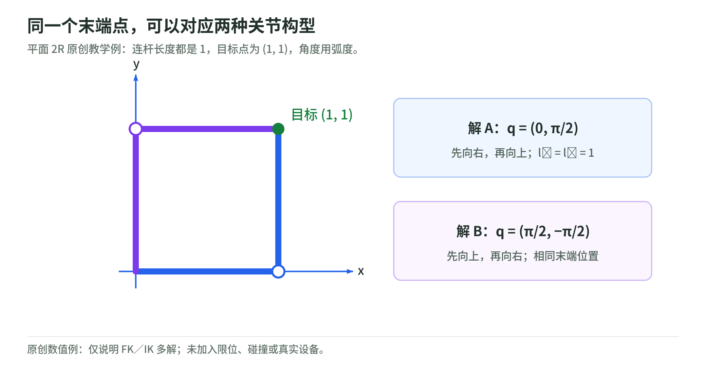
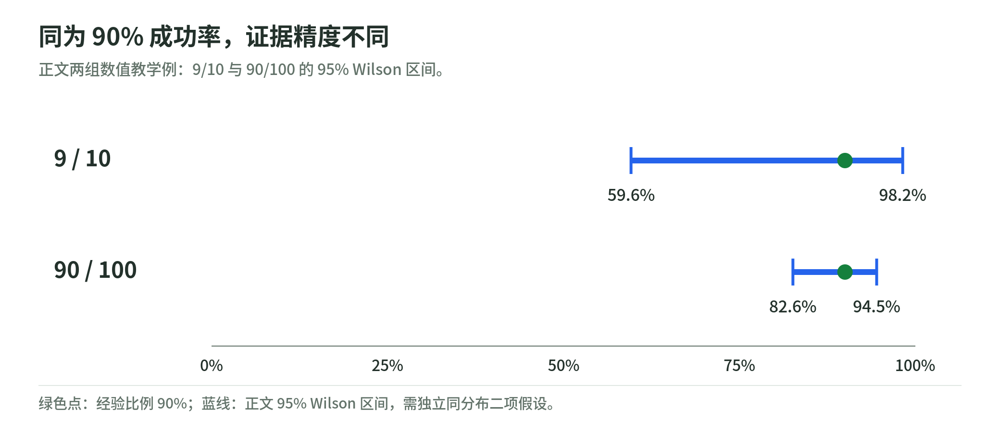

## 14 数值练习与系统贯通：把公式变成可检查的计算

### 14.1 教学程序的范围

`examples/numerical_workbook.py` 使用 Python 标准库，不联网、不连接设备、不训练模型，也没有真实接触或执行器。它验证本书若干公式及自创算例，不是机器人仿真平台。

运行：

```bash
python examples/numerical_workbook.py --output qa/numerical-results.json
```

完整结果在 `qa/numerical-results.json`。脚本包含 11 组断言；以下数值来自实际运行，不是预估结果。

### 14.2 正运动学与逆运动学：两个关节怎样到同一点

<!-- illustration: robot-2r-363ff9f0a4 -->


*图：同一个末端点，可以对应两种关节构型。平面 2R 原创教学例：连杆长度都是 1，目标点为 (1, 1)，角度用弧度。*
<!-- /illustration: robot-2r-363ff9f0a4 -->

取两段长度都为 1 的平面机械臂，目标为 $(1,1)$。两组关节配置 $(0,\pi/2)$ 与 $(\pi/2,-\pi/2)$ 都得到相同末端位置。计算时角度用弧度。

这验证几何上的多解，不包含关节限位或碰撞。在有桌面和工具的系统中，还要检查整段机构的运动，不只是末端点。

程序又从 $(0.2,-0.4)$ 开始，用阻尼最小二乘求解目标 $(1.2,0.6)$，阻尼为 0.05，每次关节更新向量的范数限制为 0.25。它在 10 次更新后得到：

$$
q\approx(1.29912949,-1.67096376),
\qquad \|e\|\approx6.63\times10^{-9}.
$$

这些参数属于数值教学设置。约束每步更新避免局部线性化一次走太远，但不是全局收敛证明；更换初值、目标或机构后应重新验证。

### 14.3 雅可比怎样做代码核对

除了看符号推导，还可以用中心差分近似每一列：

$$
J_{\cdot i}(q)\approx
\frac{f(q+\varepsilon e_i)-f(q-\varepsilon e_i)}
{2\varepsilon}.
$$

$e_i$ 是第 $i$ 个坐标方向的单位向量，$\varepsilon$ 是小步长，$f$ 为 FK。选 $q=(0.3,-0.7)$、$\varepsilon=10^{-6}$，程序的解析与差分雅可比最大绝对差约为 $6.94\times10^{-11}$。

差分步长不能盲目越小越好：太大时截断误差增加，太小时浮点相消影响结果。应检查多个合理步长，不能把一次差分匹配当成所有输入都正确。

### 14.4 奇异位形附近为什么需要阻尼

设 $q=(0,10^{-6})$，局部目标位移为 $(0.001,0)$。直接求解 $J\Delta q=e$ 得到约 $(1000,-2000)$，更新范数约 2236；阻尼 0.1 的更新范数约 $4.47\times10^{-8}$。

阻尼抑制了奇异方向的巨大增益，但没有实现这个位移。接近完全伸直时，机器人在径向方向的局部速度能力极弱；目标还可能越过可达边界。不能把“输出变小且数值稳定”写成“目标一定完成”。第 2 章的 SVD 解释了抑制发生在哪些方向。

### 14.5 反馈与估计：两种不同的纠正

理想积分器取 $\Delta t=1$、初始误差 1。比例增益 0.5 的误差乘子为 0.5，20 步后绝对误差约 $9.54\times10^{-7}$；增益 2.2 的误差乘子为 −1.2，同样步数后绝对误差约 38.34。后一过程正负交替并增长。

再做一个标量 Kalman 更新。先验均值 0、方差 4；测量值 2、测量方差 1，测量关系为 $z=x+v$。增益为：

$$
K=\frac{4}{4+1}=0.8,\qquad
\hat x^+=0+0.8(2-0)=1.6.
$$

后验方差为 0.8，程序还核对 Joseph 形式与简化形式一致。增益是依据所设方差计算的权重，不会独立判断传感器是否撒谎。如果把测量噪声低估，估计器就会更相信测量。

反馈在改变被控对象，估计更新在改变我们对状态的判断。它们可以相互连接，但不是同一种运算。

### 14.6 从数据分布理解动作生成

给同一观测下的动作标签 −1 和 1，各占一半。输出 0 的平均平方误差为 1；总是输出 1 的误差为 2。MSE 选择中间值，即使 0 从未出现在标签中。这里标签是标量教学分布；“中间路线穿过障碍”是对机器人应用的解释，不是这个脚本进行的碰撞测试。

扩散前向采样采用：

$$
x=0.6\times0.7+0.8\epsilon,\qquad
\epsilon\sim\mathcal N(0,1).
$$

理论均值为 0.42，方差为 0.64。固定随机种子采样 20,000 次，样本均值约 0.4234，方差约 0.6366。这个例子只验证高斯噪声的构造；没有训练去噪网络，也没有验证动作策略。

Flow matching 的最简端点例子取噪声端 −1、数据端 2，直线路径速度为 3。用十次步长 0.1 的 Euler 更新得到约 2。常量速度是本例已知目标，不是神经网络学到的速度场；实际模型要通过数据学习条件速度。

### 14.7 时间对齐与统计

<!-- illustration: wilson-evidence-dcc32f4b96 -->


*图：同为 90% 成功率，证据精度不同。正文两组数值教学例：9/10 与 90/100 的 95% Wilson 区间。*
<!-- /illustration: wilson-evidence-dcc32f4b96 -->

记录时刻为 0、0.05、0.10、0.15。对 0.12 时刻的因果查询，最近一个已经可用的样本是 0.10，不是更近但尚未出现的 0.15。程序用二分查找验证这个条件。

这并不禁止离线重建使用前后样本插值。训练样本若模拟实时输入，必须明确是否允许使用未来样本；相同重建方法不能不加区分地用于部署可用性评测。

程序也计算了第 13 章的两组 Wilson 区间。改变尝试次数会改变区间宽度；改变样本相关性则会改变区间方法的适用条件。它们是不同问题。

### 14.8 把取放任务接成一套具体系统

以“视觉得到末端目标、执行层生成关节运动”的教学组合为例，接口依次为：

1. 相机给 RGB、深度和采集时刻；内参用于反投影，外参把点变换到基座坐标。
2. 状态估计给当前 $q,\dot q$ 和相关不确定性；把估计推进到规划所用时刻。
3. 任务层选择抓取／搬运／放置阶段；阶段变化依据观测或明确结果，不能只依据计时。
4. 目标位姿经 IK 得到候选关节配置，再做机构碰撞与运动限制检查。
5. 路径加上时间参数变成 $q^\star(t),\dot q^\star(t)$；控制器产生设备所需命令。
6. 反馈确认跟踪与接触，任务评测器确认物体结果；二者分别记录。

若换成 VLA，主要替换的可以是第 3—4 步的任务到动作映射，但最终边界取决于其动作头。末端增量还需要坐标与运动转换；关节目标还需要执行时标；力矩动作则直接涉及动力学与驱动限制。

这套教学组合没有被本书在实机验证。它的用途是让你把每层输入输出、数学假设和代码字段对上；以后更换某一层时，可以明确知道其余层需要哪些调整。

### 14.9 用什么问题检查是否理解

不以背术语为检查方式。尝试推导或实现以下问题：

- 改变坐标系时，点、速度和力的表示分别怎样变化？
- 旋转误差为何不能一般地用四元数逐元素相减？
- EKF 的测量协方差改变后，增益和后验协方差怎样变化？
- 碰撞可行、动力学可行和任务成功之间还缺什么条件？
- 动作归一化、时间尺度或控制模式改变，训练标签怎样改变？
- PPO 的 clip 限制了哪个训练激励，为什么不是策略变化的硬约束？
- 世界模型用来想象训练，为什么不等于运行时每步在线规划？
- 去掉动作段的过期前缀，何时会破坏增量动作的语义？

如果只能说出方法名称，回到对应公式和接口。能够解释假设、复现数值、指出失败条件，再继续到完整仿真或硬件系统。
