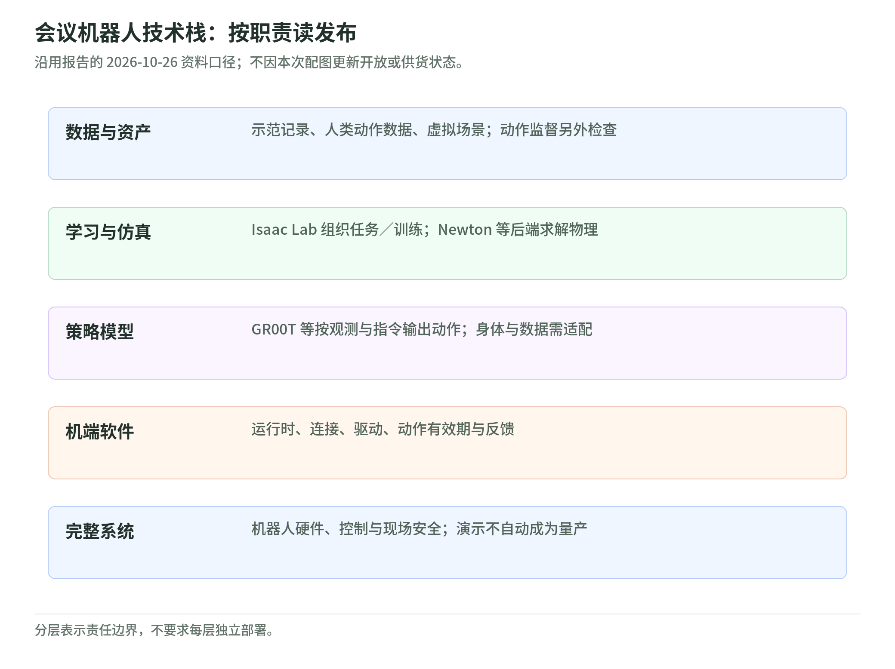
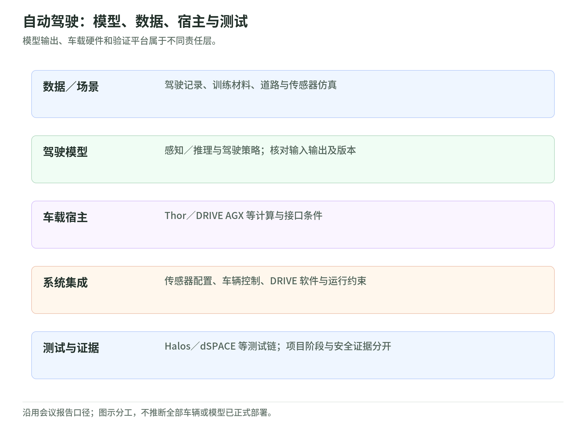

# GTC Berlin 2026：Physical AI 内容整理

这次介绍了哪些技术，机器人、工厂和自动驾驶分别怎么用

会议时间：2026 年 10 月 20–22 日｜德国柏林  
主题演讲：2026 年 10 月 21 日｜Jensen Huang

资料整理日期：2026 年 10 月 26 日｜版本 1.2

内容包括 Cosmos 世界模型、Isaac 机器人开发工具、工厂应用、自动驾驶和 Physical AI 技术栈。技术名词在第一次出现时解释，后面附会议场次和原始资料。

本文根据 NVIDIA 官方资料、技术文档和合作方公告整理。第六章补充通用技术栈及组件接口；其他会期内容沿用此前整理记录。性能、收益数字注明发布方和测试条件。资料来源见文末。[1] [2] [3] [4]

[TOC]

## 内容概览

GTC Berlin 的 Physical AI 内容涉及几类工作：收集训练数据，让模型理解场景和产生动作，在虚拟环境里训练、测试，再把模型接到机器人、车辆或工厂软件中。[1] [2] [6]

这里的 Physical AI，可以理解为“在真实环境里做事的 AI”。例如，机械臂根据相机画面和指令搬动物品，车辆根据路况规划行驶路线，工厂软件根据设备状态处理生产异常。[6] [20] [23]

会议中介绍的主要工具如下：

| 名称 | 主要做什么 |
|---|---|
| Cosmos | 理解场景，生成训练画面，根据动作推演后续场景 [7] [9] |
| Cosmos Framework、Curator、Evaluator | 分别负责模型训练、数据整理和结果评测 [10] [11] [12] |
| Isaac Capture | 记录人的操作示范和遥操作数据 [17] |
| GR00T 1.7／N1.7 | 根据图像、机器人状态和语言指令，生成动作序列 [6] [28] [29] |
| Isaac Lab、Newton | 在虚拟环境中训练机器人，并计算运动、接触等物理过程 [14] [15] |
| Isaac OS | 连接机器人上的 AI、传感器和控制软件 [6] [16] |
| Human 1M、SimReady Central | 提供人类动作数据和可用于仿真的三维资产 [6] [32] |
| Agile ONE SN | 配有 Jetson Thor 和 NVIDIA 机器人软件的研究用人形机器人 [19] |
| Factory Operations Blueprint（FOX） | 提供视觉检测、异常分析、报告和车队管理等工厂软件流程 [20] |
| Alpamayo 2 Edge | 面向车端的驾驶模型，生成行驶轨迹和规划说明 [23] [25] |
| Halos SAFE | 把驾驶安全要求整理成测试场景、测试项目和结果记录 [26] |

下面按工具和应用分别说明，第六章汇总技术栈。版本差异、下载时间和供货计划放在第七章。

## 一、Cosmos：让 AI 理解场景，也能推演接下来会发生什么

### 1.1 世界模型是什么

世界模型学习的是场景中的物体、状态和变化。例如，给它当前画面和一个机械臂动作，它可以生成执行该动作后的画面；换一个动作，就得到另一种后续变化。开发者可以用这种方式构造训练场景，或让机器人策略在虚拟环境中反复尝试。[7] [9]

世界模型与物理仿真引擎的做法不同：Cosmos 从数据中学习场景变化，Newton 等物理引擎根据设定的物理参数计算运动和接触。[9] [14]

本次相关的交互式仿真资料，展示了驾驶、双臂操作和场景外观变化等示例。在这类仿真中，模型会根据机器人或车辆的动作继续生成环境画面，而不是只播放一段事先录好的视频。[9]

### 1.2 Cosmos 的几种用法

| 用法 | 输入什么 | 得到什么 |
|---|---|---|
| 场景理解 | 图像、视频、任务描述 | 对场景的解释或任务计划 [7] |
| 生成训练数据 | 文字描述、参考画面或场景结构 | 新的图像、视频及其他训练样本 [7] [11] |
| 场景变化 | 原有场景和光照、天气、材质等条件 | 同一类场景的不同版本 [7] |
| 动作后的场景推演 | 当前观测和机器人／车辆动作 | 后续环境画面 [9] |
| 动作建模 | 观测、任务或目标状态 | 供特定机器人使用的动作输出 [7] [10] |

Cosmos 3 的技术报告采用 Mixture-of-Transformers 架构，将文字、图像、视频、音频和动作放进同一套模型体系。公开仓库将能力分为两个部分：Reasoner 负责根据文字和视觉信息进行理解、推理；Generator 负责生成视觉、音频或动作。[7] [8]

### 1.3 已公开的模型和示例

公共 Cosmos 3 仓库列出三个模型档位：

| 模型 | 参数量 |
|---|---|
| Cosmos3-Super | 64B，约 640 亿 |
| Cosmos3-Nano | 16B，约 160 亿 |
| Cosmos3-Edge | 4B，约 40 亿 |

这里的 B 表示十亿。参数量是模型规模的一个指标。[7]

仓库还提供了针对具体任务训练过的模型参数文件：Sim-Auto 用于驾驶仿真，Transfer-Auto 用于驾驶场景数据生成，Sim-Bimanual 用于双臂操作仿真，Sim-Transfer 用于场景条件转换，另有基于 DROID 数据的机器人策略模型。[7]

### 1.4 训练、数据整理和评测工具

Cosmos Framework 负责训练和运行模型，包括多 GPU 训练、模型参数导入导出、进一步训练以及模型服务。其公开训练示例包含经过 8 张 H100、每张 80GB 显存验证的配置。[10]

文档对驾驶仿真给出了一条具体训练流程：先用 Transfer-Auto 适应新的道路、场景或传感器数据，再通过蒸馏得到执行更快的 Sim-Auto 模型。“适应”是用目标数据继续训练；“蒸馏”是让更快的模型学习原模型的行为。[10]

Cosmos Curator 用于整理数据，包括处理、标注、过滤和去重。Cosmos Evaluator 用于评测模型生成或推理的结果。[11] [12]

Cosmos 仓库列出的已知问题包括：较长视频中前后不一致、物体形状发生变化，以及不合理的物理运动。[7]

## 二、机器人：从记录示范到训练，再到机器上运行

<!-- illustration: gtc-robot-stack-a5e10f6bc8 -->

*图：会议机器人技术栈：按职责读发布。沿用报告的 2026-10-26 资料口径；不因本次配图更新开放或供货状态。*
<!-- /illustration: gtc-robot-stack-a5e10f6bc8 -->

### 2.1 Isaac Capture 记录什么

Isaac Capture 用来收集机器人学习所需的数据。人通过遥操作设备控制机器人，或用 VR 头显、智能眼镜等设备记录操作示范，系统再整理人的动作、场景和传感器数据。[6] [17]

公开代码提供设备接入、遥操作、动作重定向、记录和回放等功能。动作重定向，就是把人的动作转换成机器人能够执行的动作；例如，将手的位置变化转换成机械臂末端的运动。MCAP 是其中使用的数据记录格式。[17]

### 2.2 GR00T 怎样把指令变成动作

会上介绍的是 Isaac GR00T 1.7，公开代码和模型参数文件使用 GR00T N1.7、GR00T-N1.7-3B 等名称。[6] [28] [29]

GR00T 属于 VLA 模型。VLA 是 Vision-Language-Action 的缩写，即视觉、语言和动作：模型读取相机图像、机器人当前状态和语言指令，再输出一段动作序列。[29]

N1.7 约有 30 亿参数。其视觉语言部分负责处理场景和指令，动作生成部分负责产生机器人动作。仓库说明，它使用相对末端执行器动作表示，并在预训练中加入约 20,000 小时的 EgoScale 人类视频。[28] [29]

“末端执行器”是机械臂末端的手、夹具等部件。“相对动作”描述的是相对当前位置移动多少，而不是直接给出一个固定位置。[28]

公开仓库中的配置和性能数据为：

| 项目 | 仓库列出的数据 |
|---|---|
| 推理显存 | 示例工作流至少 16GB |
| 微调显存 | 示例工作流至少 40GB |
| RTX PRO 6000 Blackwell Server Edition | TensorRT 基准约 40Hz |
| Jetson AGX Thor | TensorRT 基准约 28Hz |

Hz 表示每秒的频率。这里的测试条件包括 batch-1 LIBERO、Thor 的 MAXN 模式等，数字对应所列模型推理测试。[28]

### 2.3 Isaac Lab 和 Newton 分别做什么

Isaac Lab 是机器人学习框架，用于建立训练环境、运行训练并评测机器人策略。Newton 是物理仿真引擎，用来计算物体运动、接触和约束等过程。[14] [15]

开发者可以先在虚拟场景中训练，再把得到的动作策略用于真实机器人。会议相关的 Microduck 示例，就是用 AI 代理辅助搭建 Isaac Lab 环境，训练机器人在仿真中行走。[31]

这里的“AI 代理”指能按指令调用工具、修改代码和执行开发步骤的程序。Microduck 博客介绍的是它如何协助机器人开发。[31]

### 2.4 Isaac OS 负责运行时的软件连接

Isaac OS 是本次宣布的机器人运行时框架，基于 NVIDIA Holoscan。它连接机器人上的 AI 模型、传感器和控制组件，让这些软件共同处理观测和动作。[6] [16]

“运行时”指机器人实际工作时使用的软件部分。它与前面的训练环境分工不同：Isaac Lab 用于开发和训练，Isaac OS 用于接入机器上的感知、推理和控制软件。[6] [15] [16]

### 2.5 人类动作数据和虚拟场景资产

Human 1M 包含多种人类活动、同步三视角视频和 3D 手部跟踪。完整数据集向 Cosmos Coalition 伙伴开放。[6] [18]

SimReady Central 是另一类资源。它提供超过 2,000 个机器人和工厂仿真资产，资产中包含质量、材料、碰撞等物理属性，可用来搭建虚拟训练场景。[6] [32]

两者的用途不同：Human 1M 提供人的活动和动作数据，SimReady Central 提供场景中的物体及其仿真属性。

### 2.6 参考机器人和合作案例

Agile Robots 发布了 Agile ONE SN 人形机器人研究平台，配有 Jetson Thor 和 NVIDIA 机器人软件。官方计划于 2027 年初供货。[19]

NVIDIA 公告还介绍了几项机器人合作：

- Sereact 使用 GR00T 和 Cosmos Transfer 训练、继续优化其 Cortex 货物操作平台，运行设备包括 Universal Robots 的机械臂。[6]
- Kinetix Robotics 围绕 KR1、Kino-2 和 GR00T 开发仓储、退货处理及工业工作流程。[6]
- Agility、Figure、KUKA 等也出现在本次机器人合作名单中。[6]

## 三、工厂：数字孪生、异常处理和生产协调

### 3.1 数字孪生怎么用

数字孪生是现实设备、产线或工厂的数字模型。它可以包含设备位置、结构、运行状态和生产流程。开发者在这个模型里比较布局、排程或设备配置，再根据结果调整真实系统。[21]

Siemens 与 NVIDIA 的合作将工业软件、工厂数据和 Omniverse 仿真连接起来。这里的 Omniverse 是用于构建和运行三维场景、数字孪生的工具平台。[20] [21]

### 3.2 Factory Operations Blueprint 的内容

Factory Operations Blueprint，简称 FOX，是一套工厂运营参考方案，目前以提前开放版本提供。[20]

它由分工不同的 AI 代理组成：工厂管理代理协调工作，其他代理负责视觉检查、查找异常原因、生成报告和车队管理。它们可以读取设计图、产品数据、仿真信息和工厂系统数据，将相机发现的异常与机器日志联系起来。[20]

公告中的 CAD 指计算机辅助设计，PLM 指产品生命周期管理，IT／OT 分别对应信息系统和现场设备、控制系统。FOX 会利用这些系统中的资料来分析工厂状态。[20]

### 3.3 Siemens Erlangen 电子工厂的例子

Siemens 10 月 22 日公告介绍了 Erlangen 电子工厂的相关应用：

| 软件或工具 | 在这个案例中做什么 |
|---|---|
| Intelligence Center X 及运营软件 | 汇集企业系统和车间数据 |
| FOX | 协调生产计划和工厂运营 |
| Digital Twin Composer | 将虚拟工厂与真实运行数据连接，在更改产线前比较方案 |
| Process Preparation X 与 Cosmos Data Factory | 生成电路板缺陷图像，用于检查流程 |

这些应用属于 Siemens 与 NVIDIA 既有合作的新进展。[20] [21]

NVIDIA 的材料给出两项数据：FOX 与 Intelligence Center X 的集成预计可节约 20% 成本；Erlangen 工厂使用缺陷图像生成方法后，检查流程的校准时间减少了 40%。前一项是估算，后一项对应所述校准步骤。[20]

Industrial AI Operating System 是双方合作体系的名称，涵盖 NVIDIA 的计算和 AI 平台，以及 Siemens 的工业硬件、软件和数据。双方在此前 CES 已扩展合作，本次公布的是相关产品和试点进展。[21]

### 3.4 Schneider、ABB 的数据中心案例

另一组公告讨论的是 AI 数据中心。这里的 “AI factory” 指提供 AI 计算的设施。[22]

Schneider 提供 Vera Rubin 电力和冷却参考设计，并与 AVEVA 合作开发数字孪生，覆盖数据中心的设计、建设和运营。ABB 正在开发用于 DSX Sim 的仿真资产，供工程师在建设前比较供电和机架等配置。部分 DSX 管理组件处于开发者预览阶段。[22]

这组案例的对象是数据中心，前面的 FOX 和 Erlangen 案例讨论的是制造工厂。

### 3.5 医疗机器人相关内容

会议汇总也包括 Isaac for Healthcare。其产品资料列出数据采集、模型、物理仿真、合成数据和端侧运行工具，覆盖机器人手术、超声等开发流程。[2] [27]

这里介绍的是机器人开发工具和参考流程。公开产品页持续更新，本报告未逐项确认所有功能的首次发布日期。[27]

## 四、自动驾驶：驾驶模型、数据工具和测试

<!-- illustration: gtc-driving-stack-83b3215fdc -->

*图：自动驾驶：模型、数据、宿主与测试。模型输出、车载硬件和验证平台属于不同责任层。*
<!-- /illustration: gtc-driving-stack-83b3215fdc -->

### 4.1 Alpamayo 2 Edge 做什么

Alpamayo 2 Edge 是约 20 亿参数的驾驶推理模型，针对 DRIVE AGX Thor 优化，设计运行频率为 10Hz。它根据车内获得的场景信息规划行驶轨迹，并生成规划说明。[23] [25]

它同样采用视觉、语言和动作相结合的方式。与机器人的动作序列不同，驾驶模型主要输出车辆的运动轨迹。[25]

官方计划在 10 月晚些时候开放相关模型下载。Alpamayo 已有公开开发工具，包含进一步训练、强化学习和量化等流程。[5] [24]

### 4.2 训练数据和仿真工具

本次汽车相关资料还介绍了以下工具：

| 工具 | 用途 |
|---|---|
| Cosmos Sim-Auto | 根据车辆动作继续生成仿真环境 |
| Cosmos Transfer-Auto | 生成多视角、不同场景条件下的驾驶数据 |
| AlpaJudge | 对驾驶模型的解释进行评分 |
| Foundation4D | 为多摄像头视频增加训练用标注 |
| NuRec | 根据真实采集记录重建可交互场景 |
| Cosmos Data Factory | 整理视频和车辆信号，形成训练数据 |
| Alpamayo Agentic Factory | 自动安排数据准备、模型进一步训练和仿真评测 |

其中，Alpamayo Agentic Factory 计划于 2027 年初开放。[7] [9] [23]

“标注”是在原始数据上增加训练所需的信息；“仿真评测”是在虚拟场景中观察驾驶模型采取什么动作，以及动作之后出现什么结果。[23]

### 4.3 Thor、DRIVE AGX、Hyperion 和 DRIVE AV 的区别

| 名称 | 是什么 |
|---|---|
| Thor | 车端计算芯片 |
| DRIVE AGX | 开发用计算平台 |
| NVIDIA Hyperion | 计算平台和传感器的参考架构 |
| DRIVE AV | 驾驶软件 |

它们在汽车开发中承担不同工作。模型在计算平台上运行，车辆还需要传感器、驾驶软件和整车集成。[23] [25]

### 4.4 Halos SAFE 和 dSPACE 的测试流程

Halos SAFE 是安全评测框架，用于把安全要求对应到场景、测试和结果记录。它连接仿真、软件在环、硬件在环、实车测试和车队监控。[23] [26]

软件在环是让驾驶软件在模拟环境中运行；硬件在环会接入实际控制硬件，检查软件和硬件共同工作时的结果。dSPACE 在同期公告中介绍了 SAFE 与 NuRec 的集成，以及 Euro NCAP 测试流程的自动执行。[35]

NVIDIA 的 Halos 资料还包括面向机器人的安全栈和 AI Systems Inspection Lab 检验实验室。相关公告发表于 6 月，本次汽车发布新增的工具名称是 Halos SAFE。[26] [36]

### 4.5 汽车合作项目进展

| 项目 | 公告中的内容 | 时间或阶段 |
|---|---|---|
| Mercedes-Benz MB.DRIVE ASSIST PRO | 计划在德国提供城市点到点驾驶辅助，明确为 SAE L2，驾驶员仍需负责 [33] | 计划 2027 年上半年开放订购，部分客户有提前体验安排 |
| Bolt／Lucid | Bolt 选择 Alpamayo Stack，目标支持至少 25,000 辆未来 L4-ready 车辆 [34] | 2027 年先在马德里采集道路数据，相关计划受监管批准约束 |
| Uber 与 NVIDIA | 合作推进 Cosmos 数据工厂 [23] | 本次公告介绍的是开发合作 |

L2 是需要驾驶员监督的辅助驾驶。表中的 L4-ready 是项目对未来车型准备状态的表述，所列车辆数量是计划目标。[33] [34]

## 五、计算设备和公开性能数据

### 5.1 训练、仿真和机端运行

训练模型、生成仿真场景、在机器人或车辆上执行模型，是三类不同的计算任务。前两类可以在工作站或数据中心进行；机端、车端运行则使用安装在设备上的计算平台，例如 Jetson 或 DRIVE。[10] [13] [15] [25]

“Edge”在这里表示靠近设备的部署位置。Cosmos3-Edge 是面向这类运行环境的模型档位。[7]

### 5.2 数据中的测试对象

Cosmos 的性能文档分别列出生成模型和理解／推理模型的数据，并区分运行软件。一个公开测试使用 Jetson AGX Thor T5000、原生 Transformers eager 模式、视频输入，端到端请求时间约为 3.25 秒。[13]

前面 GR00T 的约 40Hz、28Hz 是动作模型的推理基准；这里的 3.25 秒是视频输入后的理解／推理请求时间。两组数字对应不同模型和工作任务。[13] [28]

## 六、Physical AI 技术栈

技术栈就是完成一个任务所用的整套软件和设备。Physical AI 涉及数据、模型、虚拟场景、训练程序、设备端软件，以及与真实机器连接的接口。本章按这些工作分层，包含本次 GTC 介绍的组件，也补充 OpenUSD、PyTorch、ROS 2 等通用工具。

### 6.1 各层做什么，输出什么

| 层 | 做什么 | 主要输出 | 对应组件举例 |
|---|---|---|---|
| 数据与资产 | 收集示范和传感数据，整理样本，准备三维物体 | 数据集、标注、三维资产 | Isaac Capture、Human 1M、Cosmos Curator、SimReady Central [6] [11] [17] [32] |
| 场景与仿真 | 搭建虚拟环境，计算运动和接触，生成传感器画面 | 场景状态、相机图像、训练样本 | OpenUSD、Omniverse、Isaac Sim、Newton、PhysX、Replicator [14] [37] [38] [39] [41] |
| 感知 | 处理相机等传感器数据，提取后续程序需要的信息 | 图像处理结果、场景和状态信息 | Isaac ROS 的处理节点；具体输出取决于所用软件包 [46] |
| 模型与动作决策 | 理解任务和场景，生成计划或动作 | 文字计划、动作序列、车辆轨迹 | Cosmos Reasoner、GR00T、Alpamayo [7] [28] [25] |
| 训练与任务编排 | 运行训练程序、仿真和测试，安排计算任务 | 模型参数、训练日志、任务产物 | PyTorch、Cosmos Framework、Isaac Lab、OSMO [10] [15] [43] [44] |
| 评测 | 检查模型输出和机器行为，记录测试结果 | 评测指标、失败记录、安全测试材料 | Cosmos Evaluator、仿真测试、Halos SAFE [12] [26] |
| 设备端运行 | 在机器人或车辆上加载模型、处理输入并执行推理 | 模型预测和动作输出 | TensorRT、Isaac OS、Jetson、DRIVE AGX [6] [25] [45] |
| 通信与运动控制 | 传递数据和请求，读取硬件状态，将控制命令写到设备 | 消息、控制命令、设备反馈 | ROS 2、ros2_control、机器人的硬件驱动 [40] [47] [48] |
| 业务应用 | 将分析结果接入工厂、车辆或其他应用软件 | 报告、生产计划、业务处理结果 | FOX、Siemens 工业软件、DRIVE AV [20] [21] [23] |

同一组件可以参与不同工作。例如，Cosmos 可以生成训练样本，也可以用于场景理解；Isaac Sim 可以产生数据，也可以作为训练和测试环境。[7] [39] [41]

这些程序运行在 CPU、GPU 和操作系统上。CUDA 提供 NVIDIA GPU 的计算支持，PyTorch 提供训练所需的张量计算和自动求导，TensorRT 负责已训练模型的推理运行。训练可以使用工作站或数据中心 GPU；设备端则使用 Jetson、DRIVE 等计算平台。[42] [43] [45] [25]

### 6.2 OpenUSD、Isaac Sim、Isaac Lab 和模型的分工

<!-- illustration: scene-physics-twin-1339cfe061 -->

*图：场景描述、物理引擎、仿真与数字孪生。画面逼真、接触准确和任务可靠性是不同测试对象。*
<!-- /illustration: scene-physics-twin-1339cfe061 -->

OpenUSD 是描述和组合三维场景的工具与格式。它可以保存物体、层级关系和动画等信息；USD Physics 相关描述还可以保存刚体、碰撞、关节和质量等属性。[37] [38]

Isaac Sim 是机器人仿真平台。它读取机器人和场景资产，运行物理仿真，产生相机、激光雷达等传感器数据，并提供连接外部软件的接口。Replicator 用来安排场景变化并生成带标注的合成数据。[39] [40] [41]

Isaac Lab 提供机器人学习流程，包括任务环境、训练和评测。GR00T 等模型则读取观测和指令，产生动作。场景、仿真平台、训练框架和模型是四类不同组件。[15] [28]

| 组件 | 处理的对象 | 主要工作 |
|---|---|---|
| OpenUSD | 三维场景和资产描述 | 保存、组合场景信息 |
| Isaac Sim | 虚拟机器人、环境和传感器 | 运行仿真并输出观测 |
| Isaac Lab | 机器人学习任务 | 组织训练和评测 |
| GR00T | 图像、机器人状态、语言指令 | 产生机器人动作 |

### 6.3 训练程序、任务编排和推理软件

训练程序读取样本或仿真经验，更新模型参数。Cosmos Framework、Isaac Lab 和 PyTorch 分别提供相关的训练能力。[10] [15] [43]

OSMO 管的是这些程序怎么运行：工作流文件写明任务使用的容器、需要的计算资源和前后依赖，OSMO 将任务安排到相应资源上，并传递或保存任务产物。模型参数由训练程序产生。[44]

TensorRT 用于模型推理。一个常见流程是导出 ONNX 模型，再由 TensorRT 编译成适合目标 GPU 的运行引擎。ONNX 是模型交换格式；运行引擎加载后，接收新数据并输出预测结果。[45]

因此，这几类组件传递的对象不同：训练框架产生模型参数，OSMO 传递工作任务及其产物，TensorRT 执行模型预测。

### 6.4 模型输出怎样接到机器人

ROS 2 通过节点组织程序。节点之间用 topic 发布和订阅数据，用 service 发送请求，用 action 管理较长时间的任务。节点可以位于同一进程、不同进程或不同机器上。[47]

Isaac ROS 是 NVIDIA 提供的一组加速 ROS 2 软件包，提供可接入这套节点机制的处理功能。Isaac Sim 的 ROS 2 Bridge 则负责在仿真和 ROS 2 程序之间传递传感器数据、关节状态及控制请求。[40] [46]

ros2_control 管理控制器和硬件接口。其控制循环先读取硬件状态，再更新控制器，最后将命令写到硬件；实际设备通信由对应的硬件插件完成。[48]

用一个机械臂任务来说明，设备工作时的数据流可以写成：

相机画面、机器人状态 → GR00T 等动作模型 → 动作目标 → 控制器与硬件驱动 → 机械臂执行 → 新的观测和状态。[28] [47] [48]

这条示例按组件职责说明数据怎么传递。具体模型的动作格式、控制器和硬件接口由所用机器人决定。

### 6.5 三类应用使用的内容不同

| 应用 | 常见输入 | 模型或程序产生什么 | 连接到哪里 |
|---|---|---|---|
| 机器人操作 | 相机图像、机器人状态、操作指令 | 物体相关信息或动作序列 | 机器人控制器和硬件接口 [28] [48] |
| 自动驾驶 | 车辆传感数据、场景和任务信息 | 行驶轨迹及规划说明 | 驾驶软件和车端平台 [23] [25] |
| 工厂运营 | 相机、机器日志、生产系统数据 | 异常分析、报告和调度方案 | 工厂运营软件 [20] [21] |

开发阶段还会使用另一条流程：采集和整理数据 → 训练模型 → 在仿真或任务测试中评测 → 将模型放到设备端运行。运行时得到的观测、动作和日志也可以记录下来，用于后续数据整理和训练。[10] [17] [39]

## 七、版本、开放时间和供货信息

本章集中列出资料中的具体状态。GA 通常译为正式发布；Early Access 是提前开放版本；Developer Preview 是开发者预览。[6] [20] [22]

| 产品或资源 | 10 月 26 日整理记录 |
|---|---|
| Cosmos | 会期开放模型总览使用 Cosmos 3.5 名称，公开仓库和技术报告仍使用 Cosmos 3 [5] [7] [8] |
| GR00T N1.7 | 仓库称 GA，模型卡仍称 Early Access；有公开模型参数入口 [28] [29] |
| Isaac Lab 3.0 | 新闻稿称 GA；查到的公开发行标签仍为 9 月 16 日的 v3.0.0-EA [6] [30] |
| Isaac Capture | 有公开代码和产品页，仓库沿用 Teleop 的版本发布记录 [17] |
| Isaac OS | 本次宣布，新闻稿未给出版本号和完整硬件支持表 [6] [16] |
| Human 1M | 完整数据集向 Cosmos Coalition 伙伴开放 [6] [18] |
| Agile ONE SN | 计划 2027 年初供货 [19] |
| FOX | Early Access [20] |
| Alpamayo 2 Edge | 计划 10 月晚些时候开放下载；本报告尚未确认权重已开放 [5] [25] |
| Alpamayo Agentic Factory | 计划 2027 年初开放 [23] |

资料中的 Cosmos 3.5 和 Cosmos 3 保留各自名称。Cosmos 3 的公开模型在会前已有发布记录：仓库列出 5 月发布 Cosmos 3、7 月发布 Edge 版本；本次相关内容包括新的交互仿真示例和开发流程。[7] [9]

代码和模型参数可能采用不同许可。GR00T 源码采用 Apache 2.0，模型参数下载说明列出 NVIDIA Open Model License；Cosmos 公共仓库将代码和模型许可指向 OpenMDW-1.1。[7] [28] [29]

## 八、相关会议场次

以下是公开议程中的场次编号、标题中文译名及讲者／参与单位。[3] [4]

| 编号 | 主题 | 讲者或参与单位 |
|---|---|---|
| SB61077 | 以开放模型与 Physical AI 构建欧洲自主系统的未来 | Rev Lebaredian／NVIDIA |
| SB61076 | 用 AI 代理加速人形机器人开发 | Spencer Huang／NVIDIA |
| SB61074 | 车辆和机器人的全栈安全平台 | Riccardo Mariani／NVIDIA |
| SB61218 | 用虚拟孪生连接车辆设计与工厂 | Dassault Systèmes、AUDI |
| SB61159 | 工厂机器人与自动驾驶 | Mercedes-Benz Group |
| SB61187 | 欧洲机器人：自动化与自主能力 | NVIDIA、Agile Robots、Dexory、Humanoid、Sereact、Wandelbots |
| SB61157 | 欧洲 Robotaxi 的构建、部署与认证 | NVIDIA、TÜV Rheinland、Mercedes-Benz、Wayve、Uber、Bolt |
| SB61073 | 开放模型、Skills 与自主视觉代理 | Saurabh Jain／NVIDIA |
| SB61219 | 从生成像素到理解世界 | NVIDIA、LTX、Black Forest Labs、Vesoma |
| SB61119 | 视觉生成与动作预测的开放基础 | Robin Rombach／Black Forest Labs |

## 附录 A：名词对照

| 名词 | 含义 |
|---|---|
| 世界模型 | 学习场景状态及其变化，用于理解、预测或生成场景 |
| VLA | 将视觉、语言和动作连接起来的模型 |
| 模仿学习 | 根据人的或其他机器的示范学习动作 |
| 强化学习 | 根据尝试后的结果和奖励，调整动作策略 |
| 后训练 | 在基础模型上继续训练，使其适应具体任务 |
| 模型参数／权重 | 保存训练结果的文件，用于加载和运行模型 |
| 数字孪生 | 与真实设备或流程对应的数字模型 |
| 仿真 | 用计算机模拟环境、运动和物理过程 |
| Sim-to-Real | 将在仿真中得到的策略用于真实设备 |
| 运行时 | 模型和软件在设备实际工作时使用的执行部分 |
| Blueprint | 提供架构和工作流程的参考方案 |
| Edge／端侧 | 在机器人、车辆或靠近现场的设备上运行 |
| GA | 正式发布标识 |
| Early Access | 提前开放版本 |
| Developer Preview | 开发者预览 |

## 附录 B：技术报告与资料版本

| 报告 | 内容 |
|---|---|
| Cosmos 3: Omnimodal World Models for Physical AI | 介绍 Cosmos 3 的多模态架构，属于会前技术资料；arXiv 编号为 2606.02800 [8] |
| Interactive World Simulation with Cosmos for Physical AI | 介绍可根据动作继续生成环境的交互式仿真 [9] |

两份报告都有公开 PDF。会期相关内容沿用上轮核查的公开代码版本：

- NVIDIA/cosmos：`0c9e2f1330b235c87dc77d7af489c78a901c4c9e`，提交时间 2026-10-21T22:46:16Z。
- NVIDIA/cosmos-framework：`4f6e539f98d1e7951e1c0907e61e2ff3ccdbdc92`，提交时间 2026-10-26T04:05:29Z。

本版新增的第六章按 10 月 26 日查阅的官方文档补充组件用途和接口；其他会期发布、版本和性能数据沿用此前记录。新增工具说明属于技术背景，不统称为本次 GTC 新发布。

## 附录 C：原始资料

正文编号对应下列资料。原有资料按此前读取记录保留；编号 37–48 是本版新增的技术栈资料，查阅日期为 2026-10-26。

1. NVIDIA Blog，GTC Berlin 2026: Live Updates From NVIDIA CEO Jensen Huang’s Keynote。2026-10-21，主题演讲文字记录。[1]
2. NVIDIA Blog，NVIDIA GTC Berlin: Live Updates on What’s Next in AI。2026-10-20–22，会期汇总。[2]
3. NVIDIA GTC，Physical AI and Robotics Conference Sessions。会议议程。[3]
4. NVIDIA GTC，Industrial AI and Manufacturing Sessions。会议议程。[4]
5. NVIDIA Blog，NVIDIA Open Models Advance Europe’s Sovereign Intelligence Across Industries。开放模型总览。[5]
6. NVIDIA Newsroom，NVIDIA Advances Isaac Platform for General-Purpose Robotics With New Reference Humanoid, Frameworks, Simulation Pipelines and Data。机器人发布稿。[6]
7. NVIDIA/cosmos。公开代码仓库与模型说明。[7]
8. NVIDIA，Cosmos 3: Omnimodal World Models for Physical AI。2026 年技术报告。[8]
9. NVIDIA Research，Interactive World Simulation with Cosmos for Physical AI。项目页与技术报告。[9]
10. NVIDIA/cosmos-framework。训练与运行框架。[10]
11. NVIDIA/cosmos-curator。数据整理工具。[11]
12. NVIDIA/cosmos-evaluator。模型评测工具。[12]
13. NVIDIA/cosmos，Inference Benchmarks。性能数据与测试条件。[13]
14. Newton。物理仿真引擎资料。[14]
15. NVIDIA Isaac Lab。机器人学习框架。[15]
16. NVIDIA Isaac OS。机器人发布稿中的运行时说明。[16]
17. NVIDIA/IsaacCapture。示范采集和遥操作代码。[17]
18. Human 1M。NVIDIA 机器人发布稿中的数据集说明。[18]
19. Agile Robots，Agile Robots launches Agile ONE SN。2026-10-21。[19]
20. NVIDIA Blog，Europe’s Industrial Leaders Reinvent Engineering and Manufacturing With NVIDIA。FOX、Siemens 和工业应用资料。[20]
21. Siemens，Siemens and NVIDIA are advancing Industrial AI。2026-10-22。[21]
22. NVIDIA Newsroom，European Ecosystem Builds World’s Most Efficient AI Factories With NVIDIA DSX。2026-10-21。[22]
23. NVIDIA Newsroom，European Mobility Leaders Build Safe Vehicles and Robotaxi Fleets on NVIDIA Hyperion。2026-10-21。[23]
24. NVlabs/alpamayo-recipes，NVIDIA Alpamayo Developer Hub。驾驶模型开发工具。[24]
25. NVIDIA Developer，Autonomous AI Solutions／DRIVE。驾驶模型和平台说明。[25]
26. NVIDIA Docs，Halos SAFE Technical Brief: Our Architecture。安全评测框架。[26]
27. NVIDIA Developer，Isaac Robotics Platform for Healthcare。医疗机器人开发工具。[27]
28. NVIDIA/Isaac-GR00T。模型、训练配置与基准说明。[28]
29. NVIDIA，GR00T-N1.7-3B Model Card。模型参数说明。[29]
30. Isaac Lab，Release v3.0.0-EA。2026-09-16。[30]
31. NVIDIA Developer Blog，Using AI Agents to Teach Robots Like Microduck to Walk in Simulation。2026-10-21。[31]
32. NVIDIA，Announcing SimReady Central: An Open Library of Simulation-Ready 3D Assets for Robotics and AI Factories。2026-10-21。[32]
33. Mercedes-Benz，Mercedes-Benz first to bring point-to-point driving to Germany。2026-10-21。[33]
34. Bolt，Bolt picks NVIDIA Alpamayo Stack to drive its autonomous vehicles across Europe。2026-10-21，Bolt 署名的 Cision 发布稿。[34]
35. dSPACE，From Sensor Data to Simulation。2026-10-21。[35]
36. NVIDIA Newsroom，NVIDIA Announces Halos for Robotics, the Industry’s First Full-Stack Safety System for Physical AI。2026-06-22。[36]
37. OpenUSD，Introduction to USD。25.11 文档，场景描述与组合。[37]
38. OpenUSD，Rigid Body Physics。25.11 文档，物理属性描述。[38]
39. NVIDIA，What Is Isaac Sim?。机器人仿真平台说明。[39]
40. NVIDIA Isaac Sim，ROS 2 Reference Architecture。仿真、ROS 2 Bridge 与外部节点的数据连接。[40]
41. NVIDIA Isaac Sim，Synthetic Data Generation with Replicator。合成数据生成说明。[41]
42. NVIDIA CUDA，CUDA MPS Overview／Introduction。NVIDIA GPU 计算架构说明。[42]
43. PyTorch，官方仓库 README。张量计算与自动求导。[43]
44. NVIDIA/OSMO，官方仓库 README。Physical AI 工作流编排。[44]
45. NVIDIA TensorRT，Quick Start Guide。模型构建与推理流程。[45]
46. NVIDIA Isaac ROS，官方文档首页。加速 ROS 2 软件包说明。[46]
47. ROS 2 Jazzy，Nodes。节点通信机制。[47]
48. ros2_control Jazzy，Getting Started。控制器、状态接口与硬件命令接口。[48]

[1]: https://blogs.nvidia.com/blog/gtc-berlin-2026-keynote/
[2]: https://blogs.nvidia.com/gtc-berlin-2026-news/
[3]: https://www.nvidia.com/en-eu/gtc/sessions/physical-ai-and-robotics/
[4]: https://www.nvidia.com/en-eu/gtc/sessions/industrial-ai-and-manufacturing/
[5]: https://blogs.nvidia.com/blog/open-models-europe-industry/
[6]: https://nvidianews.nvidia.com/news/nvidia-advances-isaac-platform-for-general-purpose-robotics-with-new-reference-humanoid-frameworks-simulation-pipelines-and-data
[7]: https://github.com/NVIDIA/cosmos
[8]: https://research.nvidia.com/labs/cosmos-lab/cosmos3/technical-report.pdf
[9]: https://research.nvidia.com/labs/cosmos-lab/cosmos-simulation/
[10]: https://github.com/NVIDIA/cosmos-framework
[11]: https://github.com/NVIDIA/cosmos-curator
[12]: https://github.com/NVIDIA/cosmos-evaluator
[13]: https://github.com/NVIDIA/cosmos/blob/main/docs/reference/inference_benchmarks.md
[14]: https://github.com/newton-physics/newton
[15]: https://github.com/isaac-sim/IsaacLab
[16]: https://nvidianews.nvidia.com/news/nvidia-advances-isaac-platform-for-general-purpose-robotics-with-new-reference-humanoid-frameworks-simulation-pipelines-and-data
[17]: https://github.com/NVIDIA/IsaacCapture
[18]: https://nvidianews.nvidia.com/news/nvidia-advances-isaac-platform-for-general-purpose-robotics-with-new-reference-humanoid-frameworks-simulation-pipelines-and-data
[19]: https://www.agile-robots.com/en/news/detail/agile-robots-launches-agile-one-sn/
[20]: https://blogs.nvidia.com/blog/europe-industrial-leaders-engineering-manufacturing/
[21]: https://press.siemens.com/global/en/pressrelease/siemens-and-nvidia-are-advancing-industrial-ai
[22]: https://nvidianews.nvidia.com/news/european-ecosystem-builds-worlds-most-efficient-ai-factories-with-nvidia-dsx
[23]: https://nvidianews.nvidia.com/news/european-mobility-leaders-build-safe-vehicles-and-robotaxi-fleets-on-nvidia-hyperion
[24]: https://github.com/NVlabs/alpamayo-recipes
[25]: https://developer.nvidia.com/drive
[26]: https://docs.nvidia.com/halos-safe/technical-brief/our-architecture
[27]: https://developer.nvidia.com/isaac/healthcare
[28]: https://github.com/NVIDIA/Isaac-GR00T
[29]: https://huggingface.co/nvidia/GR00T-N1.7-3B
[30]: https://github.com/isaac-sim/IsaacLab/releases/tag/v3.0.0-EA
[31]: https://developer.nvidia.com/blog/using-ai-agents-to-teach-robots-like-microduck-to-walk-in-simulation/
[32]: https://huggingface.co/blog/nvidia/simready-central-assets-robotics-ai-factories
[33]: https://group.mercedes-benz.com/technology/autonomous-driving/driving/point-to-point-navigation.html
[34]: https://news.cision.com/bolt/r/bolt-picks-nvidia-alpamayo-stack-to-drive-its-autonomous-vehicles-across-europe,c4412935
[35]: https://www.dspace.com/en/pub/home/news/dspace_pressroom/press/from-sensor-data-to-simulation.cfm
[36]: https://nvidianews.nvidia.com/news/nvidia-announces-halos-for-robotics-the-industrys-first-full-stack-safety-system-for-physical-ai
[37]: https://openusd.org/25.11/intro.html
[38]: https://openusd.org/25.11/api/usd_physics_page_front.html
[39]: https://docs.isaacsim.omniverse.nvidia.com/6.0.1/index.html
[40]: https://docs.isaacsim.omniverse.nvidia.com/6.0.1/ros2_tutorials/ros2_reference_architecture.html
[41]: https://docs.isaacsim.omniverse.nvidia.com/6.0.1/replicator_tutorials/index.html
[42]: https://docs.nvidia.com/deploy/mps/introduction.html
[43]: https://github.com/pytorch/pytorch
[44]: https://github.com/NVIDIA/OSMO
[45]: https://docs.nvidia.com/deeplearning/tensorrt/latest/getting-started/quick-start-guide.html
[46]: https://nvidia-isaac-ros.github.io/
[47]: https://docs.ros.org/en/jazzy/Concepts/Basic/About-Nodes.html
[48]: https://control.ros.org/jazzy/doc/getting_started/getting_started.html
