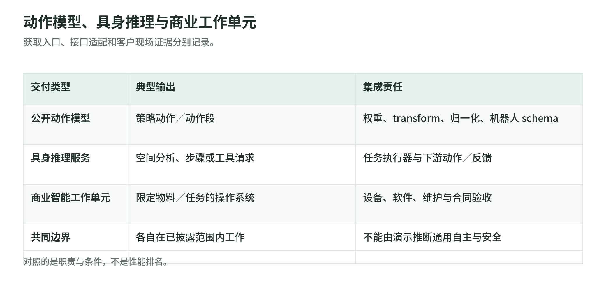

## 06 机器人模型与商业智能平台

<!-- illustration: model-platform-delivery-342c399f50 -->


*图：动作模型、具身推理与商业工作单元。获取入口、接口适配和客户现场证据分别记录。*
<!-- /illustration: model-platform-delivery-342c399f50 -->

核验日期为 2026-10-27。本章区分两类采购／开发对象：可下载、可改造的机器人模型与工具链，以及围绕特定工作单元交付的商业智能系统。公开代码、模型预览、客户部署是不同证据；代码存在不能证明任意机器人、任意动作接口或任意现场已具备生产可用模型。

### 本阶段应交付什么

模型选型后，应交付选定版本、权重与代码来源、许可范围、观测／动作 schema、训练数据使用权限、目标设备配置和适配评估。受限服务另需明确账号、API／SDK、配额、区域及访问审批；商业项目则应形成约定任务、物料范围、设备与软件接口、异常处理、验收条件和服务责任清单。这是本手册的交接要求，不自动由一个 checkpoint 或演示视频满足。

比较时先问输出是什么：动作模型生成策略动作；具身推理模型生成空间分析、计划或工具调用；商业智能平台通常交付一个可运行的限定工作单元。它们可以连接，但不可把推理回答直接当作通过安全检查的控制指令。

### NVIDIA Isaac GR00T：公开模型栈与适配工具

GR00T 的公开仓库提供机器人基础模型、推理和训练／后训练工具，以及数据处理和评估入口。前端接入图像、语言和机器人状态，数据中的 embodiment 定义、状态与动作分组要与模型配置一致；后端输出供下游控制器解释的动作。训练或适配还需要相应示范及数据配置，公开预训练权重不是自动生成目标机器人的标定、关节顺序和控制接口。[GR00T 官方仓库](https://github.com/NVIDIA/Isaac-GR00T)

访问日仓库可查 N1.7 权重下载、微调／后训练和单 GPU 示例；所依赖的 Cosmos-Reason2 骨干是 gated 模型，运行前还须申请访问并认证。计算设备、显存与依赖按所选路径核对，不能把示例配置当作统一要求。输出策略还需连接驱动、动作缩放与执行频率，获取代码／权重不表示已取得现场支持或整机交付。[公开获取和运行路径](https://github.com/NVIDIA/Isaac-GR00T)

当前 canonical 官方产品页明确列出 GR00T 1.7、3B 和 commercial license，并提供 Jetson Thor／TensorRT 部署及 LeRobot 连接入口；本章以此页记录当前商用与部署范围，不沿用旧入口可能缓存的状态。仓库正文与 License 小节对权重许可证仍有不同表述，具体权重授权应查对应模型卡及附带许可。商业许可与部署路径不等于目标机器人已完成控制、安全和现场验收。[官方产品页](https://www.nvidia.com/en-us/industries/robotics/isaac-groot/)、[仓库许可说明](https://github.com/NVIDIA/Isaac-GR00T)

### Physical Intelligence openpi：可复用的策略开发仓库

openpi 是 Physical Intelligence 公开的策略代码与部分模型 checkpoint 入口。官方 README 当前列出 π₀、π₀-FAST、π₀.₅，并提供推理、微调和样例适配路径；这些是可下载的软件／模型资源，不是供应商全部商业技术的公开副本。输入依所选配置包括图像、语言和机器人状态，输出为相应动作段，具体维度及字段由目标机器人 adapter 定义。[openpi 公开范围](https://github.com/Physical-Intelligence/openpi)

接入已有机器人时要实现输入、输出 transform，将机器人原始数据映射到模型字段，并按训练数据计算归一化统计。微调路径需要可用示范、数据配置和 GPU 训练资源；某个公开配置能够跑通，不意味着机械臂坐标、夹爪方向或数据许可已自动兼容。交接应保留 checkpoint、norm statistics、训练配置和 adapter，而非只交一个模型名称。[数据及适配说明](https://github.com/Physical-Intelligence/openpi)

官方部署路径包含策略服务器与机器人客户端，允许把大模型推理计算和机器人运行环境分开。服务器返回动作后，客户端仍承担时间对齐、队列、驱动和运行控制；网络往返及 stale chunk 不能由模型仓库自行消除。状态应记为公开代码／部分权重、研究与工程适配入口，不把它称为通用生产模型或已包含安全联锁的商用工作站。[策略服务边界](https://github.com/Physical-Intelligence/openpi)

### OpenVLA／OFT：原始动作模型与扩展微调配方

原始 OpenVLA 提供公开 VLA 权重、训练／微调代码及推理示例，以图像和指令生成机器人动作；其官方接口按数据集统计恢复动作。OFT 是另一个官方仓库中的扩展配方，当前可查并行解码、动作 chunk、连续动作头，以及多图／本体信息的设置，不能把这些能力追溯为原始发布版的输入输出。[OpenVLA](https://github.com/openvla/openvla)、[OpenVLA-OFT](https://github.com/moojink/openvla-oft)

输入训练数据要满足所选配方要求，OFT 仓库为新 RLDS 数据、动作／观测处理、L1／扩散头和 checkpoint 加载提供代码。输出的动作段必须与目标 embodiment 的动作坐标、归一化及执行前缀对齐；扩散头和 L1 头不是仅换文件名即可互换的权重。GPU、CUDA／PyTorch 环境和训练资源由具体配方决定，不能从可下载权重推断任何边缘设备都能满足时延。[OFT 适配入口](https://github.com/moojink/openvla-oft)

获取方式是公开源码、模型资源及自行构建的运行端，不是合同式机器人智能服务。适配方还应留存所选仓库版本。官方仓库中的仿真 benchmark 和真实机器人评估说明证明的是可复现路径，不证明新工厂、陌生硬件或未覆盖操作已经验收。模型层不替代示范质量控制、运行端兼容测试、运动控制和安全审批。[原版评估边界](https://github.com/openvla/openvla)、[OFT 运行说明](https://github.com/moojink/openvla-oft)

### Gemini Robotics／ER：动作与具身推理分开访问

Gemini Robotics 产品族包含承担动作生成的 VLA 路线，以及 ER（Embodied Reasoning）空间／任务推理路线。访问日 Google 产品页列出 Robotics 2、ER 2 和 On-Device 2，分别承担动作、推理与本地动作模型角色，并保留模型测试等待名单。不能把 ER 可调用理解为动作模型已向所有开发者开放，也不能把高层推理结果当成直接驱动电机的输出。[产品角色与等待名单](https://deepmind.google/models/gemini-robotics/)

当前 Gemini API 文档已列 Gemini Robotics-ER 2 preview，前端接受图像、视频、音频和文本，后端输出文本及供应用解析的工具／空间信息；这是服务 API，不是公开下载的动作权重。旧 ER 1.6 带有八月底关闭说明，不能仅凭仍存在的型号表判断可调用，本章按 ER 2 预览入口记录。账号、条款与配额仍需实际核对。[当前 ER API 范围](https://ai.google.dev/gemini-api/docs/robotics-overview)

动作模型接入机器人还需适配传感器、本体状态与动作接口，公开演示和产品页没有提供所有客户可取得的通用生产部署包。目标硬件和示范需求也需随获准的模型接入方式确认。ER 可位于任务理解或上层规划层，下游要有执行器、反馈和约束；本章不把云端 API 的延迟、推理文本或模型演示视为运动控制、安全联锁和现场验收的替代物。[VLA 获取边界](https://deepmind.google/models/gemini-robotics/)、[ER 文档](https://ai.google.dev/gemini-api/docs/robotics-overview)

### OSARO：围绕拣选和包装交付的智能层

OSARO 当前官网提供商业联系入口，并以 SightWorks、AutoModel 等视觉／学习能力连接拣选、装袋、配套和拆垛等工作单元。前端是现场图像、物料与工作单元任务信息，后端是供合作机器人和系统执行的决策及操作结果；公开页面没有等价于可下载通用动作模型的权重接口，具体设备、协议和维护责任要在项目范围内确定。[OSARO 产品范围](https://www.osaro.com/)

这条路线的获取方式是商业交付与合作集成，而非把开源策略装到任意机械臂。物料变化、视觉条件、抓取工具和包装设备会影响实施边界；供应商介绍中的自动学习能力不等于项目不需要数据、配置或验收。采购应要求明确输入物料范围、失败／人工接管流程和工作单元接口，而不是只采购一个抽象的“机器人基础模型”。[供应商可确认范围](https://www.osaro.com/)

客户证据单独标明：Zenni 官网 2023-11-14 的自述介绍 OSARO 在其履约流程中的拣取并送入装袋机，记录的是眼镜订单包装场景。该客户披露比供应商自行列客户名称更具体，但不是第三方审计，也不能证明 2026 年的运行时长、服务承诺或全部产品已覆盖其他行业。OSARO 智能层不替代机械、电气、WMS 接口和安全系统的项目责任。[Zenni 客户自述](https://www.zennioptical.com/blog/revolutionizing-eyewear-fulfillment-the-role-of-robotics/)

### Dexterity：特定物流操作的商业机器人智能系统

Dexterity 的 Mech 页面列出装载、码垛／拆垛等工业任务，客户通过项目渠道获取。前端组合现场传感、箱体信息和任务要求，后端实现限定工作单元操作，不是公开下载的通用机器人权重。官网曾开放 Foresight API Challenge，当前已标注结束，不能据此认为公众可持续取得商业模型 API。[Mech 商业范围](https://www.dexterity.ai/mech)、[当前访问状态](https://www.dexterity.ai/)

设备依赖包括与任务配套的机器人、末端执行器、感知和现场计算；客户输入、设施约束、异常处理和接口需随项目确认。训练数据及内部模型不是本章能公开核实的客户可导出资产，不能承诺用户可自行微调全部模型或替换任意硬件。交付物按合同中的任务、设备、软件和维护边界确定，不以开源模型的 checkpoint 交接方式类推。[设备及任务范围](https://www.dexterity.ai/mech)

客户方证据是 FedEx 官网 2026-07-30 联合公告：双方在 Maryland 的 Hagerstown Hub 扩展 Foresight 与 Mech 自动拖车装载部署，将项目从此前试点扩大到生产范围。它确认指定客户和任务，不是独立测评或跨场景认证。本章不复述装载架构、产能数字，也不把该交付当作运输业务软件、安全管理与整厂集成的替代物。[FedEx 客户方联合披露](https://newsroom.fedex.com/newsroom/global-english/fedex-and-dexterity-expand-physical-ai-deployment-for-autonomous-trailer-loading-at-hagerstown-hub)

### 同类别对照：模型访问与商业交付分别看

| 模型／开发平台 | 输出职责 | 可核验访问状态 | 接入前仍需明确 |
|---|---|---|---|
| GR00T | embodiment 条件动作 | [公开代码／权重](https://github.com/NVIDIA/Isaac-GR00T)；[官方商用许可与 Jetson Thor／TensorRT 部署路径](https://www.nvidia.com/en-us/industries/robotics/isaac-groot/) | 对应模型卡许可、数据 schema、适配和交付责任 |
| openpi | 目标机器人动作段 | [公开代码与部分 checkpoint](https://github.com/Physical-Intelligence/openpi)，自行适配 | transforms、归一化、服务／客户端职责 |
| OpenVLA／OFT | 原版动作或扩展动作 chunk | [原版资源](https://github.com/openvla/openvla)与 [OFT 配方](https://github.com/moojink/openvla-oft)分别公开 | 配方、动作头、checkpoint 与运行端匹配 |
| Gemini Robotics／ER | VLA 动作与 ER 推理分工 | [动作族测试等待名单](https://deepmind.google/models/gemini-robotics/)；[ER 预览 API](https://ai.google.dev/gemini-api/docs/robotics-overview) | 访问审批、账号、输入约定和下游执行器 |

| 商业智能平台 | 本章确认的任务范围 | 供应商证据 | 客户方证据性质 |
|---|---|---|---|
| OSARO | 拣选及包装工作单元 | [商业官网](https://www.osaro.com/) | [Zenni 2023 年客户自述](https://www.zennioptical.com/blog/revolutionizing-eyewear-fulfillment-the-role-of-robotics/)，不作当前运行保证 |
| Dexterity | 物流操作工作单元 | [商业方案入口](https://www.dexterity.ai/) | [FedEx 2026 年官网联合公告](https://newsroom.fedex.com/newsroom/global-english/fedex-and-dexterity-expand-physical-ai-deployment-for-autonomous-trailer-loading-at-hagerstown-hub)，非独立审计 |

第一表比较模型层职责与获取方式；第二表比较限定任务的商用交付证据。两张表不合成性能榜，也不根据是否开源判定哪条路线具有更高价值。

### 典型连接流程

以下连接由项目团队明确责任，不声称任一供应商覆盖全部层：

```text
公开模型：数据／机器人 schema → 选定代码与权重 → 适配／微调
          → 评估及模型登记 → 策略服务／运行端 → 下游控制与安全层

ER 服务：图像／任务 → 受支持 API → 空间理解／步骤／工具请求
         → 任务执行器与动作策略 → 反馈检查

商业交付：物料与现场任务边界 → 供应商项目定义 → 限定工作单元
          → 合同验收与服务责任 → 工业集成章节规定的接口
```

模型服务与适配路径可核对 [openpi](https://github.com/Physical-Intelligence/openpi)、[OFT](https://github.com/moojink/openvla-oft)；ER 输出边界见 [API 文档](https://ai.google.dev/gemini-api/docs/robotics-overview)；商业交付范围见 [OSARO](https://www.osaro.com/)、[Dexterity](https://www.dexterity.ai/)。此处只定义层间交接，不重复工业集成架构或客户案例的详细设计。

### 本章一手来源

- [Isaac GR00T 官方仓库](https://github.com/NVIDIA/Isaac-GR00T)、[NVIDIA canonical 官方产品页](https://www.nvidia.com/en-us/industries/robotics/isaac-groot/)：公开资源、GR00T 1.7／3B、商用许可、Jetson Thor／TensorRT 和 LeRobot 入口；具体权重许可查模型卡。
- [Physical Intelligence openpi](https://github.com/Physical-Intelligence/openpi)：公开模型、数据适配、推理服务和微调入口。
- [OpenVLA](https://github.com/openvla/openvla)、[OpenVLA-OFT](https://github.com/moojink/openvla-oft)：原版与扩展配方分离。
- [Gemini Robotics 产品页](https://deepmind.google/models/gemini-robotics/)、[Gemini API 机器人文档](https://ai.google.dev/gemini-api/docs/robotics-overview)：动作／ER 角色和当前访问入口。
- [OSARO 官网](https://www.osaro.com/)、[Zenni 客户官网文章](https://www.zennioptical.com/blog/revolutionizing-eyewear-fulfillment-the-role-of-robotics/)：供应商范围与客户自述分别使用。
- [Dexterity 官网](https://www.dexterity.ai/)、[Mech 产品页](https://www.dexterity.ai/mech)、[FedEx 2026-07-30 官网公告](https://newsroom.fedex.com/newsroom/global-english/fedex-and-dexterity-expand-physical-ai-deployment-for-autonomous-trailer-loading-at-hagerstown-hub)：商业入口与客户方联合披露，不视为独立审计。
