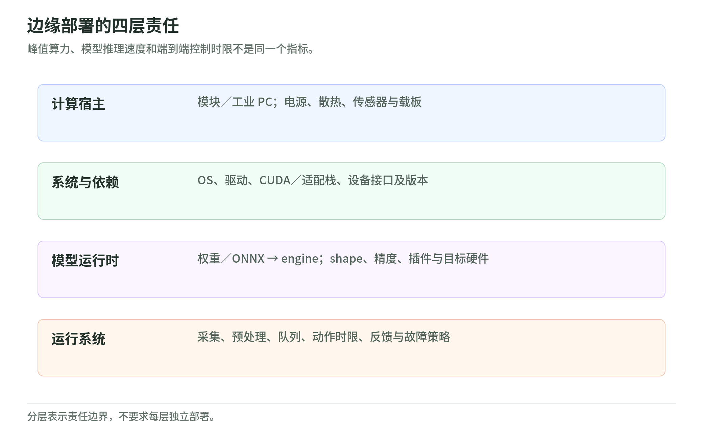

## 08 边缘推理与工业运行环境

<!-- illustration: edge-deployment-0ccd22389b -->

*图：边缘部署的四层责任。峰值算力、模型推理速度和端到端控制时限不是同一个指标。*
<!-- /illustration: edge-deployment-0ccd22389b -->

核验日：2026-10-27。边缘部署至少有三种不同对象：承载计算的模块/工业 PC、执行模型的推理库、维护操作系统与应用的运行平台。本章按此分层，不把某 GPU 的能力、某 SDK 的可用性或某板卡的认证外推为整台机器人的实时与安全能力。工业运行环境采用可核实的 Siemens IPC / Industrial Edge 分支，不把未经确认的第三方 ROS 桥接仓库包装成 Beckhoff 正式产品。

### Jetson / JetPack：计算模块与适配软件栈

Jetson 是机器人本地计算硬件系列，JetPack 是对应的软件栈。应用输入相机、传感器、模型与任务数据，输出感知结果或上层控制请求；公开开发接缝包括 Linux 驱动、CUDA、推理库和传感器相关 SDK。JetPack 不是伺服控制器，它提供算法运行条件，具体执行闭环仍需机器人侧软件与设备接口。[JetPack 官方职责](https://developer.nvidia.com/embedded/jetpack)

开发套件用于开发，生产模块用于整机集成，两者的载板、散热、电源和接口责任不能混同。NVIDIA 在 2025-08-25 宣布 Jetson Thor 开发套件及生产模块正式可用，并列出 Agility Robotics 等早期采用方；这是供应商具名采用披露，不证明每个采用方已经大规模交付整机。[正式供货与采用范围](https://investor.nvidia.com/news/press-release-details/2025/NVIDIA-Blackwell-Powered-Jetson-Thor-Now-Available-Accelerating-the-Age-of-General-Robotics/default.aspx)

交付要固定具体模块、Jetson Linux/JetPack、驱动和载板支持组合，不能把旧 Nano、Orin 与 Thor 的接口、内存或软件条件拼成一个虚构型号。热降频、图像搬运与并发任务会改变整条感知链的延迟，峰值算力不是控制周期的保证。[当前支持入口](https://developer.nvidia.com/embedded/jetpack)

### TensorRT：把训练模型构建成目标 GPU 的推理引擎

TensorRT 接收训练模型，通常从 ONNX 导入，再结合目标硬件、输入形状和精度策略构建 engine；运行时接收张量、返回预测张量。公开接口包括 C++/Python builder 与 runtime、ONNX parser 和 `trtexec`；因此“模型转换成功”和“应用已正确处理相机数据”是两个不同交付检查。[构建与运行接口](https://docs.nvidia.com/deeplearning/tensorrt/latest/getting-started/quick-start-guide.html)

官方提供软件包、容器等获取渠道，也作为 NVIDIA 计算栈组件使用。其可查状态是正式 SDK 和文档化部署路径；本卡没有另行核验某机器人客户的 TensorRT 生产应用，不能把 Jetson 采用名单直接移作此库的客户证据。[软件获取与部署](https://docs.nvidia.com/deeplearning/tensorrt/latest/getting-started/quick-start-guide.html)

engine 是面向硬件的构建产物，不应当作任意设备通用的模型文件。应随模型保留输入输出名称、布局、动态形状范围、精度/量化约定和构建环境，并重新核验支持矩阵。算子缺失、自定义插件与数值变化会影响部署；只测 engine 时间也会遗漏采集、预处理、传输和后处理。[支持及扩展边界](https://docs.nvidia.com/deeplearning/tensorrt/latest/getting-started/quick-start-guide.html)

### NVIDIA IGX：已正式提供的平台，但供货与支持须按形态区分

IGX 面向工业、机器人和医疗边缘系统，承载传感器处理、AI 推理及企业运行栈；应用通过 GPU/传感器 SDK 和平台管理接口集成，输出仍是业务结果或上层控制信息。官方区分 IGX Thor、旧 IGX Orin、开发套件以及 T5000 模块/T7000 板卡形态，不是 Jetson 任意型号的另一名称。[平台与形态](https://developer.nvidia.com/igx)

2026 年 3 月的官方发布确认 IGX Thor 开发套件可购，并有生产软件栈；同份发布仍将生产模块/板卡供货写为后续。因此本卡确认平台及开发套件正式可供，不声称所有生产 SKU 在各地都有现货。NVIDIA 披露 Hitachi Rail 的预测维护/检查采用及 Caterpillar 的开发应用，分别保留其公开阶段。[正式可供与案例范围](https://blogs.nvidia.com/blog/gtc-2026-news/)、[生产软件发布](https://forums.developer.nvidia.com/t/igx-sw-2-0-is-now-live/363924)

企业软件订阅的支持范围与普通开发栈不同，官方特别说明 IGX 上的 JetPack 不自动享有企业长期支持。硬件、软件、OEM 整机和支持合同应分别固定；平台功能安全机制或部件认证也不等于采用它的机器人获得整机安全认证。[企业支持边界](https://docs.nvidia.com/igx/user-guide/latest/NVAIE/nvaie.html)

### ONNX Runtime：跨硬件执行模型，后端仍需逐项核验

ONNX Runtime 接收 ONNX 模型和按输入名称组织的张量，通过 `InferenceSession` 返回模型输出。Execution Provider 将可支持的节点或子图分配给 CPU、GPU、NPU 等后端；Python、C/C++、C# 等接口让上层应用可以保留相近调用方式，而不是为每个加速器重写完整业务。[公开 API 与后端机制](https://onnxruntime.ai/docs/execution-providers/)

项目以开源代码和发布包获取，可部署在本地边缘进程或应用容器。官方披露 Windows、Office、Bing 等产品采用，说明通用软件生产应用，但这些不是机器人现场案例；不同 EP 也可能分别处于生产、预览或弃用状态，不能沿用一个总的“已成熟”标签。[官方应用范围](https://onnxruntime.ai/)、[官方代码](https://github.com/microsoft/onnxruntime)

CPU 回退可能让模型“能运行”，却改变延迟、内存搬运和数值路径。交付需记录实际后端、节点分配、依赖库、模型 opset 和输入布局，不能只看是否返回输出；本库不负责机器人状态机、运动合法性或硬实时调度。[后端状态与回退](https://onnxruntime.ai/docs/execution-providers/)

### OpenVINO：Intel 设备上的模型准备与推理运行时

OpenVINO 将模型读取/转换、设备编译和推理请求连接起来。输入可为 ONNX、IR 等模型及观测张量，输出由模型定义；公开 C/C++/Python 接口包括 Core、`compile_model`、InferRequest 与张量接口，可选择 CPU、GPU、NPU 或适用的设备选择模式。[官方推理流水线](https://docs.openvino.ai/2026/openvino-workflow/running-inference.html)

工具链开源，官方提供安装包、容器和源码；部署时仍需匹配设备插件、驱动与操作系统。Intel 在 2026-07-17 披露 Onyx Healthcare、FREE Bionics 使用 OpenVINO 开发外骨骼 AI 应用，记为“供应商具名开发/采用披露”，不把文章的康复愿景当作临床有效性、认证或量产规模证明。[官方代码](https://github.com/openvinotoolkit/openvino)、[案例范围](https://www.intel.com/content/www/us/en/newsroom/news/client-computing/intel-powered-medical-exoskeleton-helps-patients-get-back-on-their-feet.html)

OpenVINO 的直接 runtime 与 ONNX Runtime 的 OpenVINO EP 是两条集成路径，不必同时套用。设备编译、首次加载和异步排队也应计入上线测试；AUTO 选择不能替代明确的部署后端和资源预算，目标模型算子与动态形状仍需核验。部署交付应保留编译配置。[运行接口与模式](https://docs.openvino.ai/2026/openvino-workflow/running-inference.html)

### Siemens SIMATIC IPC / Industrial Edge：工业宿主与应用生命周期

SIMATIC IPC 提供工业计算宿主，Industrial Edge 提供设备运行环境、应用分发与管理。输入是现场数据、连接器配置和容器化应用，输出是边缘分析结果、状态与应用部署结果；公开接缝包括设备网络/USB 接口、Docker 容器及平台公开 API，而不是一套统一的机器人关节驱动协议。[设备目录](https://www.siemens.com/en-us/products/industrial-edge/devices/)、[平台架构](https://www.siemens.com/en-us/products/industrial-edge/edge-computing-architecture/)

商业产品可通过供应商设备与软件渠道获取，官方区分 IPC、面板、虚拟设备及管理部署模式。目录同时保留多个代际，本章不把列出的旧 IPC 条目称为最新硬件。当前证据是正式产品与运行架构；未据平台案例声称某具体机器人已经采用特定 IPC 型号。[获取与部署形态](https://www.siemens.com/en-us/products/industrial-edge/devices/)

“实时现场数据”与“硬实时伺服执行”不是同义词：容器应用能够交换数据，不意味着普通推理线程承担了 PLC/运动控制任务。工程交付需注明各闭环在哪个运行域执行、跨域数据有效期与失联策略；若另用虚拟控制器，也要核验其独立支持条件，不能从 IPC 的工业属性推断所有进程都实时。[架构依据及本手册的边界解释](https://www.siemens.com/en-us/products/industrial-edge/edge-computing-architecture/)

### 本阶段交付物与验证衔接

建议交付一份发布清单：硬件/载板、系统镜像、驱动、推理库、模型及 engine 哈希、输入输出 schema、量化与形状约定、许可和支持期限。附上冷启动、稳态并发、内存、热状态与完整感知链延迟的测试定义，再交第 09 章实施验证。算法进程只产生有时间戳、可拒收的结果或请求；控制器/PLC 的执行边界另行记录，不能由“平均推理很快”替代。

### 实际读取来源

- [JetPack 官方栈](https://developer.nvidia.com/embedded/jetpack)、[Jetson Thor 正式可供声明](https://investor.nvidia.com/news/press-release-details/2025/NVIDIA-Blackwell-Powered-Jetson-Thor-Now-Available-Accelerating-the-Age-of-General-Robotics/default.aspx)。
- [TensorRT 官方快速指南](https://docs.nvidia.com/deeplearning/tensorrt/latest/getting-started/quick-start-guide.html)：读取模型构建、runtime、公开接口与获取路径，不绑定泛用最新版到某个 JetPack。
- [IGX 官方平台入口](https://developer.nvidia.com/igx)、[2026 年正式可供与采用披露](https://blogs.nvidia.com/blog/gtc-2026-news/)、[IGX 生产软件发布](https://forums.developer.nvidia.com/t/igx-sw-2-0-is-now-live/363924)、[企业支持范围](https://docs.nvidia.com/igx/user-guide/latest/NVAIE/nvaie.html)。
- [ONNX Runtime 官方首页](https://onnxruntime.ai/)、[EP 文档](https://onnxruntime.ai/docs/execution-providers/)、[官方代码](https://github.com/microsoft/onnxruntime)。
- [OpenVINO 推理接口](https://docs.openvino.ai/2026/openvino-workflow/running-inference.html)、[官方代码](https://github.com/openvinotoolkit/openvino)、[外骨骼开发披露](https://www.intel.com/content/www/us/en/newsroom/news/client-computing/intel-powered-medical-exoskeleton-helps-patients-get-back-on-their-feet.html)。
- [Siemens Industrial Edge 设备](https://www.siemens.com/en-us/products/industrial-edge/devices/)、[架构](https://www.siemens.com/en-us/products/industrial-edge/edge-computing-architecture/)：后者经官网 HTML 读取，未安装软件。
