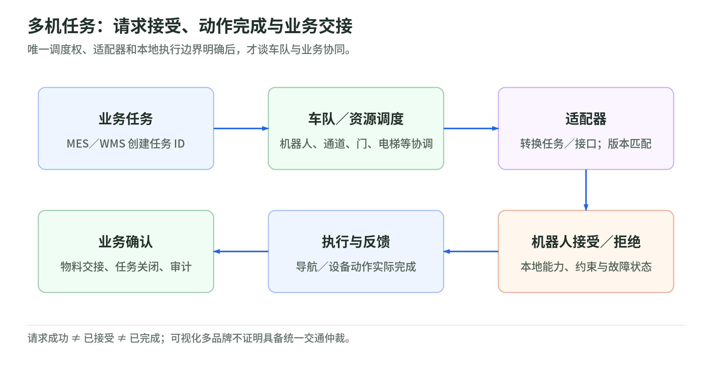

## 10 多机调度、遥测与现场运维

核验日：2026-10-27。单机控制、车队任务分配、跨厂商交通协调、遥测和人工介入有不同的责任边界。以下产品可在接口清楚时组合，但“一个面板能看到多种机器人”不等于“已经能仲裁所有机器人在门、电梯和窄通道中的动作”。本阶段承接第 09 章的版本与失败分类，形成现场可执行的运维契约。

### MiRFleet：MiR 车队的任务与运行协调

MiRFleet 接收任务、地图与各机器人状态，选择适合的 MiR 机器人执行任务并向操作员报告进展/障碍。它连接集中车队服务与车载软件，Web 界面用于运行管理；MiR Academy 的公开教材明确介绍 REST 请求和 Fleet 的机器人查询接口，可供 ERP/WMS 等上层系统集成。[职责](https://mobile-industrial-robots.com/blog/higher-order-mobile-robotics)、[公开接口入口](https://academy.mobile-industrial-robots.com/free-skill-paths/software-integration/)

获取属于 MiR 的商业软件与设备集成渠道；部署需固定 Fleet、机器人软件、地图及外部接口版本，不能把旧博客中的容量或路线图当当前规格。FORVIA Faurecia Písek 的官方案例明确使用 MiR Fleet 组织任务，是“供应商具名工厂应用”，不是仅购买机器人而推断用了车队软件。[应用证据](https://mobile-industrial-robots.com/de/falle/forvia)

案例中的 ERP 接入仍写为后续目标，不应改成已经完成。MiR 车队协调也不能自动推成任意品牌原生互操作；其它车队的接入能力、任务确认与交通权限必须另行核验。[案例边界](https://mobile-industrial-robots.com/de/falle/forvia)

### InOrbit：机器人运维数据、任务接口与跨系统编排

InOrbit 接收机器人遥测、任务事件及业务系统上下文，输出运行视图、事件/告警、任务追踪和经配置的操作请求。公开接缝包括 REST API、Robot SDK、ROS 1/2 集成及 Edge SDK；可通过 agent、非 ROS 代码或连接器接入，因此不能仅把它理解成一个 ROS 可视化工具。[开发者接口](https://developer.inorbit.ai/docs)

产品采用商业云平台与机器人/边缘接入组件，开发者方案有明确功能与获取入口，具体订阅权限及保留策略须按方案确认。供应商公开的 Instock + OTTO 跨系统编排案例是在 Robot Space 与展会远程演示，记为“具名伙伴演示”，不将其描述为已在客户仓库普遍生产运行。[获取状态](https://developer.inorbit.ai/pricing-dev)、[演示范围](https://www.inorbit.ai/blog/instock-and-inorbit)

API 的可调用性不代表机器人必定接受请求。平台可编排任务与介入，但实际动作由机器人/车队接口兑现；联网丢失、状态陈旧和同一机器人多操作员争用，都必须由接入合同及本地状态机处理，不能让云端操作覆盖机器人执行边界。[配置、动作与权限接口](https://developer.inorbit.ai/docs)

### Open-RMF：开源多车队与楼宇资源协调

Open-RMF 输入任务、导航图、机器人位置/电量/执行状态，以及门、电梯等设施状态，输出任务分配与交通协商结果，再由 fleet adapter 转成各车队 API。公开接缝包括 C++ API、Python bindings、ROS 2 消息和适配模板；Full Control 与只允许暂停/继续的 Traffic Light Control 等接入模式能力不同。[官方集成契约](https://osrf.github.io/ros2multirobotbook/integration_fleets.html)

它是免费开源模块化工具链，有官方仓库与演示工程，通常由部署方维护服务、地图和适配器。官方说明源于医疗场景并提供酒店、办公室等 demos；本卡以可获取工具链与接口为证据，没有另核具名医院的生产配置，不将 demo、行业起源或合作标志写成现场客户部署。[产品与治理](https://www.open-rmf.org/)、[官方代码](https://github.com/open-rmf/rmf)

适配器必须准确报告位置、命令完成和中断，并具备约定的导航/暂停权限。只读接入不能被当成全控制接入；导航图遗漏、坐标不一致或非参与设备占用空间，都可能使调度假设失效。Open-RMF 的资源协调不替代机器人本地避障与运动闭环。[适配责任](https://osrf.github.io/ros2multirobotbook/integration_fleets_adapter_tutorial.html)

### Formant：遥测、事件上下文与远程支持

Formant 接收机器人状态、视频、事件和应用数据，提供历史查询、现场诊断、经授权的命令与遥操作通道。官方 agent 是 Linux 侧程序，上传数据并处理定义好的命令；遥操作使用 WebRTC，公开 Agent SDK、Cloud SDK 与 API 区分设备侧数据接入、云侧查询和组织管理。[agent 职责](https://docs.formant.io/docs/the-formant-agent)、[API/SDK](https://docs.formant.io/reference/api-sdk-overview)

服务通过商业平台获取，机器人端按支持矩阵部署 agent 或应用 SDK；官网现入口为 `formant.ai`，文档/应用仍使用 `formant.io`，不能把域名迁移误判为停供。Burro 的供应商具名案例涉及农场机器人监控、遥操作和 rosbag 支持，说明实际现场运维使用，不据旧案例推断当前机器人数量。[当前入口](https://www.formant.ai/)、[Burro 使用范围](https://www.formant.ai/burro)

历史数据上传与实时遥操作链路不是同一种保证：缓存可补传遥测，却不能把过期运动命令延后执行仍视为正常。遥操作权限、命令有效期、网络中断后的本地行为及审计应独立交付；它不是所有品牌通用的交通仲裁器。[通道与执行条件](https://docs.formant.io/docs/the-formant-agent)

### 交付与衔接：谁派任务，谁确认动作

<!-- illustration: fleet-business-handoff-4c9b94bd21 -->

*图：多机任务：请求接受、动作完成与业务交接。唯一调度权、适配器和本地执行边界明确后，才谈车队与业务协同。*
<!-- /illustration: fleet-business-handoff-4c9b94bd21 -->

本手册建议交付一份分层责任表：业务系统创建任务，车队服务分配，适配器转换，本地系统接受或拒绝，机器人回报实际完成，运维平台保存可查询事件。组合部署时须指定同一资源的唯一调度权和同一机器人的操作权；不能让两个平台都认为自己可以重新派发同一任务。

每次任务至少关联任务 ID、机器人 ID、发布版本、地图版本、时间戳和终止原因；“请求成功”“机器人已接受”“实际完成”应是三个状态。现场事件应能链接回第 09 章的复现材料，第 08 章的发布清单以及第 07 章的执行接口，这些是建议的工程契约，不是假定每个平台都有同名字段。

移交运行团队的内容还应包括告警所有者、远程介入权限、失联/重启/重复请求处理、数据保留与导出方式，以及配置变更和回滚记录。车队界面、AI 助手或自动恢复脚本都不能成为省略现场执行边界的理由。本次核验未接入任何客户账户、设备或生产系统。

### 实际读取来源

- [MiRFleet 职责说明](https://mobile-industrial-robots.com/blog/higher-order-mobile-robotics)、[MiR Academy 接口教材入口](https://academy.mobile-industrial-robots.com/free-skill-paths/software-integration/)、[FORVIA Faurecia 案例](https://mobile-industrial-robots.com/de/falle/forvia)：旧博客只用于职责，不采用其容量或未来路线图。
- [InOrbit 开发者文档](https://developer.inorbit.ai/docs)、[开发者获取入口](https://developer.inorbit.ai/pricing-dev)、[Instock/OTTO 演示披露](https://www.inorbit.ai/blog/instock-and-inorbit)。
- [Open-RMF 官方入口](https://www.open-rmf.org/)、[官方代码](https://github.com/open-rmf/rmf)、[多车队集成](https://osrf.github.io/ros2multirobotbook/integration_fleets.html)、[适配器教程](https://osrf.github.io/ros2multirobotbook/integration_fleets_adapter_tutorial.html)。
- [Formant 当前官网](https://www.formant.ai/)、[agent 文档](https://docs.formant.io/docs/the-formant-agent)、[API/SDK 文档](https://docs.formant.io/reference/api-sdk-overview)、[Burro 现场使用案例](https://www.formant.ai/burro)。
