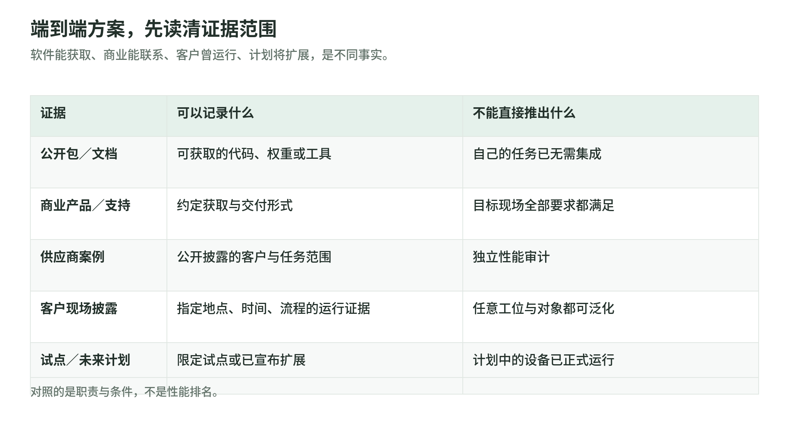

## 11 端到端组合与客户公开案例

<!-- illustration: solution-evidence-199118f231 -->

*图：端到端方案，先读清证据范围。软件能获取、商业能联系、客户曾运行、计划将扩展，是不同事实。*
<!-- /illustration: solution-evidence-199118f231 -->

### 11.1 研发新的机械臂策略：组件式参考组合

这是一条依据各阶段职责整理的研发组合，不是某客户已采用的架构，也不是供应商联合验证的安装包。

真实机器人提供图像、关节状态和实际命令；记录／回放平台保留时间、标定与任务轨迹；数据工具生成训练窗口和划分；仿真系统建立可重置环境；训练框架和机器人模型生成检查点；运行时完成输入处理和动作解码；执行层再接到设备。对应产品的获取和接口见第 2—8 章。

| 环节 | 可以对应的产品类别 | 应交付的东西 | 不能省掉的适配 |
|---|---|---|---|
| 采集与检查 | LeRobot、Foxglove／MCAP、Rerun | 轨迹、消息、任务与标定记录 | 动作命令与实测状态分开 |
| 环境与扩增 | Isaac Sim／Isaac Lab、MuJoCo、Mimic | 场景、任务接口、合成轨迹 | 机器人机构、控制模式与时间 |
| 策略训练 | PyTorch、LeRobot、openpi、GR00T 等 | 检查点、预处理、动作契约 | 目标机器人数据与模型支持条件 |
| 推理与执行 | 目标设备运行时、ROS 2 驱动和控制层 | 有时限的动作／目标和反馈 | 运行引擎是否支持该模型、坐标与限幅 |
| 评测与迭代 | 任务测试、回放和实验管理 | 成功／失败、延迟与可复现版本 | 仿真结果与实机结果分别记录 |

这里没有预设所有模型都能直接导出到 TensorRT，也没有预设所有机器人都接受同一动作。对于完整应用，集成者仍需确认数据、检查点、运行包和设备接口一致；换模型或换身体时，需要重新核对这些契约。

### 11.2 工业视觉取放与包装：已有应用软件的组合

**Mech-Mind 与 UR 的接口例子。** UR 的官方产品目录列有 Mech-Mind 3D Vision，包括工业 3D 相机、视觉／机器人编程软件和 URCap 集成。其公开范围涉及无序抓取、上下料、定位及码垛／拆垛；这个目录入口证明存在明确的产品与机器人集成形式，而不是只展示一个视觉模型。[UR 官方 Mech-Mind 产品目录](https://www.universal-robots.com/plus/products/mech-mind-robotics/mech-mind-3d-vision/)

按职责看，相机提供场景数据，视觉处理给出物体与抓取相关结果，应用规划和设备程序组织动作，机器人及工具实际执行。工位对象、遮挡、工具、设备型号和软件版本仍需配置与确认；“目录里有 URCap”不能推出任意 UR、任意物体都已完成验证。

**ABB PickMaster Twin 的打包形式。** PickMaster 面向视觉引导的随机物料流抓取与包装，结合视觉和输送跟踪；Twin 的 PowerPac／Operator 连接数字工作站、运行与操作界面，官方页还说明 PackML 集成和 OmniCore／IRC5 兼容范围。它提供的是具体应用软件，不是一个通用机器人 VLA 权重。[ABB PickMaster Twin 产品页](https://www.abb.com/global/en/areas/robotics/products/software/pickmaster-twin)

这类流程可以是“物料到达 → 相机／传感器识别 → 应用跟踪与选取 → 控制器与夹具执行 → 包装状态与运行记录”。训练模块是否需要由客户准备，取决于该应用产品，不应把通用模型研发步骤强加到所有工业方案。

这里两组例子是公开的产品集成形态。它们的任务对象、设备生态和支持范围不同，不按宣传中的最高吞吐量排优劣。

### 11.3 工厂送料：MiR 车队与 DENSO 案例

MiR 发布的 DENSO 案例描述仓库到生产区域的物料运输，随后扩展到线边供料。文中明确提到与集成伙伴 ACS 一起使用 REST API 组织信息流，处理任务优先、充电与现场呼叫，并通过 MiR I/O 模块接入洁净区门的控制。证据类型是供应商发布、包含客户访谈的案例，不是本册独立测试。[MiR／DENSO 案例](https://mobile-industrial-robots.com/cases/denso)

这说明送料应用不止“地图上选一个终点”。业务系统要发出任务，车队组织机器人与资源，底盘导航执行，门和工位提供交接条件，任务系统记录结果。门禁、充电、工位确认与车辆状态是不同接口。

可作为参考的职责组合是：业务请求 → Fleet 任务／资源调度 → AMR 导航与移动 → I/O 和工位握手 → 任务结果与现场记录。具体代码、网络与任务字段并未全部公开，不能从这份案例复原完整客户配置，更不能认定其中使用了哪套未披露的 VLA。

### 11.4 仓库卸箱：DHL 与 Boston Dynamics Stretch

Stretch 是面向仓库箱件处理的机器人产品，供应商同时提供应用、集成和维护入口。DHL 在 2025-05-13 的公告中说明：其供应链业务已于 2023 年在北美商业使用 Stretch，随后扩展到英国和欧洲；公开任务为集装箱／拖车卸箱，并描述与输送和码垛设备的衔接。[Stretch 产品与服务入口](https://bostondynamics.com/products/stretch/)、[DHL 2025 公告](https://group.dhl.com/en/media-relations/press-releases/2025/dhl-group-signs-mou-with-boston-dynamics-and-accelerates-cross-business-automation-strategy.html)

这是“面向特定任务的机器人应用交付”：机器人处理箱件，输送和后续仓储流程接收结果，部署与服务团队处理现场条件。用户得到的不是一个要求自己从头训练的模型压缩包。

同一 DHL 公告还提出更多机器人部署的 MOU 和后续任务扩展。**已经发生的商业使用与未来数量计划需要分开**；不能把“拟新增超过 1,000 台”写成“目前已有 1,000 台 Stretch 运行”，也不能把 DHL 全部机器人数量都归到这个产品上。

### 11.5 仓库装车：FedEx 与 Dexterity Mech／Foresight

FedEx 在 2026-07-30 的公告中说明，在 Maryland 的 Hagerstown Hub 扩展 Dexterity 拖车装载系统，将项目推进到此前试点场地之外。公告将系统描述为由 Foresight world model 支持的 Mech 双臂设备，融合视觉、深度和触觉信息，处理箱件放置的空间、稳定性和速度。证据是客户官网的双方公告。[FedEx／Dexterity 2026 公告](https://newsroom.fedex.com/newsroom/global-english/fedex-and-dexterity-expand-physical-ai-deployment-for-autonomous-trailer-loading-at-hagerstown-hub)

从交付看，它把感知、决策、执行设备和装车工作流放在同一方案中。FedEx 的公告还提到目的地规划、拖车分配、维护和人员流程，说明现场接入不是只完成机械臂抓取。

具体模型网络、训练数据、底层控制协议和客户日志接口没有在这份公告中全部披露。因此能介绍的是该装车系统的产品职责与现场证据，不能据此认定 Foresight 就是 Cosmos／Dreamer，也不能把它当成向任何开发者开放的通用模型 API。

### 11.6 人形机器人：限定任务试点与商业流程分别看

**BMW／Figure 的生产环境试点。** BMW 的 2026-09-21 文章回顾了 2025 年 Spartanburg 的 Figure 02 项目：在十个月内参与超过 30,000 辆 BMW X3 的生产，取放并定位焊接用钣金件；报道还保留组件、运行时间和现场集成的口径。这里“参与车辆生产”不等于机器人完成整车制造，任务范围应保留。[BMW 人形机器人项目说明](https://www.bmwgroup.com/en/news/general/2026/humanoid-robot-in-leipzig.html)

能确认的应用组合是指定工序、机器人运动能力、生产系统接口与现场运维共同运行。客户没有在该文中公开所有内部模型和数据管线，不能补成“某个开源 VLA＋某仿真平台”的已验证架构。后续型号、物流排序任务与其它工厂的试点，也应保留各自时间与状态。

**GXO／Agility 的商业 RaaS 流程。** GXO 在 2026-10-26 公告中回顾 2024 年签订的多年 RaaS 协议：Digit 与 Agility Arc 已在 Georgia 的 Flowery Branch 仓库搬运料箱并放上输送线，累计处理超过 100,000 个料箱。Arc 的产品职责包括车队、工作流与仓储系统集成。[GXO 2026 客户公告](https://investors.gxo.com/news-releases/news-release-details/gxo-and-agility-robotics-expand-partnership-accelerate)、[Agility Digit／Arc 方案](https://www.agilityrobotics.com/solutions)

同一客户公告把新增 Statesville 和 Lebanon 场地的部署预计时间写为 **2027 年初**，先用 Digit 4，再在 Digit 5 商业可用时迁移。以本册日期 2026-10-27 看，这是已宣布的后续扩展，不能写成两处新增场地已经运行，也不能只根据新品发布认定 Digit 5 已完成该商业部署。

这两个例子分别给出限定工序试点与特定物流流程的商业运行证据。它们都不能直接证明机器人已经具备任意工种或任意场地的通用能力。

### 11.7 工厂规划：BMW 的数字孪生与已有工程软件

BMW 的 2023 年 Debrecen 虚拟生产材料说明，将 Omniverse 用于工厂布局、机器人和物流系统的虚拟规划，同时列出已有工具：Bentley MicroStation、ipolog、Siemens Process Simulate、CATIA 和 Revit。当前 BMW 生产介绍仍列出 Omniverse 作为全球协作规划环境。[BMW 2023 虚拟生产材料](https://www.visit-bmwgroup.com/en/virtual-production-at-the-future-bmw-group-plant-in-debrecen/)、[BMW 当前生产介绍](https://www.bmwgroup.com/en/company/production.html)

这类方案解决的是多源工程数据、场景、工艺和协作验证的组织。CAD／BIM／工艺工具产生各自资料，数字场景提供统一查看与规划，工作站和物流配置再交付相应执行系统。

这个案例不能被改写成“用数字孪生自动训练所有工厂机器人”。工厂规划仿真、物理训练环境和现场自主操作属于相关但不同的阶段；一些功能在历史文档中是未来规划，应按其原始口径记录。

### 11.8 车辆开发：商业工具链、验证与车端平台

TRATON 在 2025-03-17 的公告说明，与 Applied Intuition 的合作建立在此前五年的 ADAS／AD 开发工具合作上，新合作涉及 Vehicle OS、开发／验证工具链与云端虚拟测试。Applied Intuition 的 Audi 合作材料也将仿真、数据管理和场景化工程放在 AD 发布与生命周期管理中。[TRATON 客户公告](https://traton.com/en/newsroom/press-releases/the-traton-group-and-applied-intuition-announce-strategic-partnership-on-vehicle-software.html)、[Applied Intuition／Audi 合作材料](https://www.appliedintuition.com/press-releases/audi)

这是汽车领域的产品与工程链路：道路／车辆数据 → 场景与测试 → 软件版本与验证 → 车端平台 → 运行反馈。第 9 章的车辆测试产品可放到相应阶段，但这条链不是机械臂抓取的直接安装包。

合作公告中的扩大部署目标、未来功能和范围，也不是当前所有车型已装车的证明。仿真和验证产品支持开发流程，不自动授予整车安全结论或自动驾驶系统的准入状态。

### 11.9 如何使用这些组合

案例能确认哪些任务、哪些产品或接口、什么日期和状态，就写到哪里。参考组合则用来理解分工，不能偷换成客户原始架构。对于内部模型、训练环境和维护条件没有公开的商业系统，应保留这些空白。

应用方案与开发工具还可以共存：购买特定任务系统后，客户仍可能用日志平台诊断、用数字孪生调整布局；研发新模型时，也可以接入成熟控制器和现场调度。阶段不要求被同一家供应商包办。

### 本章来源

- [UR 官方 Mech-Mind 产品目录](https://www.universal-robots.com/plus/products/mech-mind-robotics/mech-mind-3d-vision/)
- [ABB PickMaster Twin](https://www.abb.com/global/en/areas/robotics/products/software/pickmaster-twin)
- [MiR／DENSO 案例](https://mobile-industrial-robots.com/cases/denso)
- [Stretch 产品](https://bostondynamics.com/products/stretch/)
- [DHL 2025 公告](https://group.dhl.com/en/media-relations/press-releases/2025/dhl-group-signs-mou-with-boston-dynamics-and-accelerates-cross-business-automation-strategy.html)
- [FedEx 2026 公告](https://newsroom.fedex.com/newsroom/global-english/fedex-and-dexterity-expand-physical-ai-deployment-for-autonomous-trailer-loading-at-hagerstown-hub)
- [BMW 人形项目](https://www.bmwgroup.com/en/news/general/2026/humanoid-robot-in-leipzig.html)
- [GXO 2026 公告](https://investors.gxo.com/news-releases/news-release-details/gxo-and-agility-robotics-expand-partnership-accelerate)
- [Agility 方案](https://www.agilityrobotics.com/solutions)
- [BMW 虚拟规划](https://www.visit-bmwgroup.com/en/virtual-production-at-the-future-bmw-group-plant-in-debrecen/)
- [BMW 当前生产介绍](https://www.bmwgroup.com/en/company/production.html)
- [TRATON 公告](https://traton.com/en/newsroom/press-releases/the-traton-group-and-applied-intuition-announce-strategic-partnership-on-vehicle-software.html)
- [Audi 合作材料](https://www.appliedintuition.com/press-releases/audi)
