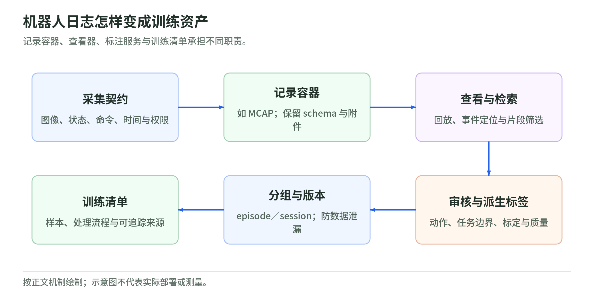
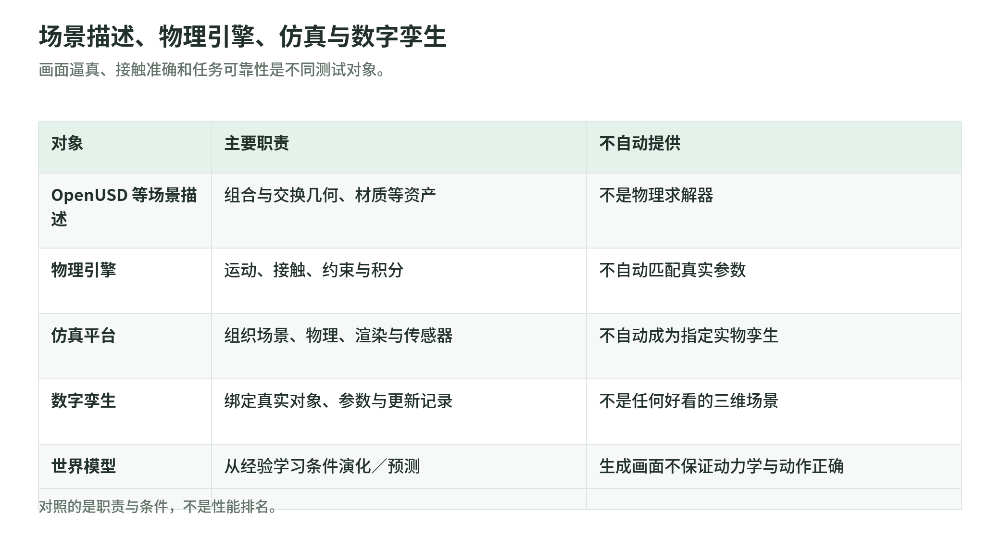

# Physical AI：数据、仿真与评测

截止、查阅日：2026-10-27。独立补充模块，不展开模型、训练算法或控制硬件；benchmark 采用原论文设定，不做排名。

## 数据：视频、动作和状态不是一回事

<!-- illustration: robot-data-assets-ac90a189a8 -->

*图：机器人日志怎样变成训练资产。记录容器、查看器、标注服务与训练清单承担不同职责。*
<!-- /illustration: robot-data-assets-ac90a189a8 -->

teleoperation（遥操作）是采集方式：人操纵机器人并记录过程。人类视频记录人怎样做事，通常没有机器人控制指令；示范动作则是带任务上下文的行为轨迹，可由遥操作等方式获得，用作机器人动作监督前须明确动作空间，不能把人的手部移动直接当机器人命令。[1][2]

推荐核对四组字段，并非所有数据集都具备：action 是发出的命令，如关节目标或末端速度，要注明单位、坐标系、绝对值／增量；state 是观测到的关节、夹爪等状态，命令不等于执行结果；time 包括采集／发令时间戳、采样率、跨设备同步及轨迹边界；calibration 包括相机内参、畸变、相机与机器人之间的外参、坐标系及标定版本。[1][3]

真实数据包含现场噪声与接触，但覆盖有限；合成数据便于控制条件、生成标签，但受场景与动力学假设限制。合成图像不自动带有可执行动作。[1][7]

## 仿真：场景描述不等于物理求解

<!-- illustration: scene-physics-twin-39aa65e5c8 -->

*图：场景描述、物理引擎、仿真与数字孪生。画面逼真、接触准确和任务可靠性是不同测试对象。*
<!-- /illustration: scene-physics-twin-39aa65e5c8 -->

OpenUSD 是场景描述、组合与交换框架，可承载物体、材质等信息，不是物理求解器；数字孪生强调与真实对象及其数据对应，不是任意三维场景。[4][5] MuJoCo 等物理引擎计算运动、接触与约束；Isaac Sim 把场景、PhysX 物理、渲染和传感器仿真组织成平台。[6][7] world model 从数据学习环境演化，可预测未来视频或状态；生成画面合理，不保证接触动力学正确，也不等于物理引擎。[8]

domain randomization 随机改变光照、材质、质量、摩擦等条件，帮助减少对单一模拟环境的依赖；sim-to-real 是把模拟中形成的能力迁移到现实，仍须真机验证。[9] 仿真逼真度与动作可靠性是两个测试对象：前者检查画面、传感器或动力学是否贴近现实，后者检查闭环执行能否成功、遇干扰是否稳定。逼真不推出可靠。[6][7][9]

## 评测：先读考试规则，再看分数

benchmark 是固定任务、环境与计分协议的考试，不代表全部现实能力。

- LIBERO：MuJoCo／robosuite 桌面操作，如取放与开抽屉；Spatial、Object、Goal、100 四套任务区分空间、物体、目标与混合知识迁移。可统计任务成功率；原始终身学习协议还报告前向迁移、负向后向迁移与归一化学习曲线面积。[10]
- CALVIN：原论文在 PyBullet 的四种桌面环境中定义 34 个语言技能，如开关抽屉、移动物块；长时程评测连续执行五条指令，报告至少完成前 1—5 项的比例及平均连续完成数（0—5），首次失败即停止该链。[11]

读表须核对版本、训练／测试划分、已见／未见环境、观测与动作接口、步数上限、初始化、成功判据及重复试验。LIBERO 单任务成功率与 CALVIN 五任务链成绩不能跨表直接比；模拟分数也不是现实可靠性证明。[10][11]

## 一手来源

无单独发布日期的网页统一标注查阅日；论文日期为 arXiv 首次提交日。论文结构化元数据见同目录 `evaluation-papers.json`。

1. DROID，**Dataset / Raw Data Format**；查阅 2026-10-27：[数据格式](https://droid-dataset.github.io/droid/the-droid-dataset)，[作者环境代码：动作／状态／时间戳](https://github.com/droid-dataset/droid/blob/main/droid/robot_env.py)。
2. Ego4D，**Ego4D: Around the World in 3,000 Hours of Egocentric Video**，作者项目；查阅 2026-10-27：[项目](https://ego4d-data.org/)。
3. ROS，**sensor_msgs/CameraInfo Message**；DROID，**Camera Calibration**；均查阅 2026-10-27：[CameraInfo](https://docs.ros.org/en/noetic/api/sensor_msgs/html/msg/CameraInfo.html)，[标定](https://droid-dataset.github.io/droid/camera-calibration.html)。
4. OpenUSD，**Introduction to USD**；查阅 2026-10-27：[官方文档](https://openusd.org/release/intro.html)。
5. NVIDIA，**What Is a Digital Twin?**；查阅 2026-10-27：[官方定义](https://www.nvidia.com/en-us/glossary/digital-twin/)。
6. MuJoCo，**Overview**，固定版本 3.3.5；查阅 2026-10-27：[官方文档](https://mujoco.readthedocs.io/en/3.3.5/overview.html)。
7. NVIDIA Isaac Sim，**Simulation Fundamentals**，固定版本 4.5.0；查阅 2026-10-27：[官方文档](https://docs.isaacsim.omniverse.nvidia.com/4.5.0/physics/simulation_fundamentals.html)。
8. NVIDIA，**Cosmos Predict1 – 7B Text2World**，官方模型卡；查阅 2026-10-27：[模型卡](https://catalog.ngc.nvidia.com/orgs/nvidia/teams/cosmos/models/cosmos-1.0-predict-7b-text2world)。
9. NVIDIA Isaac Sim，**Domain Randomization**，版本 4.5.0；**Physics-based Domain Randomization**，版本 4.2.0；均查阅 2026-10-27：[视觉条件随机化](https://docs.isaacsim.omniverse.nvidia.com/4.5.0/replicator_tutorials/tutorial_replicator_domain_randomization.html)，[物理参数随机化及 sim-to-real 定义](https://docs.isaacsim.omniverse.nvidia.com/4.2.0/py/source/extensions/omni.replicator.isaac/docs/index.html)。
10. **LIBERO: Benchmarking Knowledge Transfer for Lifelong Robot Learning**，2023-06-05；论文与作者资料均查阅 2026-10-27：[原论文](https://arxiv.org/abs/2306.03310)，[论文 PDF](https://arxiv.org/pdf/2306.03310)，[作者仓库](https://github.com/Lifelong-Robot-Learning/LIBERO)，[robosuite 官方环境说明](https://robosuite.ai/)。
11. **CALVIN: A Benchmark for Language-Conditioned Policy Learning for Long-Horizon Robot Manipulation Tasks**，2021-12-06；论文与作者资料均查阅 2026-10-27：[原论文](https://arxiv.org/abs/2112.03227)，[论文 PDF](https://arxiv.org/pdf/2112.03227)，[作者仓库](https://github.com/mees/calvin)，[作者评测及链计分代码](https://github.com/mees/calvin/blob/main/calvin_agent/evaluation/utils.py)。
