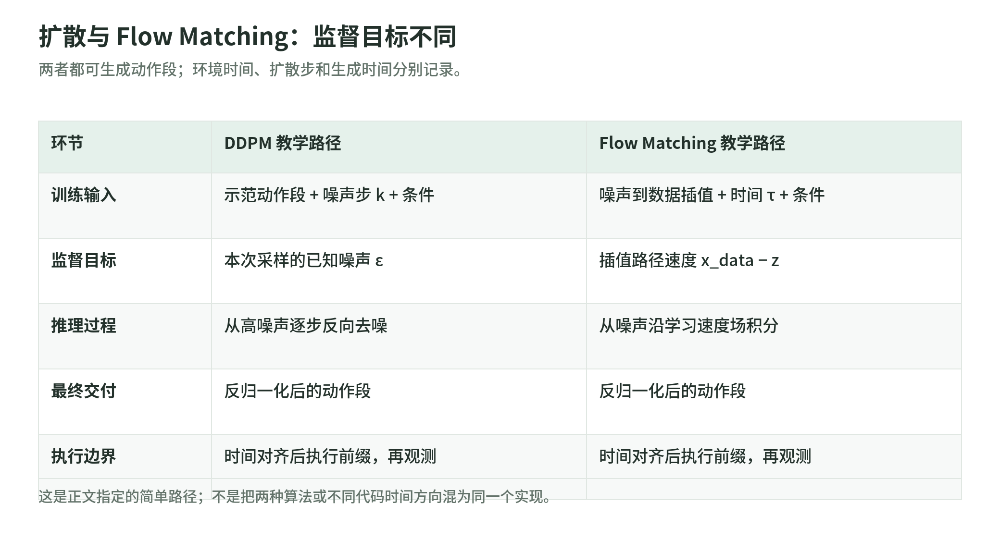

# Physical AI：学习算法与模型

研究截止与访问日期：2026-10-27。范围仅为学习机制、模型输入输出、动作分块和跨机器人适配；不展开控制、硬件、仿真平台或 benchmark 复核。六篇论文按机制覆盖选取，不表示截至研究日的最新、最佳或产品排名。

## 通俗笔记

<!-- illustration: diffusion-flow-8e505b3674 -->

*图：扩散与 Flow Matching：监督目标不同。两者都可生成动作段；环境时间、扩散步和生成时间分别记录。*
<!-- /illustration: diffusion-flow-8e505b3674 -->

先分清“向谁学习”。行为克隆（BC）把示范中的观察与动作配对，学习“看到这种情况，应怎样行动”；它是模仿学习的一种，而不是模仿学习的全部。强化学习（RL）则用奖励评估行为，优化累计回报。生成动作的模型也可以用 BC 训练：用了扩散或大模型，并不自动变成 RL。Diffusion Policy 和 Octo 的原论文主要从示范学习；DreamerV3 则展示基于奖励的另一条路线。[S1][S4][S6]

Diffusion Policy 学的不是一条固定答案，而是“可能动作的分布”。例如绕物体可以从左边或右边走，简单平均可能给出不可行路线；它从噪声开始，依据观察逐步去噪，生成一段连续动作。动作 chunk 是一次预测多个未来动作，不是完整任务计划。执行一部分后重新观察、再生成，能兼顾时序连贯与反馈；但仍受示范覆盖不足和多次采样延迟限制。[S1]

VLM 主要处理图像与语言，VLA 则进一步输出机器人动作。RT-2 把动作离散成文本 token，与视觉语言任务共同微调，将网页中的语义知识接到已有机器人技能上。原论文明确指出：理解新物体或新指令，不等于从网页学会全新运动技能。OpenVLA 同样用离散动作 token，结合视觉编码器与语言骨干，并研究参数高效微调；原始版本仅接收单张图像、预测单步动作，不应混入后来扩展的能力。[S2][S3]

Octo 展示另一种通用策略：直接用多机器人示范训练 Transformer，再接扩散动作头；它不是把一个预训练 VLM 整体改成 VLA。模块化输入和输出允许为新机器人增加观察编码器或替换动作头，再用目标域数据微调。跨机器人适配因此不仅是“换个机器人名称”，还涉及观察、动作空间与数据分布的对应。原论文的实验对象主要是单臂和双臂操作器。[S4]

π₀ 把预训练 VLM 与专门的动作专家结合，用 flow matching 学习从噪声到连续动作的生成路径，原文一次预测五十步。它与 Diffusion Policy 都生成动作段，但训练目标和采样过程并不相同。其预训练使用多平台、多任务数据；复杂任务还经过较窄、较高质量示范的后训练。折衣等结果不能统一写成“一个基础模型对陌生任务零样本完成”。[S5]

世界模型回答“采取这个动作，接下来可能怎样”，不同于直接回答“现在做什么”的策略。DreamerV3 从交互经验学习潜在状态、奖励及继续标志，再在想象轨迹中训练 actor 和 critic；执行时从策略取动作，并非每步搜索未来。其多领域结果主要来自数字环境，不能当作开放现实场景可靠性的证明；“同一套超参数”也不等于“同一组权重包办所有任务”。[S6]

学习时可依次读：BC 与奖励目标、单步与 chunk、动作分布的扩散生成、VLM 到 VLA 的迁移、目标域微调、世界模型中的想象学习。每篇都记录四件事：监督来自哪里，模型实际看见什么，输出是什么，测试变化是否仍靠近训练分布。这个阅读顺序是本笔记的组织建议，不是方法优劣排序。[S1–S6]

## 机制对照表

表中年份为预印本首发年；JSON 的 `year` 则采用下文说明的正式出版年。输入输出均限定为选读原论文的配置，而非当前仓库全部能力。

| 方法／首发 | 解决什么、怎样学习 | 输入 → 输出 | 实验分布与解释边界 |
|---|---|---|---|
| Diffusion Policy／2023 [S1] | BC 下表达多峰连续动作；条件去噪生成动作段 | 观察历史中的图像、机器人状态，或任务状态 → 连续动作 chunk，执行前缀后再预测 | 论文覆盖选定操作任务及真实机器人任务；不是跨机器人基础模型实验。示范不足仍限制效果，迭代采样增加延迟 |
| RT-2／2023 [S2] | 保留视觉语言知识，同时用机器人示范学习动作 token | 当前图像＋语言指令 → 离散化动作字符串，再还原为动作 | 主要在特定机器人与操作场景测试语义、物体变化；运动技能仍受机器人示范分布限制。部分实验另有语言推理中间结果 |
| OpenVLA／2024 [S3] | 开放 VLA 训练及目标域微调流程；动作 token 的监督学习 | 单张 RGB＋指令 → 七维单步动作，经离散编码后解码 | 直接测试与新设置微调是不同实验；原始模型不含多图、本体状态或观察历史输入，也不是动作 chunk 模型 |
| Octo／2024 [S4] | 多机器人 BC；模块化 Transformer＋扩散头便于适配 | RGB 观察历史＋指令或目标图；新模态可经微调加入 → 连续动作 chunk，预训练配置为四步 | 预训练筛选图像及末端动作数据；新动作空间通常需微调。原文指出腕部相机、语言数据不足，未验证任意形态迁移 |
| π₀／2024 [S5] | VLM 语义迁移＋连续动作 flow matching；多阶段示范训练 | 多路 RGB＋语言＋本体状态 → 五十步连续动作 chunk | 单臂、双臂与移动操作数据；区分预训练直接执行、任务微调及高层指令辅助，复杂任务表现包含后训练条件 |
| DreamerV3／2023 [S6] | 从交互学习世界模型，再用想象轨迹做基于模型的 RL | 观察＋历史动作／内部状态 → 策略动作；训练时另预测状态、奖励、继续标志 | 数字任务上的固定超参数结果；不是多机器人示范 VLA，也不能据此声称统一权重或现实部署可靠性 |

## 元数据与访问口径

`models-papers.json` 是 academic-search 标准字段的 JSON 数组，另加版本及来源核验字段。标题、作者、`year`、venue 优先采用正式论文集／Crossref；预印本首发日期、选读版本及差异单列，不把不同版本的作者列表拼接。

- Diffusion Policy 采用 RSS 2023 的七人署名；所读 arXiv v4 与之对应。当前 arXiv v5 是扩展期刊版本，不能将其八人署名倒填到原始会议版。
- RT-2 的 PMLR 正式记录与 arXiv／项目页的作者排列、姓名形式不同；JSON 按 PMLR 保留。
- OpenVLA 的 CoRL 会议在 2024 年举行，PMLR 270 于 2025-01-12 出版，所以 JSON 的出版年为 2025；PMLR 的十七人署名与含 Grace Lam 的十八人预印本署名不同。[S3]
- Octo 的 RSS 作者表、arXiv 元数据与 PDF 封面并不完全一致；例如所读 PDF 含 Ria Doshi，arXiv API 列表未含。JSON 采用 RSS 正式记录的十八人作者表，明确不声称它是 PDF 封面的完整复制。[S4]
- π₀ 预印本首发于 2024 年，RSS 正式出版于 2025 年；正式记录含 Laura Smith，预印本元数据未含。DreamerV3 的 2023 年预印本题为 *Mastering Diverse Domains through World Models*，2025 年 Nature 版本改题，二者分别记录。[S5][S6]

六篇均有公开 arXiv PDF；RT-2 PDF 超出网页读取工具的大小限制，因此实际阅读全文改用 arXiv HTML，并用 HTTP 响应核验 PDF。DreamerV3 的 Nature PDF 经普通重定向返回 PDF，但正文机制核对仍使用开放预印本和作者仓库。RT-2 未确认到论文官方模型实现，`code_url` 为 null；不等于断言没有任何第三方实现。

Semantic Scholar 批量 API 返回 HTTP 429，故全部 `citation_count` 为 null，不以搜索摘要或估计数字填补。四个已核实 DOI 均查询了 OpenAlex OA 字段；Unpaywall 因未提供真实联系邮箱返回 HTTP 422，记录为未完成核验，不伪造邮箱。RSS 三篇的 `bronze`、Nature 的 `hybrid` 为 OpenAlex 对出版版本的分类；开放 PDF 状态则由实际访问核验，不把代码许可当论文许可。

## 一手来源：标题、日期、URL

所有来源访问于 2026-10-27。项目页／仓库没有核实到统一发布日期的，明确记为“发布日期未标明”；不把仓库当前内容默认视为原论文版本。

### S1 — Diffusion Policy

- *Diffusion Policy: Visuomotor Policy Learning via Action Diffusion*；首发 2023-03-07，所读 v4 修订 2023-06-01：[原始论文 PDF](https://arxiv.org/pdf/2303.04137v4)；重点为 §III、§VIII。
- 同题 RSS XIX 正式记录；2023 年 7 月：[论文集／作者／DOI](https://roboticsproceedings.org/rss19/p026.html)。
- *Diffusion Policy* 作者项目；发布日期未标明：[项目页](https://diffusion-policy.cs.columbia.edu/)。
- *real-stanford/diffusion_policy* 官方实现；发布日期未标明：[代码](https://github.com/real-stanford/diffusion_policy)。

### S2 — RT-2

- *RT-2: Vision-Language-Action Models Transfer Web Knowledge to Robotic Control*；首发 2023-07-28：[原文 HTML](https://arxiv.org/html/2307.15818)，重点为 §3、§5；[公开 PDF](https://arxiv.org/pdf/2307.15818)。
- 同题 CoRL 正式记录；2023：[PMLR 229](https://proceedings.mlr.press/v229/zitkovich23a.html)。
- *RT2: Vision-Language-Action Models* 作者项目；发布日期未标明：[项目页](https://robotics-transformer2.github.io/)。

### S3 — OpenVLA

- *OpenVLA: An Open-Source Vision-Language-Action Model*；首发 2024-06-13，所读 v3 修订 2024-09-05：[原文 HTML](https://arxiv.org/html/2406.09246v3)，重点为 §3、§5.2、§6；[公开 PDF](https://arxiv.org/pdf/2406.09246v3)。
- 同题正式记录；出版 2025：[PMLR 论文](https://proceedings.mlr.press/v270/kim25c.html)；CoRL 举行于 2024-11-06 至 09、论文集出版于 2025-01-12：[PMLR 270 卷首页](https://proceedings.mlr.press/v270/)。
- 同题作者项目；发布日期未标明：[项目页](https://openvla.github.io/)。
- *openvla/openvla* 官方实现；发布日期未标明，README 的 OFT 更新为 2025-03-03：[代码与版本提示](https://github.com/openvla/openvla)。

### S4 — Octo

- *Octo: An Open-Source Generalist Robot Policy*；首发 2024-05-20，所读 v2 修订 2024-05-26：[原始论文 PDF](https://arxiv.org/pdf/2405.12213v2)，重点为 §III、§V。
- 同题 RSS XX 正式记录；2024 年 7 月：[论文集／作者／DOI](https://roboticsproceedings.org/rss20/p090.html)。
- 同题作者项目；发布日期未标明：[项目页](https://octo-models.github.io/)。
- *octo-models/octo* 官方实现；发布日期未标明：[代码](https://github.com/octo-models/octo)，README FAQ 核实观察历史及四步 chunk。

### S5 — π₀

- *π₀: A Vision-Language-Action Flow Model for General Robot Control*；首发 2024-10-31，所读 arXiv v4 修订 2026-01-08：[原始论文 PDF](https://arxiv.org/pdf/2410.24164v4)，重点为 §IV、§V、§VII。
- 同题 RSS XXI 正式记录；2025 年 6 月：[论文集／作者／DOI](https://www.roboticsproceedings.org/rss21/p010.html)。
- *π₀: Our First Generalist Policy*；2024-10-31：[作者项目](https://www.pi.website/blog/pi0)（原公司网址重定向至此）。
- *Physical-Intelligence/openpi* 官方实现；发布日期未标明：[代码](https://github.com/Physical-Intelligence/openpi)。该仓库也含其他后续模型，本笔记未将其能力计入原始 π₀。

### S6 — DreamerV3

- *Mastering Diverse Domains through World Models*；首发 2023-01-10，所读 v2 修订 2024-04-17：[原始论文 PDF](https://arxiv.org/pdf/2301.04104v2)，重点为模型学习、actor-critic 学习及实验设置。
- *Mastering diverse control tasks through world models*；Nature 在线出版 2025-04-02：[出版页](https://www.nature.com/articles/s41586-025-08744-2)；[Crossref 官方元数据](https://api.crossref.org/works/10.1038/s41586-025-08744-2)核实改题、作者、日期、DOI 和 CC BY 4.0。
- *Mastering Diverse Control Tasks through World Models* 作者项目；发布日期未标明：[项目页](https://danijar.com/project/dreamerv3/)。
- *danijar/dreamerv3* 官方实现；发布日期未标明：[代码](https://github.com/danijar/dreamerv3)。

### 元数据 API 访问证据

- *arXiv Query API*；访问 2026-10-27：[六篇批量元数据](https://export.arxiv.org/api/query?id_list=2303.04137,2307.15818,2406.09246,2405.12213,2410.24164,2301.04104)；Diffusion Policy 另核实 v4。
- *Semantic Scholar Graph API — Paper Batch*；访问 2026-10-27，HTTP 429：[端点](https://api.semanticscholar.org/graph/v1/paper/batch)；所请求字段含 `citationCount`。
- *OpenAlex Works API*；访问 2026-10-27：[Diffusion Policy OA](https://api.openalex.org/works?filter=doi:10.15607/RSS.2023.XIX.026&select=id,open_access,best_oa_location)、[Octo OA](https://api.openalex.org/works?filter=doi:10.15607/RSS.2024.XX.090&select=id,open_access,best_oa_location)、[π₀ OA](https://api.openalex.org/works?filter=doi:10.15607/RSS.2025.XXI.010&select=id,open_access,best_oa_location)、[DreamerV3 OA](https://api.openalex.org/works?filter=doi:10.1038/s41586-025-08744-2&select=id,open_access,best_oa_location)。
- *Unpaywall REST API*；访问 2026-10-27，四个 DOI 均 HTTP 422，错误为必须提供邮箱：[示例请求](https://api.unpaywall.org/v2/10.1038/s41586-025-08744-2)。
